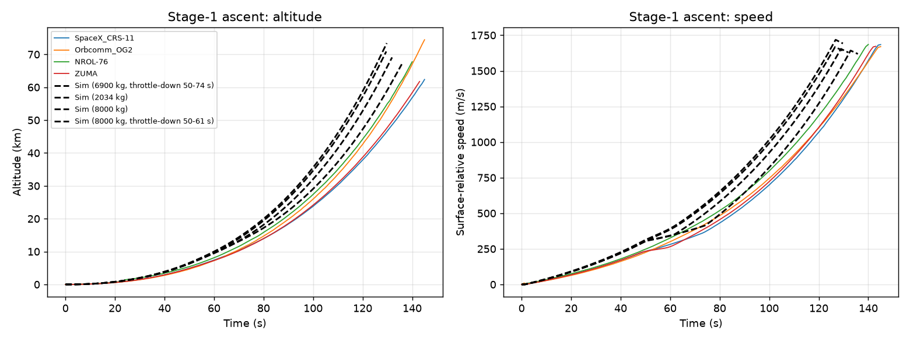

# Validation against Falcon 9 flight telemetry

Generated by `python -m rlv_sim.validation.flight_compare`. Flight data: [shahar603/Telemetry-Data](https://github.com/shahar603/Telemetry-Data) (public domain), extracted from SpaceX webcasts at 1 Hz. Sim: default vehicle (Falcon 9 FT stage masses, 9 x 845 kN), payload matched where published, otherwise the 8 t default; target orbit, inclination and landing site are sim defaults, not the flight's, so differences in booster timeline are partly mission, not model.

## Ascent curve error (lift-off to MECO)

| Flight | Sim payload (kg) | Throttle-down (flight's) | Altitude RMS (km) | Speed RMS (m/s) |
|---|---|---|---|---|
| SpaceX_CRS-11 | 6900 | 50-74 s | 5.26 | 112 |
| Orbcomm_OG2 | 2034 | none (not in data) | 7.79 | 208 |
| NROL-76 | 8000 (unpublished) | none (not in data) | 6.06 | 145 |
| ZUMA | 8000 (unpublished) | 50-61 s | 7.03 | 155 |

## Key events

| Flight | Quantity | Flight | Sim | Difference |
|---|---|---|---|---|
| SpaceX_CRS-11 | MECO time (s) | 145.0 | 135.8 | -6.3% |
|  | MECO speed (m/s) | 1684.3 | 1619.0 | -3.9% |
|  | MECO altitude (km) | 62.4 | 66.9 | +7.3% |
|  | Peak q (kPa) | 23.0 | 29.7 | +28.9% |
|  | Max-q time (s) | 65.0 | 50.2 | -22.7% |
|  | Booster apogee (km) | 120.1 | 126.5 | +5.3% |
|  | Boostback start (s) | 161.0 | 163.7 | +1.7% |
|  | Entry burn start (s) | 372.0 | 327.0 | -12.1% |
|  | Landing burn start (s) | 429.0 | 466.0 | +8.6% |
|  | Touchdown (s) | 462.0 | 505.0 | +9.3% |
| Orbcomm_OG2 | MECO time (s) | 145.0 | 129.7 | -10.5% |
|  | MECO speed (m/s) | 1669.7 | 1692.6 | +1.4% |
|  | MECO altitude (km) | 74.5 | 73.3 | -1.5% |
|  | Peak q (kPa) | 28.6 | 31.9 | +11.6% |
|  | Max-q time (s) | 70.0 | 62.5 | -10.7% |
|  | Booster apogee (km) | – | 144.9 | – |
| NROL-76 | MECO time (s) | 140.0 | 129.5 | -7.5% |
|  | MECO speed (m/s) | 1685.0 | 1642.7 | -2.5% |
|  | MECO altitude (km) | 67.8 | 70.8 | +4.5% |
|  | Peak q (kPa) | 29.2 | 31.9 | +9.4% |
|  | Max-q time (s) | 69.0 | 63.3 | -8.3% |
|  | Booster apogee (km) | 165.6 | 138.6 | -16.3% |
|  | Boostback start (s) | 157.0 | 157.6 | +0.4% |
|  | Entry burn start (s) | 431.0 | 340.9 | -20.9% |
|  | Landing burn start (s) | 508.0 | 489.3 | -3.7% |
|  | Touchdown (s) | 540.0 | 530.6 | -1.7% |
| ZUMA | MECO time (s) | 143.0 | 131.9 | -7.8% |
|  | MECO speed (m/s) | 1672.2 | 1629.6 | -2.5% |
|  | MECO altitude (km) | 61.8 | 69.0 | +11.8% |
|  | Peak q (kPa) | 26.0 | 29.4 | +13.4% |
|  | Max-q time (s) | 75.0 | 50.2 | -33.0% |
|  | Booster apogee (km) | 124.9 | 133.3 | +6.7% |
|  | Boostback start (s) | 159.0 | 159.9 | +0.5% |
|  | Entry burn start (s) | 381.0 | 334.3 | -12.3% |
|  | Landing burn start (s) | 446.0 | 478.2 | +7.2% |
|  | Touchdown (s) | 459.0 | 521.3 | +13.6% |

## Findings

- **MECO speed matches within ~4%** on every flight: the energy the stage delivers is right.
- **Max-q throttle-down.** Where the webcast data shows the throttle-down window (CRS-11, Zuma) the sim flies it (`ascent_throttle_bucket_*`, 70% thrust). On CRS-11 this halves the curve error (altitude RMS 9.2 -> 5.3 km, speed RMS 218 -> 111 m/s) and moves MECO from 15.5 s to 9 s early. Flights without that data still use the q-hold law only.
- **Remaining gap: MECO 6-10% early.** The sim holds back a 67.5 t recovery reserve and its RTLS needs ~3600 m/s; Falcon 9 burns more of stage 1 on ascent, so its real RTLS budget is smaller. The entry burn is the outlier (~28 t over ~115 s, low throttle, mostly lateral divert). Crediting drag and a 300 m/s target descent rate (`booster_entry_drag_credit`, `booster_entry_target_descent_rate_mps`) saves ~2.6 t, but that moves MECO only ~1 s and drops 100-run Monte Carlo success from 78% to 59%, so it is off by default. Closing the gap needs a redesigned entry/landing targeting, not tuning.
- **Peak q still 9-29% high**: Falcon's throttle depth and timing are not published; 70% is an estimate.
- **Booster timelines start right (boostback within ~2%)**; later events differ by up to ~20% because the sim flies its own target orbit and pad. Target inclination was tried per flight and does not change the stage-1 trajectory.
