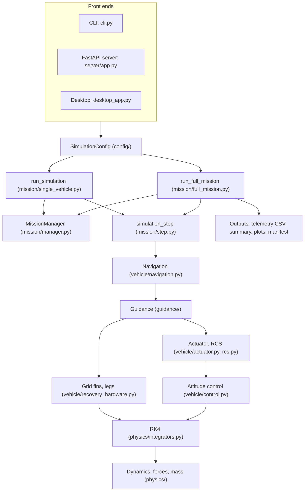
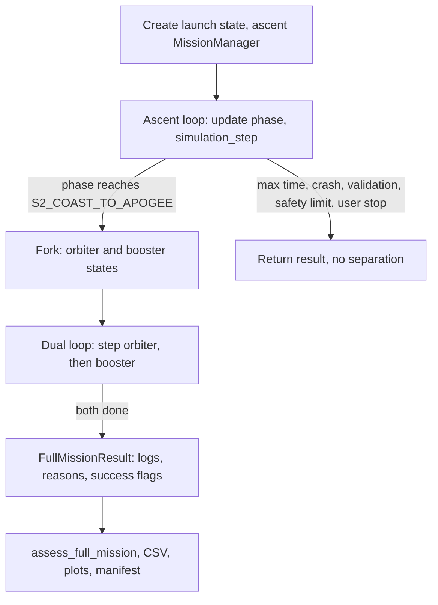
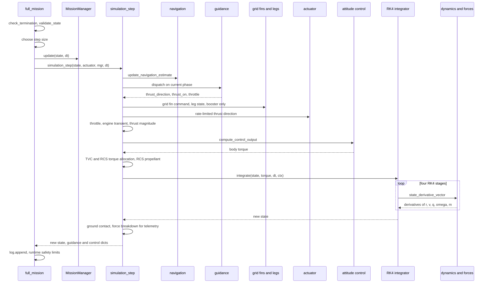
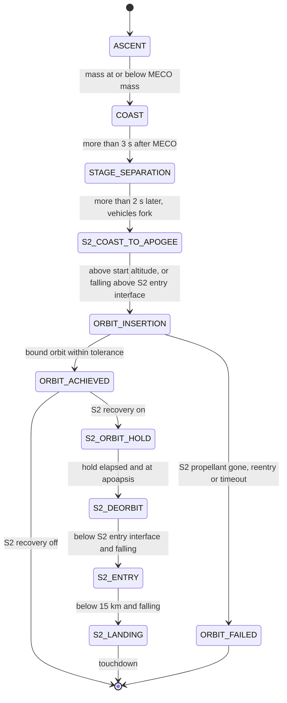
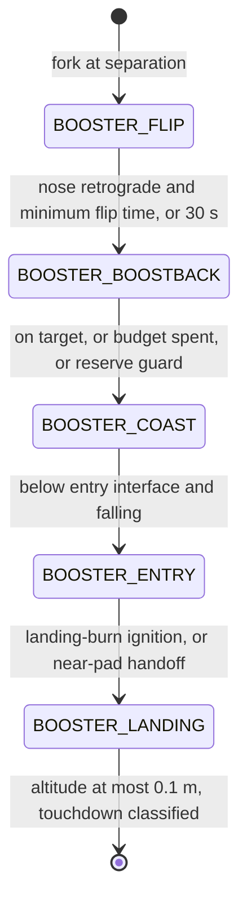

# 1. System overview, mission flow and simulation architecture

> Vyom (`rlv_sim`) is a six-degree-of-freedom (6-DOF) simulator of a two-stage,
> Falcon 9-class reusable launch vehicle. One run flies the stacked vehicle from
> the pad to main-engine cutoff (MECO) and stage separation. It then forks the
> trajectory into two independent rigid bodies: the **orbiter** (stage 2 plus
> payload), which coasts and burns to a target circular orbit (and can
> optionally de-orbit and land), and the **booster** (stage 1), which flips,
> burns back toward the launch site (return to launch site, RTLS), re-enters
> and lands propulsively. Each vehicle is integrated with fixed-step
> fourth-order Runge-Kutta (RK4) in an Earth-centred inertial frame, under
> gravity (central, J2 or truncated EGM96), a standard atmosphere with wind,
> Mach-dependent aerodynamics, throttleable engines with thrust-vector control
> (TVC), reaction-control thrusters (RCS), grid fins and landing legs. Phase
> changes are triggered by physical conditions (mass, altitude, radial
> velocity, predicted impact point, ignition altitude), not by a timeline.
> This chapter describes the program structure, the per-step loop, the state
> and frames, the phase state machines, the time-step policy, the termination
> and success rules, and the configuration and output systems. Detailed models
> are in Chapters 2-11.

All paths below are relative to `backend/rlv_sim/` unless they start with
`backend/` or `docs/`. Default values come from `create_default_config()`
(`config/factory.py:63`), the "research profile".

---

## 1.1 Role in the simulation: what is modelled end to end

| Segment | Vehicle model (`vehicle_model`) | Engine | Main guidance | Ends when |
|---|---|---|---|---|
| Stacked ascent | `stacked`, stage 1 | 9 stage-1 engines | `guidance/ascent.py` | mass reaches the MECO mass |
| MECO coast + separation | `stacked`, stage 1 | off | `guidance/orbit.py` coast | 5 s after MECO the state is forked |
| Orbiter coast and insertion | `orbiter`, stage 2 | stage-2 vacuum engine | `guidance/orbit.py` | target orbit reached, or failure |
| Optional S2 recovery | `orbiter`, stage 2 | stage-2 engine | `guidance/orbit.py` deorbit / entry / landing | touchdown |
| Booster recovery | `booster`, stage 1 | 3 (boostback, entry) / 1 (landing) engines | `guidance/booster.py`, `guidance/recovery.py`, optional `guidance/gfold.py` | touchdown or crash |

Engine counts are config fields: `stage1_engine_count` = 9,
`boostback_engine_count` = 3, `entry_engine_count` = 3,
`landing_engine_count` = 1 (`config/definition.py:417-431`,
`mission/step.py:600-619`).

### Architecture

Two orchestrators exist:

* **`run_full_mission`** (`mission/full_mission.py:512`) is the production path
  used by the CLI full mission, the web server and the desktop app. It runs the
  stacked ascent (`_run_ascent`, `full_mission.py:212-336`), then the
  two-vehicle phase (`_run_dual_vehicles`, `full_mission.py:347-509`). It wraps
  the run in `wind_profile_context` so that the per-run altitude-correlated
  wind perturbation is active (`full_mission.py:532`, `core/utils.py:49-56`).
* **`run_simulation`** (`mission/single_vehicle.py:44`) is a single-vehicle
  path kept for the CLI's single-segment modes and tests. With
  `vehicle_type="ascent"` it flies the stack and, at separation, *replaces*
  the state with the orbiter only (the booster is discarded,
  `single_vehicle.py:191-232`). With `"orbiter"` or `"booster"` it flies one
  vehicle from a supplied initial state.

### Two-vehicle split ("lockstep")

At the fork (`full_mission.py:355-400`):

| Quantity | Orbiter | Booster |
|---|---|---|
| Mass $m$ | $m_{2,dry} + m_{2,prop} + m_{pl}$ = 119 500 kg | $m_{1,dry} + m_{res}$ = 89 700 kg |
| Dry-mass floor | $m_{2,dry} + m_{pl}$ = 12 000 kg | $m_{1,dry}$ = 22 200 kg |
| $\mathbf{r}, \mathbf{q}, t$ | copied from stack | copied from stack |
| $\mathbf{v}, \boldsymbol\omega$ | stack value + separation increment | stack value + separation increment |
| Own objects | `MissionManager("orbiter")`, `GuidanceState`, `ActuatorState`, log, abort monitor | `MissionManager("booster")`, ... |

$m_{res}$ is `stage1_landing_fuel_reserve_kg` (67 500 kg). The MECO mass is
defined so that the two masses sum exactly to the stack mass at MECO
(`config/definition.py:443-457`):

$$
m_{MECO} = m_{1,dry} + m_{2,dry} + m_{2,prop} + m_{pl} + m_{res} = 209\,200\ \text{kg}.
$$

**Separation increments** (`mission/vehicle_split.py:36-58`, enabled by
`enable_separation_dynamics`). With $\hat{\mathbf{e}}_s$ the stack body $+z$
axis in ECI, $\hat{\mathbf{e}}_\omega = \widehat{\hat{\mathbf{e}}_s \times
\mathbf{v}}$, $\Delta v_s$ = `separation_delta_v` and $\omega_s$ =
`separation_tumble_rate`, $m_O, m_B$ the orbiter and booster masses,
$M = m_O + m_B$:

$$
\Delta\mathbf{v}_O = +\hat{\mathbf{e}}_s\,\Delta v_s\,\frac{m_B}{M},\qquad
\Delta\mathbf{v}_B = -\hat{\mathbf{e}}_s\,\Delta v_s\,\frac{m_O}{M},
$$
$$
\Delta\boldsymbol\omega_O = +\hat{\mathbf{e}}_\omega\,\omega_s\,\frac{m_B}{M},\qquad
\Delta\boldsymbol\omega_B = -\hat{\mathbf{e}}_\omega\,\omega_s\,\frac{m_O}{M}.
$$

The velocity split conserves linear momentum exactly
($m_O\Delta\mathbf{v}_O + m_B\Delta\mathbf{v}_B = 0$) and gives a relative
separation speed $\Delta v_s$. The angular-rate split is mass-weighted, not
inertia-weighted, so it does not conserve angular momentum; it is a residual
tumble seed. Note that `_inherit_separation_state` adds the angular
increment, an inertial-axis vector, directly to the body-frame $\boldsymbol\omega$
(`vehicle_split.py:81-82`); the difference is not explained in code.
Classification: linear split *Standard* (momentum conservation); tumble split
*Project heuristic; no external reference*.

After the fork, a single `while` loop (`full_mission.py:424-503`) advances the
orbiter by one step, then the booster by one step, per iteration. The two
vehicles do not interact. "Lockstep" means "same loop iteration", not
"identical time stamps": each vehicle's step size is chosen separately
(Section 1.6), so with `dt` > 0.05 s the booster's clock falls behind the
orbiter's during its capped recovery phases. Each telemetry row carries its
own time, so this affects only the live progress display, not the physics.

### Mission orchestration

---

## 1.2 Per-step loop

### Step sequence

One call of `_step_vehicle` (dual phase, `full_mission.py:68-104`) or one
ascent iteration (`full_mission.py:240-330`) does the following.

### Details of `simulation_step` (`mission/step.py:673-874`)

1. **Navigation and guidance** (`_run_guidance`, `step.py:96-169`). The
   navigation estimate is updated every step (`step.py:105-110`). Guidance
   receives the estimated $\mathbf{r}, \mathbf{v}, t$ only when
   `use_navigation_estimate_for_guidance` is set (default `False`), otherwise
   truth; the integrator always uses truth (Chapter 10). Guidance is chosen by
   phase (`step.py:120-153`):

   | Phase(s) | Guidance function |
   |---|---|
   | `ASCENT` | `guidance/ascent.py: compute_guidance_output` |
   | `COAST`, `STAGE_SEPARATION`, `S2_COAST_TO_APOGEE` | `guidance/orbit.py: compute_coast_guidance` |
   | `ORBIT_INSERTION` | `compute_orbit_insertion_guidance` |
   | `S2_DEORBIT` | `compute_deorbit_guidance` |
   | `S2_ENTRY`, `S2_LANDING` | `compute_s2_entry_landing_guidance` |
   | `BOOSTER_*` | `guidance/booster.py: compute_booster_guidance` |
   | any other (e.g. `ORBIT_ACHIEVED`, `S2_ORBIT_HOLD`) | coast guidance |

   The air-relative velocity $\mathbf{v}_{rel}$ is attached to the guidance
   output for logging (`step.py:163-166`).
2. **Recovery hardware** (booster only, `step.py:172-228`): grid-fin command
   toward the (possibly lead-time-predicted) landing site, grid-fin force for
   telemetry, landing-leg state update (Chapters 7-8).
3. **Thrust direction** (`step.py:714-724`). For the stack and the orbiter in
   ascent/insertion phases, the commanded direction passes through the
   rate-limited actuator `update_actuator` (`vehicle/actuator.py:58`), which
   rotates the previous direction toward the new one by at most
   $\dot\delta_{max}\,\Delta t$ with $\dot\delta_{max}$ =
   `MAX_GIMBAL_RATE` = 25 deg/s (`core/constants.py:347`) using Rodrigues'
   formula (`actuator.py:27-55`). For the booster and the orbiter's S2
   recovery phases the guidance direction is used directly. The resulting
   direction is the **attitude reference** for the body $+z$ axis; it is not a
   gimbal angle (Chapter 9).
4. **Throttle** (`step.py:726-739`): zero if $m \le m_{dry} + 10^{-6}$ kg;
   first-order spool-up/spool-down lag if `enable_engine_transients`
   (`physics/forces.py:547`). Thrust is active only if guidance requests it,
   propellant remains and throttle > 0.
5. **Thrust magnitude** (`_thrust_magnitude`, `step.py:600-619`): booster
   boostback/entry/landing use 3/3/1 engines; any other stage-1 phase uses all
   9; stage 2 uses `stage2_thrust_vac`; all scaled by `runtime_thrust_scale`.
6. **Attitude control** (`step.py:744-816`): inertia from `physics/mass.py`,
   available torque from TVC ($T\,\delta\,\sin\delta_{max}\,\ell$) plus RCS,
   PD or PID law (`vehicle/control.py:313`), then allocation in body axes:
   pitch/yaw ($x,y$) limited to TVC + RCS authority, roll ($z$) to RCS only
   (`step.py:254-296`). Details in Chapter 9.
7. **RCS propellant** (`step.py:818-825`): only torque beyond TVC authority is
   charged to the RCS budget, which is tracked outside $m$.
8. **Integration** (`step.py:844-852`): a `DynamicsContext` freezes thrust
   flag, throttle, dry mass, stage, vehicle model, aero mode, thrust override
   and grid-fin command; `integrate(..., method='rk4')` advances the state.
   Torque and context are held constant over the step (zero-order hold).
9. **Ground contact** (`_apply_ground_contact`, `step.py:645-659`): on the pad
   during the first part of ascent the stack is projected onto the pad sphere
   and inward radial velocity removed (`apply_launch_pad_constraint`,
   `step.py:308-343`); any other surface crossing is linearly interpolated to
   the crossing instant and projected onto the surface
   (`_interpolate_ground_crossing`, `step.py:346-372`).
10. **Force breakdown** for telemetry is recomputed at the new state with the
    step's control inputs (`step.py:856-868`); it does not feed back.

### RK4 integrator (`physics/integrators.py:24-126`)

With $\mathbf{y} = [\mathbf{r}, \mathbf{v}, \mathbf{q}, \boldsymbol\omega, m]
\in \mathbb{R}^{14}$ and $\mathbf{f}$ = `state_derivative_vector`
(`physics/dynamics.py:331`):

$$
\begin{aligned}
\mathbf{k}_1 &= \mathbf{f}(t, \mathbf{y}),\\
\mathbf{k}_2 &= \mathbf{f}\big(t+\tfrac{\Delta t}{2},\ \mathcal{N}(\mathbf{y}+\tfrac{\Delta t}{2}\mathbf{k}_1)\big),\\
\mathbf{k}_3 &= \mathbf{f}\big(t+\tfrac{\Delta t}{2},\ \mathcal{N}(\mathbf{y}+\tfrac{\Delta t}{2}\mathbf{k}_2)\big),\\
\mathbf{k}_4 &= \mathbf{f}\big(t+\Delta t,\ \mathcal{N}(\mathbf{y}+\Delta t\,\mathbf{k}_3)\big),\\
\mathbf{y}_{n+1} &= \mathcal{N}\Big(\mathbf{y}+\tfrac{\Delta t}{6}(\mathbf{k}_1+2\mathbf{k}_2+2\mathbf{k}_3+\mathbf{k}_4)\Big),\quad m_{n+1}\leftarrow\max(m_{n+1}, m_{dry}),
\end{aligned}
$$

where $\mathcal{N}$ renormalises the quaternion part (`integrators.py:103-117`).
The textbook RK4 does not renormalise intermediate stages; the code does, to
keep $\|\mathbf{q}\| = 1$ ("conditional normalization" in the docstring is
outdated: every stage is normalised). **Burn-out event:** if the engine would
drive $m$ below $m_{dry}$ within the step, the step is split into a powered
sub-step of length $t_{dry} = (m - m_{dry})/(-\dot m)$, with $m$ then set
exactly to $m_{dry}$, and an unpowered sub-step for the remainder
(`integrators.py:66-91`). This is what makes MECO detection exact.
Classification: *Standard* (classical RK4 [3]); quaternion renormalisation and
burn-out splitting are standard practice. Equations of motion are in
Chapter 2.

---

## 1.3 State vector (`core/state.py`)

| Symbol | Field | Frame | Unit | Vector index |
|---|---|---|---|---|
| $\mathbf{r}$ | `r` | ECI | m | 0-2 |
| $\mathbf{v}$ | `v` | ECI (inertial velocity) | m/s | 3-5 |
| $\mathbf{q}=[q_w,q_x,q_y,q_z]$ | `q` | body-to-ECI, scalar first | - | 6-9 |
| $\boldsymbol\omega$ | `omega` | body | rad/s | 10-12 |
| $m$ | `m` | - | kg | 13 |
| $t$ | `t` | - | s | not in vector |

(`state.py:20-50`, `to_vector`/`from_vector` at `state.py:77-111`.) Two
non-integrated attachments ride along: `sim_config` and `dry_mass_kg`.
Constructing a `State` with $\big|\|\mathbf{q}\|-1\big| > 10^{-6}$
(`QUATERNION_NORM_TOL`) raises (`state.py:57-62`). Derived quantities:
`altitude` $h = \|\mathbf{r}\| - R_E$ (`state.py:113-117`,
`physics/forces.py:581-583`), `speed` $\|\mathbf{v}\|$ (inertial),
`propellant_remaining` $\max(0, m - m_{dry})$.

Everything not in this vector is held in per-vehicle side objects:
`GuidanceState` (guidance memory, navigation state, controller integrator,
RCS propellant, leg state), `ActuatorState` (current thrust-direction
reference and throttle), and `MissionManager` (phase and event times).

**Initial state** (`create_initial_state`, `state.py:161-195`):

$$
\mathbf{r}_0 = (R_E + h_{site})\begin{bmatrix}\cos\phi\cos\lambda\\ \cos\phi\sin\lambda\\ \sin\phi\end{bmatrix},\qquad
\mathbf{v}_0 = \boldsymbol\omega_E\times\mathbf{r}_0,\qquad
\boldsymbol\omega_0 = \mathbf{0},\qquad
m_0 = m_{1,dry}+m_{1,prop}+m_{2,dry}+m_{2,prop}+m_{pl},
$$

with $\mathbf{q}_0$ the shortest-arc rotation taking body $+z$ onto
$\hat{\mathbf{r}}_0$ (`core/constants.py:204-239`). $m_0$ is then shifted by
`runtime_initial_mass_offset_kg` (dispersion hook,
`mission/vehicle_split.py:86-91`). Default $m_0$ = 552 600 kg.

---

## 1.4 Coordinate frames and conversions

| Frame | Definition in code | Where |
|---|---|---|
| **ECI** | Geocentric, $+z$ along Earth spin axis, $x$ through longitude 0 at $t=0$ (Greenwich sidereal angle taken as zero at launch). All states and forces. | `core/state.py`, `physics/dynamics.py:176-226` |
| **ECEF** | Rotates about $+z$ at $\omega_E$; used only to place Earth-fixed sites and for geodetic conversion. | `guidance/recovery.py:62-82`, `physics/high_fidelity_atmosphere.py:18-61` |
| **Local up/east/north** | $\hat{\mathbf u}=\hat{\mathbf r}$, $\hat{\mathbf e}=\widehat{\hat{\mathbf z}\times\hat{\mathbf u}}$, $\hat{\mathbf n}=\hat{\mathbf u}\times\hat{\mathbf e}$ (geocentric, spherical). | `guidance/common.py:116-133`, `core/utils.py:82-90` |
| **Body** | $+z$ = thrust/longitudinal axis (nose), $x,y$ transverse. $\mathbf{v}_{ECI} = R(\mathbf q)\,\mathbf{v}_{body}$. | `core/frames.py:33-56` |

**Earth model.** Spherical with mean radius $R_E$ = 6 371 000 m for
altitude, sites and ground distances (`core/constants.py:15`); the
equatorial WGS-84 radius 6 378 137 m is used only inside the J2/EGM96
gravity expansions (`constants.py:17-19`, Chapter 3). Latitude/longitude
inputs are placed on the sphere as if geocentric
(`constants.py:204-219`, docstring "geodetic-style"). A WGS-84 geodetic
conversion (Bowring iteration [5], [6]) exists only for the optional GRAM-like
density model (`high_fidelity_atmosphere.py:18-61`).

**Earth rotation.** $\boldsymbol\omega_E = [0,0,\omega_E]^T$ with
$\omega_E$ = 7.2921159e-5 rad/s (`constants.py:248`). It enters in three
places:

$$
\mathbf{r}_{site}^{ECI}(t) = R_z(\omega_E t)\,\mathbf{r}_{site}^{ECEF}
\quad(\texttt{recovery.py:62-82}),
$$
$$
\mathbf{v}_{gnd} = \mathbf{v} - \boldsymbol\omega_E\times\mathbf{r}
\quad(\texttt{utils.py:108-118}),\qquad
\mathbf{v}_{rel} = \mathbf{v} - \boldsymbol\omega_E\times\mathbf{r} - \mathbf{v}_{wind}(\mathbf r)
\quad(\texttt{utils.py:95-105}).
$$

Ground-relative velocity is used for targeting and touchdown contact;
air-relative velocity for aerodynamics, $\bar q$, angle of attack and the
logged touchdown speed. There are no Coriolis or centrifugal terms because
the equations are written in the inertial frame
(`physics/dynamics.py:184-186`).

**Attitude kinematics.** $R(\mathbf q)$ is the standard scalar-first
direction-cosine matrix (`frames.py:52-56`) and
$\dot{\mathbf q} = \tfrac12\,\Omega(\boldsymbol\omega)\,\mathbf q$ with

$$
\Omega(\boldsymbol\omega)=\begin{bmatrix}0&-\omega_x&-\omega_y&-\omega_z\\ \omega_x&0&\omega_z&-\omega_y\\ \omega_y&-\omega_z&0&\omega_x\\ \omega_z&\omega_y&-\omega_x&0\end{bmatrix}
\quad(\texttt{frames.py:59-95}).
$$

Euler angles exist only for output (`frames.py:159-181`).

**Other recurring kinematic quantities**

| Quantity | Formula | Source |
|---|---|---|
| Radial velocity | $\dot r = \mathbf r\cdot\mathbf v/\|\mathbf r\|$ (inertial) | `mission/manager_helpers.py:13-18` |
| Ground (great-circle) distance | $d = R_E\arccos(\hat{\mathbf a}\cdot\hat{\mathbf b})$ | `guidance/recovery.py:267-274` |
| Axisymmetric angle of attack | $\alpha = \arccos\lvert\hat{\mathbf z}_b\cdot\hat{\mathbf v}_{rel}\rvert$ (tail-first = 0) | `core/utils.py:131-145` |
| Attitude alignment test | $\arccos(\hat{\mathbf z}_b\cdot\hat{\mathbf d}) < \theta$ | `mission/manager_helpers.py:21-35` |

Classification: frames and kinematics *Standard* [1], [2]; the spherical
Earth for altitude is a stated simplification.

**Launch site.** `launch_site_lat_deg` = 28.608402 deg,
`launch_site_lon_deg` = -80.604201 deg (Cape Canaveral area),
`launch_site_altitude_m` = 0 (`config/definition.py:147-149`). The RTLS
landing site defaults to the launch site (`booster_landing_target_downrange_km`
= 0), optionally moved downrange along local east, to explicit
coordinates, or with the wind ("movable target")
(`guidance/recovery.py:105-148`, Chapter 7).

---

## 1.5 Mission phase manager

`MissionManager` (`mission/manager.py:74`) holds one `MissionPhase`
(`manager.py:47-67`) per vehicle. A manager created as `"ascent"` starts in
`ASCENT`, `"orbiter"` in `S2_COAST_TO_APOGEE`, `"booster"` in `BOOSTER_FLIP`
(`manager.py:97-102`). `update(state, dt)` (`manager.py:180-205`) is called
once per step *before* guidance, so a transition detected on state
$\mathbf{y}_n$ applies to the step from $t_n$ to $t_{n+1}$. At most one
transition per sub-machine fires per call, so each phase lasts at least one
step. `PRELAUNCH` and `APOGEE_REACHED` are declared but never entered.

### Ascent and orbiter

### Booster

Crash, time-out, validation and safety-limit terminations can end either
vehicle from any phase (Section 1.7).

### Transition conditions

Notation: $h$ altitude, $\dot r$ radial velocity, $m$ mass, $\tau$ time in
current phase, $t_{MECO}$ MECO time.

| # | Transition | Exact condition (code) | Config fields / constants | Source |
|---|---|---|---|---|
| A1 | ASCENT → COAST (MECO) | $m \le m_{MECO}$ | `meco_mass_kg` (derived, 209 200 kg) | `manager.py:209-221` |
| A2 | COAST → STAGE_SEPARATION | $t - t_{MECO} > 3$ s | literal 3.0 s | `manager.py:223-229` |
| A3 | STAGE_SEPARATION → S2_COAST_TO_APOGEE | $\tau > 2$ s | literal 2.0 s | `manager.py:231-238` |
| O1 | S2_COAST_TO_APOGEE → ORBIT_INSERTION | $h > h_{ins}$ **or** ($\dot r < -20$ m/s **and** $h > h_{EI,2}$) | `orbit_insertion_start_altitude_m` 85 km; `s2_entry_interface_altitude_m` 70 km | `manager.py:240-267` |
| O2 | ORBIT_INSERTION → ORBIT_ACHIEVED | $\varepsilon<0$ and $\lvert h_p-h^*\rvert\le\Delta h$ and $\lvert h_a-h^*\rvert\le\Delta h$ and $e\le e_{max}$ | `orbit_target_altitude_m` 400 km; `orbit_altitude_tolerance_m` 75 km; `orbit_ecc_max` 0.02 | `manager.py:269-296` |
| O3 | ORBIT_INSERTION → ORBIT_FAILED (propellant) | not O2 and $m - m_{dry} \le 0$ | - | `manager.py:298-308` |
| O4 | ORBIT_INSERTION → ORBIT_FAILED (reentry) | $h < 80$ km and $\dot r < -50$ m/s and $h_p < 100$ km | literals | `manager.py:310-325` |
| O5 | ORBIT_INSERTION → ORBIT_FAILED (stall) | $\tau >$ timeout | `orbit_insertion_timeout_s` 5000 s | `manager.py:327-341` |
| S1 | ORBIT_ACHIEVED → S2_ORBIT_HOLD | immediately (next update) | `enable_s2_recovery` (False) | `manager.py:345-348` |
| S2 | S2_ORBIT_HOLD → S2_DEORBIT | $\tau \ge t_{hold}$ and $\dot r$ changes from $>0$ to $\le 0$ | `s2_orbit_hold_time_s` 600 s | `manager.py:349-355` |
| S3 | S2_DEORBIT → S2_ENTRY | $h < h_{EI,2}$ and $\dot r < 0$ | `s2_entry_interface_altitude_m` | `manager.py:356-369` |
| S4 | S2_ENTRY → S2_LANDING | $h < 15$ km and $\dot r < 0$ | literal 15 000 m | `manager.py:370-378` |
| B1 | BOOSTER_FLIP → BOOSTBACK | ($\angle(\hat{\mathbf z}_b, -\hat{\mathbf v}) < 15°$ and $\tau > \tau_{flip}$) or $\tau > 30$ s | `booster_flip_min_time_s` 11 s; literals 15°, 30 s | `manager.py:383-397` |
| B2 | BOOSTBACK → COAST | complete **or** budget **or** reserve guard (see below) | see below | `manager.py:415-526` |
| B3 | BOOSTER_COAST → ENTRY | $h < h_{EI,1}$ and $\dot r < 0$ | `booster_entry_interface_altitude_m` 70 km | `manager.py:402-410` |
| B4 | BOOSTER_ENTRY → LANDING | ignition **or** near-pad handoff (see below) | see below | `manager.py:528-575` |

Flip alignment uses the *inertial* velocity $\mathbf{v}$, not
$\mathbf{v}_{rel}$; if $\|\mathbf v\| \le 1$ m/s the test passes trivially
(`manager.py:384-389`).

**Orbit metrics** used by O2-O4 and by the success assessment
(`manager_helpers.py:38-74`), with $\mu$ = 3.986004418e14 m³/s²:

$$
\varepsilon=\tfrac12 v^2-\frac{\mu}{r},\quad
a=\begin{cases}-\mu/(2\varepsilon)&|\varepsilon|>1\\ r&\text{otherwise}\end{cases},\quad
e=\sqrt{\max\!\Big(0,\,1-\frac{\|\mathbf r\times\mathbf v\|^2}{\mu a}\Big)}\ (a>0;\ \text{else }e=1),
$$
$$
h_p = a(1-e)-R_E,\qquad h_a=a(1+e)-R_E .
$$

Perigee and apogee altitudes are relative to the mean spherical radius.
Classification: *Standard* two-body elements [1], [2]; the thresholds are
project choices.

**B2 boostback cutoff** (`manager.py:415-526`). Let $d_{miss}$ be the miss
distance of a no-thrust ballistic impact prediction against the landing site
(`estimate_ballistic_impact_to_pad`, Chapter 7), $v_{ts}$ and $v_{req}$ the
velocity toward the site and the return velocity needed from
`estimate_recovery_targeting` (with lead time = powered-descent lead + 22.4 s,
`manager.py:83`, `422-432`), $\tau \ge 15$ s the minimum boostback time
(`manager.py:477-478`), and

$$
\text{velocity\_on\_target} = v_{ts}>0\ \wedge\ 0.92\,v_{req}\le v_{ts}\le 1.25\,v_{req},\qquad
\text{corridor} = d_{miss}\le d_{corr}.
$$

* Near-pad RTLS (landing site within 15 km of the launch site,
  `guidance/recovery.py:259-264`; true by default):
  complete $= \tau\ge15\text{ s} \wedge \big(d_{miss}\le 2000\text{ m} \vee
  (\text{velocity\_on\_target}\wedge\text{corridor})\big)$.
* Otherwise: complete $=$ velocity\_on\_target $\wedge\ v_{pad}\ge1.5\,v_{pad,need}
  \wedge$ corridor $\wedge\ \tau\ge15$ s, with $v_{pad}$ the ground-relative
  horizontal closure speed toward the pad and
  $v_{pad,need}=\mathrm{clip}(d_{pad}/\max(t_{coast},60),\,20,\,250)$.
* Budget: propellant used since separation $\ge$
  `booster_boostback_budget_kg` (43 000 kg).
* Reserve guard: $m - m_{1,dry} \le$ `booster_entry_budget_kg` +
  `booster_landing_reserve_kg` + `booster_landing_propellant_margin_kg`
  = 12 500 + 5 000 + 750 = 18 250 kg (`guidance/recovery.py:283-289`).

$d_{corr}$ = `booster_boostback_impact_corridor_m` = 10 km.

**B4 landing-burn ignition** (`manager.py:143-161`, `528-575`). The
suicide-burn estimator (`guidance/recovery.py:639-768`, Chapter 8) returns a
braking height $h_{ign} = v_{eff}^2/(2\bar a)$ from the rocket equation and
mean net deceleration, with $T$ = `landing_planning_thrust_n` (one engine,
845 kN). The transition fires when

$$
\Big(h \le k\,h_{ign}\Big)\ \wedge\ \dot r<0\ \wedge\ h\le\min\big(h_{ceil},\,k\,h_{ign}\big)
\quad\text{or near-pad handoff},
$$

with $k$ = `booster_landing_ignition_safety_factor` = 1.8 and $h_{ceil}$ =
`booster_landing_ignition_ceiling_m` = 8 000 m. The near-pad handoff
(near-pad target only) fires if $\dot r<0$, $h\le 7030$ m
(`NEAR_PAD_HANDOFF_ALTITUDE_M`, `manager.py:79`), propellant
$> 0.75\times$`booster_landing_reserve_kg`, predicted ballistic miss
$\le$ `booster_pad_tolerance_m` (50 m) and predicted time to impact $\ge 8$ s.

Classification of B1-B4: *Project heuristic; no external reference*. The
literal constants (15°, 30 s, 15 s, 0.92, 1.25, 1.5, 2 000 m, 7 030 m, 8 s,
22.4 s) are tuned for the default vehicle (comment at `manager.py:81-83`).

**Documentation drift.** The `manager.py` module docstring
(`manager.py:7-14`) says MECO is at $m\le m_{dry}$ and entry interface uses a
Knudsen-number test; the code uses $m\le m_{MECO}$ and a plain altitude test.

---

## 1.6 Time-step policy

All steps are fixed-size RK4 steps; there is no error control. The step for
each vehicle in each loop iteration is:

| Situation | Step $\Delta t$ | Source |
|---|---|---|
| Any step | $\min(\Delta t_{req},\ t_{max}-t)$ (never past `max_time`) | `vehicle_split.py:109-111` |
| Stacked ascent (incl. MECO coast, separation) | $\min(\Delta t,\ 0.05)$ | `STACKED_ASCENT_MAX_DT`, `full_mission.py:257-259` |
| Booster in FLIP, BOOSTBACK, ENTRY, LANDING | $\min(\Delta t,\ 0.05)$ | `BOOSTER_RECOVERY_MAX_DT`, `manager.py:163-178`, `full_mission.py:88-89` |
| Booster in COAST | $\Delta t$ (uncapped) | same |
| Orbiter, demo mode, booster finished, phase `S2_COAST_TO_APOGEE` | `demo_coast_max_dt` (2 s) | `full_mission.py:434-439` |
| Orbiter, booster finished, phase in {ORBIT_INSERTION, ORBIT_ACHIEVED, S2_ORBIT_HOLD}, engine off on previous step, $h>120$ km | $\max(\Delta t,$ `orbit_coast_max_dt`$)$ = 0.5 s | `full_mission.py:440-446` |
| Orbiter otherwise | $\Delta t$ | `full_mission.py:433` |

| Parameter | Field / constant | Default | Unit |
|---|---|---|---|
| Base step $\Delta t$ | `dt` | 0.05 | s |
| Run horizon $t_{max}$ | `max_time` | 6000 | s |
| Demo mode | `enable_demo_mode` | False | - |
| Demo coast step | `demo_coast_max_dt` (validated $\ge$ `dt`) | 2.0 | s |
| Orbital coast step | `orbit_coast_max_dt` | 0.5 | s |
| Ascent cap | `STACKED_ASCENT_MAX_DT` | 0.05 | s |
| Recovery cap | `BOOSTER_RECOVERY_MAX_DT` | 0.05 | s |
| Aero cut-off altitude | `AERO_DISABLE_ALTITUDE` | 120 000 | m |

Consequences: the stack and the booster's powered/guided phases are always
integrated at $\le 0.05$ s regardless of `dt`, which keeps the recovery
trajectory reproducible across `dt` choices (docstring `manager.py:163-172`).
The coarse orbiter steps are taken only once the booster is finished, so they
never change the booster result. Demo profiles: `create_demo_config()` sets
`dt` = 0.1, demo mode on, demo coast step 2 s (`config/factory.py:88-97`);
the CLI demo profile uses `dt` = 0.25 unless overridden (`cli.py:164-176`);
the server's demo flag only switches demo mode and the coast step, keeping
the caller's `dt` (`server/app.py:365-373`). With S2 recovery, the CLI and
server raise `max_time` to at least 9 000 s
(`S2_RECOVERY_MIN_MAX_TIME_S`; `cli.py:204-228`, `server/app.py:377-382`).

Classification: *Project heuristic*; step sizes were chosen empirically (the
regression references in `tests/test_full_mission_regression.py` were
recorded with `orbit_coast_max_dt` = 0.5 s).

---

## 1.7 Termination conditions

### Stacked ascent loop (`full_mission.py:240-330`)

The ascent loop ends, in order of checking, on: user stop (`control_callback`
returns `"stop"`); `validate_state` failure (non-finite state, quaternion norm,
position, mass outside $[0.999\,m_{dry},\ 1.01\,m_{0,max}]$, $\|\mathbf v\| >
15$ km/s, $\|\boldsymbol\omega\| > 10$ rad/s; `physics/checks.py:167-193`);
no time left; the manager reaching any orbiter phase (normal exit, fork);
$t\ge t_{max}$; $h < -1000$ m (`CRASH_ALTITUDE_TOLERANCE`); a runtime safety
limit. If separation never happened the run returns with both vehicles
"No separation" (`full_mission.py:611-623`). The ascent loop does not call
`check_termination`, so a ground strike above $-1000$ m is not caught there.

### Each vehicle after the fork (`check_termination`, `step.py:390-534`)

Checked at the start of every vehicle step, before the phase update:

| Order | Condition | Reason string (prefix) |
|---|---|---|
| 1 | phase `ORBIT_ACHIEVED` and S2 recovery off | `ORBIT ACHIEVED - Mission Complete` |
| 2 | phase `S2_LANDING` and $h\le0.1$ m | `S2 DRONE-SHIP LANDING SUCCESS` if $\|\mathbf v_{rel}\|<$ `s2_touchdown_speed_limit_mps` (5 m/s), else `S2 DRONE-SHIP CRASH` |
| 3 | phase `ORBIT_FAILED` | `ORBIT INSERTION FAILED - ...` |
| 4 | booster, phase `BOOSTER_LANDING`, $h\le0.1$ m | touchdown classification (below) |
| 5 | $t \ge t_{max}$ | orbiter: `ORBIT INSERTION FAILED - maximum time reached: ...`; booster: `Maximum simulation time reached` |
| 6 | $t>1$ s and $h\le0$ | `CRASH - Ground impact` |
| 7 | $h < -1000$ m | `CRASH - Below Earth's surface` |

After each step, `_check_runtime_safety_limits` (`step.py:537-597`) can also
end the vehicle: $q\alpha = \tfrac12\rho v_{rel}^2\alpha > $ `q_alpha_max`
(50 kPa·rad) if `abort_on_q_alpha_limit` (default off), or an abort-monitor
trip if `enable_abort_modes` (default off; never evaluated in booster recovery
phases). Validation failures end a vehicle with `Validation failure: ...`.

**Booster touchdown** (`step.py:445-512`). With $\mathbf v_{rel}$ the
air-relative velocity, $d$ the great-circle distance to the target site, and
the tilt $\angle(\hat{\mathbf z}_b, \hat{\mathbf u})$, `assess_touchdown_contact`
(`vehicle/recovery_hardware.py:273-372`) applies, in order: legs must be
`LOCKED` (if `enable_landing_legs`), tilt $\le$ `landing_leg_max_tilt_deg`
(15°), then a speed/pad matrix on the *ground-relative* speed. If that yields
`landing_success`, the final reason comes from `classify_landing`
(`outputs/summary.py:215-272`) on the air-relative speed. Otherwise: speed
above the hard-landing limit gives `CRASH` (on pad) or `OFFSITE CRASH`; an
off-site soft touchdown with `booster_enforce_pad_landing` gives
`OFFSITE LANDING`; else the contact reason (e.g. `TIPOVER`,
`LEG DEPLOYMENT FAILURE`, `HARD LANDING`). The measured speed and site error
are stored on the manager (`step.py:464-465`) and returned in
`FullMissionResult`.

The dual loop exits when both vehicles are done (`full_mission.py:424`).

---

## 1.8 Mission success criteria

There are two levels.

### Run-time flags (`FullMissionResult`, `step.py:78-93`)

* `orbiter_success`: without S2 recovery, final phase is `ORBIT_ACHIEVED`;
  with S2 recovery, final phase `S2_LANDING`, $h\le0.1$ m and
  $\|\mathbf v_{rel}\| < 5$ m/s.
* `booster_landing_success`: the booster termination reason starts with
  `"LANDING SUCCESS"`.

### Strict assessment (`assess_full_mission`, `outputs/summary.py:550-650`)

Used by the CLI summary, the web app, the regression test and the Monte Carlo
campaign. `mission_success` is true only if `failed_criteria` is empty:

| Gate | Pass condition | Field / constant | Default | Source |
|---|---|---|---|---|
| `separation` | separation occurred | - | - | `summary.py:599-600` |
| `orbit` | bound ($\varepsilon<0$), $\lvert h_p-h^*\rvert\le\Delta h$, $\lvert h_a-h^*\rvert\le\Delta h$, $e\le e_{max}$, evaluated on the **final** orbiter state | `orbit_target_altitude_m`, `orbit_altitude_tolerance_m`, `orbit_ecc_max` | 400 km, ±75 km, 0.02 | `summary.py:121-187` |
| `orbit` (S2 recovery) | same, on the first logged `ORBIT_ACHIEVED`/`S2_ORBIT_HOLD` sample (or last insertion sample) | same | | `summary.py:521-547`, `605` |
| `s2_recovery` | `orbiter_success` | `s2_touchdown_speed_limit_mps` | 5 m/s | `summary.py:606-607` |
| `landing`: speed | touchdown speed $\le$ limit | `landing_leg_max_touchdown_speed_mps` | 6 m/s | `summary.py:227`, `250-251` |
| `landing`: pad | site error $\le$ tolerance | `booster_pad_tolerance_m` | 50 m | `summary.py:224`, `252-253` |
| `landing`: propellant | remaining $\ge$ margin | `booster_landing_propellant_margin_kg` | 750 kg | `summary.py:254-257` |
| `landing`: legs | last logged leg status is `LOCKED` | - | - | `summary.py:413-419` |
| `landing`: reached ground | booster final $h\le100$ m, reason not q-alpha / pre-touchdown abort | literal 100 m | | `summary.py:573-594` |
| `ascent_dynamic_pressure` | max ascent $\bar q\le$ 35 kPa | `MAX_DYNAMIC_PRESSURE` | 35 000 Pa | `summary.py:612-613` |
| `recovery_dynamic_pressure` | max booster $\bar q\le$ limit | `booster_recovery_max_q_pa` | 90 000 Pa | `summary.py:614-615` |
| `recovery_q_alpha` | max booster $q\alpha\le$ limit | `booster_recovery_max_q_alpha_pa_rad` | 150 000 Pa·rad | `summary.py:616-617` |
| `terminal_attitude_error` | final tilt of body $+z$ from local up $\le$ limit | `booster_terminal_attitude_error_max_deg` | 15° | `summary.py:381-385`, `618-619` |

Landing speeds are classified into bands: success $\le$ 6 m/s; "hard" up to
`hard_landing_speed_limit` = 10 m/s while the success limit is $\le$ 10 m/s,
else twice the success limit (`summary.py:190-212`); crash above. The
nominal regression run lands at 4.41 m/s, 0.31 m from the pad, with a
326.7 × 435.0 km, $e$ = 0.0080 orbit (`tests/test_full_mission_regression.py:27-34`).

Classification: *Project heuristic* gates. The 6 m/s touchdown and 50 m pad
tolerances are project choices, not published Falcon 9 requirements.

---

## 1.9 Configuration system

**`SimulationConfig`** (`config/definition.py:94-457`) is a single flat,
frozen dataclass with 195 fields covering vehicle, mission, guidance, recovery,
physics switches, sensors, dispersions (`runtime_*`) and outputs. Frozen means
a config cannot be mutated during a run; changes are made by building a new
instance. Derived quantities are properties: `stage1_thrust_n`,
`boostback_thrust_n`, `entry_thrust_n`, `landing_thrust_n`,
`landing_planning_thrust_n`, `reference_area_m2`, `meco_mass_kg`
(`definition.py:416-457`). Grouped read-only views (`config.vehicle`,
`.mission`, `.recovery`, `.physics`, `.runtime`) and
`SimulationConfig.from_profiles(...)` exist as a transitional API
(`definition.py:697-921`).

**Validation** (`validate()`, `definition.py:459-687`) collects all errors
(signs, ranges, literals, engine counts, cross-field checks such as
`demo_coast_max_dt >= dt` and de-orbit perigee below the S2 entry interface,
and confinement of `aero_deck_path` to the packaged deck folder) and raises
one `ValueError`. It runs in every factory, in `MissionManager.__init__`
(`manager.py:96`) and at the start of each run (`full_mission.py:573`).

**Profiles** (`config/factory.py`):

| Factory | Use | Notes |
|---|---|---|
| `create_default_config(**overrides)` | research profile used everywhere | overrides dataclass defaults for the recovery budget, e.g. `stage1_landing_fuel_reserve_kg` = 67 500 kg, ignition factor 1.8, ceiling 8 000 m, wind sensitivity 383 kg per m/s (`factory.py:63-85`) |
| `create_demo_config(**overrides)` | live demos | research profile + `dt` 0.1, demo mode (`factory.py:88-97`) |
| `create_test_config(dt, max_time, **overrides)` | unit tests | bare dataclass defaults, `dt` 0.1, `max_time` 10 s (`factory.py:100-109`) |

All three go through `_with_overrides` (`factory.py:35-60`), which drops
retired field names so old saved configs still load, converts JSON lists of
wind modes to tuples, optionally auto-sizes the landing reserve
(`auto_size_recovery_reserve`, `mission/planner.py`), adds the wind-sensitivity
reserve adjustment, and validates. JSON files load through
`config/loader.py:12-24`; the server maps its form to overrides and merges an
`advanced_overrides` dict last (`server/app.py:389-400`); `config/schema.py`
publishes field types, units and bounds for the web UI. Monte Carlo
dispersions enter only via the `runtime_*` fields (Chapter 11).

Note: `dataclasses.replace` (used by the CLI, `cli.py:172-213`) does not
re-run the reserve adjustments of `_with_overrides`; the CLI calls
`validate()` at the end (`cli.py:232`).

---

## 1.10 Outputs

| Output | Content | Source |
|---|---|---|
| `SimulationLog` | dict-of-lists telemetry, one row per step per vehicle: state, phase, guidance, control, forces, $\bar q$, $q\alpha$, propellant, sensor/hardware status | `mission/models.py:20-263` |
| Telemetry CSV | `ascent_telemetry.csv`, `orbiter_telemetry.csv`, `booster_recovery_telemetry.csv` in a time-stamped folder | `cli.py:334-346`, `models.py:258-263` |
| `FullMissionResult` | three logs, final states, termination reasons, separation time, success flags, touchdown speed and site error | `models.py:266-284` |
| Mission summary | JSON + Markdown from `assess_full_mission` | `outputs/summary.py:674-776` |
| Plots | matplotlib figures + plot manifest | `outputs/plots/` |
| Run manifest | `run_manifest.json`: schema version, UTC time, package version, Python/platform, CLI argv, full config, SHA-256 of `uv.lock`, artifacts, assessment, termination, NASA-STD-7009A-style input-pedigree block [7] | `outputs/manifest.py:29-122`, `cli.py:384-396`; switch `enable_run_manifest` (True) |

The progress callback (`MissionProgress`, `full_mission.py:51-60`) streams
live states to the web UI; `control_callback` implements pause/stop and
`realtime_factor` paces the run to wall-clock (`full_mission.py:582-597`).

---

## 1.11 Known issues and observations

These were found while tracing the code for this chapter. None is fixed here.

1. **"Lockstep" clocks can diverge.** The orbiter and booster advance by
   their own step sizes each iteration (Section 1.6). With `dt` > 0.05 s
   (demo: 0.1 or 0.25 s) the booster time lags the orbiter time during
   flip/boostback/entry/landing. Physics is unaffected; the live display pairs
   states with different $t$.
2. **Separation time vs. fork time.** `separation_time` is recorded on entry
   to `STAGE_SEPARATION` (MECO + 3 s), but the stack continues as one body for
   2 s more and the fork happens on entry to `S2_COAST_TO_APOGEE`
   (`full_mission.py:270-284`, `manager.py:231-238`).
3. **Landing flag vs. strict assessment.** If the touchdown is soft and on the
   pad but propellant is below the margin, `classify_landing` keeps the reason
   prefix `LANDING SUCCESS - ... but propellant margin below ...`
   (`summary.py:259-261`), so `booster_landing_success` is `True` while the
   strict assessment fails `landing`.
4. **Two hard-landing boundaries.** At the default 6 m/s limit,
   `assess_touchdown_contact` uses $\max(10, 2\times6)$ = 12 m/s
   (`recovery_hardware.py:333-336`) while `hard_landing_speed_limit` returns
   10 m/s (`summary.py:209-212`), despite the comment saying they match.
   Touchdowns between 10 and 12 m/s are classed "hard" by one and "crash" by
   the other.
5. **Contact status never logged.** `touchdown_contact_status` is written as
   `''` every booster step (`step.py:226`) and touchdown ends the run before a
   row is appended, so the contact overlay in `_landing_with_contact_gates`
   (`summary.py:402-447`) only acts through the leg status.
6. **`max_gimbal_angle_deg` is not used by the physics.** It is validated and
   exposed in the UI, but TVC authority uses the constant `MAX_GIMBAL_ANGLE`
   = 15° (`step.py:244`, `277`, `640`; `forces.py:814`).
7. **`validate()` mass check uses constants.** The "no ascent propellant above
   MECO" test uses `C.INITIAL_MASS` and `C.DRY_MASS` instead of the
   configured masses (`definition.py:681-684`).
8. **Non-zero site altitude.** Altitude is always $\|\mathbf r\|-R_E$, but the
   ground-crossing projection puts the vehicle on a sphere of radius
   $R_E + h_{site}$ (`step.py:299-305`, `368-371`). With
   `launch_site_altitude_m` > 0.1 m the booster touchdown test $h\le0.1$ m
   appears unreachable after the projection. Not verified by execution; the
   default site altitude is 0.
9. **Telemetry downrange** is measured from the default constant launch site
   `C.INITIAL_POSITION`, not the configured site, and without Earth rotation
   (`models.py:57-59`).
10. **EGM96 longitude in ECI.** The spherical-harmonic gravity takes
    longitude as $\mathrm{atan2}(y,x)$ of the ECI position
    (`forces.py:434`), so tesseral terms do not rotate with the Earth.
    See Chapter 3.
11. **Stale docstrings.** `manager.py:7-14` (see 1.5); `vehicle/actuator.py:1-3`
    calls the actuator "second-order", but it is a first-order slew-rate limit;
    `single_vehicle.py` logs the dropped stage-1 dry mass with the constant
    `C.STAGE1_DRY_MASS` rather than the config value (cosmetic).
12. **Unused enum values and vehicle type.** `PRELAUNCH`, `APOGEE_REACHED` and
    the `"ascent_only"` branch of `check_termination` (`step.py:514-519`) are
    unreachable from the shipped orchestrators.
13. **Orbit acceptance band.** O2 fires the first time the osculating orbit
    enters the ±75 km box, so the nominal perigee (326.7 km) sits just inside
    the lower edge (325 km). The 75 km tolerance is wide for a 400 km target.

---

## 1.12 Chapter map

| Ch. | Title | Main sources |
|---|---|---|
| 1 | System overview, mission flow and simulation architecture | `mission/`, `core/`, `config/`, `outputs/` |
| 2 | Rigid-body dynamics and numerical integration | `physics/dynamics.py`, `physics/integrators.py`, `core/frames.py` |
| 3 | Environment: gravity, atmosphere, wind | `physics/forces.py`, `physics/high_fidelity_atmosphere.py`, `core/utils.py` |
| 4 | Aerodynamics and heating | `physics/forces.py`, `aero/` |
| 5 | Propulsion, mass properties and actuators | `physics/mass.py`, `physics/forces.py`, `vehicle/actuator.py`, `vehicle/rcs.py`, `vehicle/recovery_hardware.py` |
| 6 | Ascent and orbit-insertion guidance | `guidance/ascent.py`, `guidance/orbit.py` |
| 7 | Booster recovery guidance: flip, boostback, entry | `guidance/booster.py`, `guidance/recovery.py` |
| 8 | Landing guidance | `guidance/booster.py`, `guidance/recovery.py`, `guidance/gfold.py`, `guidance/plugins.py` |
| 9 | Attitude control | `vehicle/control.py`, `mission/step.py` allocation |
| 10 | Navigation, aborts and mission assessment | `vehicle/navigation.py`, `guidance/abort.py`, `outputs/summary.py` |
| 11 | Monte Carlo and validation | `mission/campaign.py`, `validation/` |

---

## 1.13 Verification

| Test | What it covers |
|---|---|
| `tests/test_full_mission_regression.py` (`pytest -m slow`, ~35 s) | Nominal research-profile full mission: strict `mission_success`, both run-time flags, separation time 129.55 s, orbit elements, touchdown speed and site error pinned |
| `tests/test_mission_smoke.py` | Short ascent runs, terminates at `max_time`, valid final state, mass decreases |
| `tests/test_integrators.py` | Quaternion norm preservation, mass constant in coast, burn-out sub-stepping clamps exactly to dry mass, input validation, `integrate` dispatcher |
| `tests/test_config.py` | Default/test/demo configs validate; bad values rejected with all errors reported; frozen dataclass; overrides |
| `tests/test_touchdown_classification.py` | Leg-lock and tilt precedence, speed/pad matrix, S2 drone-ship crash classification |
| `tests/test_review_regressions.py` | Pre-separation results can be assessed and written; separated vehicles use configured mass limits; S2 report uses achieved/last insertion state |
| `tests/test_server_bugfixes.py` | Demo mode keeps explicit `dt`, sets coast step |

For refactors, the project practice is to compare full-mission telemetry CSVs
before and after the change (`CLAUDE.md`).

---

## 1.14 References

1. Vallado, D. A. (2013). *Fundamentals of Astrodynamics and Applications*,
   4th ed. Microcosm Press / Springer. (Frames, Earth rotation, two-body
   elements.)
2. Curtis, H. D. (2014). *Orbital Mechanics for Engineering Students*, 3rd ed.
   Butterworth-Heinemann. (Specific energy, eccentricity, apse altitudes.)
3. Hairer, E., Nørsett, S. P., and Wanner, G. (1993). *Solving Ordinary
   Differential Equations I: Nonstiff Problems*, 2nd ed. Springer. (Classical
   RK4.)
4. Markley, F. L., and Crassidis, J. L. (2014). *Fundamentals of Spacecraft
   Attitude Determination and Control*. Springer. (Quaternion kinematics.)
5. Bowring, B. R. (1976). Transformation from spatial to geographical
   coordinates. *Survey Review*, 23(181), 323-327.
6. National Imagery and Mapping Agency (2000). *Department of Defense World
   Geodetic System 1984: Its Definition and Relationships with Local Geodetic
   Systems*, NIMA TR8350.2, 3rd ed.
7. NASA (2016). *Standard for Models and Simulations*, NASA-STD-7009A.

Phase-transition logic, time-step caps, separation tumble split and success
thresholds: Project heuristic; no external reference.
