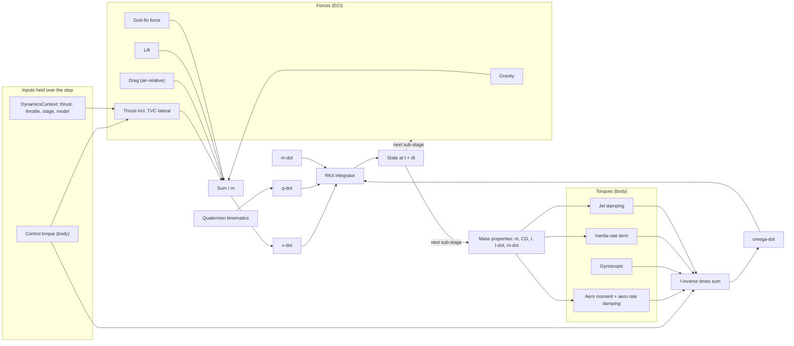
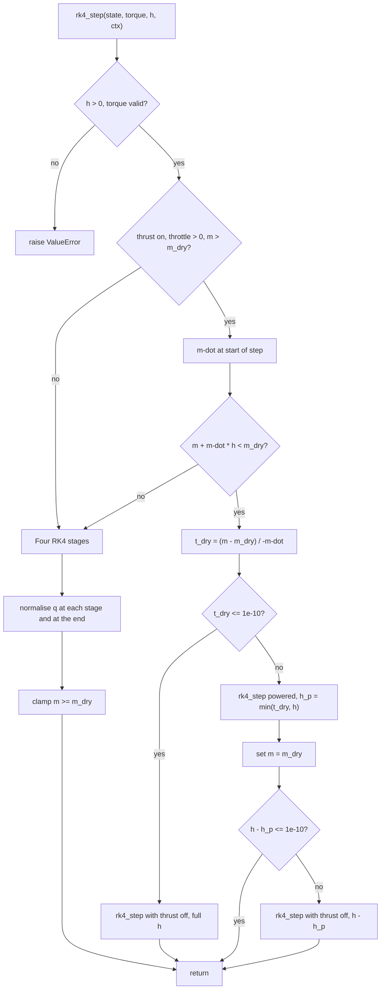

# 2. Rigid-body dynamics and numerical integration

> This chapter covers how Vyom turns forces and torques into motion. Each vehicle
> (the stacked launcher, the Stage-2 "orbiter" and the Stage-1 "booster") is a
> single variable-mass rigid body with 14 states: ECI position and velocity,
> body-to-ECI attitude quaternion, body angular rate and total mass. The
> translational equations are Newton's second law in an inertial frame. The
> rotational equations are Euler's equation with two variable-mass terms added:
> a $-\dot{\mathbf I}\boldsymbol\omega$ term and a per-axis jet-damping torque. A
> fixed-step classical fourth-order Runge–Kutta (RK4) scheme integrates the state.
> The scheme renormalises the quaternion and splits a step exactly when
> propellant runs out. The model has no propellant slosh, no structural
> flexibility and no internal fluid dynamics. Inertia and centre-of-gravity (CG)
> position are linear in propellant fraction.

All paths are relative to the repository root. Line numbers refer to the source
as of this writing.

---

## 2.1 Role in the simulation

On every mission step, `simulation_step` (`backend/rlv_sim/mission/step.py:673`)
does the following in order:

1. Runs guidance and the attitude controller.
2. Builds a `DynamicsContext` (`backend/rlv_sim/physics/dynamics.py:41-76`). This
   holds the parameters that stay constant across the RK4 sub-steps: `thrust_on`,
   `throttle`, `dry_mass`, `stage`, `vehicle_model`, `booster_aero_mode`,
   `thrust_magnitude_override`, `grid_fin_command` and `config`.
3. Calls `integrate(state, control['torque'], dt, ctx)` (`step.py:852`).
4. Applies the ground-contact or launch-pad constraint (`step.py:854`, §2.7).
5. Recomputes the force breakdown at the new state, for logging only
   (`step.py:857`).

The mission loop chooses `dt` (§2.6.4). The mission loop also calls
`validate_state` before each step (§2.8).

**Inputs per step:** the state $(\mathbf r,\mathbf v,\mathbf q,\boldsymbol\omega,m,t)$,
the commanded body torque $\boldsymbol\tau_c$ (held constant over the step), and
the context.
**Output:** the new `State` at $t+\Delta t$.

### 2.1.1 State vector

`State` (`backend/rlv_sim/core/state.py:20-146`) stores the variables listed
below. `to_vector`/`from_vector` (`state.py:77-111`) flatten them into a 14-vector
$\mathbf y = [\mathbf r, \mathbf v, \mathbf q, \boldsymbol\omega, m]$.

| Slice | Symbol | Frame | Unit |
|---|---|---|---|
| 0:3 | $\mathbf r$ | ECI | m |
| 3:6 | $\mathbf v$ | ECI (inertial velocity) | m/s |
| 6:10 | $\mathbf q=[q_w,q_x,q_y,q_z]$ | body→ECI, scalar first | – |
| 10:13 | $\boldsymbol\omega$ | body | rad/s |
| 13 | $m$ | – | kg |

Time $t$ is carried separately. So are `sim_config` and `dry_mass_kg`, which
`propellant_remaining` uses (`state.py:124-137`). `__post_init__` (`state.py:52-62`)
raises `ValueError` when $\big|\,|\mathbf q|-1\big| >$ `QUATERNION_NORM_TOL`
($10^{-6}$, `backend/rlv_sim/core/constants.py:302`). As a result, every
constructed `State` carries a unit quaternion.

$\mathbf r$ is treated as the position of the vehicle CG. The CG's axial
movement within the body (§2.4) does not feed back into $\mathbf r$.

**Initial state** (`create_initial_state`, `state.py:161-196`):
- $\mathbf r_0$ is the launch site on the reference sphere.
- $\mathbf v_0 = \boldsymbol\omega_E\times\mathbf r_0$, so the vehicle starts at rest relative to the ground.
- $\mathbf q_0$ rotates body $+z$ onto local vertical (`constants.py:222`).
- $\boldsymbol\omega_0 = 0$.
- $m_0$ is stage dry masses plus propellant masses plus payload.

---

## 2.2 Translational equations of motion

**Physical idea.** ECI is treated as inertial, so the equation needs no Coriolis
or centrifugal terms. The effects of Earth rotation enter only through the
air-relative velocity used by the aerodynamic forces. The equation divides the
sum of external forces by the instantaneous mass. The thrust force already
contains the momentum flux of the exhaust, so no additional $\dot m\,\mathbf v$
term appears (the standard "rocket equation" form).

**Implemented equations** (`compute_linear_acceleration`,
`backend/rlv_sim/physics/dynamics.py:176-225`):

$$
\dot{\mathbf r} = \mathbf v,\qquad
\dot{\mathbf v} = \frac{1}{m}\Big(\mathbf F_g + \mathbf F_T + \mathbf F_D + \mathbf F_L + \mathbf F_{GF}\Big)
$$

The code returns $\dot{\mathbf v}=\mathbf 0$ if $m <$ `ZERO_TOLERANCE`
($10^{-10}$ kg, `dynamics.py:222-223`). One routine,
`_compute_force_breakdown` (`backend/rlv_sim/physics/forces.py:1108-1225`; sum
at `forces.py:1212`), computes the force sum for both integration and
telemetry. The two paths therefore cannot diverge.

| Force | Function | Frame of evaluation | How it enters |
|---|---|---|---|
| $\mathbf F_g$ gravity | `compute_gravity_force` (`forces.py:489-544`) | ECI | `gravity_model` = `central`, `j2` or `egm96`; default `egm96`. When `gravity_model="egm96"`, `enable_j2=True` has no effect (`forces.py:519-541`). See the gravity chapter. |
| $\mathbf F_T$ thrust | `compute_thrust_force` (`forces.py:836-908`) | Computed in body frame, rotated to ECI by $\mathbf R(\mathbf q)$ (`forces.py:906`) | Magnitude includes Stage-1 back-pressure interpolation, a Stage-2 sea-level penalty and throttle efficiency $0.96+0.04\,\delta_{thr}$ (`forces.py:900`). Direction includes the TVC lateral component (below). |
| $\mathbf F_D$ drag | `compute_drag_force` (`forces.py:623-666`) | ECI, along $-\hat{\mathbf v}_{rel}$ | $-\tfrac12\rho C_D(M)A\,v_{rel}^2\hat{\mathbf v}_{rel}$. Multiplied by the booster recovery drag scale (`forces.py:1193`) or by `s2_entry_drag_scale` during S2 entry and landing (`forces.py:1196`). |
| $\mathbf F_L$ lift/normal | `compute_lift_force` (`forces.py:669-745`) | ECI, normal to $\mathbf v_{rel}$ in the plane containing body $z$ | Sign is flipped for tail-first flow. |
| $\mathbf F_{GF}$ grid fins | `compute_grid_fin_force` (`backend/rlv_sim/vehicle/recovery_hardware.py:217`) | ECI | Booster only, and only when `grid_fin_command` is set. |

Aerodynamic forces are zero above `AERO_DISABLE_ALTITUDE` = 120 km
(`constants.py:321`, `forces.py:1151`), or when `enable_atmosphere`, or both
`enable_drag` and `enable_lift`, are off.

**TVC coupling between translation and rotation.** The transverse part of the
commanded torque, $\boldsymbol\tau_{c,xy}$, sets the gimbal deflection. The
lateral thrust is therefore consistent with the torque that the rotational
equation receives (`_gimbaled_thrust_body_vector`, `forces.py:781-833`).

The gimbal-produced torque is capped:

$$
\tau_{TVC} = \min\!\big(|\boldsymbol\tau_{c,xy}|,\; T\sin\delta_{max}\,\ell_{TVC}\big)
$$

The lateral force components follow from the capped torque:

$$
F_{y} = \tau_x/\ell_{TVC}, \qquad F_x=-\tau_y/\ell_{TVC}
$$

The gimbal angle is:

$$
\delta=\arcsin\!\big(|F_{xy}|/T\big)
$$

The body-frame thrust vector is:

$$
\mathbf F_{T,body}=T\,[\sin\delta\,\hat u_x,\ \sin\delta\,\hat u_y,\ \cos\delta]
$$

Here $\delta_{max}$ is `MAX_GIMBAL_ANGLE` = 15°, and $\ell_{TVC}$ is
`tvc_lever_arm_m` (default `None`). When `tvc_lever_arm_m` is `None`, the code
uses 32 m for S1, 12 m for S2 and 21 m for the booster (`forces.py:748-778`).
Torque above the TVC capacity is assumed to come from the reaction control
system (RCS) and adds no lateral force.

**Mass rate** (`backend/rlv_sim/physics/mass.py:40-110`):

$$
\dot m = \begin{cases}
-\dfrac{T_{vac,2}}{I_{sp,vac,2}\,g_0}\cdot\dfrac{s_T}{s_{I}}\cdot\delta_{thr} & \text{stage 2}\\[2ex]
-\dot m_{1,ref}\,\dfrac{T_{ovr}}{T_{ref}}\cdot\dfrac{s_T}{s_{I}}\cdot\delta_{thr} & \text{stage 1 with override}\\[2ex]
-\dot m_{1,ref}\cdot\dfrac{s_T}{s_{I}}\cdot\delta_{thr} & \text{stage 1 otherwise}
\end{cases}
$$

The symbols are:
- $\dot m_{1,ref}$ = `MASS_FLOW_RATE` $=T_{ref}/(I_{sp}g_0)$, with $T_{ref}=7.607\times10^6$ N and $I_{sp}=282$ s.
- $s_T$ = `runtime_thrust_scale` and $s_I$ = `runtime_isp_scale`.
- $\delta_{thr}\in[0,1]$ is the throttle.

$\dot m = 0$ if the thrust is off, if $\delta_{thr}\le 0$, or if $m\le m_{dry}$.
Within one step $\dot m$ does not depend on $m$ (apart from that floor), so the
RK4 integrates mass exactly.

**Classification.** *Standard*: Newtonian point-mass translation in an inertial
frame; see, for example, Wie [3] or Cornelisse et al. [2]. The individual force
models are classified in their own chapters.

**Validity limits.**
- ECI is taken as non-rotating and the Earth as a sphere for altitude
  (`forces.py:581-587`).
- The CG shift relative to the body does not feed back into translation.
- The gimbal pivot location is not modelled. $\ell_{TVC}$ is a fixed number and
  is not computed from the current CG (§2.4).
- Stage-1 $\dot m$ for the stacked vehicle does not use
  `config.stage1_engine_thrust_n`; it uses the constant $T_{ref}$. If a user
  changes the per-engine thrust, thrust changes but propellant use during ascent
  does not.

---

## 2.3 Rotational equations of motion

### 2.3.1 Textbook form and implemented form

**Physical idea.** For a rigid body with constant inertia about its CG,
Euler's equation is $\mathbf I\dot{\boldsymbol\omega}+\boldsymbol\omega\times\mathbf I\boldsymbol\omega=\boldsymbol\tau$.
A rocket loses mass continuously, so a control-volume balance of angular
momentum adds two effects:

- **Inertia rate.** The inertia of the material inside the vehicle changes,
  giving a $\dot{\mathbf I}\boldsymbol\omega$ term.
- **Jet damping.** The exhaust leaves the nozzle exits rotating with the
  vehicle, so it carries angular momentum out of the control volume.

When the CG lies well forward of the nozzles, jet damping opposes transverse
(pitch/yaw) rates. This is the classical stabilising "jet damping". The general
variable-mass treatment is in Thomson [1] and Cornelisse, Schöyer & Wakker [2].
The project's own derivation of the per-axis terms is in
`docs/reports/Reusable booster sim improvements.md` ("Roll jet damping…").

**Control-volume balance (standard result).** Take a control volume fixed to
the body. Let $\mathbf H=\mathbf I\boldsymbol\omega$ be the angular momentum of
its contents about the CG. Let the exhaust leave through exit surfaces $S$ with
mass flux density $\rho u$. Then:

$$
\frac{d}{dt}(\mathbf I\boldsymbol\omega) + \boldsymbol\omega\times\mathbf I\boldsymbol\omega
= \boldsymbol\tau_{ext} - \int_S \rho u\;\mathbf p\times(\mathbf v_r + \boldsymbol\omega\times\mathbf p)\,dS
$$

Here $\mathbf p$ is the position on the exit surface relative to the CG and
$\mathbf v_r$ is the exhaust velocity relative to the body.

- The $\mathbf p\times\mathbf v_r$ part is the thrust moment. In Vyom it is
  already represented by the commanded TVC torque.
- The $\mathbf p\times(\boldsymbol\omega\times\mathbf p)$ part equals
  $\mathbf J\boldsymbol\omega$, where
  $\mathbf J=\int_S\rho u\,[(\mathbf p\cdot\mathbf p)\mathbf E-\mathbf p\mathbf p^{\mathsf T}]\,dS$
  and $\mathbf E$ is the 3×3 identity.

Expanding $\tfrac{d}{dt}(\mathbf I\boldsymbol\omega)=\dot{\mathbf I}\boldsymbol\omega+\mathbf I\dot{\boldsymbol\omega}$
gives the implemented form.

**Implemented equation** (`compute_angular_acceleration`, `dynamics.py:88-120`;
assembled at `dynamics.py:323`):

$$
\dot{\boldsymbol\omega} = \mathbf I^{-1}\Big(\boldsymbol\tau_c + \boldsymbol\tau_a
- \boldsymbol\omega\times(\mathbf I\boldsymbol\omega)
- \dot{\mathbf I}\,\boldsymbol\omega
- \boldsymbol\tau_{jet}\Big),\qquad \boldsymbol\tau_{jet}=\mathbf J\boldsymbol\omega
$$

| Symbol | Meaning | Source |
|---|---|---|
| $\boldsymbol\tau_c$ | commanded control torque (TVC + RCS), body frame, held over the step | `step.py:852` |
| $\boldsymbol\tau_a$ | aerodynamic moment about the CG, body frame | `dynamics.py:277-297` |
| $\mathbf I$ | diagonal inertia, `compute_inertia_tensor` | `mass.py:176-230` |
| $\dot{\mathbf I}$ | `compute_inertia_derivative`; $\le 0$ while burning | `mass.py:233-279` |
| $\mathbf J$ | diagonal jet-damping matrix | `dynamics.py:139-173` |

Two implementation notes:

- `np.linalg.inv` inverts $\mathbf I$. If $\mathbf I$ is singular, the code
  falls back to the reciprocal of the diagonal, with zeros replaced by 1
  (`dynamics.py:262-267`).
- $\dot{\mathbf I}<0$ while burning, so $-\dot{\mathbf I}\boldsymbol\omega$ is
  *anti*-damping. The net transverse coefficient is
  $J_{xx}-|\dot I_{xx}|$, which is the discrete analogue of the classical
  $\dot m(l^2-k^2)$ criterion.

The docstring at `dynamics.py:151` warns against also using
$\dot m(l^2-k^2)$, which would double-count. The module docstring
(`dynamics.py:11-13`) states that this is "not a complete variable-mass
angular-momentum derivation". Two effects are omitted:

- internal relative flow of propellant and its Coriolis effects;
- CG motion relative to the body.

**Classification.** Euler's equation: *Standard*. Control-volume
$\dot{\mathbf I}$ and jet terms: *Standard* (variable-mass rigid-body theory
[1], [2]). Engine geometry, uniform flux and the ring averaging below: *Project
heuristic*. The geometry values are engineering estimates and are not flight
data (`constants.py:63-65`).

### 2.3.2 Per-axis jet damping

**Derivation of the implemented coefficients.** Each active engine $i$ has its
nozzle-exit centre at $\mathbf p_i=(x_i,y_i,-l)$ relative to the CG, and it
carries an equal share $\dot m/n$ of the mass flow. Assume uniform flux over an
exit disk of radius $r_e$. The disk average of $\mathbf s\mathbf s^{\mathsf T}$
over the disk is $\tfrac{r_e^2}{4}\mathrm{diag}(1,1,0)$. Averaging the
integrand over the disk therefore gives:

$$
[(\mathbf p_i\!\cdot\!\mathbf p_i)\mathbf E-\mathbf p_i\mathbf p_i^{\mathsf T}] + \tfrac{r_e^2}{4}\,\mathrm{diag}(1,1,2)
$$

The engine layout is one centre engine plus $n-1$ engines on a ring of radius
$R$. For a rotationally symmetric ring:
- $\sum x_i^2=\sum y_i^2=(n-1)R^2/2$;
- the cross terms cancel.

Summing over the engines gives the implemented result (`dynamics.py:153-173`):

$$
J_{xx}=J_{yy}=|\dot m|\Big(l^2+\tfrac12 fR^2+\tfrac14 r_e^2\Big),\qquad
J_{zz}=|\dot m|\Big(fR^2+\tfrac12 r_e^2\Big),\qquad f=\frac{n-1}{n}
$$

where:
- $l$ = `cg_pos_z` from `compute_center_of_mass`, the CG height above the
  vehicle base. The code treats the base as the nozzle-exit plane.
- For Stage 2 or the orbiter, $f=0$ and $r_e$ = `stage2_nozzle_exit_radius_m`.
- If $\dot m\ge 0$, then $\boldsymbol\tau_{jet}=\mathbf 0$.

**Active engine count** (`_active_engine_count`, `dynamics.py:123-136`):

| Context | Intended $n$ | Config field |
|---|---|---|
| orbiter / stage 2 | 1 | – |
| booster, mode `BOOSTBACK` | 3 | `boostback_engine_count` |
| booster, mode `ENTRY` | 3 | `entry_engine_count` |
| booster, mode `LANDING` | 1 | `landing_engine_count` |
| anything else (stacked ascent) | 9 | `stage1_engine_count` |

> **Known issue (live mismatch).** The mission loop sets
> `booster_aero_mode = phase.name` (`step.py:827`). Phase names are
> `BOOSTER_BOOSTBACK`, `BOOSTER_ENTRY` and `BOOSTER_LANDING`
> (`backend/rlv_sim/mission/manager.py:63-67`). These never equal
> `BOOSTBACK`, `ENTRY` or `LANDING`, so during the live mission every booster
> burn uses $n=9$, i.e. $f=8/9$. Running `_active_engine_count` on the default
> config confirms this: it returns 9 for all three phase names and 1 only for
> the bare string `LANDING`. The unit tests pass the short strings, so they do
> not catch the mismatch. The effect is on roll only. For a single-engine
> landing burn, the code applies $J_{zz}\approx 644$ instead of $\approx 32$
> kg m²/s (see the table below). Pitch and yaw change by less than 1 %.

**Illustrative magnitudes.** The values below were computed by calling the
code functions at default config with full throttle; they come from a one-off
script, not a test. $\tau$ is the time constant
$I/(J+\dot I)$; a negative $\tau$ means slow spin-up.

| Case | $m$ (kg) | $\dot m$ (kg/s) | $l$ (m) | $I_{xx}$ | $J_{xx}$ | $\dot I_{xx}$ | $\tau_{pitch}$ (s) | $I_{zz}$ | $J_{zz}$ | $\dot I_{zz}$ | $\tau_{roll}$ (s) |
|---|---|---|---|---|---|---|---|---|---|---|---|
| Stacked, mid-burn | 333,700 | −2751 | 31.7 | 4.3e7 | 2.77e6 | −3.78e5 | 18 | 1.49e6 | 5.79e3 | −6.69e3 | −1650 |
| Booster boostback (live, $n$=9) | 82,200 | −917 | 21.6 | 1.04e7 | 4.27e5 | −7.47e4 | 30 | 9.73e4 | 1.93e3 | −700 | 79 |
| Booster landing (live, $n$=9) | 30,200 | −306 | 25.4 | 6.15e6 | 1.98e5 | −2.49e4 | 36 | 5.76e4 | 644 | −233 | 140 |
| Booster landing (intended, $n$=1) | 30,200 | −306 | 25.4 | 6.15e6 | 1.97e5 | −2.49e4 | 36 | 5.76e4 | 32 | −233 | −287 |
| Orbiter, mid-burn | 54,000 | −278 | 60.3 | 1.25e6 | 1.01e6 | −6.0e3 | **1.2** | 2.4e5 | 379 | −777 | −600 |

Units: inertia in kg m²; $J$ and $\dot I$ in kg m²/s.

**Validity limits.**
1. **Orbiter lever arm.** The orbiter's CG (58–63 m) is measured from the
   *stacked* vehicle base (`mass.py:154-156`), but jet damping uses it as the
   distance to the S2 nozzle exit. The S2 nozzle sits roughly at the interstage
   (~47 m, `H_STAGE1`), so the real lever arm is of order 10–20 m. With the
   current value, $l^2$ is about 10–30 times too large, and the S2 pitch/yaw
   damping time constant is about 1 s instead of tens of seconds. The code
   gives no explanation for this.
2. **Ring averaging.** The $R^2/2$ average assumes a rotationally symmetric
   ring. A 3-engine burn (centre plus two opposite engines) is not symmetric:
   the true $J_{xx}\neq J_{yy}$ and cross terms appear. Engine-out cases are
   not modelled.
3. **$\dot{\mathbf I}$ assumption.** $\dot{\mathbf I}$ assumes inertia is linear
   in propellant mass (§2.4). It does not represent tanks draining bottom-first.

### 2.3.3 Aerodynamic moment input

`compute_state_derivative` (`dynamics.py:277-297`) calls
`compute_aerodynamic_moment` (`forces.py:911-1023`) when all of the following
hold: the atmosphere is enabled, drag or lift is enabled, and
$h\le120$ km. The call uses:
- `cp_pos_z = H_CP` = 33 m for every vehicle (`dynamics.py:288`);
- the current model CG.

The moment is the static normal-force moment
$\mathbf r_{arm}\times\mathbf F_N$, with $\mathbf r_{arm}=(0,0,z_{cp}-z_{cg})$
(`forces.py:1011`). If an aero deck with `CM` is loaded, the moment is instead
$\bar q S d\,C_m$ about $\hat z\times\hat u_{trans}$. For the booster flying
tail-first, the centre of pressure (CP) is moved to
`booster_tail_first_cp_z_m`.

A pitch/yaw rate-damping term is added:

$$
\tau_{a,x/y} \mathrel{+}= C_{m_q}\,\frac{\bar q\,S\,d^2}{2\max(v_{rel},1)}\,\omega_{x/y}
$$

where $C_{m_q}$ = `C_M_DAMPING` = −8 (`forces.py:1015-1021`). This term is
damping because $C_{m_q}<0$.

For the booster, the whole moment is multiplied by the moment scale from
`_booster_recovery_aero_scale` (`forces.py:1029-1105`, clipped to [1, 6]).
Grid-fin *forces* enter translation (§2.2), but no separate grid-fin *moment*
enters this equation; grid fins affect attitude only through the moment
scale. Details are in the aerodynamics chapter.

### 2.3.4 Control torque input

$\boldsymbol\tau_c$ is the body-frame torque from the attitude controller after
TVC/RCS allocation and saturation (`step.py:780-815`). It is applied directly as
a body torque and held constant over all four RK4 stages (zero-order hold).

The same $\boldsymbol\tau_{c,xy}$ also produces the lateral thrust force (§2.2).
No actuator dynamics act inside the step. Gimbal rate limiting and engine spool
transients are applied before the step, in `update_actuator` and
`apply_engine_transient`.

---

## 2.4 Mass properties feeding the dynamics

All three functions take the current mass, which the RK4 updates at every
stage, and `vehicle_model`. The inertia tensor is diagonal with
$I_{xx}=I_{yy}$ (axisymmetric). The CG is a scalar station along body $z$,
measured from the vehicle base. Each property is interpolated linearly in a
propellant fraction $\phi\in[0,1]$:

$$
I(\phi)=I_{empty}+\phi\,(I_{full}-I_{empty}),\qquad
\dot I=\frac{I_{full}-I_{empty}}{m_{prop,ref}}\;\dot m\quad(\text{zero outside the interpolation range})
$$

| Model | $\phi$ | CG | Source |
|---|---|---|---|
| `stacked` | $\mathrm{clip}(m-m_{dry,C},0,m_{p1})/m_{p1}$, where $m_{dry,C}=$ `C.DRY_MASS` = 133,700 kg | Mass-weighted mean of four stations: S1 dry 24 m, S1 propellant 19 m, S2 dry 59 m, S2 propellant 56 m | `mass.py:169-173, 219-230` |
| `booster` | $(m-m_{S1,dry})/$`stage1_landing_fuel_reserve_kg` | `booster_cg_empty_m` + $\phi$(full − empty) | `mass.py:158-167, 198-209` |
| `orbiter` | $(m-m_{S2,dry})/m_{p2}$ | $58+5\phi$ m (hard-coded) | `mass.py:154-156, 192-196` |

**Parameters** (default values from `create_default_config()` or
`core/constants.py`):

| Symbol | Config field / constant | Default | Unit | Meaning |
|---|---|---|---|---|
| $I_{xx,full}$ stack | `stack_ixx_full_kgm2` | 7.2e7 | kg m² | stacked transverse, S1 full |
| $I_{xx,empty}$ stack | `stack_ixx_empty_kgm2` | 1.55e7 | kg m² | stacked transverse, S1 empty |
| $I_{zz,full}$ stack | `stack_izz_full_kgm2` | 2.0e6 | kg m² | stacked roll, S1 full |
| $I_{zz,empty}$ stack | `stack_izz_empty_kgm2` | 1.0e6 | kg m² | stacked roll, S1 empty |
| $I_{xx,full}$ booster | `booster_ixx_full_kgm2` | 1.1e7 | kg m² | booster transverse, reserve full |
| $I_{xx,empty}$ booster | `booster_ixx_empty_kgm2` | 5.5e6 | kg m² | booster transverse, dry |
| $I_{zz,full}$ booster | `booster_izz_full_kgm2` | 1.03e5 | kg m² | booster roll, reserve full |
| $I_{zz,empty}$ booster | `booster_izz_empty_kgm2` | 5.15e4 | kg m² | booster roll, dry |
| $z_{cg,full}$ booster | `booster_cg_full_m` | 21.0 | m | booster CG, reserve full |
| $z_{cg,empty}$ booster | `booster_cg_empty_m` | 26.0 | m | booster CG, dry |
| $m_{reserve}$ | `stage1_landing_fuel_reserve_kg` | 67,500 | kg | booster interpolation span (constant fallback 35,000) |
| orbiter $I_{xx}$ | hard-coded `mass.py:194` | 1.67e5 → 2.5e6 | kg m² | empty → full |
| orbiter $I_{zz}$ | hard-coded `mass.py:195` | 1.0e5 → 4.0e5 | kg m² | empty → full |
| $R$ | `stage1_engine_ring_radius_m` | 1.5 | m | outer engine ring radius |
| $r_{e,1}$ | `stage1_nozzle_exit_radius_m` | 0.46 | m | Merlin-class exit radius |
| $r_{e,2}$ | `stage2_nozzle_exit_radius_m` | 1.65 | m | S2 vacuum nozzle exit radius |
| $n$ | `stage1_engine_count` / `boostback_engine_count` / `entry_engine_count` / `landing_engine_count` | 9 / 3 / 3 / 1 | – | engines per burn |
| $C_{m_q}$ | `C_M_DAMPING` | −8.0 | – | aero pitch-damping coefficient |
| $z_{cp}$ | `H_CP` | 33.0 | m | CP station used for all vehicles |

**Classification.** Linear interpolation of inertia in propellant fraction:
*Project heuristic*, a standard first-order approximation
(`mass.py:225-228`). The full and empty values and the CG stations are
project estimates with no external reference.

**Known issues.**
- The stacked model uses the module constants (`C.DRY_MASS`,
  `STAGE1_PROPELLANT_MASS`), not the config masses. It also excludes the
  payload (8,000 kg default). Consequences:
  - At liftoff ($m$ = 552,600 kg) $\phi$ saturates at 1 and
    $\dot{\mathbf I}=0$ for the first ≈8 t of propellant (≈3 s).
  - At MECO, $\phi$ is about 0.18 instead of 0.16.
  - Changing `stage1_prop_mass` or `payload_mass` does not move the stacked
    inertia or CG.
- Orbiter inertia and CG are not configurable, and the orbiter CG is
  referenced to the stacked base (see §2.3.2).

---

## 2.5 Attitude representation and quaternion kinematics

**Physical idea.** Attitude is stored as a unit quaternion. This avoids
gimbal lock and needs only a renormalisation to stay valid. The kinematics
are linear in $\mathbf q$ for a given body rate.

**Convention.** Hamilton quaternion, scalar first, rotating body vectors into
ECI: $\mathbf x_{ECI}=\mathbf R(\mathbf q)\,\mathbf x_{body}$
(`backend/rlv_sim/core/frames.py:33-56`):

$$
\mathbf R(\mathbf q)=\begin{bmatrix}
1-2(q_y^2+q_z^2) & 2(q_xq_y-q_wq_z) & 2(q_xq_z+q_wq_y)\\
2(q_xq_y+q_wq_z) & 1-2(q_x^2+q_z^2) & 2(q_yq_z-q_wq_x)\\
2(q_xq_z-q_wq_y) & 2(q_yq_z+q_wq_x) & 1-2(q_x^2+q_y^2)
\end{bmatrix}
$$

`quaternion_to_rotation_matrix` normalises $\mathbf q$ before building
$\mathbf R$ (`frames.py:46`). Body-frame air velocity is
$\mathbf R^{\mathsf T}\mathbf v_{rel}$.

**Kinematics** (`omega_matrix`, `quaternion_derivative`, `frames.py:59-95`):

$$
\dot{\mathbf q}=\tfrac12\,\boldsymbol\Omega(\boldsymbol\omega)\,\mathbf q,\qquad
\boldsymbol\Omega=\begin{bmatrix}
0&-\omega_x&-\omega_y&-\omega_z\\
\omega_x&0&\omega_z&-\omega_y\\
\omega_y&-\omega_z&0&\omega_x\\
\omega_z&\omega_y&-\omega_x&0\end{bmatrix}
$$

This is equivalent to $\dot{\mathbf q}=\tfrac12\,\mathbf q\otimes[0,\boldsymbol\omega]$
with $\boldsymbol\omega$ in body axes. $\boldsymbol\Omega$ is skew-symmetric, so
$\mathbf q\cdot\dot{\mathbf q}=0$ and the exact flow preserves $|\mathbf q|$.

**Normalisation** (`quaternion_normalize`, `frames.py:16-30`):
$\mathbf q/|\mathbf q|$. If $|\mathbf q|<10^{-10}$, it returns the identity
quaternion. The RK4 applies it at every stage (§2.6).

**Other helpers.**
- `direction_to_quaternion` (`frames.py:115-156`) builds a shortest-arc
  quaternion from the normalised $[1+\hat r\!\cdot\!\hat d,\ \hat r\times\hat d]$.
- `cross3` and `vec_norm` (`backend/rlv_sim/core/utils.py:17-33`) give results
  bit-identical to `np.cross` and `np.linalg.norm`, with less overhead.

**Euler angles.** `quaternion_to_euler_zyx` (`frames.py:159-181`) gives the
intrinsic Z-Y-X roll, pitch and yaw of the body relative to the **ECI axes**,
not a local-level frame. They are used only by the Euler-angle plot
(`backend/rlv_sim/outputs/plots/mission.py:361-373, 1212`). Pitch is computed
with `arcsin` of a clipped argument, so it is singular at ±90°. This affects
the plot only, not the dynamics. Telemetry logs the quaternion. The logged
`pitch_angle` comes from guidance (`backend/rlv_sim/mission/models.py:160`).

**Classification.** *Standard* [3], [4].

---

## 2.6 Numerical integration (RK4)

### 2.6.1 Scheme as implemented

`rk4_step` (`backend/rlv_sim/physics/integrators.py:24-126`) runs these stages:

$$
\begin{aligned}
\mathbf k_1&=\mathbf f(\mathbf y_n,t_n)\\
\mathbf k_2&=\mathbf f\big(\mathcal N(\mathbf y_n+\tfrac h2\mathbf k_1),t_n+\tfrac h2\big)\\
\mathbf k_3&=\mathbf f\big(\mathcal N(\mathbf y_n+\tfrac h2\mathbf k_2),t_n+\tfrac h2\big)\\
\mathbf k_4&=\mathbf f\big(\mathcal N(\mathbf y_n+h\mathbf k_3),t_n+h\big)\\
\mathbf y_{n+1}&=\mathcal N\!\Big(\mathbf y_n+\tfrac h6(\mathbf k_1+2\mathbf k_2+2\mathbf k_3+\mathbf k_4)\Big),\qquad m_{n+1}\leftarrow\max(m_{n+1},m_{dry})
\end{aligned}
$$

- $\mathcal N$ normalises the quaternion slice only (`integrators.py:104, 108,
  112, 117`).
- $\mathbf f$ = `state_derivative_vector` (`dynamics.py:331-360`). It *also*
  normalises $\mathbf q$ before evaluating (`dynamics.py:350`). The stage
  normalisation is therefore redundant for the derivative values. The
  integrated vector field is $\tfrac12\boldsymbol\Omega\,\mathbf q/|\mathbf q|$,
  which agrees with the true one on the unit sphere.
- The mass floor is applied at `integrators.py:119`.
- $\boldsymbol\tau_c$ and the context (thrust on/off, throttle) are constant
  across the four stages. $t$ is passed to $\mathbf f$ but not used by it,
  because the dynamics are autonomous given the context.

Input checks (`integrators.py:58-63`) raise `ValueError` when:
- $h\le 0$;
- the torque shape is not (3,);
- the torque contains NaN.

`integrate()` accepts only `method='rk4'` (`integrators.py:129-146`).

### 2.6.2 Propellant-exhaustion step splitting

When $\dot m$ is a step function, a step that crosses burnout would apply full
thrust past $m_{dry}$ and lose accuracy. The integrator therefore splits the
step at the exhaustion instant (`integrators.py:66-91`).

Let $\dot m_0$ be the mass rate at the start of the step. If thrust is on,
$\dot m_0 < 0$ and $m+\dot m_0 h<m_{dry}$, then:

$$
t_{dry}=\frac{m-m_{dry}}{-\dot m_0}
$$

1. If $t_{dry}\le10^{-10}$ s, the whole step is integrated as a coast
   (`thrust_on=False`, `throttle=0`).
2. Otherwise, the code integrates a powered sub-step of
   $h_p=\min(t_{dry},h)$, sets $m\leftarrow m_{dry}$ exactly (`:87`), and then
   integrates a coast sub-step of $h-h_p$ (skipped if $\le10^{-10}$ s).

A coast call cannot split again, because its thrust is off. Under normal
rounding the recursion depth is 2. The `dry_mass` for the stacked ascent is
`config.meco_mass_kg` (`backend/rlv_sim/mission/full_mission.py:234`), so the
split happens at MECO mass, not at true S1 dry mass.

> **Known issue (rare RecursionError).** Inside the powered sub-call, the code
> repeats the exhaustion test with $h=t_{dry}$. In floating point,
> $m+\dot m_0\,t_{dry}$ can round to just *below* $m_{dry}$. In that case the
> sub-call recomputes the same $t_{dry}$, gets a zero coast remainder, and calls
> itself with identical arguments. The recursion never terminates, and Python
> raises `RecursionError`.
>
> The trigger was reproduced for Stage 2 (orbiter, $\dot m=-278.37$ kg/s,
> $m_{dry}=4000$ kg). About 1 % of uniformly sampled masses in
> $m_{dry}+[0,3000]$ kg met the rounding condition. For example,
> $m=6675.133319624401$ kg with $h=20$ s raised `RecursionError`. The same
> search found no such case for the Stage-1 mass rate. In a normal mission the
> step is ≤0.5 s and guidance usually cuts S2 off before exhaustion, so the
> trigger is unlikely but possible. Not covered by tests.

### 2.6.3 Discretisation error

**Order.** Classical RK4 is fourth-order for smooth right-hand sides [5], [6].
Normalising the quaternion at each stage keeps fourth order. A check with a
constant body rate (0.3, −0.2, 0.5) rad/s over 20 s, using the code's stage
pattern, gave an attitude error ratio of exactly 16 per halving of $h$
(order 4.00) for steps from 0.2 s to 0.025 s. The result was identical with and
without stage normalisation.

**Full right-hand side.** Many inputs are non-smooth:
- piecewise-linear Mach tables (`np.interp`);
- post-stall clamps;
- the gimbal saturation `min`;
- the wind ramp;
- the 120 km aero cut-off.

These kinks reduce the observed order. A one-off self-convergence run
integrated the stacked vehicle (powered at 90 % throttle, 10 km altitude,
constant torque) for 10 s. It compared $h$ = 0.2…0.025 s against $h$ = 0.003125 s:

| $h$ (s) | $\lvert\Delta\mathbf r\rvert$ (m) | $\lvert\Delta\mathbf v\rvert$ (m/s) | $\lvert\Delta\mathbf q\rvert$ | $\lvert\Delta\boldsymbol\omega\rvert$ (rad/s) |
|---|---|---|---|---|
| 0.2 | 8.2e-5 | 2.7e-5 | 3.5e-7 | 3.4e-7 |
| 0.1 | 4.1e-5 | 7.7e-6 | 1.2e-7 | 1.8e-7 |
| 0.05 | 1.1e-5 | 3.9e-6 | 5.4e-8 | 7.1e-8 |
| 0.025 | 2.1e-6 | 2.3e-6 | 4.1e-8 | 6.0e-8 |

The observed order is about 1–2, not 4, but the errors are negligible in
absolute terms: micrometres over 10 s at the default $h$ = 0.05 s.

**Dominant timing error.** The larger time-discretisation effect is the
zero-order hold. $\boldsymbol\tau_c$, throttle, thrust on/off and the grid-fin
command are frozen for each step, so closed-loop behaviour is first-order in
$h$ with respect to the control update rate.

There is no error estimator and no adaptive step. Timestep adequacy is
established empirically through the phase caps in §2.6.4 and the full-mission
regression; there is no formal convergence study
(`docs/MATHEMATICAL_REFERENCES.md` §2).

### 2.6.4 Step size selection (outside the integrator)

| Situation | Step | Source |
|---|---|---|
| Default | `dt` = 0.05 s | `config.dt`, `constants.py:180` |
| Stacked ascent | $\min(dt,$ `STACKED_ASCENT_MAX_DT` = 0.05 s$)$ | `full_mission.py:259` |
| Booster flip, boostback, entry, landing | $\min(dt,$ `BOOSTER_RECOVERY_MAX_DT` = 0.05 s$)$; booster coast uncapped | `full_mission.py:89`, `manager.py:163-178` |
| Orbiter unpowered coast above 120 km after booster done | $\max(dt,$ `orbit_coast_max_dt` = 0.5 s$)$ | `full_mission.py:440-446` |
| Demo mode, S2 coast to apogee | `demo_coast_max_dt` = 2.0 s | `full_mission.py:433-439` |
| Final step | clipped to reach `max_time` exactly | `backend/rlv_sim/mission/vehicle_split.py:109-111` |

### 2.6.5 Numba kernels

`backend/rlv_sim/physics/numba_kernels.py` does **not** compile the 6-DOF RK4
path described above. It compiles only two hot spots:

1. `egm96_accel` (`:43-112`): the EGM96 spherical-harmonic gravity
   acceleration. `compute_egm96_gravity_accel` calls it once per force
   evaluation, so four times per RK4 step (`forces.py:421-428`).
2. `propagate_to_surface` (`:145-261`): a 3-DOF point-mass RK4 ballistic
   impact predictor (gravity plus optional drag and wind) used by booster
   guidance (`backend/rlv_sim/guidance/recovery.py:384-390`).

Both mirror their pure-Python counterparts operation for operation. When
`numba` is not installed, `AVAILABLE` is False and the Python paths run
(`numba_kernels.py:20-30`). `tests/test_numba_kernels.py` checks agreement:
- EGM96 at 200 random points to `rtol=1e-13`;
- the predictor's impact point to 1 µm and its flight time to 1e-9 s.

In both implementations, the predictor's surface-crossing interpolation
computes the position as $\mathbf r_{new}+f(\mathbf r_{prev}-\mathbf r_{new})$
(a fraction $f$ *back* from the end of the step). The time is computed as
$t_{new}-h(1-f)$ (a fraction $f$ *forward* from the start). These two are
inconsistent unless $f=\tfrac12$, so the predicted time-to-impact can be off
by up to one predictor step. The code gives no explanation. This belongs to
the guidance chapter and does not affect the 6-DOF state.

---

## 2.7 Post-step constraints

`_apply_ground_contact` (`step.py:645-659`) modifies the integrated state
(this is not dynamics):

- **Launch pad** (`apply_launch_pad_constraint`, `step.py:308-343`). For the
  stacked vehicle in ASCENT while on the pad, the code projects $\mathbf r$
  back onto the pad sphere and removes inward radial velocity. This stands in
  for the missing pad normal force while thrust-to-weight is below 1.
- **Ground crossing** (`_interpolate_ground_crossing`, `step.py:346-375`). If
  altitude changes sign during the step, the code returns a state linearly
  interpolated to $h=0$. The quaternion is interpolated linearly and then
  normalised.

---

## 2.8 Physical sanity checks

`validate_state` (`backend/rlv_sim/physics/checks.py:167-193`) runs these
checks in order and stops at the first failure:

| Check | Condition for failure | Line |
|---|---|---|
| finite | any NaN/inf in $\mathbf r,\mathbf v,\mathbf q,\boldsymbol\omega,m,t$ | `:32-45` |
| quaternion norm | $\big||\mathbf q|-1\big|>$ `quaternion_norm_tolerance` (1e-6) | `:48-68` |
| position | $|\mathbf r|<0.5R_E$ | `:71-88` |
| mass | $m<0.999\,m_{dry}$, or $m>$ `max_mass` (default $1.01\times$ `C.INITIAL_MASS` = 550,046 kg) | `:91-120` |
| speed | $|\mathbf v|>15{,}000$ m/s | `:123-142` |
| body rate | $|\boldsymbol\omega|>10$ rad/s | `:145-164` |

**On violation.** The ascent loop (`full_mission.py:245-254`) and the
dual-vehicle loop (`full_mission.py:76-82`) call `validate_state` with the
default `abort_on_error=True` and catch the `ValidationError`. The error is
logged, and the vehicle's run ends with reason
`"Validation failure…: <message>"`. The process does not crash, and the other
vehicle keeps running. The ascent loop passes the configured `max_mass`; the
separated vehicles use the default.

**Energy diagnostic.** `compute_total_energy` gives
$E=\tfrac12 m|\mathbf v|^2-\mu m/|\mathbf r|$ (`:196-223`).
`validate_energy_conservation` (`:226-253`) compares $E$ over 100-step
unpowered intervals with relative tolerance `ENERGY_TOLERANCE` = 1e-3. A
failure only produces a log warning
(`backend/rlv_sim/mission/single_vehicle.py:277-291`).

The check applies only when *all* of the following hold
(`single_vehicle.py:329-345`):
- thrust is off;
- gravity is the central model with J2 off;
- $\bar q\le1$ Pa.

The default config uses `egm96`, so in default runs this diagnostic **never
executes**.

**Classification.** Project heuristic bounds (*no external reference*).

---

## 2.9 Validity limits (summary)

- **Rigid body.** No propellant slosh and no structural bending. Telemetry
  includes the columns `slosh_displacement_m`, `slosh_cg_offset_m`,
  `slosh_torque_n_m`, `flex_eta_m`, `flex_eta_dot_mps` and
  `flex_parasitic_angle_rad` (`backend/rlv_sim/mission/models.py:248-253`).
  No code writes these keys, so they are always 0. They are placeholders,
  not model output. The model card states "no slosh, no flexible body"
  (`backend/rlv_sim/outputs/model_card.py:19`).
- **Mass properties.** Diagonal, axisymmetric inertia that is linear in
  propellant fraction. The CG moves only along the axis. Lateral CG offset
  and thrust misalignment are not modelled.
- **Variable-mass terms.** Partial: $\dot{\mathbf I}\boldsymbol\omega$ and jet
  damping are present. Internal flow, Coriolis effects of propellant motion and
  CG-velocity terms are omitted. See §2.3.2 for the engine-count and orbiter
  lever-arm issues.
- **Integration.** Fixed-step RK4 with a zero-order hold on controls, and no
  error control.

---

## 2.10 Verification

| Test | What it covers |
|---|---|
| `backend/tests/test_jet_damping.py` | No flow gives no damping. Centre-engine roll damping equals $\dot m\,r_e^2/2$. Pitch damping ≈ $\dot m\,l^2$. Roll ordering 9 > 3 > 1 engines, and roll < 1 % of pitch. Uses the short mode strings (`LANDING`, `BOOSTBACK`), so it does not exercise the live phase names (§2.3.2). |
| `backend/tests/test_research_features.py::test_jet_damping_uses_configured_nozzle_geometry` | Config nozzle geometry reaches the damping term |
| `backend/tests/test_integrators.py` | Quaternion norm kept over many coast steps, with and without torque. Finite state. Mass unchanged on coast. Exact clamp to dry mass with the powered/coast split. No split for small $h$. `ValueError` on bad $h$, torque shape or NaN torque. Only `rk4` accepted. |
| `backend/tests/test_validation_tier1.py` | Two-body circular orbit with RK4 at $h$=2 s: radius drift < 1e-4, energy drift < 1e-4 and angular-momentum drift < 1e-6 over two orbits. Period against Kepler's third law. Vis-viva. Tsiolkovsky Δv. |
| `backend/tests/test_physics_checks.py` | Each sanity check, its boundaries, short-circuiting, and the energy helpers |
| `backend/tests/test_numba_kernels.py` | Compiled EGM96 and impact predictor match the Python versions (skipped without numba) |
| `backend/tests/test_full_mission_regression.py` (`-m slow`) | End-to-end mission regression |

When this chapter was written, the first five files passed: 74 tests in
8.9 s. The convergence, jet-damping magnitude and recursion results in
§2.3.2 and §2.6 come from one-off scripts. They are not part of the test suite.

---

## 2.11 References

1. W. T. Thomson, *Introduction to Space Dynamics*, John Wiley & Sons, 1961
   (Dover reprint, 1986). Covers variable-mass systems and rocket attitude
   dynamics.
2. J. W. Cornelisse, H. F. R. Schöyer, K. F. Wakker, *Rocket Propulsion and
   Spaceflight Dynamics*, Pitman, 1979.
3. B. Wie, *Space Vehicle Dynamics and Control*, 2nd ed., AIAA Education
   Series, 2008.
4. F. L. Markley, J. L. Crassidis, *Fundamentals of Spacecraft Attitude
   Determination and Control*, Springer, 2014.
5. E. Hairer, S. P. Nørsett, G. Wanner, *Solving Ordinary Differential
   Equations I: Nonstiff Problems*, 2nd ed., Springer, 1993.
6. J. C. Butcher, *Numerical Methods for Ordinary Differential Equations*,
   2nd ed., Wiley, 2008.

Project-internal: `docs/MATHEMATICAL_REFERENCES.md` §1–2;
`docs/reports/Reusable booster sim improvements.md` (jet-damping derivation and
the roll-damping correction).
