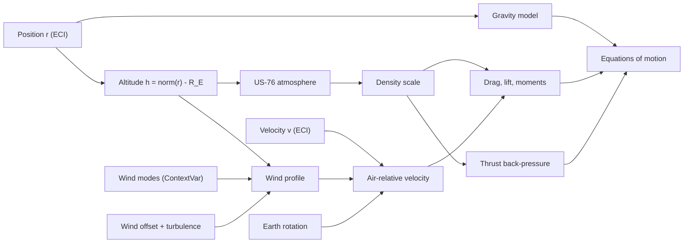

# 3. Environment: Earth, gravity, atmosphere and wind

> This chapter covers the natural environment that every vehicle in the simulation flies through: the Earth model and how altitude is computed, the gravity field (central, J2 or a degree-6 spherical-harmonic field with EGM96-style coefficients), the atmosphere (US Standard Atmosphere 1976, optionally extended above 84.852 km, with a run-time density scale), and the wind (a power-law mean profile plus optional altitude modes, a constant offset and per-step random turbulence and gusts). The forms are textbook ones. The Earth model is simplified: altitude is measured above a sphere, the atmosphere does not depend on latitude by default, and the wind blows along a single fixed azimuth. The optional "GRAM" switch is an analytic density factor, not NASA Earth-GRAM, and the current call sites never turn it on (§3.5.4).

All source paths are relative to `backend/rlv_sim/`. Default values come from `create_default_config()` and `core/constants.py`.

## 3.1 Role in the simulation

Every force evaluation (four per RK4 step, see Chapter 2) starts from the inertial position $\mathbf{r}$. Spherical altitude $h$ is computed once and used to look up the atmosphere and the wind. Gravity uses $\mathbf{r}$ directly. The air-relative velocity $\mathbf{v}_{rel}$ removes Earth rotation and wind from the inertial velocity. Aerodynamics (Chapter 5), engine back-pressure (Chapter 6), guidance and the impact predictor all use these quantities.

| Function | File:line | Called from |
|---|---|---|
| `compute_gravity_force` | `physics/forces.py:489` | `_compute_force_breakdown` (`physics/forces.py:1132`) |
| `compute_egm96_gravity_accel` | `physics/forces.py:401` | `compute_gravity_force` (`:540`) |
| `altitude_above_configured_surface` / `_altitude_from_r` | `physics/forces.py:581`, `:586` | forces, `State.altitude` (`core/state.py:114`), safety checks |
| `compute_atmosphere_properties` | `physics/forces.py:156` | `compute_configured_atmosphere_properties`, abort monitor (`guidance/abort.py:108`), two-body invariant check (`mission/single_vehicle.py:343`) |
| `compute_configured_atmosphere_properties` | `physics/forces.py:210` | drag `:640`, lift `:682`, thrust `:871`, aero moment `:923`, guidance, telemetry, recovery hardware |
| `_wind_vector`, `compute_relative_velocity` | `core/utils.py:67`, `:95` | all aero forces and moments, guidance, recovery target shift |
| `wind_profile_context` | `core/utils.py:49` | `run_full_mission` (`mission/full_mission.py:532`) |
| `_make_wind_applier` | `mission/full_mission.py:107` | per step at `mission/full_mission.py:293`, `:451`, `:462` |

Aerodynamic forces are set to zero above `C.AERO_DISABLE_ALTITUDE` = 120 km (`physics/forces.py:1151`, `core/constants.py:321`), whatever the atmosphere model returns.

## 3.2 Earth model, frames and altitude

### Physical idea
The simulation integrates in an Earth-centred inertial (ECI) frame whose $z$ axis is the Earth's spin axis. At $t=0$ this frame coincides with the Earth-fixed frame (ECEF), so the launch-site longitude is also its inertial longitude at lift-off. The Earth turns about $+z$ at a constant rate. Altitude is measured above a **sphere** of mean radius. The WGS-84 equatorial radius is used only to normalise the gravity harmonics.

### Equations (implemented)
Launch-site position (`core/constants.py:204-219`, used at `:242`). The latitude $\phi_0$ and longitude $\lambda_0$ go straight into spherical coordinates, so the geodetic latitude is treated as geocentric:

$$
\mathbf{r}_0 = (R_E + h_0)\,[\cos\phi_0\cos\lambda_0,\ \cos\phi_0\sin\lambda_0,\ \sin\phi_0]^T
$$

Initial velocity is the velocity of a point fixed to the rotating ground (`core/constants.py:251`):

$$
\mathbf{v}_0 = \boldsymbol{\omega}_E \times \mathbf{r}_0, \qquad \boldsymbol{\omega}_E = [0,0,\omega_E]^T
$$

Altitude (`physics/forces.py:581-583`):

$$
h = \lVert\mathbf{r}\rVert - R_E
$$

The `config` argument of `altitude_above_configured_surface` is ignored: the surface is always the sphere $R_E$. The same expression is computed inline in `_wind_vector` (`core/utils.py:70`) and `compute_thrust_force` (`physics/forces.py:870`).

Velocity relative to the ground (`core/utils.py:108-118`) and to the air (`core/utils.py:95-105`):

$$
\mathbf{v}_{gnd} = \mathbf{v} - \boldsymbol{\omega}_E\times\mathbf{r},\qquad
\mathbf{v}_{rel} = \mathbf{v} - \boldsymbol{\omega}_E\times\mathbf{r} - \mathbf{w}(\mathbf{r})
$$

$\mathbf{v}_{gnd}$ is used for navigation, targeting and touchdown. $\mathbf{v}_{rel}$ is used for aerodynamic forces, Mach number, $\bar q$ and angle of attack.

### Parameters

| Symbol | Config field / constant | Default | Unit | Meaning |
|---|---|---|---|---|
| $\mu$ | `C.MU_EARTH` (`core/constants.py:12`) | 3.986004418e14 | m³/s² | Earth gravitational parameter |
| $R_E$ | `C.R_EARTH` (`:15`) | 6 371 000 | m | Mean spherical radius: altitude reference, site placement, impact surface |
| $a_e$ | `C.R_EARTH_EQUATORIAL_WGS84` (`:19`) | 6 378 137 | m | Reference radius of the J2/harmonic terms |
| $\omega_E$ | `C.EARTH_ROTATION_RATE` (`:248`) | 7.2921159e-5 | rad/s | Earth spin rate |
| $g_0$ | `C.G0` (`:22`) | 9.80665 | m/s² | Standard gravity (atmosphere hydrostatics, Isp) |
| $\phi_0$ | `launch_site_lat_deg` | 28.608402 | deg | Launch site latitude (Cape Canaveral area) |
| $\lambda_0$ | `launch_site_lon_deg` | −80.604201 | deg | Launch site longitude |
| $h_0$ | `launch_site_altitude_m` | 0 | m | Launch site height above the sphere |

### Classification and references
Standard (spherical Earth, rigid rotation). The value of $\mu$ and $a_e$ are WGS-84 values [1]. The rate 7.2921159e-5 rad/s is the value tabulated in Vallado [3]. WGS-84 itself defines 7.292115e-5 rad/s; the difference is 1.2e-11 rad/s.

### Validity limits and known issues
- **Spherical altitude.** The ellipsoid is not used for altitude. At the launch latitude the WGS-84 ellipsoid lies about 2.2 km above the 6371 km sphere, so "altitude" here is height above the mean sphere, not geodetic height. Because the pad, the landing site and the vehicle all use the same sphere, landing and pad-clearance logic are self-consistent.
- **Geodetic vs geocentric latitude.** The site latitude goes straight into spherical coordinates. The resulting site lies about 0.16° (about 18 km) north of where a geodetic placement would put it. This matters only when comparing against real ground tracks.
- No precession, nutation or polar motion: the ECI frame is the Earth-fixed frame at $t=0$ rotated by $\omega_E t$ about $z$.

## 3.3 Gravity

Gravity is selected by `gravity_model` ∈ {`central`, `j2`, `egm96`} (`physics/forces.py:521-544`). With `central`, setting `enable_j2=True` upgrades the model to `j2` (`:522-525` and `:1129-1131`). An unrecognised name falls back to `central` (`:543-544`). **The default is `egm96`.** The default `enable_j2=True` therefore has no effect, because `enable_j2` is consulted only when the model is `central`.

### 3.3.1 Central (two-body) gravity
$$
\mathbf{F}_g = -\frac{\mu\, m\, \mathbf{r}}{\lVert\mathbf{r}\rVert^3}
$$
`physics/forces.py:519`. If $\lVert\mathbf{r}\rVert < 10^{-10}$ m, it returns zero (`:516-517`). Standard [3, 4].

### 3.3.2 J2 zonal oblateness (legacy `j2` model)
$$
\mathbf{a}_{J2} = \frac{3}{2}\frac{J_2\,\mu\,a_e^2}{r^5}
\begin{bmatrix} x\,(5z^2/r^2 - 1)\\ y\,(5z^2/r^2 - 1)\\ z\,(5z^2/r^2 - 3)\end{bmatrix},
\qquad \mathbf{F}_g = -\frac{\mu m\mathbf{r}}{r^3} + m\,\mathbf{a}_{J2}
$$
`physics/forces.py:527-538`. This is the textbook form [3, §8.6; 4, §3.2] written with the opposite sign inside the brackets. $J_2$ comes from `j2_coefficient` (default 1.08263e-3). Classification: Standard.

### 3.3.3 Spherical-harmonic geopotential (`egm96`)

**Physical idea.** The potential is expanded in fully normalised spherical harmonics up to degree and order $N=6$. Normalised associated Legendre functions are built by stable recursions, and the gradient is formed in the local spherical basis (radial, north, east) before conversion to ECI.

**Potential** (comment at `physics/forces.py:444-445`):

$$
U(r,\phi,\lambda) = \frac{\mu}{r}\left[1 + \sum_{n=2}^{N}\sum_{m=0}^{n}\left(\frac{a_e}{r}\right)^n \bar P_{nm}(\sin\phi)\,\big(\bar C_{nm}\cos m\lambda + \bar S_{nm}\sin m\lambda\big)\right]
$$

$\phi$ and $\lambda$ are the **geocentric latitude and longitude of the ECI vector** (`physics/forces.py:432-434`):
$\sin\phi = z/r$, $\cos\phi = \sqrt{x^2+y^2}/r$, $\lambda = \operatorname{atan2}(y,x)$.

**Normalisation.** Full (geodesy) normalisation without the Condon–Shortley phase (`physics/forces.py:357-360`):

$$
\bar P_{nm} = \sqrt{(2-\delta_{m0})(2n+1)\frac{(n-m)!}{(n+m)!}}\;P_{nm},
$$

This is the normalisation of the EGM96 coefficients [2] and of [3, 4]. The test reference potential `tests/test_review_regressions.py:47-49` uses exactly this definition.

**Legendre recursion** (`physics/forces.py:340-384`; compiled copy `physics/numba_kernels.py:59-79`), with $s=\sin\phi$, $c=\cos\phi$ and $\bar P_{00}=1$:

| Step | Implemented formula | Line |
|---|---|---|
| Sectoral | $\bar P_{mm} = f_m\, c\, \bar P_{m-1,m-1}$, $f_1=\sqrt3$, $f_m=\sqrt{(2m+1)/(2m)}$ for $m\ge2$ | `forces.py:340-343`, `:369` |
| Sub-diagonal | $\bar P_{m+1,m} = \sqrt{2m+3}\; s\; \bar P_{mm}$ | `:344`, `:374` |
| Column recursion ($n\ge m+2$) | $\bar P_{nm} = a_{nm}\, s\, \bar P_{n-1,m} - b_{nm}\bar P_{n-2,m}$ | `:345-353`, `:380` |

$$
a_{nm}=\sqrt{\frac{(2n+1)(2n-1)}{(n-m)(n+m)}},\qquad
b_{nm}=\sqrt{\frac{(2n+1)(n+m-1)(n-m-1)}{(2n-3)(n-m)(n+m)}}
$$

The latitude derivatives $\partial\bar P_{nm}/\partial\phi$ are obtained by differentiating each recursion line (`:370`, `:375`, `:381`). For $m>0$ the code also carries $Q_{nm}=\bar P_{nm}/\cos\phi$ through the same recursions (`:371`, `:377`, `:383`). Because $Q$ is seeded with $f_m\bar P_{m-1,m-1}$ instead of being divided by $\cos\phi$, the east component stays finite at the poles.

**Acceleration** (`physics/forces.py:454-486`). With $\rho_n=(a_e/r)^n$ and $Y_{nm}=\bar C_{nm}\cos m\lambda+\bar S_{nm}\sin m\lambda$:

$$
\begin{aligned}
D_r &= \sum -(n+1)\rho_n\bar P_{nm}Y_{nm}, \quad
D_\phi = \sum \rho_n\,\frac{\partial\bar P_{nm}}{\partial\phi}\,Y_{nm}, \quad
D_\lambda = \sum_{m>0} \rho_n\,Q_{nm}\,m\,(-\bar C_{nm}\sin m\lambda+\bar S_{nm}\cos m\lambda)\\
\mathbf{a} &= \frac{\mu}{r^2}\Big[(D_r - 1)\,\hat{\mathbf{r}} + D_\phi\,\hat{\boldsymbol\phi} + D_\lambda\,\hat{\boldsymbol\lambda}\Big]
\end{aligned}
$$

with $\hat{\mathbf r}=(c\cos\lambda, c\sin\lambda, s)$, $\hat{\boldsymbol\phi}=(-s\cos\lambda,-s\sin\lambda,c)$ (north) and $\hat{\boldsymbol\lambda}=(-\sin\lambda,\cos\lambda,0)$ (east). The "−1" adds the central term back in (`:485`), so the function returns the **total** gravitational acceleration. The sums run only over the non-zero $(n,m)$ pairs cached by `_egm96_terms()` (`:319-337`). When Numba is available, the compiled `egm96_accel` (`physics/numba_kernels.py:44-112`) runs instead. It implements the same arithmetic and agrees with the Python path to a relative tolerance of 1e-13.

**Coefficients** (`physics/forces.py:62-112`). Truncation `_EGM96_MAX_DEG = 6`. $\bar C_{20} = -0.484165143403758\times10^{-3}$ is derived from $J_2=1.082626173\times10^{-3}$ as $\bar C_{20}=-J_2/\sqrt5$ (`:64-65`), not taken from the EGM96 file. That file gives the tide-free value $-0.484165371736\times10^{-3}$ [2]; the difference in $\bar C_{20}$ is 4.7e-10.

### Parameters

| Symbol | Config field / constant | Default | Unit | Meaning |
|---|---|---|---|---|
| — | `gravity_model` | `egm96` | — | `central`, `j2` or `egm96` |
| — | `enable_j2` | True | — | Adds J2 only when `gravity_model == "central"` |
| $J_2$ | `j2_coefficient` | 1.08263e-3 | — | Used by the `j2` model only |
| $N$ | `_EGM96_MAX_DEG` (`physics/forces.py:62`) | 6 | — | Degree and order of the expansion |
| $\bar C_{nm},\bar S_{nm}$ | `_EGM96_C`, `_EGM96_S` (`:66-112`) | embedded table | — | Fully normalised coefficients |

### Classification and references
The recursions and the gradient are Standard [3, 4]. The coefficient set is described in the code as EGM96 [2] (Published), but see the known issues below.

### Validity limits and known issues
- **Truncation.** Degree 6 captures oblateness and the largest long-wavelength terms. It is not the full degree-360 model and ignores regional anomalies. For a launch-and-landing simulation lasting minutes, effects beyond J2 are at the level of 1e-5 m/s² or smaller.
- **The tesseral terms are fixed in inertial space.** $\lambda$ is computed from the ECI vector (`physics/forces.py:434`; `numba_kernels.py:49`) and no Earth-rotation angle $\omega_E t$ is subtracted. Every $m>0$ term is therefore evaluated as if the Earth had stopped rotating at $t=0$. The zonal terms ($m=0$, including J2) are unaffected. The Earth turns about 2.5° in a 10-minute mission, so the error is a small fraction of an already small tesseral contribution. For long S2 orbit propagation, however, the field does not rotate with the Earth. Difference not explained in code.
- **Coefficient provenance.** A spot check against published EGM96 values [2] shows that several embedded coefficients **do not** match EGM96:

  | Term | Embedded value | EGM96 published |
  |---|---|---|
  | $\bar C_{22}$ | 0.243938357e-5 | 0.243914352e-5 |
  | $\bar S_{22}$ | −0.140028337e-5 | −0.140016684e-5 |
  | $\bar S_{32}$ | +0.750037e-6 | −0.619026e-6 |
  | $\bar S_{33}$ | −0.365235e-6 | +0.141436e-5 |

  Coefficients are also missing: $\bar C_{53}$ and $\bar C_{62}$ are absent and $\bar S_{53}$ is set to 0.0, although none of these is zero in EGM96. The degree-2 tesseral values are close to EGM2008 values. Several degree-3 and higher values differ in sign. The table should be regenerated from the official `egm96_to360.ascii` file before results are described as "EGM96". In the meantime, read it as "an EGM96-like degree-6 field". The J2/C20 term, which dominates, is correct.
- At $\lVert\mathbf r\rVert<10^{-10}$ m both paths return zero.

## 3.4 Atmosphere: US Standard Atmosphere 1976

### Physical idea
The lower atmosphere is a stack of layers. In each layer the temperature varies linearly with height (constant lapse rate) or is constant. Pressure follows from hydrostatic balance with constant $g_0$. Density follows from the ideal-gas law and the speed of sound from $T$. Layer-base values are built once by integrating upward from sea level and are then cached.

### Equations (implemented)
Layer table (`physics/forces.py:117-118`). The layer bases $h_i$ are used as **geometric** altitude:

| $i$ | Base $h_i$ (m) | Lapse $L_i$ (K/m) | Base $T_i$ (K) | Base $P_i$ (Pa) |
|---|---|---|---|---|
| 0 | 0 | −0.0065 | 288.15 | 101 325 |
| 1 | 11 000 | 0 | 216.65 | 22 631.7 |
| 2 | 20 000 | +0.0010 | 216.65 | 5 474.72 |
| 3 | 32 000 | +0.0028 | 228.65 | 867.974 |
| 4 | 47 000 | 0 | 270.65 | 110.898 |
| 5 | 51 000 | −0.0028 | 270.65 | 66.9336 |
| 6 | 71 000 | −0.0020 | 214.65 | 3.95599 |
| top | 84 852 | — | 186.946 | 0.373334 |

(The base values are computed by `_build_us76_tables`, `physics/forces.py:121-153`; the numbers above are its output.)

For $0\le h\le 84\,852$ m, with $h$ clamped below at 0 (`:172`), in layer $i$ (`:174-189`):

$$
T = T_i + L_i (h-h_i),\qquad
P = \begin{cases} P_i\,(T/T_i)^{-g_0/(L_i R)} & L_i\neq0\\[2pt] P_i\,\exp\!\big(-g_0 (h-h_i)/(R\,T_i)\big) & L_i=0\end{cases}
$$

$$
\rho = \frac{P}{R\,T},\qquad a = \sqrt{\gamma R T}\quad(\text{lines }203\text{–}206)
$$

A density below `C.DENSITY_FLOOR` = 1e-12 kg/m³ is set to 0 (`:204-205`). If $T\le0$, which cannot happen with these tables, the speed of sound falls back to 340 m/s.

### 3.4.1 Above 84.852 km
- `enable_upper_atmosphere = False` (**default**): $P=0$, $\rho=0$, and $T$ is held at 186.946 K (`:198-201`). The vehicle is in vacuum above 84.852 km.
- `enable_upper_atmosphere = True`: an isothermal exponential extension with a **fixed** scale height $H_s=5000$ m (`:190-197`):

$$
T = T_{top},\qquad P = P_{top}\exp\!\big(-(h-84\,852)/H_s\big)
$$

This is a Project heuristic. The isothermal scale height at 186.9 K would be $RT/g_0\approx5.47$ km, and real thermospheric density is much higher above about 100 km. For comparison, the model gives $\rho(100\text{ km})=3.4\times10^{-7}$ kg/m³, while the US-76 table value is about $5.6\times10^{-7}$ kg/m³.

### 3.4.2 Configured wrapper and density dispersion
`compute_configured_atmosphere_properties` (`physics/forces.py:210-235`) is what force and guidance code calls:

1. (Optional "GRAM" factor $k_G$, §3.5.4; inactive in practice.)
2. Evaluate US-76 with `enable_upper_atmosphere`.
3. If `enable_atmosphere = False`, return $(T, 0, 0, a)$: vacuum (`:227-228`).
4. Scale **both pressure and density** by $k = k_\rho\,k_G$, where $k_\rho$ = `runtime_atmosphere_density_scale` (`:230-232`), then apply the 1e-12 floor again.

$$
\rho' = k\,\rho,\qquad P' = k\,P,\qquad T' = T,\qquad a' = a
$$

Scaling $P$ and $\rho$ together keeps $T$ (and so $a$) consistent with the ideal-gas law. A side effect is that the ambient pressure seen by the engine back-pressure correction (`physics/forces.py:871`) also scales with $k_\rho$, so a density dispersion also changes sea-level thrust slightly. Monte Carlo campaigns draw $k_\rho = k_{\rho,base}(1+0.05\,z)$ with $z\sim\mathcal N(0,1)$, clamped to at least 0.1 (`mission/campaign.py:33`, `:250-254`, `:294`).

### Parameters

| Symbol | Config field / constant | Default | Unit | Meaning |
|---|---|---|---|---|
| — | `enable_atmosphere` | True | — | False gives vacuum ($P=\rho=0$) |
| — | `atmosphere_model` | `us76_deterministic` | — | Label only; no code branches on it |
| — | `enable_upper_atmosphere` | False | — | Exponential extension above 84.852 km |
| $k_\rho$ | `runtime_atmosphere_density_scale` | 1.0 | — | Multiplies $\rho$ and $P$; must be > 0 (`config/definition.py:677`) |
| $T_0, P_0$ | `C.ATM_T0`, `C.ATM_P0` (`core/constants.py:266-267`) | 288.15, 101 325 | K, Pa | Sea-level values |
| $R$ | `C.R_GAS` (`:280`) | 287.05 | J/(kg K) | Specific gas constant of air |
| $\gamma$ | `C.GAMMA` (`:279`) | 1.4 | — | Ratio of specific heats |
| $H_s$ | literal (`physics/forces.py:195`) | 5000 | m | Upper-extension scale height |
| — | `C.DENSITY_FLOOR` (`:314`) | 1e-12 | kg/m³ | Densities below this become 0 |
| — | `C.AERO_DISABLE_ALTITUDE` (`:321`) | 120 000 | m | Aero forces forced to 0 above this |

### Classification and references
Layer structure, lapse rates and base values: Published, US Standard Atmosphere 1976 [5]. Upper extension and density scale: Project heuristic.

### Validity limits and known issues
- **Geopotential vs geometric altitude.** In US-76 the layer bases and the hydrostatic equation (with constant $g_0$) are defined in *geopotential* altitude. The code feeds geometric altitude directly, without $H = R_0 h/(R_0+h)$. The induced error grows with altitude: about 0.3 % in height at 20 km, which shifts density by roughly 1–2 % in the stratosphere and more higher up. Layer-base values match the published table (they are defined at the same numbers), but intermediate altitudes are slightly off. Also, 84 852 m is the geopotential top of US-76 (86 km geometric).
- $R=287.05$ instead of the US-76 value $R^*/M_0 = 287.053$: negligible.
- There is no variation with latitude, season or day; that is what the density scale is for.
- `mission/single_vehicle.py:343` calls `compute_atmosphere_properties(altitude)` with the default `enable_upper_atm=True`, unlike the configured default (False). It affects only the gate that decides when to check the two-body energy invariant.

## 3.5 Wind

### 3.5.1 Mean wind profile and offset
**Physical idea.** A horizontal wind whose speed grows with altitude as a power law, blowing toward a fixed azimuth, and tapered smoothly to zero at the ground.

**Equations** (`core/utils.py:67-92`). For $h>0$ (zero at or below the sphere, `:71-72`):

$$
s(h) = \Big[\,V_{ref}\Big(\frac{h}{h_{ref}}\Big)^{p} + \Delta V + \delta(h)\Big]\cdot S(h),
\qquad
S(h)=\begin{cases}x^2(3-2x),\ x=h/5000 & h<5000\text{ m}\\ 1 & h\ge5000\text{ m}\end{cases}
$$

$$
\hat{\mathbf u}=\frac{\mathbf r}{\lVert\mathbf r\rVert},\quad
\hat{\mathbf e}=\frac{\hat{\mathbf z}\times\hat{\mathbf u}}{\lVert\hat{\mathbf z}\times\hat{\mathbf u}\rVert},\quad
\hat{\mathbf n}=\hat{\mathbf u}\times\hat{\mathbf e},\qquad
\mathbf w = s(h)\,\big(\cos\psi_w\,\hat{\mathbf n} + \sin\psi_w\,\hat{\mathbf e}\big)
$$

Here $\Delta V$ = `runtime_wind_offset_mps` and $\delta(h)$ is the mode perturbation (§3.5.2). The smoothstep $S$ multiplies the **total**, including offset and perturbation. At the poles ($\hat{\mathbf z}\times\hat{\mathbf u}\approx0$) the east axis defaults to $+y$ (`:85-87`).

With $\psi_w = 90°$ the wind vector points **east**. $\psi_w$ is the direction the air moves *toward*, not the meteorological "from" direction, so the default is a westerly wind (blowing from the west). The mean speeds are:

| $h$ (km) | 1 | 2.5 | 5 | 10 | 20 | 40 | 70 |
|---|---|---|---|---|---|---|---|
| $\lVert\mathbf w\rVert$ (m/s) | 1.97 | 11.4 | 26.1 | 30.0 | 34.5 | 39.6 | 44.3 |

The profile has no upper cap, so $s$ keeps growing above 70 km. By default this does not matter, because $\rho=0$ above 84.852 km and aero is disabled above 120 km.

**Sign convention of `runtime_wind_offset_mps`.** $\Delta V$ is added to the signed speed along the fixed eastward axis. A positive $\Delta V$ strengthens the eastward wind. A negative $\Delta V$ weakens it, or reverses it if the sum becomes negative. The flow is then westward, which is "from the east".
- During **ascent** the vehicle flies east (default inclination 28.5°), so a negative offset is a headwind and a positive one a tailwind.
- During **RTLS booster return** (`booster_landing_target_downrange_km = 0`) the booster flies west, back toward the pad. Geometrically, a *positive* offset is then a headwind and a negative one a tailwind.

The code documentation calls negative offsets a "headwind" throughout: `config/field_docs.py:600`, `config/definition.py:143-145`, `mission/planner.py:47`. The wind-aware recovery reserve adds propellant only for negative offsets (`tests/test_campaign_statistics.py:82-91`). The definition comment says the reserve slope (about 383 kg per m/s) comes from Monte Carlo, so the label matches the measured *effect* on booster propellant, which also includes ascent-phase effects on the separation state. It does not match the local geometry of the return leg. Readers should take "headwind" in the code to mean "negative offset, i.e. less eastward (westerly) wind".

### 3.5.2 Altitude-varying perturbation modes
**Physical idea.** A deterministic, altitude-correlated wind shear built from a sum of sinusoids in altitude. It represents the vertical structure of a measured or dispersed wind profile.

$$
\delta(h) = \sum_k A_k \sin\!\Big(\frac{2\pi h}{\Lambda_k} + \varphi_k\Big)
$$

`core/utils.py:59-64`. Each mode is (amplitude $A_k$ m/s, wavelength $\Lambda_k$ m, phase $\varphi_k$ rad), taken from `runtime_wind_profile_modes`. Validation requires a list of 3-element modes with finite values and $\Lambda_k>0$ (`config/definition.py:72-91`); JSON lists are converted to tuples (`config/factory.py:37-42`). $\delta$ adds to the speed along the mean direction only, with no cross-wind or vertical component.

**Per-run scoping.** The modes are held in a `ContextVar` (`core/utils.py:46`). `run_full_mission` enters `wind_profile_context(config.runtime_wind_profile_modes)` for the whole run (`mission/full_mission.py:532`), and the previous value is restored on exit (`core/utils.py:49-56`). Concurrent server runs in different threads therefore see their own profiles. Code that calls `_wind_vector` outside a run sees no modes.

**Monte Carlo use** (`mission/campaign.py:52-53`, `:266-271`): up to four modes with wavelengths 2, 5, 12 and 25 km and amplitude $2\,z_k$ m/s ($z_k\sim\mathcal N(0,1)$, from the case's `wind_mode_k`). Phases come from the case (default 0). They are appended to any base modes. The constant offset is dispersed as $\Delta V = \Delta V_{base} + 5\,z$ m/s (`:32`, `:247-249`).

### 3.5.3 Stochastic turbulence and gusts
**Implementation** (`mission/full_mission.py:107-130`). When `enable_stochastic_wind` is True, a NumPy `default_rng` is seeded with `wind_seed`. If `wind_seed` is None it uses `gps_seed + 3`, and 0 if both are None. On every call, the config's offset is replaced with

$$
\Delta V_{step} = \Delta V + \varepsilon + G\,B,\qquad \varepsilon\sim\mathcal N(0,\sigma_t^2),\quad B\sim\text{Bernoulli}(0.01)
$$

where $\sigma_t$ = `wind_turbulence_intensity` and $G$ = `wind_gust_magnitude`. The applier runs once per stacked-ascent step (`:293`) and once per vehicle per step after separation (`:451`, `:462`). Orbiter and booster thus get independent draws from one shared stream. The perturbed config is passed to `simulation_step`, so the value is held constant over the four RK4 stages of that step.

**Properties** (Project heuristic; not a Dryden or von Kármán turbulence model):
- The noise is **white in time** with no correlation length: each step is independent, and its spectral content depends on the step size $dt$. A smaller $dt$ gives more, faster fluctuations of the same variance.
- A "gust" is a positive 15 m/s step along the eastward axis that lasts **one integration step**, with probability 1 % per step.
- Turbulence acts only along the mean wind axis and scales with the ground smoothstep $S(h)$.
- Guidance receives the same per-step config and so "sees" the instantaneous random offset, wherever it reads `config.runtime_wind_offset_mps` (for example `guidance/booster.py:107`).

### 3.5.4 The "high-fidelity GRAM" option
`enable_high_fidelity_gram` (default False) is documented as "a smooth analytic density modifier on top of US-76 (GRAM-like, not the NASA GRAM model)" (`config/field_docs.py:442-444`). That description is accurate. It is **not** NASA Earth-GRAM [6]. When active, `compute_configured_atmosphere_properties` (`physics/forces.py:215-218`) would:

1. Convert $\mathbf r$ to geodetic latitude, longitude and altitude on WGS-84 (`physics/high_fidelity_atmosphere.py:18-61`). This rotates by $\theta=\omega_E t$ into ECEF (`:33-38`), then runs five fixed-point iterations of the standard formula $N=a/\sqrt{1-e^2\sin^2\phi}$, $h=p/\cos\phi - N$, $\phi=\operatorname{atan2}(z, p(1-e^2N/(N+h)))$ (`:54-58`). The docstring calls it "Bowring's method".
2. Replace the spherical altitude with geodetic altitude.
3. Multiply density and pressure by

$$
k_G = \max\!\Big(0.01,\ 1 + 0.08\,(\cos\phi - 0.5)\,e^{-h/15\,000}\Big)
$$

(`physics/high_fidelity_atmosphere.py:81-83`). $k_G$ ranges from 1.04 at the equator to 0.96 at the poles at sea level, decaying with altitude. It is 1.030 at the launch latitude. The tropopause height $11+4\cos\phi$ km is computed (`:77`) but discarded, and longitude is unused.

**It is never active in the current code.** The branch requires the position `r` to be passed (`physics/forces.py:215`), and none of the callers (drag `:640`, lift `:682`, thrust `:871`, moment `:923`, guidance, telemetry, recovery hardware) passes `r` or `t`. Turning on `enable_high_fidelity_gram` therefore has no effect on any result. Classification: Project heuristic; no external reference.

### 3.5.5 Wind in the impact predictor
The compiled ballistic predictor (`physics/numba_kernels.py:186-218`, parameters from `guidance/recovery.py:311-330`) re-implements the mean profile, offset and smoothstep. It does **not** include the altitude modes $\delta(h)$, while its pure-Python fallback, which calls `compute_relative_velocity`, does. When `runtime_wind_profile_modes` is non-empty, the predicted impact point therefore depends on whether Numba is installed. `tests/test_numba_kernels.py::test_impact_predictor_kernel_matches_python` runs without modes and does not catch this.

### Parameters

| Symbol | Config field / constant | Default | Unit | Meaning |
|---|---|---|---|---|
| $V_{ref}$ | `C.WIND_REF_SPEED` (`core/constants.py:325`) | 30 | m/s | Mean speed at $h_{ref}$ |
| $h_{ref}$ | `C.WIND_REF_ALT` (`:324`) | 10 000 | m | Reference altitude |
| $p$ | `C.WIND_EXPONENT` (`:326`) | 0.2 | — | Power-law exponent |
| $\psi_w$ | `C.WIND_DIRECTION_AZIMUTH` (`:327`) | 90° | rad | Azimuth the wind blows toward (east) |
| — | literal (`core/utils.py:77`) | 5000 | m | Ground taper height |
| $\Delta V$ | `runtime_wind_offset_mps` | 0 | m/s | Signed offset along the wind axis |
| $(A_k,\Lambda_k,\varphi_k)$ | `runtime_wind_profile_modes` | () | m/s, m, rad | Altitude modes |
| — | `enable_stochastic_wind` | False | — | Per-step turbulence and gusts |
| $\sigma_t$ | `wind_turbulence_intensity` | 2.0 | m/s | Turbulence standard deviation per step |
| $G$ | `wind_gust_magnitude` | 15.0 | m/s | Gust step size (probability 0.01 per step) |
| — | `wind_seed` | None (`gps_seed`+3 = 45) | — | Random-number seed |
| — | `enable_high_fidelity_gram` | False | — | Analytic latitude factor (inactive, §3.5.4) |

### Classification and references
The relation $\mathbf v_{rel}=\mathbf v-\boldsymbol\omega_E\times\mathbf r-\mathbf w$ is Standard [3]. A power-law wind profile is a common engineering form, but the coefficients here are not taken from a cited source. The mean profile, modes, turbulence and gusts are all Project heuristics with no external reference.

## 3.6 Verification

| Test | What it checks |
|---|---|
| `tests/test_review_regressions.py::test_c20_gravity_matches_analytic_j2` | The harmonic path with only $\bar C_{20}$ equals the analytic `j2` model (|lat| ≤ 90°, h up to 2000 km, atol 1e-12) |
| `tests/test_review_regressions.py::test_full_gravity_matches_independent_potential_gradient` | The full degree-6 acceleration equals the finite-difference gradient of an independently coded potential (NumPy Legendre polynomials), including the poles |
| `tests/test_numba_kernels.py::test_egm96_kernel_matches_python` | Compiled and Python gravity agree to 1e-13 relative over 200 random points |
| `tests/test_numba_kernels.py::test_impact_predictor_kernel_matches_python` | Compiled and Python impact predictors agree (no wind modes) |
| `tests/test_validation_tier1.py::TestUS76AtmosphereReferenceTable` | US-76 layer-base $T$ (±0.05 K) and $P$ (±0.1 %) against published values; ideal-gas consistency; sea-level $a\approx340.3$ m/s; monotonic tropospheric density |
| `tests/test_campaign_statistics.py::test_wind_profile_context_is_scoped` | The mode perturbation is added exactly and removed after the context exits |
| `tests/test_research_features.py::test_wind_modes_from_json_lists_become_tuples`, `::test_bad_wind_modes_are_rejected` | Mode parsing and validation |
| `tests/test_campaign_statistics.py::test_wind_aware_reserve_adds_propellant_only_for_headwind` | Sign convention used by the recovery reserve (negative offset = "headwind") |

Nothing tests the coefficient values against the EGM96 file, the inertially fixed tesseral field, the stochastic-wind process, the upper-atmosphere extension, or the GRAM option.

## 3.7 References

1. National Imagery and Mapping Agency (2000). *Department of Defense World Geodetic System 1984: Its Definition and Relationships with Local Geodetic Systems*. NIMA TR8350.2, 3rd ed., Amendment 1.
2. Lemoine, F. G., et al. (1998). *The Development of the Joint NASA GSFC and the National Imagery and Mapping Agency (NIMA) Geopotential Model EGM96*. NASA/TP-1998-206861, NASA Goddard Space Flight Center.
3. Vallado, D. A. (2013). *Fundamentals of Astrodynamics and Applications*, 4th ed. Microcosm Press.
4. Montenbruck, O., & Gill, E. (2000). *Satellite Orbits: Models, Methods and Applications*. Springer.
5. NOAA, NASA, USAF (1976). *U.S. Standard Atmosphere, 1976*. NOAA-S/T 76-1562, U.S. Government Printing Office, Washington, D.C.
6. NASA Marshall Space Flight Center. *Earth Global Reference Atmospheric Model (Earth-GRAM)*. Cited only to state that the `enable_high_fidelity_gram` option is **not** this model.
