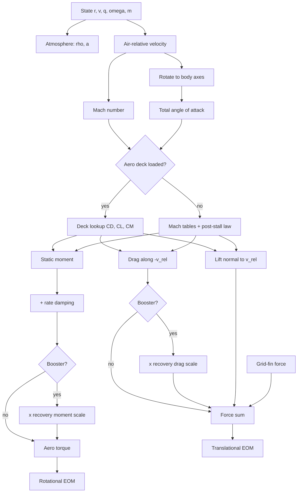
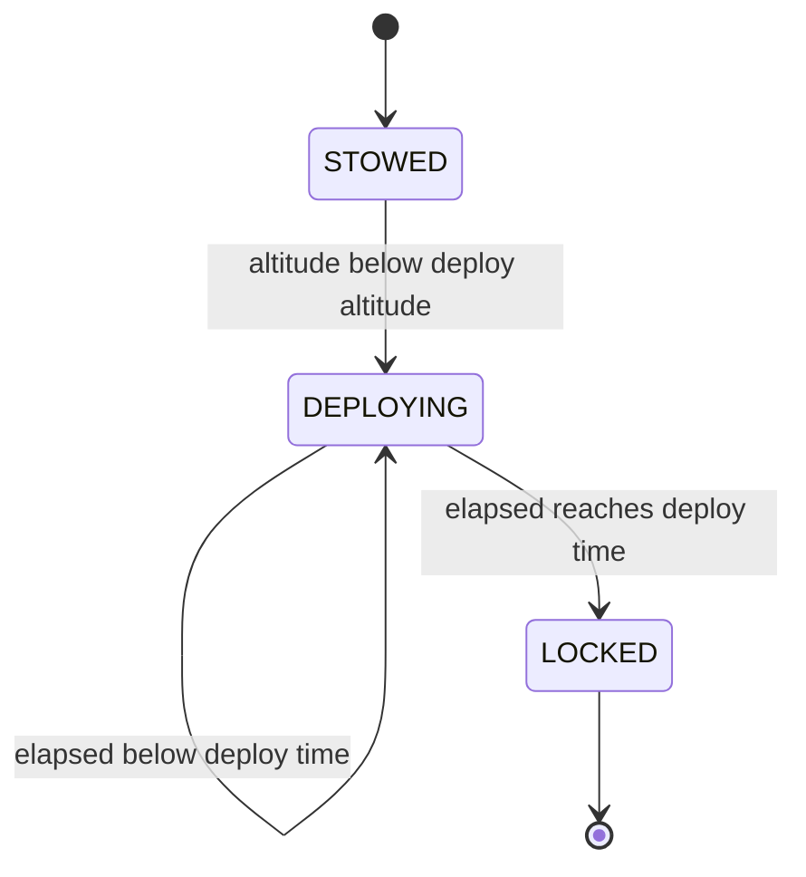
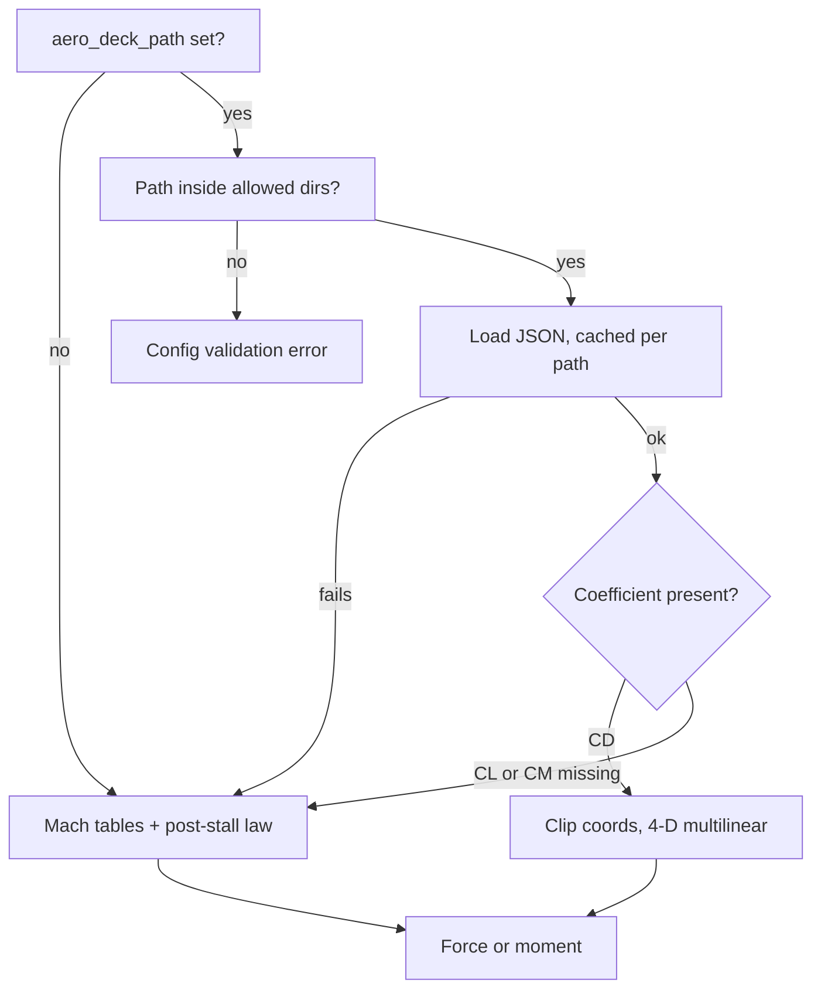

# 4. Aerodynamics, recovery hardware and aerothermal heating

> This chapter covers the aerodynamic forces and moments on all three vehicle
> models (stacked ascent vehicle, recovered booster, orbiter): drag, lift,
> the static pitching/yawing moment from the centre-of-pressure (CP) offset,
> rate damping, the booster's recovery-configuration drag and moment
> multipliers, explicit grid-fin forces, landing-leg deployment and touchdown
> gates, and the stagnation-point heating estimate. Coefficients come either
> from built-in Mach tables or from a tabular aerodynamic deck (bundled,
> derived from geometry, or imported by the user). The force equations are
> textbook forms. **None of the coefficients come from wind-tunnel, CFD
> or flight test data for this vehicle.** The one exception is an optional
> descent drag multiplier, which has been fitted to Falcon 9 webcast
> telemetry but is not on by default. Fidelity is engineering level: good
> enough for trajectory and guidance studies, not for loads or
> aerothermal design.

All paths below are relative to `backend/rlv_sim/`.

## 4.1 Role in the simulation

Each RK4 stage evaluation (`physics/integrators.py`) calls
`physics/dynamics.py`, which:

- builds the translational force sum through
  `_compute_force_breakdown` (`physics/forces.py:1108`): gravity + thrust +
  drag + lift + grid-fin force;
- adds the aerodynamic torque `compute_aerodynamic_moment`
  (`physics/forces.py:911`, called at `physics/dynamics.py:285`) to the
  control torque in Euler's equation. For the booster, this torque is
  multiplied by the recovery moment scale (`physics/dynamics.py:294`).

Once per guidance step (not per RK4 stage), `mission/step.py:172`
(`_run_booster_hardware`) computes the grid-fin command
(`vehicle/recovery_hardware.py:115`) and advances the landing-leg state
(`vehicle/recovery_hardware.py:85`). The grid-fin command is then frozen in
the `DynamicsContext` for the integration step (`mission/step.py:849`). The
recovery "aero mode" is the mission phase name (`BOOSTER_COAST`,
`BOOSTER_ENTRY`, `BOOSTER_LANDING`, … or `S2_ENTRY`/`S2_LANDING` for the
orbiter) (`mission/step.py:827`).

All aerodynamics is switched off above `AERO_DISABLE_ALTITUDE` = 120 km
(`core/constants.py:321`; `physics/forces.py:1151`,
`physics/dynamics.py:284`). It is also switched off when
`enable_atmosphere` is false, or when both `enable_drag` and `enable_lift`
are false. Heating is computed only for telemetry (`outputs/telemetry.py:38`)
and does not feed back into the dynamics.

## 4.2 Relative wind, Mach number, angle of attack

**Physical idea.** Aerodynamic loads depend on the vehicle's velocity
relative to the air mass. The air co-rotates with the Earth and also carries
a wind. Because the body is axisymmetric, only the *total* incidence between
the body axis and the relative wind matters. Sideslip is not modelled
separately.

**Equations.**

$$
\mathbf{v}_{rel} = \mathbf{v} - \boldsymbol{\omega}_\oplus \times \mathbf{r} - \mathbf{v}_{wind}(h),
\qquad
M = \frac{\lVert \mathbf{v}_{rel} \rVert}{\max(a, 1)}
$$

(`core/utils.py:95-105`; Mach at `physics/forces.py:655`, `:695`, `:946`).
$\boldsymbol{\omega}_\oplus = [0,0,7.2921159\times10^{-5}]$ rad/s, and $a$ is
the speed of sound from the atmosphere model (chapter on atmosphere). The
wind is a power-law mean profile,
$V_w = 30\,(h/10\,\text{km})^{0.2}$ m/s plus the runtime offset and the
optional wind modes, faded to zero below 5 km with a smoothstep. It blows
along azimuth 90° (`core/utils.py:67-92`, `core/constants.py:324-327`).

With $\mathbf{R}$ the body-to-ECI rotation matrix,
$\mathbf{v}_b = \mathbf{R}^T\mathbf{v}_{rel} = [v_x, v_y, v_z]$, and

$$
\alpha = \operatorname{atan2}\!\left(\sqrt{v_x^2+v_y^2},\ \max(|v_z|, 10^{-9})\right) \in [0, \tfrac{\pi}{2}],
\qquad
\hat{\mathbf{u}}_t = \frac{[v_x, v_y, 0]}{\sqrt{v_x^2+v_y^2}}
$$

(`physics/forces.py:697-702`, `:938-953`). The absolute value of $v_z$
makes $\alpha$ the incidence measured from the nearer end of the body axis.
Nose-first ($v_z>0$) and tail-first ($v_z<0$) flight at the same lateral
inclination therefore give the same $\alpha$, and the sign of $v_z$
selects the CP geometry (Section 4.6). $\hat{\mathbf{u}}_t$ is the
transverse direction of the relative wind in body axes. When
$\sqrt{v_x^2+v_y^2} < 10^{-6}$ m/s it defaults to body $+x$ with
$\alpha = 0$. Sideslip $\beta$ is always passed as 0
(`physics/forces.py:705`, `:962`, `:1162`).

**Force decomposition.** Drag and lift are formed in **wind axes**: drag
along $-\hat{\mathbf{v}}_{rel}$ and lift normal to it. The moment is formed
in **body axes** from a normal force along $-\hat{\mathbf{u}}_t$. The code
does not convert between the two ($C_L = C_N\cos\alpha - C_A\sin\alpha$).
The lift and moment paths also use different normal-force slopes and
ceilings (Sections 4.4 and 4.6).

**Common guards.** Every aero function returns zero when
$\rho < $ `DENSITY_FLOOR` $=10^{-12}$ kg/m³, or when the inertial or
ground-relative speed, or $\lVert\mathbf{v}_{rel}\rVert$, is below
`SMALL_VELOCITY_TOL` $=10^{-5}$ m/s (`core/constants.py:313-314`).

**Deck-lookup incidence for drag.** In `_compute_force_breakdown`, a drag
lookup from a deck uses an $\alpha$ computed from
$\mathbf{v} - \boldsymbol{\omega}_\oplus\times\mathbf{r}$ *without wind*
(`physics/forces.py:1164-1170`). Lift and moment include wind. Without a
deck, drag does not depend on $\alpha$.

Classification: *Standard* kinematics. The wind profile is a *project
heuristic*.

## 4.3 Drag

**Physical idea.** Drag is the axial-flow resistance along the relative
wind. Its coefficient depends on Mach number, and on angle of attack only
when a deck is used.

**Equation** (`physics/forces.py:623-666`):

$$
\mathbf{F}_D = -\tfrac12 \rho\, C_D\, S_{ref}\, \lVert\mathbf{v}_{rel}\rVert^2\, \hat{\mathbf{v}}_{rel}
$$

with $C_D = \operatorname{interp}(M;\ \texttt{MACH\_BREAKPOINTS}, \texttt{CD\_VALUES})$
(numpy linear interpolation, held constant beyond the end points). When a
deck is loaded, $C_D = \texttt{deck.CD}(M, \alpha, 0, \delta_{fin})$
instead. The reference area is
$S_{ref} = \pi d^2/4$ from `vehicle_diameter_m`
(`config/definition.py:439-441`), or the constant `REFERENCE_AREA` if no
config is present.

For the booster, $\mathbf{F}_D$ is then multiplied by the recovery drag
scale (Section 4.8). For the orbiter in `S2_ENTRY`/`S2_LANDING`, it is
multiplied by `s2_entry_drag_scale` (`physics/forces.py:1195-1197`).

**Built-in Mach table** (`core/constants.py:283-287`):

| $M$ | 0.0 | 0.8 | 1.05 | 1.3 | 2.0 | 5.0 | 10.0 | 25.0 |
|---|---|---|---|---|---|---|---|---|
| $C_D$ (`CD_VALUES`) | 0.42 | 0.42 | 0.75 | 0.65 | 0.50 | 0.35 | 0.25 | 0.20 |
| $C_{L\alpha}$ (`CL_ALPHA_VALUES`, 1/rad) | 2.0 | 2.0 | 1.8 | 1.6 | 1.2 | 0.8 | 0.6 | 0.4 |

**Parameters**

| Symbol | Config field / constant | Default | Unit | Meaning |
|---|---|---|---|---|
| $d$ | `vehicle_diameter_m` | 3.7 | m | reference diameter |
| $S_{ref}$ | `reference_area_m2` (derived) / `REFERENCE_AREA` | 10.752 / 10.75 | m² | reference area |
| — | `aero_deck_path` | `None` | — | deck file; `None` selects the Mach tables |
| — | `enable_drag`, `enable_atmosphere` | true | — | switches |
| $k_{S2}$ | `s2_entry_drag_scale` | 45.0 | — | orbiter entry/landing drag multiplier (must be ≥ 1) |

Classification: the drag law is *Standard* (e.g. Anderson [1]). The
$C_D(M)$ table is a *project heuristic* with no external source, a generic
launch-vehicle shape with a transonic peak. `s2_entry_drag_scale` = 45 is a
*project heuristic*. It stands in for an unmodelled upper-stage entry
configuration and has no physical derivation in the code.

**Validity limits.** There is no Reynolds-number dependence, and no
plume–base interaction except the booster entry factor. The table extends to
Mach 25 but is not data-backed anywhere. Section 4.8 shows the table over-
predicts booster descent drag near Mach 1 by about 2× once the recovery
multipliers are included.

## 4.4 Lift (normal force in wind axes)

**Physical idea.** At incidence, the body produces a force normal to the
relative wind. The force is linear in $\alpha$ at small angles and is held
to a bounded value after stall.

**Equations** (`physics/forces.py:669-745`):

$$
\mathbf{F}_L = \bar q\, S_{ref}\, C_L\, \hat{\mathbf{l}},\qquad
C_L = C_N^{ps}\!\left(\alpha;\ C_{L\alpha}(M),\ C_{max}=1.2\right)
$$

where $C_N^{ps}$ is the post-stall law of Section 4.5. If a deck containing
`CL` is loaded, then $C_L = \texttt{deck.CL}(M, \alpha_{deg}, 0, 0)$. The
fin-deflection argument is never passed on this path.

The lift direction is the projection of body $+z$ onto the plane normal to
$\mathbf{v}_{rel}$, with its sign reversed for tail-first flow:

$$
\hat{\mathbf{l}} = \operatorname{sgn}(v_z)\,
\frac{(\mathbf{v}_{rel}\times\hat{\mathbf{z}}_b)\times\mathbf{v}_{rel}}
{\lVert(\mathbf{v}_{rel}\times\hat{\mathbf{z}}_b)\times\mathbf{v}_{rel}\rVert}
$$

For nose-first flow this equals the projection of the body normal force
$-\hat{\mathbf{u}}_t$ onto the plane normal to $\mathbf{v}_{rel}$. The sign
flip at `:743-744` keeps the force consistent with the moment model in
tail-first flight. Lift is zero when
$\lVert\mathbf{v}_{rel}\times\hat{\mathbf{z}}_b\rVert < 10^{-4}\lVert\mathbf{v}_{rel}\rVert$
($\alpha \lesssim 10^{-4}$ rad).

Classification: the slender-body normal force is *Standard* in form
(Munk [2]: $C_{N\alpha} = 2$ /rad for a body of revolution). The Mach
schedule `CL_ALPHA_VALUES` and the 1.2 ceiling are *project heuristics*.

**Known issue.** The lift path uses $C_{L\alpha}(M)$ = 2.0–0.4 /rad and a
1.2 ceiling. The moment path (Section 4.6) uses the constant `C_N_ALPHA` =
4.0 /rad and a 1.6 ceiling. The normal force that generates the moment is
therefore up to 2× (subsonic) to 10× (Mach 25) larger than the normal force
applied to the trajectory.

## 4.5 Post-stall normal-force law

**Physical idea.** Linear slender-body theory overpredicts normal force at
large incidence. Above stall onset, the coefficient is blended smoothly and
monotonically to a fixed ceiling, which it then holds up to 90° (broadside).
An earlier form was non-monotone and produced negative aerodynamic stiffness
in deep stall (`physics/forces.py:263-271`).

**Equations** (`physics/forces.py:252-292`, constants at `:114-115`). With
$\alpha \leftarrow \operatorname{clip}(|\alpha|, 0, \pi/2)$, slope
$k = \max(k,0)$, ceiling $C_{max} = \max(C_{max},0)$,
$\alpha_s = 20°$, $\alpha_f = 45°$:

$$
C_N^{ps} =
\begin{cases}
\operatorname{clip}(k\alpha,\ 0,\ C_{max}) & \alpha \le \alpha_s\\[4pt]
\operatorname{clip}\!\big(k\alpha_s + (C_{max} - k\alpha_s)\, s(b),\ 0,\ C_{max}\big) & \alpha > \alpha_s
\end{cases}
\qquad
b = \operatorname{clip}\!\left(\frac{\alpha-\alpha_s}{\alpha_f-\alpha_s},0,1\right),\ s(b) = b^2(3-2b)
$$

Sample values (computed from the code):

| $\alpha$ (deg) | 10 | 20 | 25 | 30 | 45 | ≥ 45 |
|---|---|---|---|---|---|---|
| moment path ($k=4$, $C_{max}=1.6$) | 0.698 | 1.396 | 1.417 | 1.468 | 1.600 | 1.600 |
| lift path, $M<0.8$ ($k=2$, $C_{max}=1.2$) | 0.349 | 0.698 | 0.750 | 0.875 | 1.200 | 1.200 |

When $k\alpha_s > C_{max}$ (e.g. $k > 4.58$ with $C_{max}=1.6$), the
pre-stall branch is clipped to $C_{max}$ and the post-stall branch blends
downward toward $C_{max}$. The final clip keeps the curve flat at
$C_{max}$, so it stays monotone. A warning is logged once per process the
first time the moment path sees $\alpha > 20°$ (`physics/forces.py:954-959`).

Classification: *Project heuristic*. The behaviour is qualitatively that of
viscous cross-flow, but this is **not** the Allen–Perkins
$C_{N} = C_{N\alpha}\alpha + \eta C_{d_c}\sin^2\alpha\,(S_p/S)$ cross-flow
model [3]. The stall angles and ceilings have no external source.

## 4.6 Static aerodynamic moment and centre of pressure

**Physical idea.** The normal force acts at the centre of pressure. Its
lever arm about the CG produces a pitching/yawing moment. The moment is
destabilising when the CP lies between the CG and the leading end of the
body, and restoring when the CP lies behind the CG relative to the flow.

**Analytic branch** (no deck, or a deck without `CM`;
`physics/forces.py:984-1013`). Positions $z$ are measured along body $+z$
from the vehicle base:

$$
F_N = \bar q\, S_{ref}\, C_N^{ps}(\alpha;\ \texttt{C\_N\_ALPHA}=4,\ 1.6),\qquad
\mathbf{F}_{N,b} = -F_N\,\hat{\mathbf{u}}_t
$$

$$
\boldsymbol{\tau}_{static} = [0,0,\,z_{cp,eff} - z_{cg}] \times \mathbf{F}_{N,b}
= -F_N\,(z_{cp,eff}-z_{cg})\,(\hat{\mathbf{z}}\times\hat{\mathbf{u}}_t)
$$

A positive torque about $\hat{\mathbf{z}}\times\hat{\mathbf{u}}_t$ turns the
nose toward the relative wind, which reduces $\alpha$ in nose-first flight.

- $z_{cg}$ comes from `physics/mass.py:138` (stacked: mass-weighted
  stations; booster: `booster_cg_empty_m` 26 m → `booster_cg_full_m` 21 m;
  orbiter: 58 + 5·fill m).
- $z_{cp}$ is **always** `H_CP` = 33 m. `physics/dynamics.py:288` passes
  `cp_pos_z=C.H_CP` for every vehicle model. For the stacked vehicle this
  places the CP ahead of the CG, which is the "aerodynamically unstable
  launcher" case the TVC loop must fight. For the orbiter the CP (33 m) is
  25–30 m behind its CG, so the orbiter is strongly statically stable.
- **Tail-first booster** (`physics/forces.py:1005-1009`). When
  $v_z < -10^{-5}$ m/s and $z_{cg} \le$ `STAGE1_RECOVERY_CP` + 1 = 32 m
  (the gate that identifies the booster):

$$
z_{cp,eff} = (1-\sin^2\alpha)\,z_{tail} + \sin^2\alpha\,\min(z_{cp}, z_{tail}),\qquad z_{tail} = \texttt{booster\_tail\_first\_cp\_z\_m}
$$

  With the defaults ($z_{cp}=33$, $z_{tail}=31$), $\min(z_{cp},z_{tail}) = z_{tail}$,
  so the blend is a no-op and $z_{cp,eff} = 31$ m at every $\alpha$. The
  blend only has an effect when $z_{tail} > 33$ m. With $z_{cg}$ = 21–26 m,
  the CP lies 5–10 m *above* the CG. In tail-first flow the base leads, so
  the CP is behind the CG relative to the flow and the torque is
  **restoring**: the booster weathervanes engines-first. In nose-first
  booster flight (e.g. boostback), the CP is the stack value of 33 m.

**Deck branch** (deck containing `CM`; `physics/forces.py:966-983`):

$$
\boldsymbol{\tau}_{static} = \bar q\, S_{ref}\, d\; C_M(M,\alpha_{deg},0,0)\;
\frac{\hat{\mathbf{z}}\times\hat{\mathbf{u}}_t}{\lVert\hat{\mathbf{z}}\times\hat{\mathbf{u}}_t\rVert}
$$

If $\hat{\mathbf{z}}\times\hat{\mathbf{u}}_t$ degenerates, the axis falls
back to $\hat{\mathbf{z}}$. The deck $C_M$ is used as given and is
independent of the actual CG.

**Sign convention (important for imported decks).** Comparing the two
branches, a **positive** deck $C_M$ produces a torque along
$+\hat{\mathbf{z}}\times\hat{\mathbf{u}}_t$, which turns the nose toward
the wind and is **restoring**. Since the deck is only ever queried at
$\alpha \ge 0$, a deck with conventional static stability
($C_{m\alpha}<0$, so $C_M<0$ at $\alpha>0$) is applied here as a
*destabilising* moment. The code comment at `physics/forces.py:980-982`
says "positive Cm is destabilizing", which contradicts the algebra. The
geometry-derived deck (Section 4.10) stores $C_M = -0.5\,C_N$. In this
simulator that is a CP 0.5 calibres ahead of the reference, i.e.
destabilising. That is consistent with the analytic branch, but
`aero/validation.py:107` describes it as "static stability". Users who
import CFD/tunnel $C_M$ in standard aircraft convention should check this
sign.

**Parameters**

| Symbol | Config field / constant | Default | Unit | Meaning |
|---|---|---|---|---|
| $C_{N\alpha}$ | `C_N_ALPHA` | 4.0 | 1/rad | moment-path normal-force slope |
| $z_{cp}$ | `H_CP` | 33.0 | m from base | CP, all vehicles (nose-first) |
| $z_{tail}$ | `booster_tail_first_cp_z_m` | 31.0 (`STAGE1_RECOVERY_CP`) | m from base | booster tail-first CP |
| — | `STAGE1_RECOVERY_CP` + 1 | 32.0 | m | CG gate that identifies the booster |
| $z_{cg}$ | `booster_cg_full_m` / `booster_cg_empty_m` | 21.0 / 26.0 | m from base | booster CG range |

Classification: the moment law is *Standard* (rigid-body statics). All CP
locations, the slope and the ceiling are *project heuristics*. They are not
derived from geometry. The geometry module's own $C_{N\alpha}$ is 2–6 /rad,
not 4.

## 4.7 Aerodynamic rate damping

**Physical idea.** A body rotating in pitch or yaw sees a local incidence
change along its length, which opposes the rotation.

**Equation** (`physics/forces.py:1015-1021`), added to the transverse
components only:

$$
\tau_{x,y} \mathrel{+}= C_{m_q}\,\bar q\,S_{ref}\,\frac{d^2}{2\max(V_{rel},1)}\;\omega_{x,y},
\qquad C_{m_q} = \texttt{C\_M\_DAMPING} = -8.0
$$

This is the usual non-dimensional form
$\tau = C_{m_q}\,\bar q S d\,(\omega d/2V)$ (Etkin & Reid [4]). Roll is not
damped aerodynamically. Damping is applied whenever $\boldsymbol{\omega}$ is
supplied, with or without a deck. For the booster, the damping torque is also
multiplied by the recovery moment scale (Section 4.8), because the scale
multiplies the total `tau_aero`.

Classification: *Standard* form. The value −8 is a *project heuristic*;
measured or computed $C_{m_q}$ for this vehicle is not available.

## 4.8 Booster recovery drag and moment scaling

**Physical idea.** Deployed grid fins and landing legs add parasitic drag,
and the entry-burn plume enlarges the effective base. This model represents
those effects as multipliers on the body drag and on the aerodynamic torque.

**Equations** (`physics/forces.py:1029-1105`). Deployment fractions are
**inferred from the phase name**, because no caller passes the actual
hardware state (`physics/forces.py:1192`, `physics/dynamics.py:294`,
`guidance/recovery.py:379`):

| Phase | $f_{gf}$ | $f_{leg}$ | $k_{plume}$ |
|---|---|---|---|
| `BOOSTER_COAST` | 0.5 | 0 | 1.0 |
| `BOOSTER_ENTRY` | 1.0 | 0 | 1.3 |
| `BOOSTER_LANDING` | 1.0 | 1.0 | 1.0 |
| other (flip, boostback) | 0 | 0 | 1.0 |

$$
k_D = \operatorname{clip}\!\left(\frac{(S_{ref} + A_{gf} f_{gf} C_{D,gf} + n_{leg}A_{leg} f_{leg} C_{D,leg})\,k_{plume}}{S_{ref}}\cdot k_{fit},\ 1,\ 8\right)
$$

$$
k_M = \operatorname{clip}\!\left((1 + 2.5 f_{gf})\cdot(1.2 \text{ if ENTRY else } 1),\ 1,\ 6\right)
$$

$k_{fit}$ = `booster_descent_drag_scale` is applied only in ENTRY and LANDING.
The booster drag force becomes $k_D\,\mathbf{F}_D$
(`physics/forces.py:1190-1193`), and the aerodynamic torque becomes
$k_M\,\boldsymbol{\tau}_{aero}$. The same $k_D$ is used by the impact
predictor in `guidance/recovery.py:379`.

Values with the default configuration:

| Phase | $k_D$ | $k_M$ |
|---|---|---|
| `BOOSTER_COAST` | 1.89 | 2.25 |
| `BOOSTER_ENTRY` | 3.62 | 4.20 |
| `BOOSTER_LANDING` | 2.90 | 3.50 |

The grid-fin term (16 m² × 1.2 = 19.2 m² of drag area) is about 1.8× the
body's own reference area, so it dominates $k_D$.

**Parameters**

| Symbol | Config field / constant | Default | Unit | Meaning |
|---|---|---|---|---|
| $A_{gf}$ | `grid_fin_drag_area_m2` | 16.0 (= 4 × 4.0) | m² | total grid-fin drag area |
| $C_{D,gf}$ | `GRID_FIN_CD` | 1.2 | — | grid-fin drag coefficient |
| $n_{leg}, A_{leg}$ | `LANDING_LEG_COUNT`, `LANDING_LEG_AREA_M2` | 4, 0.3 | –, m² | leg count and area |
| $C_{D,leg}$ | `LANDING_LEG_CD` | 1.0 | — | leg drag coefficient |
| $k_{plume}$ | literal | 1.3 | — | entry-plume base-area factor |
| $k_{fit}$ | `booster_descent_drag_scale` | 1.0 | — | flight-data calibration (must be > 0) |

Constants: `core/constants.py:330-335`; config:
`config/definition.py:301`, `:394`.

**Fit to Falcon 9 telemetry** (`validation/drag_fit.py`,
`docs/VALIDATION_DRAG.md`). In the unpowered window between entry-burn
cutoff and landing-burn ignition (excluding 3 s at each end, $V>100$ m/s,
$\bar q > 500$ Pa), the real booster's drag deceleration is estimated as

$$
\frac{D}{m} = g_0\,\frac{-v_y}{V} - \frac{dV}{dt},\qquad (C_D A)_{real} = \frac{D/m}{\bar q}\, m_{assumed}
$$

(`validation/drag_fit.py:39-58`). Here $\bar q$ comes from the simulator's
US-76 model and $m_{assumed}$ = 26 000 kg ± 15 %. The data are webcast
telemetry of NROL-76, CRS-11 and Zuma. The simulated $C_DA$ is drag force /
$\bar q$ from the default mission below 40 km in ENTRY/LANDING. Both are
binned at Mach 0.9/1.2/1.5/2.0/2.5, and the fit is the median of the bin
ratios. Result: real/sim = 0.45, 0.60, 0.76, 0.89 per bin, giving
**$k_{fit}$ = 0.68 (0.58–0.78)**. The fitted value is **not** the default;
the documented reason is that landing Monte Carlo success falls from 94 % to
86 % with it. The residual Mach trend (2× too much drag near Mach 1) cannot
be removed by a single scalar.

Classification: the area build-up is *Standard* in form (drag areas add;
Hoerner [5]). Every coefficient and multiplier (0.5 coast deployment, 1.3
plume, 2.5 and 1.2 moment factors, clip bounds) is a *project heuristic*.
$k_{fit}$ is *Published data* (public webcast telemetry) under an assumed
mass.

**Validity limits.** The fin and leg drag share the body's $C_D(M)$ shape
(`physics/forces.py:1085-1090`). The deployment fractions ignore
`enable_grid_fins`, `enable_landing_legs`, the actual grid-fin deploy
altitude and the leg state. The 1.3 plume factor applies for the whole ENTRY
phase, whether or not the engines are burning. $k_M$ scales the CP moment
and the damping alike, which is not a physical CP shift. The lower clip at
1 means $k_{fit}<1$ cannot reduce drag below the bare body.

## 4.9 Grid fins and landing legs

### 4.9.1 Grid-fin command (deflection and deployment)

**Physical idea.** Below a deploy altitude, the grid fins steer the falling
booster toward the pad. A zero-effort-miss/zero-effort-velocity (ZEM/ZEV)
law gives the desired horizontal acceleration. The fin deflection is that
acceleration as a fraction of the fins' maximum aerodynamic authority.

**Equations** (`vehicle/recovery_hardware.py:115-214`). The command is zero
if `enable_grid_fins` is false or $h >$ `grid_fin_deploy_altitude_m`.
Otherwise the fins are fully deployed, $f_{gf}=1$, at once: there is no
deployment transient. Horizontal quantities are projected onto the local
horizontal plane. With $t_{go}$ = the guidance value clipped to [2, 180] s,
or else $\min(h/\max(-v_{vert},1), 60)$ floored at 2 s:

$$
\mathbf{ZEM} = \mathbf{r}_{site,h} - \mathbf{v}_{g,h}\,t_{go}\ \text{(or guidance-supplied, projected)},\qquad
\mathbf{a}_{des} = \frac{6}{t_{go}^2}\mathbf{ZEM} + \frac{2}{t_{go}}\mathbf{v}_{g,h}
$$

For the locally formed ZEM this equals the standard ZEM/ZEV law with zero
terminal velocity, $\mathbf{a} = 6\mathbf{r}_{site,h}/t_{go}^2 - 4\mathbf{v}_{g,h}/t_{go}$.

$$
a_{max} = \frac{\bar q\, A_{fin}\, C_{L,max}}{m},\qquad
f_\delta = \begin{cases}1 & \rho<10^{-12},\ V<10^{-5},\ \text{or } a_{max}<0.5\ \text{m/s}^2\\ \min(\lVert\mathbf{a}_{des}\rVert/a_{max}, 1) & \text{otherwise}\end{cases}
$$

$m$ defaults to 40 000 kg when it is not passed. The pitch and yaw commands
are $f_\delta\,\delta_{max}$ times the components of
$\hat{\mathbf{a}}_{des}$ along an "east-like" axis and a "north-like" axis.
The east-like axis points toward the site, or along the horizontal ground
velocity when the site is within 100 m. Each command is clipped to
$\pm\delta_{max}$. The command is flagged saturated when either command
clips or $f_\delta \ge 1$.

### 4.9.2 Grid-fin force

**Equation** (`vehicle/recovery_hardware.py:217-270`):

$$
\delta_n = \min\!\left(1, \frac{\sqrt{\delta_p^2+\delta_y^2}}{\delta_{max}}\right),\qquad
\mathbf{F}_{gf} = \bar q\,A_{fin}\,\delta_n f_{gf}\left[C_{L,max}\,\hat{\mathbf{a}}_{des} - \Delta C_{D}\,\hat{\mathbf{v}}_{rel}\right]
$$

The force is added to the translational sum for the booster whenever a
command exists (`physics/forces.py:1199-1210`).

**Implementation notes.** The attitude quaternion is discarded
(`del q`). The "lift" points exactly along the commanded horizontal
direction, whatever the vehicle attitude or the fin hinge geometry. The fins
therefore act as an ideal lateral force actuator. They produce **no
explicit moment**; their effect on rotation enters only through $k_M$
(Section 4.8). The fin drag is counted twice: once as parasitic area in
$k_D$ (16 m², $C_D$ 1.2) and once as $\Delta C_D$ on `grid_fin_area_m2`
here (8 m², 0.08). The two area fields also differ (16 vs 8 m²). If an aero
deck with a fin axis is used, the deck "fin" coordinate is computed as
`np.degrees(hypot(pitch_cmd_deg, yaw_cmd_deg))` (`physics/forces.py:1171-1177`).
The commands are already in degrees, so this lookup coordinate is 57.3×
too large. Bundled and imported decks have a single fin point, so this has
no effect today.

**Parameters** (`config/definition.py:298-303`)

| Symbol | Config field | Default | Unit | Meaning |
|---|---|---|---|---|
| — | `enable_grid_fins` | true | — | switch |
| $h_{gf}$ | `grid_fin_deploy_altitude_m` | 70 000 | m | deploy altitude |
| $\delta_{max}$ | `grid_fin_max_deflection_deg` | 25.0 | deg | deflection limit |
| $A_{fin}$ | `grid_fin_area_m2` | 8.0 | m² | lifting area |
| $C_{L,max}$ | `grid_fin_cl_max` | 1.2 | — | lift coefficient at full deflection |
| $\Delta C_D$ | `grid_fin_cd_increment` | 0.08 | — | drag increment at full deflection |

Classification: ZEM/ZEV is *Published* guidance (covered in the recovery
guidance chapter). The fin force model is a *project heuristic*, a
flat-plate-like lift with authority linear in deflection. The model card
(`outputs/model_card.py`) notes that it is optimistic compared with a real
lattice fin, whose transonic choking is not modelled.

### 4.9.3 Landing legs

**Deployment** (`vehicle/recovery_hardware.py:85-112`). If
`enable_landing_legs` is false, the state is always `STOWED`. Otherwise,
once $h \le$ `landing_leg_deploy_altitude_m`, elapsed time accumulates
each guidance step and the deployed fraction is
$f_{leg} = \operatorname{clip}(t_{el}/t_{deploy}, 0, 1)$. The status is
`DEPLOYING` until $f_{leg}=1$ and `LOCKED` after that. `LOCKED` and
`FAILED` are absorbing, but no code path ever sets `FAILED`. Climbing back
above the deploy altitude pauses deployment.

**Drag.** The leg drag in Section 4.8 is driven by the phase
(`BOOSTER_LANDING`), not by $f_{leg}$.

**Touchdown gates** (`vehicle/recovery_hardware.py:273-372`), applied in
this order: legs enabled and not `LOCKED` → `leg_deployment_failure`;
$|\text{tilt}| >$ `landing_leg_max_tilt_deg` → `tipover`. Otherwise the
ground-relative speed $V_{td}$ is classed as follows: $\le V_{max}$ →
success, or offsite if the site error exceeds `booster_pad_tolerance_m`;
$< \max(10, 2V_{max})$ → hard landing; otherwise crash.

| Config field | Default | Unit | Meaning |
|---|---|---|---|
| `enable_landing_legs` | true | — | switch |
| `landing_leg_deploy_altitude_m` | 1500 | m | deploy altitude |
| `landing_leg_deploy_time_s` | 3.0 | s | time to lock |
| `landing_leg_max_touchdown_speed_mps` | 6.0 | m/s | $V_{max}$ |
| `landing_leg_max_tilt_deg` | 15.0 | deg | tip-over limit |

Classification: *Project heuristic* (logic and thresholds).

## 4.10 Tabular aerodynamic decks

### 4.10.1 Deck format and lookup

A deck is JSON with `axes` (`mach`, `alpha` [deg], `beta` [deg], `fin`
[deg], each strictly increasing) and `coefficients` (`CD` required; `CL`,
`CM` optional). Each coefficient is an array of shape
$n_M\times n_\alpha\times n_\beta\times n_{fin}$
(`aero/database.py:29-45`, `aero/deck_import.py:66-92`).

**Interpolation** (`aero/database.py:47-103`): 4-D multilinear
interpolation over the enclosing hypercube.

$$
C(\mathbf{x}) = \sum_{i=0}^{15}\ \prod_{k=1}^{4} w_k^{(b_k(i))}\; C\big[j_1^{(b_1)}, j_2^{(b_2)}, j_3^{(b_3)}, j_4^{(b_4)}\big],
\qquad w^{(1)}_k = \frac{x_k - x_{k,j}}{x_{k,j+1}-x_{k,j}},\ w^{(0)}_k = 1-w^{(1)}_k
$$

Each coordinate is first clipped to its axis range, so values beyond the
grid are held constant and there is no extrapolation. An axis of length 1
uses weight (1, 0) on its single point. A missing coefficient returns
`None`, and the caller then uses the analytic model for that coefficient
(`physics/forces.py:712`, `:966`). Because $\alpha \ge 0$ always, the
negative-$\alpha$ half of a deck is never sampled. Decks are cached per path
(`physics/forces.py:589-611`). `aero_deck_path` must be a `.json` file
directly inside `aero/decks/` or the user aero directory
(`config/definition.py:19-50`). A deck that fails to load logs an exception,
and the simulation falls back to the analytic model.

### 4.10.2 Geometry-derived deck (`aero/geometry.py`)

This is a closed-form **body-alone** build-up: no fins, no boattail, no
interference terms. It is evaluated on the `MACH_BREAKPOINTS` grid and on
$\alpha \in \{-20,-10,-5,0,5,10,20\}°$, with singleton $\beta$ and fin
axes (`aero/geometry.py:139-206`). The bundled `aero/decks/geometry_deck.json`
equals the output of `generate_geometry_aero_deck()` with defaults
($d$ = 3.7 m, $L$ = 47 m, nose fineness 3). It is **not** the default aero
model: it is used only when `aero_deck_path` selects it.

With $S_{ref} = \pi d^2/4$ and base area $=S_{ref}$:

$$
C_D = \underbrace{\frac{0.455}{(\log_{10}Re)^{2.58}}\,\frac{1}{(1+0.144M^2)^{0.65}}\,\frac{\pi d L}{S_{ref}}}_{\text{skin friction}}
+ \underbrace{\begin{cases}0.12+0.13M^2 & M\le1\\ 0.25/M & M>1\end{cases}}_{\text{base}}
+ \underbrace{C_{D,w}(M)}_{\text{nose wave}}
$$

(`aero/geometry.py:48-64`, `:107-116`). $Re = 3\times10^8$ is fixed
(`:45`). The wetted area is the full cylinder $\pi d L$, without a nose
correction.

$$
C_{D,w} = \begin{cases}
0 & M<0.8\\
P\,e^{-((M-1.05)/0.35)^2} & 0.8\le M<1.2\\
P\,e^{-(0.15/0.35)^2}\,(1.2/M)^2 & M\ge1.2
\end{cases},\qquad P = \frac{1.7}{\max(f_n,1)^2}
$$

(`aero/geometry.py:67-83`). This term is discontinuous at $M = 0.8$ (it
jumps from 0 to about 0.03 for $f_n$ = 3).

$$
C_{N\alpha} = \begin{cases}\min\!\big(2/\sqrt{\max(1-M^2,0.05)},\,6\big) & M<0.85\\ 6 & 0.85\le M\le1.15\\ \min\!\big(2/\sqrt{\max(M^2-1,0.05)},\,6\big) & M>1.15\end{cases},\quad
C_L = C_{N\alpha}\sin\alpha\cos\alpha,\quad C_M = -0.5\,C_L
$$

(`aero/geometry.py:86-136`). The stored "CL" is a normal-force
coefficient, but the simulator applies it as lift normal to
$\mathbf{v}_{rel}$. $C_M$ assumes a CP 0.5 calibres ahead of the moment
reference (see the sign note in Section 4.6). Sample values at $\alpha = 0$
and 5°:

| $M$ | 0 | 0.8 | 1.05 | 1.3 | 2 | 5 | 10 | 25 |
|---|---|---|---|---|---|---|---|---|
| $C_D$ | 0.213 | 0.405 | 0.512 | 0.407 | 0.251 | 0.094 | 0.043 | 0.015 |
| $C_L(5°)$ | 0.174 | 0.289 | 0.521 | 0.209 | 0.100 | 0.035 | 0.018 | 0.007 |

Classification and sources:

- The incompressible turbulent skin friction $0.455/(\log_{10}Re)^{2.58}$ is
  the Prandtl–Schlichting formula [6] (*Published*). The code attributes the
  compressibility factor $(1+0.144M^2)^{-0.65}$ to Sommer & Short (1955) [7].
  That attribution has not been checked against the original report here.
- The base-drag correlation is the one used in the OpenRocket aerodynamic
  model [8], which in turn draws on Hoerner [5] (*Published*).
- The nose wave-drag Gaussian bump and its $1/f_n^2$ scaling are a
  *project heuristic*. The code calls this "the qualitative shape used by
  Barrowman-derived methods", but no Barrowman [9] equation is implemented.
- $C_{N\alpha}=2$ /rad is Munk's slender-body result [2] (*Published*).
  Slender-body theory itself predicts no Mach dependence. The
  $1/\sqrt{|1-M^2|}$ scaling and the 6 /rad transonic clamp are *project
  heuristics* in the style of Prandtl–Glauert/Ackeret (Anderson [1]).
- $L$ = 47 m and $f_n$ = 3 are documented estimates, not configured
  values.

### 4.10.3 User-imported decks (`aero/deck_import.py`)

Users can upload either native JSON or a CSV with columns `mach, alpha_deg,
CD[, CL][, CM]`, one row per grid point (`:38-63`). The grid must be
complete: every (mach, alpha) pair present. $\beta$ and fin are set to
singletons. Blocking validation (`:66-92`) requires: all four axes present
and strictly increasing; at most 20 000 grid points; `CD` present; every
coefficient of the correct shape and finite; and $C_D > 0$ everywhere.
Non-blocking warnings (`:95-108`) flag a lowest Mach > 0.3, a highest
Mach < 5 (beyond it $C_D$ is held), a single $\alpha$, and missing CL/CM.
The deck is saved as `user_<slug>.json`. The import then runs the
deck-interpolation checks (Section 4.12) and reports a comparison of
$C_D(M, 0°)$ against the built-in `CD_VALUES` table at the deck's Mach
points plus {0.5, 0.9, 1.05, 1.3, 2, 3, 5} (`:140-150`).

## 4.11 Aerothermal heating

**Physical idea.** Convective heat flux at a blunt stagnation point grows
with $\sqrt{\rho/R_n}$ and with $V^3$.

**Equation** (`physics/forces.py:295-311`), Sutton–Graves [10]:

$$
\dot q_s = k\,\sqrt{\frac{\rho}{\max(R_n, 0.01)}}\;V_{rel}^3,\qquad k = 1.7415\times10^{-4}\ \text{(SI; Earth air)}
$$

for $\rho > 10^{-12}$ kg/m³ and $V_{rel} > 100$ m/s, and 0 otherwise.
$\dot q_s$ is in W/m². Telemetry evaluates it with
$R_n = $ `REFERENCE_DIAMETER`/2 = 1.85 m and reports `heat_flux` in kW/m²
(`outputs/telemetry.py:37-38`, `:50`). The function default of 1.83 m is not
used. Example: $\rho=10^{-3}$ kg/m³, $V=2000$ m/s gives 32.4 kW/m².

**Skin temperature.** **No skin-temperature model is implemented.** The
telemetry columns `thermal_q_dot_w_m2`, `thermal_wall_temp_k` and
`thermal_heat_load_j_m2` (`mission/models.py:245-247`) are read from guidance
keys that no code sets. They therefore always hold their defaults (0, 300 K,
0). `outputs/model_card.py` and `docs/MATHEMATICAL_REFERENCES.md` §7
describe a "lumped first-order-lag skin temperature"; that description does
not match the code.

Classification: *Published* [10]. Validity: this is a stagnation-point,
convective, cold-wall estimate only. There is no radiative heating, no
re-radiation, no wall-temperature correction and no heat-load integration.
$R_n$ = 1.85 m treats the body radius as the nose radius, which is not
correct for an ogive fairing or for a booster flying engines-first. The value
is diagnostic only and does not feed back into the dynamics.

## 4.12 Verification

**Aero validation tiers** (`aero/validation.py`). These checks cover the
shape of the geometry-derived deck and the deck interpolator. **None of them
compares against wind-tunnel or CFD data**, and none covers the default
Mach tables used in flight.

| Tier | Function | Checks |
|---|---|---|
| 1 – physical sanity | `run_geometry_model_checks` (`:48`) | $C_D>0$ at all breakpoints; $C_D(1.05) > C_D(0.5), C_D(5)$; $C_L$ antisymmetric and zero at $\alpha=0$; $C_L$ monotone over 0–10°; $C_M$ opposite in sign to $C_L$; $C_{N\alpha}(0)=2$ exactly (Munk); $0 < C_{N\alpha} \le 6$ at all probe Machs |
| 1 – interpolator | `run_deck_interpolation_checks` (`:264`) | deck loaded; midpoint value bounded by grid neighbours; exact at a grid point |
| 2 – literature shape | `run_literature_comparison_checks` (`:185`) | peak $C_D$ in Mach 0.9–1.2; rise factor peak/$C_D(0.3)$ in [1.3, 10]; decreasing past the peak to Mach 5; $C_D(0.6) <$ peak; an informational check that a fineness ratio of 3 matches a NACA-tested configuration |

The Tier 2 source strings in the code cite a Wikipedia article on
drag-divergence Mach number, with Anderson [1] mentioned as a general
reference. They also cite NACA RM A53D02, which the code states could not be
read numerically, so it is precedent only. The Tier 2 checks are
qualitative shape checks.

**Unit tests** (`backend/tests/`):

- `test_aero_validation.py`: `test_all_geometry_checks_pass`,
  `test_report_scope_is_labeled`, `test_generated_deck_interpolation_passes`,
  `test_unloaded_deck_reports_failure_not_exception`,
  `test_run_all_checks_includes_deck_checks_when_deck_supplied`,
  `test_all_tier2_checks_pass`, `test_every_check_carries_a_source_citation`,
  `test_report_scope_distinguishes_from_wind_tunnel_data`.
- `test_aero_import.py`: `test_csv_grid_becomes_deck`,
  `test_incomplete_grid_rejected`, `test_nonpositive_cd_rejected`,
  `test_imported_deck_is_saved_compared_and_flies` (a 20 s mission flown on
  an imported deck).
- `test_touchdown_classification.py`: leg-lock, tilt and speed/site gate
  matrix, including `test_3077_mps_touchdown_is_classified_as_crash`.
- `test_research_features.py::test_scales_must_be_positive`: rejects a
  negative `booster_descent_drag_scale`.
- The full-mission regression (`pytest -m slow`) exercises all paths
  end-to-end.

**Gaps.** No unit test directly covers `compute_drag_force`,
`compute_lift_force`, `compute_aerodynamic_moment` (including the tail-first
CP and the deck $C_M$ sign), `compute_post_stall_normal_coefficient`
(monotonicity), `_booster_recovery_aero_scale`, the grid-fin
command/force, `update_landing_leg_state`, or
`compute_aerodynamic_heating`.

**External validation.** Booster descent drag compared with Falcon 9
telemetry (Section 4.8, `docs/VALIDATION_DRAG.md`): the simulator is 1.1–2.2×
too draggy over Mach 0.9–2.5 with default settings.

## 4.13 References

1. J. D. Anderson Jr., *Fundamentals of Aerodynamics*, McGraw-Hill (multiple
   editions). Drag/lift definitions; Prandtl–Glauert and linearized
   supersonic scaling.
2. M. M. Munk, "The Aerodynamic Forces on Airship Hulls", NACA Report 184,
   1924. Slender-body normal-force slope $C_{N\alpha}=2$.
3. H. J. Allen and E. W. Perkins, "Characteristics of Flow over Inclined
   Bodies of Revolution", NACA Report 1048, 1951. Viscous cross-flow (cited
   for contrast; not implemented).
4. B. Etkin and L. D. Reid, *Dynamics of Flight: Stability and Control*,
   Wiley, 3rd ed., 1996. Non-dimensional pitch-damping derivative.
5. S. F. Hoerner, *Fluid-Dynamic Drag*, published by the author, 1965.
   Drag build-up and base drag.
6. H. Schlichting, *Boundary-Layer Theory*, McGraw-Hill (multiple editions).
   Prandtl–Schlichting turbulent flat-plate skin friction.
7. S. C. Sommer and B. J. Short, "Free-Flight Measurements of
   Turbulent-Boundary-Layer Skin Friction in the Presence of Severe
   Aerodynamic Heating at Mach Numbers from 2.8 to 7.0", NACA TN 3391, 1955.
   Compressible skin-friction correction, as attributed in code.
8. S. Niskanen, *Development of an Open Source Model Rocket Simulation
   Software* (OpenRocket technical documentation), M.Sc. thesis, Helsinki
   University of Technology, 2009. Base-drag correlation.
9. J. S. Barrowman, *The Practical Calculation of the Aerodynamic
   Characteristics of Slender Finned Vehicles*, M.S. thesis, The Catholic
   University of America, 1967. Mentioned in code; not implemented.
10. K. Sutton and R. A. Graves Jr., "A General Stagnation-Point
    Convective-Heating Equation for Arbitrary Gas Mixtures", NASA TR R-376,
    1971.
11. Falcon 9 descent telemetry (NROL-76, CRS-11, Zuma) extracted from public
    SpaceX webcasts; data files in `backend/rlv_sim/validation/data/`.
