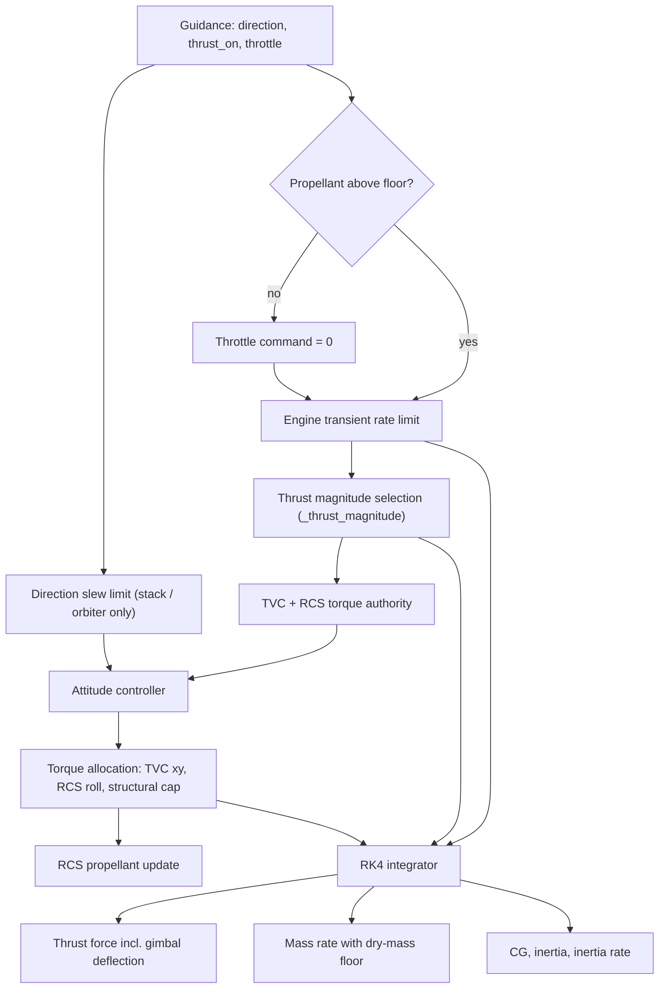
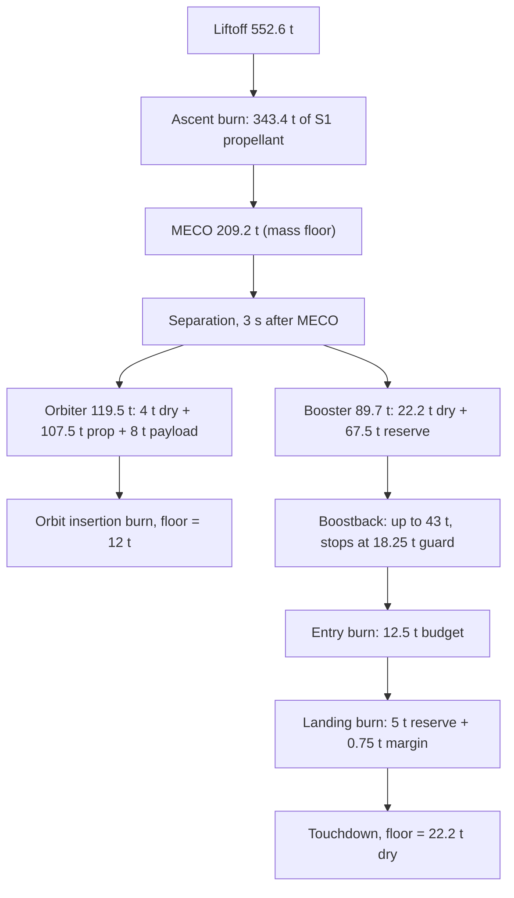
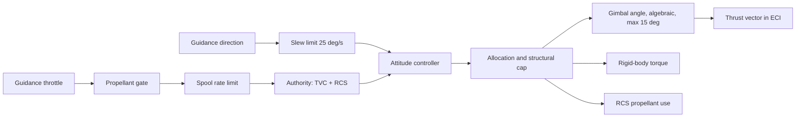

# 5. Propulsion, mass properties, actuators and RCS

> This chapter covers how Vyom turns a guidance command (thrust on/off, throttle, thrust
> direction) into a thrust force, a mass-flow rate, a time-varying centre of gravity (CG) and
> inertia, and an attitude-control torque split between thrust vector control (TVC) and the
> reaction control system (RCS). Fidelity is **engineering level**. Each stage is one *lumped*
> engine: its thrust is the engine count times a per-engine thrust. Stage-1 thrust varies
> linearly with ambient pressure. Throttle response is rate-limited. The gimbal deflection is an
> algebraic function of the commanded torque with no actuator dynamics. CG and inertia are
> linear in propellant fraction. RCS propellant is tracked in its own budget, separate from the
> vehicle mass. Stage-1 propellant for booster recovery is held back at main-engine cutoff
> (MECO). The amount held back can be set directly, sized from the rocket equation, or raised
> for a forecast headwind.

All paths are relative to `backend/rlv_sim/`. Default values are from `create_default_config()`
(`config/factory.py:63-85`) unless marked as constants (`core/constants.py`).

---

## 5.1 Role in the simulation

On every step, `mission/step.py:simulation_step` (`step.py:673-874`) runs the propulsion and
actuator chain shown below. It then calls RK4 integration (`physics/integrators.py`), which
evaluates the thrust force (`physics/forces.py:836`), the mass rate (`physics/mass.py:78`), and
the CG and inertia (`physics/mass.py:138,176,233`) at each RK4 stage. Throttle, engine-on flag,
thrust override and commanded torque stay constant across the four stages, so they act as a
zero-order hold over each step.

| Input | Source |
|---|---|
| `thrust_on`, `throttle`, `thrust_direction` | guidance (chapter 6 and the recovery-guidance chapters) |
| `dry_mass` (mass floor), `stage`, `vehicle_model` | mission loop (`mission/full_mission.py:234,450,461`) |
| `config` | `SimulationConfig` (`config/definition.py`) |

| Output | Consumer |
|---|---|
| actual throttle, engine-on flag, thrust override | `DynamicsContext` (`step.py:844-851`) |
| allocated body torque | rotational equations of motion (`physics/dynamics.py:323`) |
| $\dot m$, $\mathbf I$, $\dot{\mathbf I}$, $z_{cg}$ | rigid-body dynamics, aerodynamic moment, jet damping (`dynamics.py:255-321`) |
| RCS propellant remaining | telemetry, RCS authority on later steps |

---

## 5.2 Vehicle definition and derived thrust levels

**Physical idea.** The vehicle is described by stage masses, a stage-1 engine cluster (engine
count and per-engine sea-level thrust) and a single stage-2 vacuum engine. Each burn's thrust is
the number of engines lit in that burn times the per-engine thrust. Engines are identical and
lumped: individual engines, engine-out and cluster asymmetry are not modelled.

**Derived quantities** (`config/definition.py:416-457`):

$$
T_{S1} = N_{S1}\,T_e,\qquad T_{bb} = N_{bb}\,T_e,\qquad T_{en} = N_{en}\,T_e,\qquad T_{ld} = N_{ld}\,T_e
$$

$$
m_{MECO} = m_{d1} + m_{d2} + m_{p2} + m_{pl} + m_{res}
$$

Here $T_e$ is per-engine sea-level thrust and $N$ is the engine count for stage-1 ascent (S1),
boostback (bb), entry (en) and landing (ld). The masses $m_{d1}, m_{d2}$ are stage dry masses,
$m_{p2}$ is stage-2 propellant, $m_{pl}$ is payload and $m_{res}$ is the stage-1 recovery
reserve.

| Symbol | Config field / constant | Default | Unit | Meaning |
|---|---|---|---|---|
| $m_{d1}$ | `stage1_dry_mass` | 22 200 | kg | Stage-1 dry mass |
| $m_{p1}$ | `stage1_prop_mass` | 410 900 | kg | Stage-1 propellant load |
| $m_{d2}$ | `stage2_dry_mass` | 4 000 | kg | Stage-2 dry mass |
| $m_{p2}$ | `stage2_prop_mass` | 107 500 | kg | Stage-2 propellant load |
| $m_{pl}$ | `payload_mass` | 8 000 | kg | Payload (carried on stage 2) |
| $N_{S1}$ | `stage1_engine_count` | 9 | – | Engines lit at liftoff |
| $T_e$ | `stage1_engine_thrust_n` | 845 222 (= 7.607 MN / 9) | N | Sea-level thrust per engine |
| $N_{bb}, N_{en}, N_{ld}$ | `boostback_engine_count`, `entry_engine_count`, `landing_engine_count` | 3, 3, 1 | – | Engines lit in each recovery burn |
| $T_{2}$ | `stage2_thrust_vac` | 950 000 | N | Stage-2 vacuum thrust |
| $I_{sp,2}$ | `stage2_isp_vac` | 348 | s | Stage-2 vacuum $I_{sp}$ |
| $I_{sp,sl}$ | `C.ISP` (constant only) | 282 | s | Stage-1 sea-level $I_{sp}$ |
| $I_{sp,vac}$ | `C.ISP_VAC` (constant only) | 311 | s | Stage-1 vacuum $I_{sp}$ |
| $T_{ref}$ | `C.THRUST_MAGNITUDE` | 7.607 × 10⁶ | N | Reference stage-1 sea-level thrust |
| $\dot m_{ref}$ | `C.MASS_FLOW_RATE` = $T_{ref}/(I_{sp,sl} g_0)$ | 2 750.70 | kg/s | Reference stage-1 mass flow (`constants.py:71`) |
| $s_T$ | `runtime_thrust_scale` | 1.0 | – | Thrust dispersion multiplier |
| $s_I$ | `runtime_isp_scale` | 1.0 | – | $I_{sp}$ dispersion multiplier |
| $\Delta m_0$ | `runtime_initial_mass_offset_kg` | 0 | kg | Liftoff mass dispersion (`mission/vehicle_split.py:90`) |

Derived defaults: liftoff mass $m_0$ = 552 600 kg (`core/state.py:172-182`); liftoff
thrust-to-weight ratio 1.40; $m_{MECO}$ = 209 200 kg with $m_{res}$ = 67 500 kg. Stage-1 vacuum
thrust is 8.389 MN. Stage-2 mass flow is 278.4 kg/s, giving a 386 s burn at full throttle.

**Classification.** Vehicle numbers are a *project heuristic* approximating a Falcon 9-class
vehicle. They come from a project specification document (`constants.py:7`) and have no
traceable published source.

**Validity limits.** Stage-1 $I_{sp}$ (282/311 s) can be changed only through the constants or
through $s_I$; no config field exists for it. The engine counts change thrust and mass flow
together and feed the jet-damping geometry. They do not change the CG, the inertia or the TVC
lever arm.

---

## 5.3 Thrust magnitude

### 5.3.1 Selecting the rated thrust (`mission/step.py:600-619`)

`_thrust_magnitude` returns two values: an *override* that is passed to the force and mass
models, and a *rated thrust* $T_{rat}$, used only for torque-authority bookkeeping.

| Vehicle / phase | Override passed to physics | $T_{rat}$ |
|---|---|---|
| booster, `BOOSTER_BOOSTBACK` | `boostback_thrust_n` | override × $s_T$ |
| booster, `BOOSTER_ENTRY` | `entry_thrust_n` | override × $s_T$ |
| booster, `BOOSTER_LANDING` | `landing_thrust_n` | override × $s_T$ |
| any other stage-1 case (stack ascent, other booster phases) | `stage1_thrust_n` | override × $s_T$ |
| stage 2 (orbiter) | none | `stage2_thrust_vac` × $s_T$ |

### 5.3.2 Stage-1 pressure compensation (`physics/forces.py:887-898`)

**Physical idea.** A fixed-geometry nozzle produces more thrust in vacuum than at sea level
because the ambient pressure acting on the exit plane falls. The textbook thrust equation
[1] is

$$
F = \dot m\,v_e + (p_e - p_a)A_e = F_{vac} - p_a A_e .
$$

The code writes the same law in terms of sea-level and vacuum thrust. Mass flow is held fixed
(see 5.4), and vacuum thrust is found by scaling the reference flow with $I_{sp,vac}$:

$$
T_{sl} = s_T\,T_{cfg},\qquad
T_{vac} = \frac{T_{sl}}{T_{ref}}\,\dot m_{ref}\,I_{sp,vac}\,g_0 = T_{sl}\,\frac{I_{sp,vac}}{I_{sp,sl}},
$$

$$
T = T_{vac} - (T_{vac} - T_{sl})\,\mathrm{clip}\!\left(\frac{p_a}{p_0},\,0,\,1.2\right).
$$

Here $T_{cfg}$ is the override from 5.3.1, $p_a$ is ambient pressure from
`compute_configured_atmosphere_properties` and $p_0$ = `C.ATM_P0` = 101 325 Pa. This is the
textbook form with an implied total exit area $A_e = (T_{vac}-T_{sl})/p_0$, which is 7.72 m² for
the default vehicle.

### 5.3.3 Stage-2 sea-level penalty (`forces.py:874-885`)

$$
T = s_T\,T_2\cdot
\begin{cases}
\max(0,\;1 - 0.1\,p_a/p_0) & p_a > 100\ \text{Pa}\\
1 & \text{otherwise}
\end{cases}
$$

This is a *project heuristic* (no external reference). The vacuum-optimised stage-2 engine loses
up to 10 % of its thrust in a dense atmosphere. It affects only S2 recovery burns at low
altitude; mass flow is not changed.

### 5.3.4 Throttle and throttle efficiency (`forces.py:863-868, 900-901`)

$$
\delta \leftarrow \mathrm{clip}(\delta,0,1);\quad T = 0 \text{ if not on or } \delta<0.01;\qquad
T \leftarrow T\,\delta\,(0.96 + 0.04\,\delta).
$$

The factor $(0.96+0.04\delta)$ is a *project heuristic*: a deep-throttle efficiency loss of up
to 4 %. Mass flow scales with $\delta$ alone (5.4), so the effective $I_{sp}$ falls by the same
factor at part throttle. At $\delta = 0.35$, effective $I_{sp}$ is 2.6 % lower.

### 5.3.5 Direction

Thrust acts along body $+z$ and is deflected by the gimbal angle derived in 5.8.2. The body
force is rotated to ECI with the attitude quaternion (`forces.py:903-906`).

| Symbol | Config field / constant | Default | Unit | Meaning |
|---|---|---|---|---|
| $p_0$ | `C.ATM_P0` | 101 325 | Pa | Sea-level reference pressure |
| – | literal | 1.2 | – | Upper clip on $p_a/p_0$ |
| – | literal | 0.96 / 0.04 | – | Throttle-efficiency coefficients |
| – | literal | 0.01 | – | Throttle below which thrust is zero |
| – | literal | 0.1, 100 Pa | –, Pa | Stage-2 atmospheric penalty, threshold |

**Classification.** Pressure-compensated thrust: *Standard* [1]. Throttle efficiency and stage-2
penalty: *Project heuristic*.

**Validity limits.**
- The altitude for $p_a$ is spherical ($|\mathbf r| - R_E$, `forces.py:870`). The GRAM density
  modifier does not reach the thrust model, because `r` is not passed. `runtime_atmosphere_density_scale`
  *does* scale $p_a$ (`forces.py:230-231`), so an atmosphere dispersion also shifts stage-1
  thrust.
- The ratio $p_a/p_0$ is clipped at 1.2, so for denser-than-standard air thrust can fall below
  $T_{sl}$ but by no more than 20 % of $(T_{vac}-T_{sl})$.
- There is no nozzle flow separation or plume interaction, and no per-engine thrust.

---

## 5.4 Mass flow and propellant bookkeeping

**Physical idea.** Propellant mass flow is $\dot m = T/(I_{sp} g_0)$ [1]. Stage-1 flow is fixed
by the sea-level rating and does not depend on pressure; pressure changes only the thrust (and
so the effective $I_{sp}$). Burning stops at a mass floor.

**Implemented form** (`physics/mass.py:40-75`):

$$
|\dot m| =
\begin{cases}
\dfrac{T_{cfg}}{T_{ref}}\,\dot m_{ref}\,\dfrac{s_T}{s_I}\,\delta = \dfrac{T_{cfg}}{I_{sp,sl}\,g_0}\,\dfrac{s_T}{s_I}\,\delta & \text{stage 1}\\[2ex]
\dfrac{T_{2}}{I_{sp,2}\,g_0}\,\dfrac{s_T}{s_I}\,\delta & \text{stage 2}
\end{cases}
\qquad \dot m = -|\dot m|.
$$

$\dot m = 0$ if the engine is off, $\delta \le 0$, or $m \le m_{floor}$ (`mass.py:94-99`). As a
result, $s_T$ scales thrust and flow together (a "bigger engine"), while $s_I$ lowers flow only,
which raises the effective $I_{sp}$ to $s_I\,I_{sp}$.

Effective stage-1 specific impulse, combining 5.3 and 5.4:

$$
I_{sp,eff} = \frac{T}{|\dot m| g_0} = s_I\left[I_{sp,vac} - (I_{sp,vac}-I_{sp,sl})\frac{p_a}{p_0}\right](0.96+0.04\delta).
$$

**Mass floor and step splitting** (`physics/integrators.py:54-91,119`). If a full RK4 step would
go below the floor, the step is split. The vehicle burns for
$t_{dry} = (m-m_{floor})/|\dot m|$, its mass is set exactly to $m_{floor}$, and it coasts for
the rest of the step. The result is then clamped: $m_{k+1} \leftarrow \max(m_{k+1}, m_{floor})$.
`simulation_step` also sets the throttle command to zero once $m \le m_{floor} + 10^{-6}$
(`step.py:728-730`).

| Vehicle model | Mass floor $m_{floor}$ | Source |
|---|---|---|
| stacked (ascent) | $m_{MECO}$ | `full_mission.py:234` |
| orbiter | $m_{d2} + m_{pl}$ | `full_mission.py:361,450` |
| booster | $m_{d1}$ | `full_mission.py:362,461` |

At separation, the masses are reset to $m_{d1}+m_{res}$ for the booster and
$m_{d2}+m_{p2}+m_{pl}$ for the orbiter (`full_mission.py:360-363`). Because the ascent floor is
$m_{MECO}$, these sum to the stack mass at separation, so mass is conserved.

**Classification.** *Standard* [1].

**Validity limits.** No unusable residuals, boil-off, start/shutdown propellant or ullage are
modelled. A positive `runtime_initial_mass_offset_kg` adds liftoff mass, but MECO still happens
at the fixed $m_{MECO}$. The offset therefore behaves as extra stage-1 propellant burned on
ascent, not as a dry-mass error.

---

## 5.5 MECO and the stage-1 recovery reserve

### 5.5.1 MECO criterion

MECO is a **mass** criterion. Guidance holds `thrust_on = m > m_MECO`
(`guidance/ascent.py:329`). The mission manager switches ASCENT → COAST when $m \le m_{MECO}$
(`mission/manager.py:209-221`). The ascent integrator floor equals $m_{MECO}$, so the stack
cannot overshoot. Stage separation follows 3 s after MECO (`manager.py:223-229`). The
`S2_COAST_TO_APOGEE` phase begins 2 s after that (`manager.py:231-238`).

### 5.5.2 Auto-sized reserve (`mission/planner.py:38-43`)

If `auto_size_recovery_reserve` is true, `config/factory.py:45-49` replaces $m_{res}$ with the
rocket-equation [1] propellant needed for a full return-to-launch-site (RTLS) recovery:

$$
m_{res} = \left(m_{d1} + m_{land}\right)\exp\!\left(\frac{\Delta v_{rec} + \Delta v_{mar}}{s_I\,I_{sp,vac}\,g_0}\right) - m_{d1}.
$$

For default values this gives $m_{res}$ = 67 816 kg, close to the hand-set default of 67 500 kg.

### 5.5.3 Wind-aware reserve (`mission/planner.py:46-49`)

$$
m_{res} \leftarrow m_{res} + k_w\,\max(-w,\,0)
$$

Here $w$ = `runtime_wind_offset_mps`, and a negative value means a headwind. The adjustment is
applied once, after any auto-sizing, when the config is built (`factory.py:50-58`). The Monte
Carlo campaign swaps the base adjustment for each case's own wind
(`mission/campaign.py:272-278`), so it is not applied twice.

### 5.5.4 Planner feasibility check (`planner.py:58-105`)

The pre-launch planner reports three budgets. They are diagnostics and do not steer the vehicle:

$$
\Delta v_1 = \tfrac12(I_{sp,sl}+I_{sp,vac})\,s_I\,g_0 \ln\frac{m_0}{m_{MECO}},\qquad
\Delta v_2 = I_{sp,2}\,s_I\,g_0\ln\frac{m_{d2}+m_{p2}+m_{pl}}{m_{d2}+m_{pl}+m_{S2,res}},
$$

$$
\Delta v_{req} = \sqrt{\mu/(R_E+h_{orb})} + \Delta v_{loss} - \omega_E R_E\cos\phi_{site},\qquad
\Delta v_{rec} = s_I I_{sp,vac} g_0 \ln\frac{m_{d1}+m_{res}}{m_{d1}+m_{land}},
$$

$$
\mathrm{TWR} = \frac{T_{S1}\,s_T}{m_0 g_0} \ge 1.15.
$$

Defaults: $\Delta v_1 + \Delta v_2$ = 10 668 m/s against 9 865 m/s required. TWR = 1.40.
Recovery $\Delta v$ = 3 639 m/s against 3 600 m/s required. Verdict: `ok`.

| Symbol | Config field / constant | Default | Unit | Meaning |
|---|---|---|---|---|
| $m_{res}$ | `stage1_landing_fuel_reserve_kg` | 67 500 | kg | Stage-1 propellant held at MECO |
| – | `auto_size_recovery_reserve` | false | – | Replace $m_{res}$ with the sized value |
| $k_w$ | `recovery_reserve_wind_sensitivity_kg_per_mps` | 383 | kg/(m/s) | Extra reserve per m/s of headwind |
| $m_{land}$ | `booster_landing_reserve_kg` | 5 000 | kg | Propellant targeted at the end of recovery |
| $\Delta v_{rec}$ | `planner.RECOVERY_DV_REQUIRED_MPS` | 3 600 | m/s | RTLS recovery $\Delta v$ (calibrated) |
| $\Delta v_{mar}$ | `planner.RECOVERY_DV_MARGIN_MPS` | 50 | m/s | Sizing margin |
| $\Delta v_{loss}$ | `planner.ASCENT_LOSSES_MPS` | 2 600 | m/s | Gravity + drag + steering losses (calibrated) |
| – | `planner.MIN_LIFTOFF_TWR` | 1.15 | – | Minimum liftoff TWR |
| $m_{S2,res}$ | `s2_landing_propellant_reserve_kg` | 0 | kg | Stage-2 landing reserve |

**Classification.** The rocket equation is *Standard* [1]. $\Delta v_{rec}$, $\Delta v_{loss}$
and $k_w$ are *project heuristics* calibrated against this simulator's own full-mission runs
(`planner.py:1-7`) and a seed-42 Monte Carlo slope (`definition.py:143-146`). There is no
external reference. The stage-1 $\Delta v$ in the planner uses the arithmetic mean of sea-level
and vacuum $I_{sp}$, which is an approximation. The recovery sizing uses vacuum $I_{sp}$ only,
which slightly underestimates the propellant needed for low-altitude burns.

### 5.5.5 Propellant budget, liftoff to touchdown

Boostback, entry and landing budgets are recovery-guidance parameters (see the recovery-guidance
chapter). Boostback ends when `booster_boostback_budget_kg` has been used, or when the remaining
propellant reaches the guard
$m_{en,budget} + m_{land} + m_{margin}$ = 12 500 + 5 000 + 750 = 18 250 kg
(`guidance/recovery.py:283-289`, `mission/manager.py:502-512`).

---

## 5.6 Mass properties: CG and inertia

**Physical idea.** CG and inertia change as propellant is burned. Vyom models them as functions
of the current mass, with one model for each vehicle configuration. CG is measured along body
$+z$ from the vehicle base. Inertia is a diagonal principal tensor, with
$I_{xx} = I_{yy}$ (axisymmetric) and $I_{zz}$ the roll inertia.

### 5.6.1 Stacked (S1 + S2) (`mass.py:29-37, 169-173, 219-230, 272-279`)

The CG is a component-weighted mean:

$$
m_{p1}' = \mathrm{clip}\!\left(m - (m_{d1}^C + m_{2}^C),\,0,\,m_{p1}^C\right),\qquad
z_{cg} = \frac{m_{d1}^C z_{d1} + m_{p1}' z_{p1} + m_{d2}^C z_{d2} + m_{p2}^C z_{p2}}{m_{d1}^C + m_{p1}' + m_{d2}^C + m_{p2}^C}.
$$

Inertia is linear in the stage-1 propellant fraction $f = m_{p1}'/m_{p1}^C$:

$$
I_{xx} = I_{yy} = I_{xx}^{e} + f\,(I_{xx}^{f} - I_{xx}^{e}),\qquad
I_{zz} = I_{zz}^{e} + f\,(I_{zz}^{f} - I_{zz}^{e}).
$$

The superscript $C$ marks values taken from `core/constants.py`, **not** from config. Here
$m_2^C$ = 111 500 kg is stage 2 wet, and payload is not included. Default results: $z_{cg}$ =
26.80 m at liftoff and 39.31 m at MECO. $I_{xx}$ falls from 7.2 × 10⁷ to 2.59 × 10⁷ kg m² by
MECO.

### 5.6.2 Orbiter (S2 after separation) (`mass.py:154-156, 192-196, 251-256`)

$$
f_2 = \mathrm{clip}\!\left(\frac{m - m_{d2}^C}{m_{p2}^C},0,1\right),\quad
z_{cg} = 58 + 5 f_2,\quad
I_{xx}=I_{yy} = 1.67{\times}10^5 + f_2(2.5{\times}10^6 - 1.67{\times}10^5),\quad
I_{zz} = 10^5 + f_2(4{\times}10^5 - 10^5).
$$

All the numbers are literals in the code and cannot be set from config.

### 5.6.3 Booster (S1 recovery) (`mass.py:158-167, 198-209, 258-270`)

$$
f_b = \mathrm{clip}\!\left(\frac{m - m_{d1}^C}{\max(m_{res},1)},0,1\right),\quad
z_{cg} = z^{e}_{b} + f_b(z^{f}_{b} - z^{e}_{b}),\quad
I = I^{e}_{b} + f_b(I^{f}_{b} - I^{e}_{b}).
$$

"Full" means the vehicle at separation, carrying the whole reserve $m_{res}$.

### 5.6.4 Inertia rate (`mass.py:233-279`)

$$
\dot{\mathbf I} = \frac{\partial \mathbf I}{\partial m}\,\dot m \quad \text{inside the interpolation range},\qquad \dot{\mathbf I} = 0 \text{ outside it.}
$$

$\dot{\mathbf I}$ enters the Euler equation as $-\dot{\mathbf I}\boldsymbol\omega$, alongside the
jet-damping torque (`dynamics.py:312-323`). Both are covered in the rigid-body dynamics chapter.
$z_{cg}$ is used only in the aerodynamic moment arm and in jet damping (`dynamics.py:269-295,321`).
The TVC lever arm does **not** come from $z_{cg}$ (5.8.3).

| Symbol | Config field / constant | Default | Unit | Meaning |
|---|---|---|---|---|
| $z_{d1}, z_{p1}, z_{d2}, z_{p2}$ | `mass.S1_DRY_CG_Z`, `S1_PROP_CG_Z`, `S2_DRY_CG_Z`, `S2_PROP_CG_Z` (module constants) | 24, 19, 59, 56 | m | Stacked component CG stations |
| $I_{xx}^{f}, I_{xx}^{e}$ | `stack_ixx_full_kgm2`, `stack_ixx_empty_kgm2` | 7.2e7, 1.55e7 | kg m² | Stack transverse inertia |
| $I_{zz}^{f}, I_{zz}^{e}$ | `stack_izz_full_kgm2`, `stack_izz_empty_kgm2` | 2.0e6, 1.0e6 | kg m² | Stack roll inertia |
| $z^{f}_{b}, z^{e}_{b}$ | `booster_cg_full_m`, `booster_cg_empty_m` | 21, 26 | m | Booster CG |
| $I^{f}_{b,xx}, I^{e}_{b,xx}$ | `booster_ixx_full_kgm2`, `booster_ixx_empty_kgm2` | 1.1e7, 5.5e6 | kg m² | Booster transverse inertia |
| $I^{f}_{b,zz}, I^{e}_{b,zz}$ | `booster_izz_full_kgm2`, `booster_izz_empty_kgm2` | 1.03e5, 5.15e4 | kg m² | Booster roll inertia |
| – | literals in `mass.py:156,194-195` | see 5.6.2 | m, kg m² | Orbiter CG and inertia |

**Classification.** *Project heuristic*: linear interpolation between assumed full and empty
values, with no geometry-derived parallel-axis terms (`mass.py:225-228`). The component-weighted
CG is *Standard*, but its stations are assumptions.

**Validity limits and known issues.**
- **Not every mass property is configurable.** The stacked CG stations and the orbiter CG and
  inertia are hard-coded. The stacked and orbiter propellant fractions use the masses in
  `core/constants.py`, not the config masses. If the vehicle definition is changed, these models
  silently keep describing the reference vehicle.
- **Payload is treated as propellant.** In the stacked model the 8 t payload is counted in
  $m_{p1}'$. At liftoff the excess is clipped away, so 8 t is missing from the CG sum; after that,
  stage-1 propellant is over-stated by 8 t (75.5 t instead of 67.5 t at MECO). In the orbiter
  model the payload sits inside $f_2$, so $f_2$ starts at 1 for the first 8 t burned and never
  goes below 0.074 at burnout (CG 58.37 m rather than 58 m).
- **Orbiter and stacked CGs disagree.** In the stacked frame, the full stage-2 CG computed from
  the stations is 56.1 m. The orbiter model gives 63 m when full and 58 m when empty, a trend in
  the opposite direction. Difference not explained in code.
- No propellant slosh and no products of inertia.

---

## 5.7 Throttle limits and engine transients

### 5.7.1 Throttle limits

`min_engine_throttle_fraction` (0.35) and `max_engine_throttle_fraction` (1.0) are enforced only
by individual guidance laws. Examples are the ascent max-q hold (`guidance/ascent.py:49-56,83`),
the ascent throttle bucket (`ascent.py:339-341`) and the G-FOLD thrust bounds
(`guidance/booster.py:797-798`). The propulsion path clips the throttle to $[0,1]$ only. Some
booster laws command lower values: the entry-capture logic clips to $[0.05, \cdot]$ and
$[0.04, 0.24]$ (`guidance/booster.py:744-754`). Deep throttle below the configured floor is
therefore possible in recovery.

### 5.7.2 Spool-up and spool-down (`physics/forces.py:547-578`, called at `step.py:732-737`)

**Physical idea.** Turbopump-fed engines cannot change thrust instantly. Vyom models this as a
**slew-rate limit** on throttle, with different up and down rates. It is not a first-order lag.

$$
\delta_{k+1} = \mathrm{clip}\!\left(\delta_k + \mathrm{sat}\!\left(\delta_{c} - \delta_k,\;
-\frac{\Delta t}{\max(\tau_{dn},0.01)},\; +\frac{\Delta t}{\max(\tau_{up},0.01)}\right),\,0,\,1\right)
$$

Here $\delta_c$ is the commanded throttle, already zeroed if propellant is exhausted, and
$\delta_k$ is the actual throttle stored in `ActuatorState.throttle`. A step from 0 to 1 takes
$\tau_{up}$ seconds, and a step from 1 to 0 takes $\tau_{dn}$ seconds.

**Implementation notes.**
- `ActuatorState.throttle` starts at 0 (`vehicle/actuator.py:14-24`). The stack therefore spools
  up for 1.5 s on the pad, held by the pad constraint (`step.py:308-345`). The orbiter and the
  booster each get a new `ActuatorState` with throttle 0 at separation
  (`full_mission.py:382,395`), so their first burns also spool from 0.
- The filter acts on the throttle *value* only. The engine-on flag is not filtered:
  `thrust_active = thrust_on_cmd ∧ propellant ∧ δ > 0` (`step.py:739`). If a guidance law
  reports `thrust_on = False` with a nonzero throttle, the filtered throttle keeps tracking that
  value. The next ignition then starts at that level instead of spooling up from 0.
- Thrust is zero for $\delta < 0.01$ (`forces.py:867`), but mass flow is not. In the last
  spool-down step, a very small propellant flow can occur with no thrust.

| Symbol | Config field | Default | Unit | Meaning |
|---|---|---|---|---|
| – | `enable_engine_transients` | true | – | Enable the rate limit |
| $\tau_{up}$ | `engine_spool_up_time` | 1.5 | s | Time for 0 → 100 % throttle |
| $\tau_{dn}$ | `engine_spool_down_time` | 0.8 | s | Time for 100 → 0 % throttle |
| – | `min_engine_throttle_fraction` | 0.35 | – | Throttle floor used by some guidance laws |
| – | `max_engine_throttle_fraction` | 1.0 | – | Throttle ceiling used by some guidance laws |

**Classification.** *Project heuristic*. No external reference.

---

## 5.8 Thrust vector control

### 5.8.1 Commanded-direction slew limit (`vehicle/actuator.py:27-63`, `step.py:714-724`)

**Physical idea.** The "actuator" in `vehicle/actuator.py` does **not** model the engine gimbal.
It rate-limits the *commanded thrust direction* $\hat{\mathbf d}$, which is the attitude
reference passed to the attitude controller. The direction rotates toward the guidance request
$\hat{\mathbf d}_{des}$ by at most $\dot\theta_{max}\Delta t$ per step, about the axis
$\hat{\mathbf k} = (\hat{\mathbf d}\times\hat{\mathbf d}_{des})/\lVert\cdot\rVert$, using
Rodrigues' formula:

$$
\hat{\mathbf d}_{k+1} =
\begin{cases}
\hat{\mathbf d}_{des} & \angle(\hat{\mathbf d}_k,\hat{\mathbf d}_{des}) \le \dot\theta_{max}\Delta t\\
\hat{\mathbf d}_k\cos\theta + (\hat{\mathbf k}\times\hat{\mathbf d}_k)\sin\theta + \hat{\mathbf k}(\hat{\mathbf k}\cdot\hat{\mathbf d}_k)(1-\cos\theta) & \text{otherwise},\ \theta=\dot\theta_{max}\Delta t
\end{cases}
$$

The limit applies to the stack and to the orbiter outside S2 recovery. The booster and the S2
recovery phases use the guidance direction unfiltered (`step.py:718-721`). The module docstring
calls this "second-order rate-limited slewing"; the code is a pure first-order rate limit.

### 5.8.2 Gimbal deflection from commanded torque (`physics/forces.py:781-833`)

**Physical idea.** A gimbal point at distance $L$ below the CG on body $-z$ produces the torque
$\boldsymbol\tau = (0,0,-L)\times\mathbf F$, that is, $\tau_x = L F_y$ and $\tau_y = -L F_x$.
The code inverts this relation to find the lateral thrust that matches the transverse part of
the commanded torque. The gimbal angle is then whatever angle produces that lateral force, and
it costs a cosine loss in axial thrust [1].

$$
\tau_{cap} = T\sin\delta_{max}\,L,\qquad
\boldsymbol\tau_{xy}' = \boldsymbol\tau_{xy}\,\frac{\min(\lVert\boldsymbol\tau_{xy}\rVert,\tau_{cap})}{\lVert\boldsymbol\tau_{xy}\rVert},
$$

$$
F_x = -\tau_y'/L,\quad F_y = \tau_x'/L,\quad
\theta_g = \arcsin\!\left(\mathrm{clip}\!\left(\frac{\sqrt{F_x^2+F_y^2}}{T},0,1\right)\right),
$$

$$
\mathbf F_b = T\left[\sin\theta_g\,\hat e_x,\ \sin\theta_g\,\hat e_y,\ \cos\theta_g\right].
$$

Here $T$ is the actual thrust from 5.3, including pressure and throttle effects. Torque above
$\tau_{cap}$ is assumed to come from RCS and adds no lateral force.

**Implementation notes.**
- The gimbal angle is **algebraic**. It has no position state, no rate limit and no lag; it
  follows the commanded torque instantly at every RK4 stage.
- The torque applied to the rigid body is the allocated command torque itself (5.8.4). The
  lateral force only enters translation, so translation and rotation stay consistent by
  construction.
- $\delta_{max}$ is the constant `C.MAX_GIMBAL_ANGLE` = 15°. The config field
  `max_gimbal_angle_deg` is validated (`definition.py:503-504`) but **never read**, so changing it
  has no effect.

### 5.8.3 TVC lever arm (`forces.py:748-778`)

| Vehicle | $L$ | Source |
|---|---|---|
| any, if `tvc_lever_arm_m` is set | `tvc_lever_arm_m` | `forces.py:768-773` |
| booster | 21 m (`C.BOOSTER_TVC_LEVER_ARM`) | `forces.py:774-775` |
| stage 2 / orbiter | 12 m (`C.S2_TVC_LEVER_ARM`) | `forces.py:776-777` |
| stage 1 / stack | 32 m (`C.S1_TVC_LEVER_ARM`) | `forces.py:778` |

$L$ is fixed: it is not derived from $z_{cg}$ and does not change as propellant burns. A
`tvc_lever_arm_m` override applies one value to *every* vehicle. The code comments note that
21 m for the booster is unphysically long. A flown Merlin gimbal sits a few metres from the
CG (`forces.py:759-767`).

### 5.8.4 Torque authority and allocation (`step.py:231-296, 622-642, 757-816`)

TVC authority for bookkeeping uses the *rated* thrust from 5.3.1:

$$
\tau_{TVC} = T_{rat}\,\delta\,\sin\delta_{max}\,L,\qquad
\tau_{RCS} = N_{RCS}F_{RCS}L_{RCS} \ (\text{0 if exhausted or disabled}).
$$

Allocation in body axes, where body $z$ is the roll axis:

$$
\lVert\boldsymbol\tau_{xy}\rVert \le \min(\tau_{str},\ \min(\tau_{TVC},\tau_{str}) + \tau_{RCS}),\qquad
|\tau_z| \le \tau_{RCS},\qquad \lVert\boldsymbol\tau\rVert \le \tau_{str}.
$$

Each limit is applied by scaling the vector down.

Structural caps $\tau_{str}$ (`step.py:622-630`): the stack uses `max_torque` (3.2 × 10⁷ N m).
Stage 2 uses `max_torque`·2.0 × 10⁶/3.2 × 10⁷. The booster and the S2 recovery phases use
`max_torque`·1.2 × 10⁷/3.2 × 10⁷. In S2 recovery phases the torque is capped only by
$\tau_{str}$, with no TVC/RCS split (`step.py:803-808`). With default values, $\tau_{TVC}$ at
full throttle is 63.0 MN m for the stack (capped by $\tau_{str}$), 2.95 MN m for stage 2, and
13.8 MN m and 4.59 MN m for booster boostback and landing.

| Symbol | Config field / constant | Default | Unit | Meaning |
|---|---|---|---|---|
| $\dot\theta_{max}$ | `C.MAX_GIMBAL_RATE` | 25 | deg/s | Slew limit on commanded direction |
| $\delta_{max}$ | `C.MAX_GIMBAL_ANGLE` | 15 | deg | Gimbal limit (config `max_gimbal_angle_deg` unused) |
| $L$ | `tvc_lever_arm_m` / constants | None → 32 / 12 / 21 | m | Gimbal-to-CG arm |
| $\tau_{str}$ | `max_torque` | 3.2 × 10⁷ | N m | Stack structural torque cap |
| – | `C.BOOSTER_MAX_TORQUE_NM` | 1.2 × 10⁷ | N m | Booster cap at default `max_torque` |

**Classification.** Gimbal geometry: *Standard* [1]. Slew rate, lever arms and the allocation
scheme: *Project heuristic*.

**Validity limits.** There are no gimbal actuator dynamics: no hydraulic bandwidth, no gimbal
rate limit, no backlash. There is no per-engine or differential-throttle roll control; roll
comes from RCS only. The authority bookkeeping uses $T_{rat}$, while the force model caps
deflection with the actual $T$. These differ by the pressure and throttle-efficiency factors:
in vacuum, stage-1 thrust is about 10 % above rated, and stage 2 inside the atmosphere is below
rated.

---

## 5.9 Reaction control system

**Physical idea.** RCS thrusters give attitude torque when TVC cannot, for example during coast
or with the engines off, and they supply all roll torque. Vyom models RCS as a continuously
throttleable torque source. Its propellant is drawn from a separate budget.

**Equations** (`vehicle/rcs.py:29-141`, demand computed at `step.py:818-825`):

$$
\tau_{RCS,max} = F_{RCS}\,N_{RCS}\,L_{RCS},\qquad
\tau_d = \sqrt{\max(0,\ \lVert\boldsymbol\tau_{xy}\rVert - \tau_{TVC})^2 + \tau_z^2},
$$

$$
\dot m_{RCS} = \frac{N_{RCS}F_{RCS}}{I_{sp,RCS}\,g_0}\,\min\!\left(\frac{\tau_d}{\tau_{RCS,max}},1\right),\qquad
m_{RCS,k+1} = \max(0,\ m_{RCS,k} - \dot m_{RCS}\Delta t).
$$

When $m_{RCS}$ reaches 0, the flag `exhausted` is set and $\tau_{RCS}$ becomes 0 for the rest of
that vehicle's flight. Telemetry impulse is $\min(\tau_d,\tau_{RCS,max})\,\Delta t/L_{RCS}$
(`rcs.py:110-123`). With default values: $\tau_{RCS,max}$ = 80 kN m, full-authority flow is
1.854 kg/s, and 300 kg lasts about 162 s at full demand.

**Implementation notes.**
- **RCS propellant is not deducted from the vehicle mass.** `update_rcs_propellant` changes
  only `RCSState`. The state mass $m$, the CG and the inertia never see RCS consumption.
- RCS produces torque only, with no translational force. There is no pulse-width modulation,
  minimum impulse bit or thruster geometry.
- $L_{RCS}$ = `C.RCS_LEVER_ARM` = 20 m for every vehicle. It cannot be set from config.
- The RCS budget lives in the per-vehicle guidance state, and a new one is created when it is
  `None` (`step.py:751-752`). The stack, the orbiter and the booster each start with a full
  `rcs_propellant_mass` (`full_mission.py:379,394`). RCS use on the stack is not carried over
  to either stage.

| Symbol | Config field / constant | Default | Unit | Meaning |
|---|---|---|---|---|
| – | `enable_rcs` | true | – | Enable RCS |
| $F_{RCS}$ | `rcs_thrust` | 500 | N | Thrust per thruster |
| $N_{RCS}$ | `rcs_num_thrusters` | 8 | – | Number of thrusters |
| $I_{sp,RCS}$ | `rcs_isp` | 220 | s | RCS specific impulse |
| $m_{RCS,0}$ | `rcs_propellant_mass` | 300 | kg | RCS propellant per vehicle |
| $L_{RCS}$ | `C.RCS_LEVER_ARM` | 20 | m | Moment arm (constant) |

**Classification.** $\dot m = F/(I_{sp}g_0)$ is *Standard* [1]. The proportional-throttle,
torque-only abstraction is a *Project heuristic*.

---

## 5.10 Ascent throttle bucket

`ascent_throttle_bucket_start_s`, `ascent_throttle_bucket_end_s` and
`ascent_throttle_bucket_fraction` (defaults 0, 0, 0.7; disabled while end ≤ start) cap the
ascent throttle at $\max(\text{fraction}, \text{min throttle})$ during the given time window
(`guidance/ascent.py:339-341`). This is guidance logic, covered with the max-q throttle law in
chapter 6. It passes through the spool rate limit in 5.7.2 like any other throttle command.

---

## 5.11 Validity limits and known issues (summary)

| # | Item | Location | Effect |
|---|---|---|---|
| 1 | Lumped engines: no engine-out, per-engine throttle or cluster asymmetry | `forces.py:836-908` | Engine failure cannot be studied |
| 2 | `max_gimbal_angle_deg` validated but unused; 15° constant used | `definition.py:123,503`; `forces.py:814`; `step.py:244,277,640` | Config change has no effect |
| 3 | Stacked and orbiter mass properties use constants and literals, not config masses; payload counted as propellant | `mass.py:23-37,154-156,192-196,219-220` | Mass properties wrong for non-reference vehicles; small CG error by default |
| 4 | Orbiter CG trend disagrees with stacked S2 stations | `mass.py:156` vs `mass.py:25-26` | CG jump at separation |
| 5 | Throttle efficiency and stage-2 atmospheric penalty reduce thrust but not mass flow | `forces.py:885,900-901`; `mass.py:57-75` | Effective $I_{sp}$ below nominal at part throttle |
| 6 | Thrust zero below 1 % throttle, mass flow not | `forces.py:867`; `mass.py:57` | Negligible propellant loss during spool-down |
| 7 | Throttle floor enforced only by some guidance laws | `booster.py:744-754` | Booster can throttle to 4–5 % |
| 8 | TVC authority uses rated thrust; gimbal capacity uses actual thrust | `step.py:274-279` vs `forces.py:814` | Small authority mismatch |
| 9 | One `tvc_lever_arm_m` override for all vehicles; arm fixed, not from CG | `forces.py:768-778` | Cannot tune stages separately |
| 10 | RCS mass not deducted from vehicle mass; 300 kg per vehicle, stack usage not carried over | `rcs.py:84-127`; `step.py:751` | Up to 900 kg of RCS propellant without mass penalty |
| 11 | Jet-damping engine count compares `"BOOSTBACK"` etc. against phase names `"BOOSTER_BOOSTBACK"` etc., so the match always fails and the 9-engine geometry is used | `dynamics.py:129-136` vs `step.py:827-830` | Booster jet damping uses a ring fraction of 8/9 in every burn |
| 12 | Config check of the mass offset uses constants `C.INITIAL_MASS`, `C.DRY_MASS` | `definition.py:681` | Check ignores the configured vehicle |
| 13 | Spool filter tracks the throttle value, not the on/off flag | `step.py:726-739` | Possible ignition without spool-up |

---

## 5.12 Verification

| Test | Covers |
|---|---|
| `tests/test_validation_tier1.py::TestTsiolkovskyRocketEquation::test_delta_v_matches_tsiolkovsky_equation`, `test_zero_burn_gives_zero_delta_v` | RK4-integrated $\Delta v$ against $I_{sp} g_0 \ln(m_0/m_1)$ (stage 2, vacuum) |
| `tests/test_integrators.py::test_mass_unchanged_when_thrust_off`, `test_mass_clamps_exactly_to_dry_mass_when_depleted_mid_step`, `test_no_depletion_when_dt_small_relative_to_propellant` | Mass floor and step splitting (5.4) |
| `tests/test_vehicle_builder.py::test_burn_thrust_derives_from_engine_cluster`, `test_default_vehicle_matches_reference_constants`, `test_vehicle_variants_fly_without_code_changes`, `test_max_q_held_for_higher_thrust_vehicle` | Derived thrust levels (5.2) |
| `tests/test_research_features.py::test_default_mass_properties_match_reference_constants`, `test_mass_properties_follow_config` | Configurable inertia and booster CG (5.6) |
| `tests/test_mission_planner.py::test_payload_feasibility_matches_simulation`, `test_low_thrust_vehicle_fails_liftoff_check`, `test_auto_sized_reserve_tracks_vehicle_dry_mass` | Planner and reserve sizing (5.5) |
| `tests/test_campaign_statistics.py::test_wind_aware_reserve_adds_propellant_only_for_headwind`, `test_campaign_case_swaps_wind_reserve_without_compounding` | Wind-aware reserve (5.5.3) |
| `tests/test_control.py::test_rcs_only_deadband_zeros_small_error`, `test_rcs_only_deadband_does_not_suppress_larger_error` | RCS-only control mode |

Running these selected tests on this version gives 17 passed. No unit tests were found for:
`apply_engine_transient`, `vehicle/actuator.py`, `vehicle/rcs.py` propellant accounting,
`_gimbaled_thrust_body_vector`, or stage-1 pressure compensation. These are exercised only
through full-mission regression (`pytest -m slow`).

---

## 5.13 References

1. Sutton, G. P., & Biblarz, O. (2017). *Rocket Propulsion Elements* (9th ed.). Wiley. (Thrust
   equation with the pressure term, $\dot m = F/(I_{sp} g_0)$, the ideal rocket equation, and
   thrust-vector-control geometry.)

Every other model in this chapter is a project heuristic with no external reference: the
throttle efficiency, stage-2 atmospheric penalty, spool rate limits, mass-property
interpolation, lever arms, RCS abstraction, and the planner loss and recovery constants.
