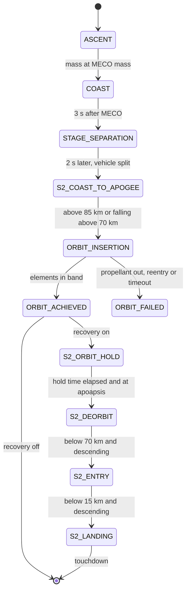
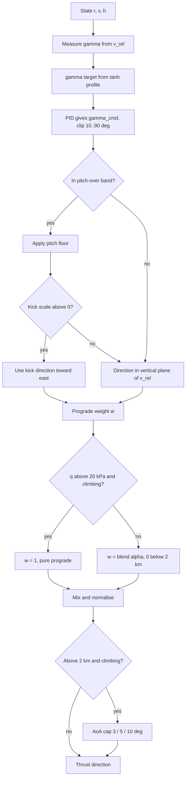
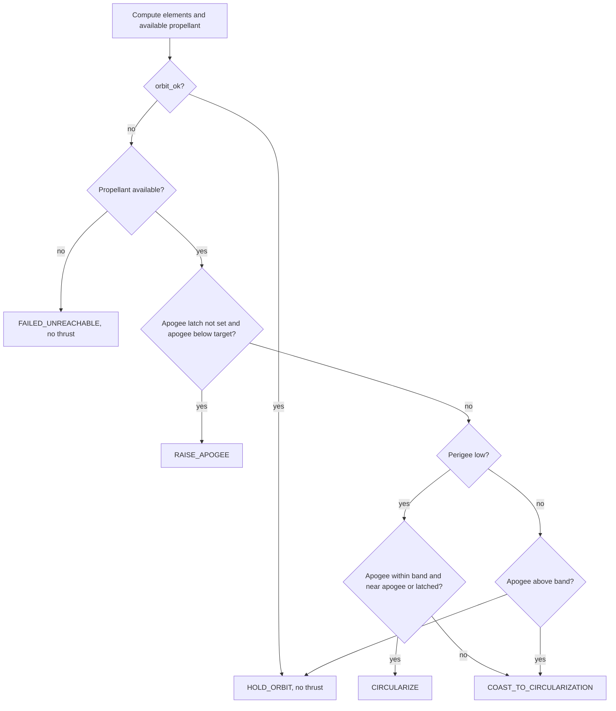

# 6. Ascent and orbit-insertion guidance (including stage-2 recovery)

> This chapter covers the guidance laws that fly the stacked vehicle from lift-off to main-engine cutoff (MECO), the separation event, and the stage-2 (S2) laws that place the upper stage in orbit. It also covers the experimental S2 deorbit, entry and drone-ship landing. All of these are **project heuristics**. The ascent law is a pitch-over kick, then tracking of an altitude-scheduled flight-path-angle profile, then a blend into air-relative prograde (a gravity turn). Separate laws limit angle of attack and hold dynamic pressure. Orbit insertion is an in-plane, two-mode apsidal law: first raise apogee, then coast and fire a tangential vis-viva burn. **It is not IGM, PEG or an optimal-control solution.** The code says so itself (`guidance/ascent.py:6-8`, `guidance/orbit.py:6-7`). No law controls the orbital plane, so the configured target inclination is never used.

All paths are relative to `backend/rlv_sim/`. Default values come from `create_default_config()` (research profile). Where these differ from the class defaults in `config/definition.py`, the factory value is given.

---

## 6.1 Role in the simulation

Each step, `mission/step.py:_run_guidance` (`step.py:96-170`) asks the `MissionManager` for the current phase. It then dispatches as follows:

| Mission phase | Guidance function | Source |
|---|---|---|
| `ASCENT` | `compute_guidance_output` | `guidance/ascent.py:266` |
| `COAST`, `STAGE_SEPARATION`, `S2_COAST_TO_APOGEE` | `compute_coast_guidance` | `guidance/orbit.py:579` |
| `ORBIT_INSERTION` | `compute_orbit_insertion_guidance` | `guidance/orbit.py:196` |
| `ORBIT_ACHIEVED`, `S2_ORBIT_HOLD` (fallback branch) | `compute_coast_guidance` | `step.py:151-155` |
| `S2_DEORBIT` | `compute_deorbit_guidance` | `guidance/orbit.py:372` |
| `S2_ENTRY`, `S2_LANDING` | `compute_s2_entry_landing_guidance` | `guidance/orbit.py:466` |

- **Inputs:** ECI $\mathbf r, \mathbf v$, time $t$ and mass $m$. Guidance gets the true state unless `use_navigation_estimate_for_guidance` (default `False`) is set, in which case it gets the navigation estimate (`step.py:112-118`). Guidance also reads the per-vehicle `GuidanceState` (`guidance/common.py:19`): the PID integrator, the previous $\gamma$, the previous $\bar q$, the insertion start time and direction, and latches.
- **Outputs:** a dict holding the desired thrust unit vector `thrust_direction`, `thrust_on`, `throttle` and a phase label, plus telemetry fields.
- **Downstream:** for the stacked vehicle and the orbiter in non-recovery phases, `update_actuator` rate-limits the thrust direction to `MAX_GIMBAL_RATE` = 25 °/s (`step.py:722`, `vehicle/actuator.py:58-63`, `core/constants.py:347`). In the S2 recovery phases the command is used without that limit (`step.py:715-721`). The throttle command then passes through the engine spool model when `enable_engine_transients` is on (default on: 1.5 s spool-up, 0.8 s spool-down; `step.py:731-737`, `physics/forces.py:547`). The attitude controller (Chapter on attitude control) tracks the resulting direction.

Nominal timeline, from a run of `create_default_config()` made while writing this chapter (log output of `mission/manager.py`):

| Event | t (s) | Altitude (km) | Speed (m/s) |
|---|---|---|---|
| Peak $\bar q$ = 31.9 kPa | 63.2 | ≈ 11 | |
| MECO | 126.55 | 66.5 | 1904 |
| Stage separation (phase entry, = `separation_time`) | 129.55 | 70.9 | |
| Vehicle split / S2 coast | 131.55 | 73.9 | 1867 |
| S2 ignition (insertion start) | 139.35 | 85.0 | 1809 |
| Apogee-raise burn ends | 514.7 | | |
| Circularisation burn | 2037.2–2038.6 | ≈ 383 | |
| `ORBIT_ACHIEVED` | 2038.55 | 383.0 | 7681 |

The final orbit has perigee 327 km, apogee 435 km and $e$ = 0.0080. The measured inclination is 29.1°. About 3030 kg of S2 propellant remains.

---

## 6.2 Local frame and measured flight-path angle

**Idea.** All ascent laws work in a local up/east/north frame built from the position vector. The vertical-plane laws use the air-relative flight-path angle.

$$
\hat{\mathbf u} = \frac{\mathbf r}{|\mathbf r|},\qquad
\hat{\mathbf e} = \frac{\hat{\mathbf k}\times\hat{\mathbf u}}{|\hat{\mathbf k}\times\hat{\mathbf u}|},\qquad
\hat{\mathbf n} = \hat{\mathbf u}\times\hat{\mathbf e}
$$

Here $\hat{\mathbf k} = [0,0,1]$ is the ECI $z$ axis, i.e. Earth's spin axis (`guidance/common.py:123-132`). The air-relative velocity is $\mathbf v_{rel} = \mathbf v - \boldsymbol\Omega_\oplus\times\mathbf r - \mathbf v_{wind}$ (`core/utils.py:95-105`). It splits into $v_{vert} = \mathbf v_{rel}\cdot\hat{\mathbf u}$ and $\mathbf v_{h} = \mathbf v_{rel} - v_{vert}\hat{\mathbf u}$. The measured flight-path angle is

$$
\gamma_{meas} = \operatorname{atan2}(v_{vert},\,|\mathbf v_h|)\quad(\text{deg}),\qquad \gamma_{meas}=90^\circ \text{ if } |\mathbf v_{rel}|<10^{-3}\ \text{m/s}
$$

(`guidance/ascent.py:135-145`). Altitude is spherical: $h = |\mathbf r| - R_\oplus$, with $R_\oplus$ = 6 371 000 m (`ascent.py:106`, `core/constants.py:15`).

Classification: Standard.

---

## 6.3 Vertical rise and pitch-over kick

**Idea.** Right after lift-off the vehicle gets a short, finite "kick" off vertical toward a fixed azimuth. This starts the gravity turn. The kick is a triangular angle profile in altitude. Up to `pitchover_end_altitude`, a minimum pitch-from-vertical floor also applies.

Let $h_0$ = `pitchover_start_altitude`, $h_1 = \max(h_0, $ `pitchover_end_altitude`$)$, and $\theta_{po}$ = `pitchover_angle` clipped to $[0, 30^\circ]$ (`ascent.py:108-124`). The kick is active while $h_0 \le h \le h_1$ (`ascent.py:165`).

**(a) Pitch floor.** This acts on the PID command of §6.4. With ramp span $s = \max(\min(100\ \text{m}, h_1-h_0), 1)$ and $x = \text{clip}((h-h_0)/s, 0, 1)$:

$$
\gamma_{cmd} \leftarrow \min\!\big(\gamma_{cmd},\ 90^\circ - \theta_{po}\,x^2(3-2x)\big)
$$

(`ascent.py:166-178`).

**(b) Kick direction.** This overrides the PID direction while its scale is positive. With $h_{pk} = \min(h_0+500, h_1)$ and $h_{end} = \min(h_1, h_0+1000)$:

$$
\sigma = \begin{cases}\dfrac{h-h_0}{\max(h_{pk}-h_0,1)} & h\le h_{pk}\\[2mm] 1-\dfrac{h-h_{pk}}{\max(h_{end}-h_{pk},1)} & h>h_{pk}\end{cases},\quad \sigma\in[0,1]
$$

$$
\hat{\mathbf a}_{po} = \cos\psi\,\hat{\mathbf n} + \sin\psi\,\hat{\mathbf e},\qquad
\hat{\mathbf d}_{guid} = \cos(\theta_{po}\sigma)\,\hat{\mathbf u} + \sin(\theta_{po}\sigma)\,\hat{\mathbf a}_{po}\quad(\sigma>0)
$$

The azimuth $\psi$ is the constant `PITCHOVER_AZIMUTH` = 90°, so the kick is toward ECI-east (`ascent.py:190-220`, `constants.py:168`).

With the defaults, the kick ramps 0 → 9° between 0 and 500 m and back to 0 between 500 and 1000 m. From 1000 to 2000 m the PID direction applies, held at least 9° off vertical by the floor. Above 2000 m only §6.4–6.5 apply.

| Symbol | Config field / constant | Default | Unit | Meaning |
|---|---|---|---|---|
| $h_0$ | `pitchover_start_altitude` | 0 | m | kick start |
| $h_1$ | `pitchover_end_altitude` | 2000 | m | end of kick and pitch floor; prograde blending is suppressed below it |
| $\theta_{po}$ | `pitchover_angle` | 0.15708 (9°) | rad | peak kick / pitch floor |
| $\psi$ | `PITCHOVER_AZIMUTH` | 90° | rad | kick azimuth from north (fixed) |
| $s$ | `PITCHOVER_RAMP_DISTANCE` | 100 | m | floor ramp span |
| | 500 m, 1000 m | hard-coded | m | kick peak / end offsets |

Classification: Project heuristic; no external reference. The general practice of a pitch kick followed by a gravity turn is textbook [4].

**Known issues.**
- At $h = h_0 + 1000$ m the kick angle has fallen to 0, so the command is near vertical. Just above that height the PID direction takes over with a pitch of at least $\theta_{po}$. The command therefore steps by up to 9°. Only the 25 °/s gimbal rate limit smooths this step.
- The kick axis is fixed ECI-east. The PID axis is the air-relative horizontal velocity direction. These are close but not identical.

---

## 6.4 Flight-path-angle profile and PID tracking

**Idea.** A smooth reference $\gamma_{tgt}(h)$ falls from 90° toward 45° with altitude. A PID loop on the measured $\gamma$ produces a commanded $\gamma$. That command is turned into a direction in the vertical plane that contains the air-relative velocity.

**Reference profile** (`guidance/common.py:144-184`), with $h_{gt}$ = `gravity_turn_start_altitude` and $\Delta$ = `gravity_turn_transition_range`:

$$
\gamma_{tgt}(h) = \begin{cases} 90^\circ & h < h_{gt}\\ 90^\circ + (45^\circ - 90^\circ)\tanh\!\left(\dfrac{h-h_{gt}}{\max(1.4\Delta, 1)}\right) & h\ge h_{gt}\end{cases}
$$

The 45° asymptote and the factor 1.4 are hard-coded (`common.py:162,175`).

**PID** (`ascent.py:147-153`), with $e = \gamma_{tgt}-\gamma_{meas}$ in degrees and $\dot\gamma_{meas} = (\gamma_{meas,k}-\gamma_{meas,k-1})/\max(\Delta t, 10^{-3})$:

$$
I_k = \text{clip}(I_{k-1} + e\,\Delta t,\ -20,\ 20)\ \ (\text{deg s}),\qquad
\gamma_{raw} = \gamma_{tgt} + K_p e + K_i I_k - K_d\dot\gamma_{meas}
$$

The gains are $K_p$ = 0.85, $K_i$ = 0.05 s⁻¹ and $K_d$ = 0.12 s (hard-coded). This is a feed-forward-plus-PID form, with the derivative taken on the measurement. Next, $\gamma_{cmd} = \text{clip}(\gamma_{raw}, 10^\circ, 90^\circ)$, then the pitch floor of §6.3 applies. The command is converted to a direction (`ascent.py:180-188`):

$$
\theta = 90^\circ - \gamma_{cmd},\qquad \hat{\mathbf d}_{guid} = \cos\theta\,\hat{\mathbf u} + \sin\theta\,\hat{\mathbf h},\qquad
\hat{\mathbf h} = \begin{cases}\mathbf v_h/|\mathbf v_h| & |\mathbf v_h|>1\ \text{m/s}\\ \hat{\mathbf e} & \text{otherwise}\end{cases}
$$

| Symbol | Config field / constant | Default | Unit | Meaning |
|---|---|---|---|---|
| $h_{gt}$ | `gravity_turn_start_altitude` | 500 | m | profile and blend start |
| $\Delta$ | `gravity_turn_transition_range` | 20 000 | m | blend width; profile scale = 1.4Δ |
| $K_p, K_i, K_d$ | hard-coded | 0.85, 0.05, 0.12 | –, s⁻¹, s | PID gains |
| | hard-coded | ±20 | deg s | integrator clamp |

Classification: Project heuristic; no external reference.

**Known issues.** Above $h_{gt}+\Delta$ = 20.5 km the prograde weight is 1 (§6.5), so this direction no longer reaches the thrust command. The integrator keeps running anyway. The reported `gamma_command_deg` is not $\gamma_{cmd}$. It is recomputed from the final thrust direction as $\arcsin(\hat{\mathbf d}\cdot\hat{\mathbf u})$ (`ascent.py:258-259`).

---

## 6.5 Prograde blending (gravity turn) and angle-of-attack limit

**Idea.** The PID direction is blended toward the air-relative velocity vector ("prograde"), and is fully prograde above about 20 km. Thrust along $\mathbf v_{rel}$ gives zero angle of attack, i.e. a gravity turn. An angle-of-attack (AoA) cap then bounds the aerodynamic load.

**Blend parameter** (`common.py:187-223`):

$$
\alpha_b = \begin{cases}0 & |\mathbf v_{rel}| < v_{min}\ \text{or}\ h\le h_{gt}\\ 1 & h\ge h_{gt}+\Delta\\ x^2(3-2x),\ x=\dfrac{h-h_{gt}}{\max(\Delta,1)} & \text{otherwise}\end{cases}
$$

**Prograde weight** (`ascent.py:227-236`):

$$
w = \begin{cases}0 & h < h_1\ \text{or}\ |\mathbf v_{rel}|<v_{min}\\ 1 & \bar q > 20\ \text{kPa},\ h\ge h_1,\ v_{vert}>0\\ \alpha_b & \text{otherwise}\end{cases},\qquad
\hat{\mathbf d} = \frac{(1-w)\hat{\mathbf d}_{guid} + w\,\hat{\mathbf v}_{rel}}{|\cdot|}
$$

Here $\bar q = \tfrac12\rho|\mathbf v_{rel}|^2$ uses the configured atmosphere (`ascent.py:155-156`). If the norm of the blend falls below $10^{-6}$, $\hat{\mathbf d}_{guid}$ is used instead.

**AoA limit** (`ascent.py:248-256`, `common.py:70-113`). It applies only when $h\ge h_1$ and $v_{vert}>0$:

$$
\alpha_{max} = \begin{cases}3^\circ & \bar q > 5\ \text{kPa}\\ 5^\circ & h < 50\ \text{km}\\ 10^\circ & \text{otherwise}\end{cases}
$$

When the angle between $\hat{\mathbf d}$ and $\hat{\mathbf v}_{rel}$ exceeds $\alpha_{max}$, the code rotates $\hat{\mathbf v}_{rel}$ by exactly $\alpha_{max}$ toward $\hat{\mathbf d}$. This is Rodrigues' formula with axis $\hat{\mathbf a} = \hat{\mathbf v}\times\hat{\mathbf d}/|\cdot|$:

$$
\hat{\mathbf d}' = \hat{\mathbf v}\cos\alpha_{max} + (\hat{\mathbf a}\times\hat{\mathbf v})\sin\alpha_{max} + \hat{\mathbf a}(\hat{\mathbf a}\cdot\hat{\mathbf v})(1-\cos\alpha_{max})
$$

The last term is zero by construction. No limit is applied when $|\mathbf v|<50$ m/s.

**Phase label** (`ascent.py:318-327`). The label is cosmetic: `VERTICAL_ASCENT` or `PITCHOVER` while $\alpha_b<0.01$, `GRAVITY_TURN` while $\alpha_b<0.99$, and `PROGRADE` after that.

| Symbol | Config field / constant | Default | Unit | Meaning |
|---|---|---|---|---|
| $v_{min}$ | `min_velocity_for_turn` | 50 | m/s | no prograde blending below this speed |
| | hard-coded | 20 000 | Pa | $\bar q$ above which pure prograde is forced |
| $\alpha_{max}$ | hard-coded | 3 / 5 / 10 | deg | AoA cap schedule |
| | hard-coded | 5000, 50 000 | Pa, m | schedule breakpoints |

Classification: the gravity turn (thrust along velocity, so zero lift) is *Standard* [4, 5]. The blend, the weights and the AoA schedule are *Project heuristics*.

**Validity.** The vehicle reaches 20.5 km at roughly the time of max-q (63 s, ≈ 11 km in the nominal run). In practice the $\bar q$ > 20 kPa override already makes the trajectory pure prograde through the dense atmosphere. The trajectory shape is therefore governed mainly by the kick and the early PID segment, not by the 45° tanh asymptote.

---

## 6.6 Max-q management

### 6.6.1 q-hold throttle law

**Idea.** The law commands the along-path acceleration that drives $\bar q$ toward a target with a first-order time constant, then converts that acceleration to throttle.

From $\bar q = \tfrac12\rho v^2$ and an exponential atmosphere, $\dot\rho = -\rho v_{vert}/H$:

$$
\dot{\bar q} = \rho v a_{\parallel} - \tfrac12\rho v^2 \frac{v_{vert}}{H}
$$

Setting $\dot{\bar q} = k(\bar q_{tgt}-\bar q)$ with $k = 1/\tau$ gives the implemented law (`guidance/ascent.py:36-83`):

$$
a_{req} = \frac{k(\bar q_{tgt}-\bar q) + \tfrac12\rho v^2 v_{vert}/H}{\rho v},\qquad
a_{cmd} = a_{req} + g\frac{v_{vert}}{v} + \frac{|\mathbf D|}{m},\qquad
\delta = \text{clip}\!\left(\frac{a_{cmd}\,m}{T(h)},\ \delta_{min},\ \delta_{max}\right)
$$

with

- $v = |\mathbf v_{rel}|$ and $g = \mu/|\mathbf r|^2$;
- $\mathbf D$ from `compute_drag_force` (`ascent.py:76`);
- local scale height from a 200 m finite difference, $H = 200/\ln(\rho(h)/\rho(h+200))$ (`ascent.py:67-71`);
- pressure-compensated stage-1 thrust (`ascent.py:79-81`):

$$
T(h) = T_{sl} + (T_{sl}\,I_{sp,vac}/I_{sp,sl} - T_{sl})\max(0, 1-p/p_0),\qquad T_{sl} = n_{eng}F_{eng}\cdot s_T.
$$

Gates (`ascent.py:58-70`). The law returns $\delta_{max}$ (full throttle) when any of these holds:

- the predicted pressure $\bar q_{pred} = \max(\bar q, \bar q + \max(\dot{\bar q},0)\tau)$ is at or below $0.6\,\bar q_{tgt}$;
- $v<50$ m/s;
- the density difference is not usable.

$\dot{\bar q}$ is a backward difference over one step (`ascent.py:333-337`). Note that $a_{req}$ uses the current $\bar q$, not $\bar q_{pred}$. The prediction serves only as a gate.

### 6.6.2 Scheduled throttle bucket

When $t_{b0} \le t < t_{b1}$, `ascent.py:339-341` applies

$$
\delta \leftarrow \min\big(\delta,\ \max(\delta_{bucket}, \delta_{min})\big)
$$

The bucket is disabled by default because start = end = 0. The validation runs set it per flight, e.g. (50, 74) s for CRS-11 (`validation/flight_compare.py:42-48`).

| Symbol | Config field / constant | Default | Unit | Meaning |
|---|---|---|---|---|
| $\bar q_{tgt}$ | `ascent_max_q_target_pa` | 32 000 | Pa | q-hold target (3 kPa under a 35 kPa structural figure quoted in a code comment) |
| $\tau$ | `Q_HOLD_TIME_CONSTANT_S` | 3.0 | s | time constant and prediction horizon |
| $\delta_{min}, \delta_{max}$ | `min_engine_throttle_fraction`, `max_engine_throttle_fraction` | 0.35, 1.0 | – | throttle limits |
| $t_{b0}, t_{b1}$ | `ascent_throttle_bucket_start_s`, `_end_s` | 0, 0 | s | bucket window (off) |
| $\delta_{bucket}$ | `ascent_throttle_bucket_fraction` | 0.7 | – | bucket throttle |
| $I_{sp,sl}, I_{sp,vac}$ | `ISP`, `ISP_VAC` | 282, 311 | s | stage-1 Isp |
| $n_{eng}F_{eng}$ | `stage1_engine_count` × `stage1_engine_thrust_n` | 9 × 845 222 | N | sea-level thrust |

Classification: the $\dot{\bar q}$ relation is *Standard* kinematics. The control law, gate and time constant are *Project heuristics*. In the nominal run, peak $\bar q$ is 31.9 kPa at 63.2 s, so the target is held.

### 6.6.3 q·α monitor

$q\alpha = \tfrac12\rho|\mathbf v_{rel}|^2\,\alpha$ is computed after each step (`step.py:551-564`). Here $\alpha$ is the axisymmetric incidence of body $+z$ against $\mathbf v_{rel}$, taken as 0 when $|\mathbf v_{rel}|\le 10$ m/s. The value is logged. It ends the run only if `abort_on_q_alpha_limit` (default `False`) is set, and then only when $q\alpha >$ `q_alpha_max` (50 000 Pa·rad). A separate `abort_q_alpha_threshold` (60 000) belongs to the abort monitor, which is off by default (`enable_abort_modes = False`). **Guidance never uses q·α as a feedback quantity.** Loads are limited only indirectly, through the AoA cap of §6.5 and the q-hold law.

---

## 6.7 MECO decision

**Idea.** Stage 1 cuts off when the stack mass falls to a fixed value that leaves the booster's recovery propellant on board. This is a propellant-reserve cutoff, not a velocity or energy target.

$$
m_{MECO} = m_{S1,dry} + m_{S2,dry} + m_{S2,prop} + m_{pay} + m_{reserve}
$$

(`config/definition.py:444-457`). Guidance sets `thrust_on` = $m > m_{MECO}$ (`ascent.py:329`). The mission manager switches `ASCENT → COAST` when $m \le m_{MECO}$ (`mission/manager.py:209-221`). The stacked step is run with `dry_mass` = $m_{MECO}$ (`full_mission.py:234`), so the propellant floor in `step.py:729-730` stops the flow exactly there. With the defaults, $m_{MECO}$ = 22 200 + 4000 + 107 500 + 8000 + 67 500 = 209 200 kg. That is 343 400 kg of the 410 900 kg load burned on ascent.

| Symbol | Config field | Default | Unit |
|---|---|---|---|
| $m_{reserve}$ | `stage1_landing_fuel_reserve_kg` | 67 500 (factory; class default 35 000) | kg |
| | `auto_size_recovery_reserve` | False | – |
| | `recovery_reserve_wind_sensitivity_kg_per_mps` | 383 | kg per m/s of headwind (`config/factory.py:50-58`) |

Classification: Project heuristic. The reserve sizing belongs to the booster recovery chapter.

**Known issue.** The module docstring (`manager.py:8`) says "MECO: propellant exhaustion (m <= m_dry)". The code actually cuts off at $m_{MECO}$, with the reserve still on board.

---

## 6.8 Post-MECO coast and stage separation

**Timing** (`manager.py:223-238`):

- `COAST` lasts until $t - t_{MECO} > 3$ s.
- `STAGE_SEPARATION` lasts until 2 s more have passed.
- The manager then enters `S2_COAST_TO_APOGEE`. The stacked loop sees an S2 phase and exits (`full_mission.py:281-284`).

The stack is split into two vehicles only at that moment, about 5 s after MECO (`full_mission.py:360-392`). The recorded `separation_time` is the entry time of `STAGE_SEPARATION`, i.e. MECO + 3 s. During both phases the stack coasts as one body, with the attitude held on the last ascent direction (§6.9).

**Mass split.** The orbiter gets $m_O = m_{S2,dry}+m_{S2,prop}+m_{pay}$ with dry mass $m_{S2,dry}+m_{pay}$. The booster gets $m_B = m_{S1,dry}+m_{reserve}$. Since $m_O+m_B = m_{MECO}$, mass is conserved. Both inherit $\mathbf r, \mathbf v, \mathbf q, \boldsymbol\omega$ (`mission/vehicle_split.py:61-83`). The orbiter also inherits the last ascent thrust direction and the actuator direction (`full_mission.py:381-382`).

**Separation impulse** (`vehicle_split.py:36-58`). This applies only when `enable_separation_dynamics` is set. Let $\hat{\mathbf n}$ be body $+z$ in ECI, $\hat{\mathbf s} = \hat{\mathbf n}\times\hat{\mathbf v}/|\cdot|$ the spin axis, and $M = m_O+m_B$:

$$
\Delta\mathbf v_O = +\hat{\mathbf n}\,\Delta v\,\frac{m_B}{M},\quad
\Delta\mathbf v_B = -\hat{\mathbf n}\,\Delta v\,\frac{m_O}{M},\qquad
\Delta\boldsymbol\omega_O = +\hat{\mathbf s}\,\omega_t\frac{m_B}{M},\quad
\Delta\boldsymbol\omega_B = -\hat{\mathbf s}\,\omega_t\frac{m_O}{M}
$$

The velocity split conserves linear momentum ($m_O\Delta\mathbf v_O + m_B\Delta\mathbf v_B = 0$), and the relative separation speed is exactly $\Delta v$.

| Symbol | Config field | Default | Unit | Meaning |
|---|---|---|---|---|
| | `enable_separation_dynamics` | True | – | apply the impulse |
| $\Delta v$ | `separation_delta_v` | 1.5 | m/s | **relative** separation speed, split by mass ratio |
| $\omega_t$ | `separation_tumble_rate` | 0.02 | rad/s | **relative** tumble rate, split by mass ratio |
| | `stage_sep_velocity` | 2200 | m/s | **not used by any physics or guidance** (see below) |

Classification: momentum-conserving impulsive split is *Standard*. The magnitudes are *Project heuristics*.

**Known issues.**
- $\hat{\mathbf s}$ is an ECI vector, but it is added to $\boldsymbol\omega$, which is stored in the body frame (`core/state.py:32`). The frame mismatch is not explained in code.
- The tumble split is weighted by mass, not by inertia, so angular momentum is not conserved.
- The field docs (`config/field_docs.py`) describe `separation_delta_v` and `separation_tumble_rate` as what "the booster receives". The code splits both between the two bodies.
- `stage_sep_velocity` is stored, exposed by the API (`server/app.py:286-287`) and documented as "speed of the stack at separation", but nothing reads it. Separation happens at whatever speed MECO produces (1904 m/s at MECO in the nominal run).

---

## 6.9 Unpowered coast guidance and S2 ignition

`compute_coast_guidance` (`orbit.py:579-635`) commands no thrust. It holds `last_ascent_direction`, the final ascent thrust direction. When $|\mathbf v_{rel}|>10$ m/s that direction is AoA-limited to 15° against $\mathbf v_{rel}$; with no stored direction it falls back to prograde.

**S2 ignition** (`manager.py:240-267`). The phase goes `S2_COAST_TO_APOGEE → ORBIT_INSERTION` when either

$$
h > h_{ign}\qquad\text{or}\qquad (\dot r < -20\ \text{m/s}\ \wedge\ h > h_{EI})
$$

with $\dot r = \mathbf r\cdot\mathbf v/|\mathbf r|$. With the defaults, S2 lights at 85 km, 7.8 s after the split, in the nominal run.

| Symbol | Config field | Default | Unit |
|---|---|---|---|
| $h_{ign}$ | `orbit_insertion_start_altitude_m` | 85 000 | m |
| $h_{EI}$ | `s2_entry_interface_altitude_m` | 70 000 | m |

**Known issue.** If the S2 apogee after separation is below $h_{EI}$, neither condition can become true. The orbiter then stays in this phase until `max_time` (6000 s). The comment at `manager.py:247-252` acknowledges this case.

---

## 6.10 Orbital elements from the state

`compute_orbit_metrics` (`mission/manager_helpers.py:38-75`) is used by both guidance and the manager:

$$
\varepsilon = \tfrac12 v^2 - \frac{\mu}{r},\qquad
a = \begin{cases}-\mu/(2\varepsilon) & |\varepsilon| > 1\ \text{J/kg}\\ r & \text{otherwise}\end{cases},\qquad
\mathbf h = \mathbf r\times\mathbf v
$$

$$
e = \sqrt{\max\!\left(0,\ 1 - \frac{h^2}{\mu a}\right)}\ (a>0),\ \ e=1\ (a\le 0);\qquad
h_p = a(1-e) - R_\oplus,\quad h_a = a(1+e) - R_\oplus
$$

$\mu$ = 3.986004418 × 10¹⁴ m³/s². These are inertial two-body elements over a spherical Earth: J2 and drag are ignored in the element computation, though they may be active in the dynamics. Inclination is not computed anywhere in the package. S2 propellant is $m - (m_{S2,dry}+m_{pay})$.

Classification: Standard [1, 2].

---

## 6.11 Orbit-insertion guidance

**Idea.** The law is a simple in-plane, two-burn apsidal strategy:

1. **RAISE_APOGEE.** Burn roughly horizontally, with a pitch chosen to track a radial-velocity target, until apogee reaches the target altitude.
2. **COAST_TO_CIRCULARIZATION.** Coast up toward apogee.
3. **CIRCULARIZE.** Fire horizontally toward the vis-viva speed for an orbit whose semi-major axis is the target radius.

All steering lies in the plane of $\hat{\mathbf u}$ and the inertial horizontal velocity, so the orbital plane is whatever the ascent produced.

**Propellant available** (`orbit.py:266-271`):

$$
m_{p,avail} = m_{p,S2} - m_{res}
$$

where $m_{res}$ = `s2_landing_propellant_reserve_kg` only when `enable_s2_recovery` is on, and 0 otherwise.

### 6.11.1 Mode selection

`_select_insertion_mode` (`orbit.py:99-193`) works with the band $[h_t-\Delta h,\ h_t+\Delta h]$ and the apogee-raise cutoff $h_t$. It defines:

- **orbit_ok** (guidance version): $\varepsilon<0$, $h_p>100$ km, $|h_p-h_t|\le\Delta h$, $|h_a-h_t|\le\Delta h$ and $e\le e_{max}$ (`orbit.py:120-126`).
- **apogee-raise latch:** set once $h_a \ge h_t$ and never cleared (`orbit.py:127-128`).
- **near apogee:** $h \ge h_a - 30$ km and $|\dot r|\le 60$ m/s (`orbit.py:135`).
- **circularisation latch:** active while perigee needs raising ($h_p < h_t-\Delta h$), the apogee latch is set, $h_a \le h_t+\Delta h$ and propellant remains, and either the vehicle is near apogee or the latch was already active under the same window conditions (`orbit.py:137-154`). The first 1.5 s after the latch sets are the "settling" period.

### 6.11.2 RAISE_APOGEE law (`orbit.py:63-83`)

$$
g_{eff} = \frac{\mu}{r^2} - \frac{v_h^2}{r},\qquad
\dot r_{tgt} = 0.0005\,\max(0, h_t-h_a),\quad
\dot r_{tgt} \leftarrow \max\!\big(\dot r_{tgt},\ 25(1 - h/120\,\text{km})\big)\ \text{if } h<120\ \text{km}
$$

$$
a_{vert} = 0.12\,(\dot r_{tgt}-\dot r),\qquad
\sin\theta = \frac{a_{vert} + g_{eff}}{T_{vac}/m},\qquad
\theta = \text{clip}\big(\arcsin(\text{clip}(\sin\theta, \pm0.99)),\ -5^\circ,\ 75^\circ\big)
$$

$$
\delta = \text{clip}\!\left(\frac{h_t - h_a}{\max(8000,\ 0.3\Delta h)},\ 0.4,\ 1\right),\qquad \text{thrust on iff } m_{p,avail}>0 \wedge h_a<h_t
$$

Here $\dot r$ and $v_h$ are inertial (`orbit.py:225-227`) and $T_{vac}$ = `stage2_thrust_vac`. The gains 0.0005 s⁻¹ and 0.12 s⁻¹, the 25 m/s floor and the 120 km height are hard-coded.

### 6.11.3 CIRCULARIZE law (`orbit.py:30-60`)

$$
v_{tgt} = \sqrt{\mu\left(\frac{2}{r} - \frac{1}{R_\oplus + h_t}\right)},\qquad \Delta v = v_{tgt} - v_h
$$

$$
\text{thrust on iff } m_{p,avail}>0 \wedge h_p<h_t-\Delta h \wedge \Delta v>0.1\ \text{m/s} \wedge h_a\le h_t+\Delta h;\qquad
\delta = \begin{cases}0.40 & \text{settling}\\ \text{clip}(\Delta v/25,\ 0.5,\ 1) & \text{otherwise}\end{cases}
$$

The pitch is $\theta = 0$ (horizontal).

### 6.11.4 Direction construction (`orbit.py:304-317`)

$$
\hat{\mathbf d}_{tgt} = \cos\theta\,\hat{\mathbf h}_I + \sin\theta\,\hat{\mathbf u}
$$

$\hat{\mathbf h}_I$ is the inertial horizontal velocity direction, or $\hat{\mathbf e}$ if $v_h\le 10$ m/s. For the first 20 s after insertion starts, $\hat{\mathbf d}$ is a smoothstep blend from the stored ascent direction to $\hat{\mathbf d}_{tgt}$ (`orbit.py:86-96`). Below `AERO_DISABLE_ALTITUDE` (120 km) the direction is AoA-limited to 15° against the **inertial** $\mathbf v$ (`orbit.py:313-314`). In the other modes the thrust is off and the direction is still horizontal.

| Symbol | Config field | Default | Unit | Meaning |
|---|---|---|---|---|
| $h_t$ | `orbit_target_altitude_m` | 400 000 | m | target altitude (apogee-raise cutoff, vis-viva radius) |
| $\Delta h$ | `orbit_altitude_tolerance_m` | 75 000 | m | acceptance half-band for both apsides |
| $e_{max}$ | `orbit_ecc_max` | 0.02 | – | must be in (0, 1) |
| | `orbit_insertion_timeout_s` | 5000 | s | stall timeout (§6.12) |
| | `target_inclination_deg` | 28.5 | deg | **not used** |
| $T_{vac}$ | `stage2_thrust_vac` | 950 000 | N | S2 vacuum thrust |
| | `stage2_isp_vac` | 348 | s | S2 vacuum Isp |
| | `orbit_coast_max_dt` | 0.5 | s | larger RK4 step for unpowered orbiter arcs above 120 km after the booster finishes (`full_mission.py:440-446`) |

Classification: vis-viva is *Standard* [1, 2]. The two-burn apsidal strategy is a textbook idea (a Hohmann-like apogee/perigee sequence) [1]. The mode logic, gains and throttle laws are *Project heuristics*.

**What it is not.** Saturn-era IGM [6] and the Space Shuttle's Powered Explicit Guidance (PEG) [3, 7] solve, in closed form or iteratively, for a steering law (typically linear tangent) and a time-to-go that hit the terminal position and velocity, including the orbital plane. Nothing in this module estimates $t_{go}$, predicts terminal state, or steers out of plane. These works are cited only for context: the code does not implement them.

**Inclination.** The kick is due ECI-east and every later command lies in the local vertical plane of the current velocity. The inclination is therefore set by the launch latitude (28.6° at the default site, `core/constants.py:197`) plus small effects of steering along air-relative rather than inertial horizontal velocity. The nominal run gives 29.1°. `target_inclination_deg` has no effect, which matches VALIDATION.md: "Target inclination was tried per flight and does not change the stage-1 trajectory".

---

## 6.12 Insertion cutoff and failure criteria

The manager evaluates these at the start of every step, before guidance runs (`manager.py:269-341`), in this order:

1. **`ORBIT_ACHIEVED`** if $\varepsilon<0$, $|h_p-h_t|\le\Delta h$, $|h_a-h_t|\le\Delta h$ and $e\le e_{max}$. Unlike the guidance version, this check has no $h_p>100$ km term. The engine cuts because the phase change switches guidance to coast.
2. **`ORBIT_FAILED`** if the S2 propellant is exhausted ($m - m_{dry} \le 0$).
3. **`ORBIT_FAILED` (reentry)** if $h < 80$ km, $\dot r < -50$ m/s and $h_p < 100$ km.
4. **`ORBIT_FAILED` (stall)** if the time in `ORBIT_INSERTION` exceeds `orbit_insertion_timeout_s`.

`check_termination` ends the orbiter on `ORBIT_FAILED`. It also ends the orbiter on `ORBIT_ACHIEVED` when recovery is off (`step.py:416-443`).

**Consequence.** The cutoff criterion is *first entry into the acceptance band*, not a target state. The run therefore stops as soon as perigee crosses $h_t-\Delta h$ = 325 km, which explains the nominal 327 × 435 km orbit. The nominal insertion consists of:

- a 375 s apogee-raise burn (139–515 s), which used about 104 t;
- a 1520 s coast;
- a 1.4 s circularisation burn that pushed perigee into the band.

The regression test pins these numbers (§6.14).

**Dead ends (Project heuristic limitations).**
- If apogee overshoots the band while perigee is acceptable or low, the mode becomes `COAST_TO_CIRCULARIZATION` permanently. No retrograde correction exists, so the run ends by timeout.
- `FAILED_UNREACHABLE` (guidance) coasts without thrust. The manager reports failure only through reentry, exhaustion or timeout, so a non-zero S2 landing reserve can leave the stage coasting for up to 5000 s.

---

## 6.13 Stage-2 recovery (experimental)

Recovery is enabled by `enable_s2_recovery` (default `False`). The phase logic is in `manager.py:343-378`.

- **Hold.** `S2_ORBIT_HOLD` starts on `ORBIT_ACHIEVED`. It ends when at least `s2_orbit_hold_time_s` has passed **and** $\dot r$ changes from positive to non-positive (apoapsis).
- **Deorbit** (`orbit.py:372-463`). Full-throttle retrograde thrust, $\hat{\mathbf d} = -\hat{\mathbf v}$. The burn stops at the first of: $h_p \le$ `s2_deorbit_target_perigee_m` (−80 km, i.e. below the surface for a steep entry), $m_{p,avail}\le0$, or $\Delta v_{used} = I_{sp}g_0\ln(m_{start}/m) \ge 300$ m/s. That calculation uses the constant `STAGE2_ISP_VAC`, not `stage2_isp_vac`.
- **Entry.** Starts when $h < h_{EI}$ and $\dot r<0$. The stage flies unpowered and retrograde, switching to $+\hat{\mathbf u}$ below 20 km (`orbit.py:501-502`). Drag on the orbiter in `S2_ENTRY` and `S2_LANDING` is multiplied by `s2_entry_drag_scale` = 45 (`physics/forces.py:1195-1197`). This is a large tuning factor that stands in for a lifting or high-drag entry body, which the model does not have.
- **Landing.** Starts when $h<15$ km and $\dot r<0$ (`orbit.py:504-549`). The ignition altitude is $\max(h_{ig}\cdot SF, 1200\ \text{m})$, with $h_{ig}$ from the variable-mass suicide-burn estimator `estimate_suicide_burn` (described in the booster recovery chapter) and $SF$ = `booster_landing_ignition_safety_factor` (1.8). The burn latches on. Once lit:

$$
a_{vert} = \frac{v_d^2}{2\max(h-40,1)} + g,\qquad a_{hor} = \frac{|\mathbf v_{h}|}{8\ \text{s}},\qquad
\mathbf a_{cmd} = a_{vert}\hat{\mathbf u} - a_{hor}\hat{\mathbf v}_h,\qquad
\delta = \text{clip}\!\left(\frac{|\mathbf a_{cmd}|}{T_{vac}/m}, 0, 1\right)
$$

Thrust cuts when $h<3$ m and $|\mathbf v_{rel}|<1.5$ m/s. Touchdown at $h\le0.1$ m counts as a success if the surface-relative speed is below `s2_touchdown_speed_limit_mps` (5 m/s) (`step.py:74-82, 420-440`). In recovery phases the thrust direction bypasses the gimbal rate limit, and the torque is capped at the booster level (`step.py:622-630`).

**Why it is propellant-starved.** By the code's own account (`config/definition.py:162-187`, `tests/test_s2_landing_propellant_reserve.py:1-21`):

- insertion plus deorbit leave about 1.7 t of propellant;
- a replay of the failing landing needed about 4.2 t to land at 1.85 m/s;
- reserving 4 t (`s2_landing_propellant_reserve_kg`) made insertion itself fail (perigee −208 km).

The vehicle carries no margin for S2 recovery, so the default reserve is 0 and S2 recovery normally ends in a "S2 DRONE-SHIP CRASH". The nominal run leaves 3.0 t after insertion; the deorbit burn uses part of that.

| Config field | Default | Unit | Meaning |
|---|---|---|---|
| `enable_s2_recovery` | False | – | enable recovery phases |
| `s2_orbit_hold_time_s` | 600 | s | minimum hold before deorbit |
| `s2_deorbit_target_perigee_m` | −80 000 | m | deorbit cutoff perigee |
| `s2_entry_interface_altitude_m` | 70 000 | m | entry interface (also used in §6.9) |
| `s2_entry_drag_scale` | 45 | – | drag multiplier in entry and landing |
| `s2_touchdown_speed_limit_mps` | 5 | m/s | landing success threshold |
| `s2_landing_propellant_reserve_kg` | 0 | kg | propellant withheld from insertion and deorbit |
| hard-coded | 300 m/s, 15 km, 20 km, 40 m, 8 s, 1200 m | | Δv cap, landing start, nose-up height, stop height, horizontal time constant, minimum ignition altitude |

Classification: Project heuristic throughout. It is experimental and not validated.

---

## 6.14 Verification

| Test | What it checks |
|---|---|
| `tests/test_full_mission_regression.py` (slow) | Nominal default mission: `separation_time` = 129.55 ± 0.1 s; perigee 326.73 ± 2 km; apogee 435.01 ± 2 km; $e$ = 0.00802 ± 5e-4; orbiter success |
| `tests/test_flight_validation.py::test_meco_speed_matches_flight_telemetry` (slow) | CRS-11 replay (6.9 t payload, bucket 50–74 s): sim MECO speed within 5 % of flight |
| `tests/test_s2_landing_propellant_reserve.py` | reserve gating: `FAILED_UNREACHABLE` below the reserve; no effect with recovery off; deorbit burn on/off around the reserve; zero reserve equals no reserve |
| `tests/test_review_regressions.py` | pre-separation runs can be assessed (with and without S2 recovery); S2 report uses the achieved or last insertion state; separated vehicles use the configured mass limits |
| `tests/test_validation_tier1.py`, `tests/test_physics_checks.py` | Keplerian conservation and the vis-viva semi-major axis (checks the element relations of §6.10 indirectly) |
| `tests/test_mission_smoke.py` | short ascent runs and terminates |

No unit test covers `compute_desired_thrust_direction`, `compute_q_hold_throttle`, the throttle bucket, `_select_insertion_mode` or `_compute_separation_adjustments` in isolation. They are covered only by the full-mission regression.

**Validation against Falcon 9** (`docs/VALIDATION.md`). Four webcast-telemetry flights were compared:

| Flight | MECO speed flight / sim (m/s) | MECO altitude flight / sim (km) | MECO time flight / sim (s) | Peak q flight / sim (kPa) |
|---|---|---|---|---|
| CRS-11 | 1684 / 1618 (−3.9 %) | 62.4 / 67.0 | 145 / 135.8 | 23.0 / 29.7 |
| Orbcomm OG2 | 1670 / 1692 (+1.4 %) | 74.5 / 73.4 | 145 / 129.7 | 28.6 / 31.9 |
| NROL-76 | 1685 / 1642 (−2.5 %) | 67.8 / 70.9 | 140 / 129.5 | 29.2 / 31.9 |
| Zuma | 1672 / 1629 (−2.6 %) | 61.8 / 69.1 | 143 / 131.9 | 26.0 / 29.4 |

- MECO speed agrees within 4 %.
- MECO comes 6–10 % early, which VALIDATION.md attributes to the 67.5 t recovery reserve.
- Peak $\bar q$ is 9–29 % high.
- Note that `flight_compare.simulate` uses `separation_time` as the sim's "MECO" (`validation/flight_compare.py:57`). Separation time is 3 s after the actual MECO (§6.8), so the sim MECO times in that table are about 3 s later than the true sim MECO, and the early-MECO gap is understated by about 2 %.
- No validation exists for the S2 insertion, the orbit or S2 recovery.

---

## 6.15 Summary of known issues

1. `target_inclination_deg` and `stage_sep_velocity` are configurable and shown in the UI and API but read by no model (§6.8, §6.11).
2. The separation tumble adds an ECI-frame vector to the body-frame $\boldsymbol\omega$ and is mass-weighted, so angular momentum is not conserved. Field docs describe both separation quantities as the booster's alone (§6.8).
3. There is a pitch-command step of up to `pitchover_angle` at 1000 m above `pitchover_start_altitude` (§6.3).
4. The insertion cutoff is first entry into the ±75 km band, so the "400 km" target yields about 327 × 435 km. No retrograde mode exists for apogee overshoot (§6.12).
5. The manager's `orbit_ok` lacks the guidance's $h_p>100$ km term. This is harmless while $h_t-\Delta h > 100$ km.
6. The RAISE_APOGEE pitch assumes full thrust, but the throttle can be 0.4, so gravity is under-compensated at low throttle. The insertion AoA limit uses inertial rather than air-relative velocity. The deorbit Δv cap uses the constant Isp, not the configured one.
7. S2 never ignites if its apogee after separation is below `s2_entry_interface_altitude_m` (§6.9).
8. The manager docstring says MECO happens at $m\le m_{dry}$; it actually happens at $m_{MECO}$ (§6.7).
9. VALIDATION.md's sim "MECO time" is the separation time, MECO + 3 s (§6.14).

---

## 6.16 References

1. Curtis, H. D. *Orbital Mechanics for Engineering Students*, 3rd ed. Butterworth-Heinemann (Elsevier), 2014. (Two-body energy, vis-viva, orbital elements, apsidal manoeuvres.)
2. Bate, R. R., Mueller, D. D., White, J. E. *Fundamentals of Astrodynamics*. Dover Publications, 1971.
3. Jaggers, R. F. "An Explicit Solution to the Exoatmospheric Powered Flight Guidance and Trajectory Optimization Problem for Rocket Propelled Vehicles." AIAA Paper 77-1051, AIAA Guidance and Control Conference, 1977. (PEG; context only, not implemented.)
4. Sutton, G. P., Biblarz, O. *Rocket Propulsion Elements*, 9th ed. Wiley, 2017. (Flight performance, gravity-turn trajectories.)
5. Vallado, D. A. *Fundamentals of Astrodynamics and Applications*, 4th ed. Microcosm Press, 2013.
6. Chandler, D. C., Smith, I. E. "Development of the Iterative Guidance Mode with its Application to Various Vehicles and Missions." *Journal of Spacecraft and Rockets*, Vol. 4, No. 7, 1967. (IGM; context only, not implemented.)
7. McHenry, R. L., Brand, T. J., Long, A. D., Cockrell, B. F., Thibodeau, J. R. "Space Shuttle Ascent Guidance, Navigation, and Control." *Journal of the Astronautical Sciences*, Vol. 27, No. 1, 1979. (Context only.)
8. shahar603, *Telemetry-Data* (GitHub repository, public domain): Falcon 9 webcast telemetry used in `docs/VALIDATION.md`.

The ascent, q-hold, insertion and S2 recovery laws themselves are project heuristics with no external reference.
