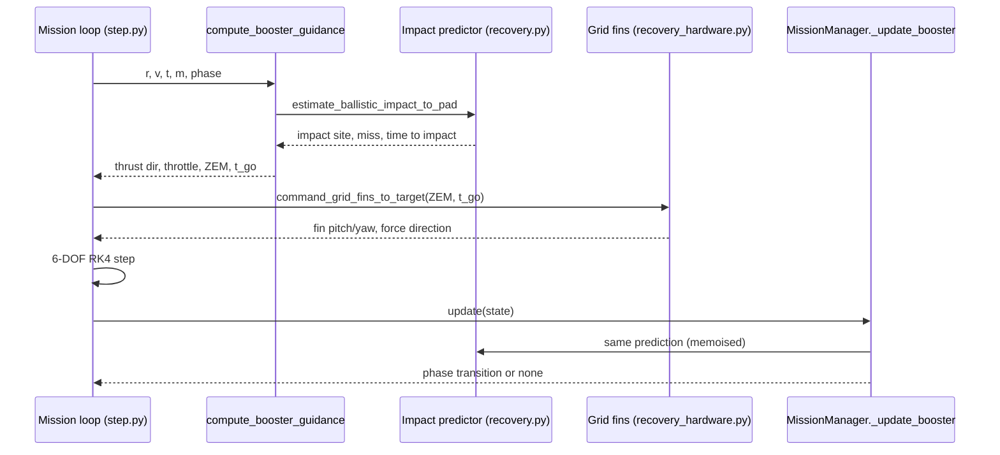
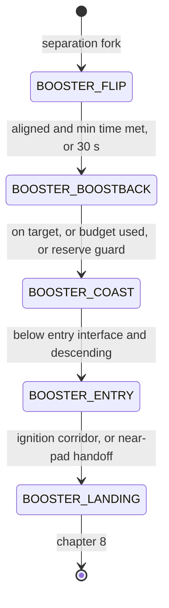
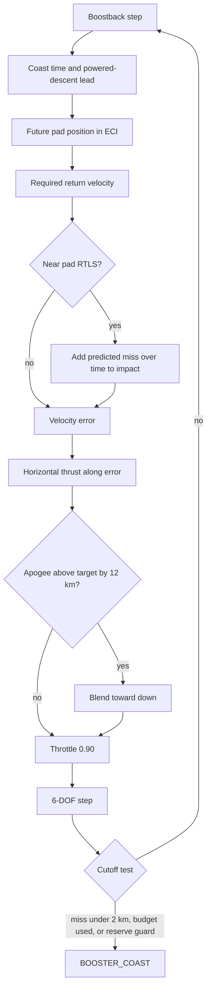
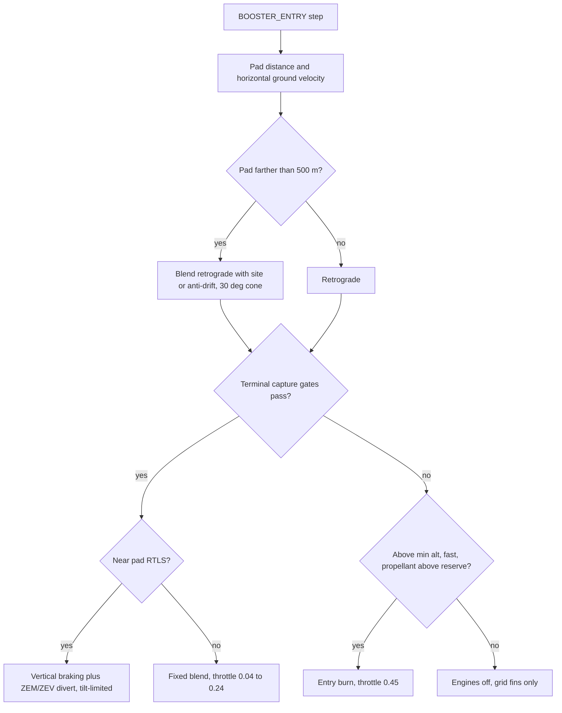

# 7. Booster recovery guidance I: flip, boostback, coast and entry

> After stage separation the first stage (the "booster") flies its own return-to-launch-site (RTLS) recovery: it flips to point its engines along the air-relative velocity vector, burns back toward the pad (boostback), coasts over apogee, re-enters the sensible atmosphere and, in the default near-pad RTLS case, flies a thrusting terminal-capture law while grid fins steer it toward the pad. This chapter covers everything from separation up to landing-burn ignition. The landing burn itself (`_landing_guidance`, G-FOLD, position hold) is covered in chapter 8. The guidance is a **project heuristic** built on standard parts: two-body plus drag impact prediction (RK4), Earth-rotation site geometry, rocket-equation and work-energy budgets, and a zero-effort-miss / zero-effort-velocity (ZEM/ZEV) style lateral law. Its gains, gates and blends are tuned for the default Falcon 9-like vehicle, and the guidance uses the same drag model as the simulated "truth".

## 7.1 Role in the simulation

At separation, `full_mission.py` forks the stack into an orbiter and a booster. The booster has mass $m_{dry} + m_{res}$ (`stage1_dry_mass` + `stage1_landing_fuel_reserve_kg` = 22 200 + 67 500 kg; `backend/rlv_sim/mission/full_mission.py:363`) and gets its own `MissionManager(vehicle_type="booster")`, which starts in `BOOSTER_FLIP` (`backend/rlv_sim/mission/manager.py:101-102`). The following runs on every integration step:

Guidance entry point: `compute_booster_guidance` (`backend/rlv_sim/guidance/booster.py:1163`). Inputs are the inertial state $(\mathbf r,\mathbf v)$, time, mass and phase name. Outputs are a unit thrust direction (the attitude target for the body $+z$ axis), `thrust_on`, `throttle`, and, during entry, a ZEM vector and $t_{go}$ for the grid fins. The engine cluster depends on the phase: boostback uses `boostback_engine_count` = 3 engines, entry uses `entry_engine_count` = 3 and landing uses `landing_engine_count` = 1 (`backend/rlv_sim/mission/step.py:599-618`). Each engine gives $T_e$ = 7.607 MN / 9 = 845.2 kN, so $T_{bb}=T_{entry}$ = 2.536 MN. In the flip, boostback, entry and landing phases the integration step is capped at `C.BOOSTER_RECOVERY_MAX_DT` = 0.05 s (`manager.py:163-178`).

### Phase sequence

No separate apogee phase exists. `BOOSTER_COAST` covers the climb after boostback cutoff, apogee and the fall to the entry interface. The "entry burn" and the "aerodynamic descent with grid fins" are not separate phases either. Both happen inside `BOOSTER_ENTRY`: whether thrust is on, and how much, is decided on every call (§7.7).

Timeline of the default nominal mission (`create_default_config()`, no wind; transition lines from the run log of this code version):

| Event | t (s) | Altitude | Note |
|---|---|---|---|
| Separation (`BOOSTER_FLIP` start) | 129.55 | 70.9 km | booster 89.7 t |
| Flip complete | 157.40 | ≈108 km | aligned; 27.9 s, longer than the 11 s minimum |
| Boostback cutoff | 193.95 | ≈135 km | "impact on target": predicted miss 1.9 km, propellant 37.9 t |
| Apogee (inside `BOOSTER_COAST`) | ≈221 | ≈138.7 km | |
| Entry interface | 341.20 | 70.0 km | 1151 m/s |
| `BOOSTER_LANDING` | 455.65 | 6.2 km | near-pad handoff (see 7.10) |
| Touchdown | ≈505.6 | 0 | 5.37 t propellant left |

## 7.2 Flip manoeuvre

**Idea.** The engine stays off while the attitude controller turns the body $+z$ axis to the air-relative retrograde direction, so the engines face the direction of travel for the boostback.

**Equations.** The guidance target is (`booster.py:1182-1186, 1251-1252`)

$$
\hat{\mathbf d} = -\frac{\mathbf v_{rel}}{\lVert \mathbf v_{rel}\rVert},\qquad \text{thrust\_on} = \text{false}.
$$

Here $\mathbf v_{rel}$ is the velocity relative to the rotating, windy atmosphere (`compute_relative_velocity`). The phase ends (`manager.py:383-397`) when

$$
\big(\angle(\hat{\mathbf z}_{body}, -\hat{\mathbf v}) < 15^\circ \;\wedge\; t-t_{phase} > t_{flip,min}\big)\;\vee\; t - t_{phase} > 30\ \text{s}.
$$

**Implementation notes.** The manager tests alignment against **inertial** retrograde $-\mathbf v/\lVert\mathbf v\rVert$ (`check_attitude_aligned`, `backend/rlv_sim/mission/manager_helpers.py:21-35`). The guidance, however, points at **air-relative** retrograde. Near the pad the two differ by the Earth-rotation velocity (≈408 m/s eastward at 28.6° latitude), which is a few degrees at separation speed. The 15° tolerance absorbs this. If $\lVert\mathbf v\rVert \le 1$ m/s, alignment counts as true.

| Symbol | Config field / constant | Default | Unit | Meaning |
|---|---|---|---|---|
| $t_{flip,min}$ | `booster_flip_min_time_s` | 11.0 | s | minimum flip duration |
| — | literal (`manager.py:387`) | 15 | deg | alignment tolerance |
| — | literal (`manager.py:393`) | 30 | s | flip timeout |

**Classification.** Project heuristic (retrograde pointing is the standard idea; the thresholds are tuned).

## 7.3 Landing-site geometry in ECI

**Idea.** The pad is fixed to the rotating Earth. Every predictor therefore evaluates the pad's inertial position at the time the booster is expected to arrive there.

**Equations.** For a site given by latitude and longitude, the spherical Earth-fixed (ECEF) position is rotated about $\hat{\mathbf z}$ by $\theta=\omega_E t$ (`backend/rlv_sim/guidance/recovery.py:62-82`):

$$
\mathbf r_{site}(t) = R_z(\omega_E t)\,\mathbf r_{site}^{ECEF},\qquad \mathbf r^{ECEF} = (R_E+h)\,[\cos\phi\cos\lambda,\ \cos\phi\sin\lambda,\ \sin\phi]^T .
$$

By default (`booster_landing_site_lat_deg/lon_deg` = None) the target is placed a surface arc $d$ east of the rotating launch site (`target_landing_site_eci`, `recovery.py:105-147`):

$$
\hat{\mathbf e} = \frac{\hat{\mathbf z}\times\hat{\mathbf r}_L}{\lVert\hat{\mathbf z}\times\hat{\mathbf r}_L\rVert},\quad
\theta_d = \frac{d}{R_E},\quad
\mathbf r_T = R_E\,\frac{\cos\theta_d\,\hat{\mathbf r}_L + \sin\theta_d\,\hat{\mathbf e}}{\lVert\cdot\rVert}.
$$

$d$ is `booster_landing_target_downrange_km` (0 by default, i.e. RTLS to the launch pad). The target sits at radius $R_E$, so `launch_site_altitude_m` is ignored here. A site counts as "near pad" if it lies within 15 km great-circle distance of the launch site (`is_near_pad_target`, `recovery.py:259-264`). Many gains switch on this flag, `near_pad_rtls`. Distances use $s = R_E\arccos(\hat{\mathbf a}\cdot\hat{\mathbf b})$ (`recovery.py:267-274`).

**Movable target (optional).** With `enable_movable_landing_target`, the downrange is shifted by the wind drift the booster would pick up, emulating where a drone ship would be stationed (`movable_target_downrange_km`, `recovery.py:150-221`):

$$
d_{eff} = d + \operatorname{clip}\!\Big(\frac{k_w\,T_{exp}\,\big[(\mathbf w(\mathbf p;\Delta w)-\mathbf w(\mathbf p;0))\cdot\hat{\mathbf e}\big]}{1000},\ \pm d_{max}\Big)\ \text{km}.
$$

The wind $\mathbf w$ is sampled at the launch site at $t=0$, 20 km altitude ($\mathbf p$). Only the change caused by `runtime_wind_offset_mps` ($\Delta w$) is used, because the nominal trajectory is already trimmed against the base profile.

| Symbol | Config field | Default | Unit | Meaning |
|---|---|---|---|---|
| $d$ | `booster_landing_target_downrange_km` | 0.0 | km | target arc east of launch site |
| — | `booster_landing_site_lat_deg` / `_lon_deg` / `_altitude_m` | None / None / 0 | deg, m | explicit site (overrides $d$) |
| — | `launch_site_lat_deg`, `launch_site_lon_deg` | 28.608402, −80.604201 | deg | launch site |
| — | `enable_movable_landing_target` | False | — | wind-shifted target |
| $T_{exp}$ | `landing_target_wind_exposure_s` | 61.0 | s | wind exposure time (code fallback 150 if field absent) |
| $k_w$ | `landing_target_wind_gain` | 1.0 | — | gain |
| $d_{max}$ | `landing_target_max_downrange_offset_km` | 40.0 | km | clamp |
| $\omega_E$ | `C.EARTH_ROTATION_RATE` | 7.2921159e-5 | rad/s | Earth rate |
| $R_E$ | `C.R_EARTH` | 6.371e6 | m | spherical radius |

**Classification.** Rotation and arc geometry: Standard [3]. Movable-target offset: Project heuristic.

**Known issue.** If an explicit lat/lon site is set, the movable offset is computed and then discarded: the fixed-site branch returns without using it (`recovery.py:121-132`).

## 7.4 Ballistic impact predictor

**Idea.** "Where would the booster hit the ground if the engines stayed off from now on?" The boostback cutoff, the boostback impact feedback, entry steering, the grid-fin ZEM and the near-pad landing handoff all depend on this prediction.

**Equations.** `_propagate_2body_to_surface` (`recovery.py:353-440`) integrates, at constant mass $m$,

$$
\ddot{\mathbf r} = -\frac{\mu}{\lVert\mathbf r\rVert^3}\mathbf r + \frac{s_D(\text{phase})}{m}\,\mathbf F_D(\mathbf r,\mathbf v),
\qquad \mathbf F_D = -\tfrac12\rho\,C_D(M)\,A_{ref}\,\lVert\mathbf v_{rel}\rVert\,\mathbf v_{rel}.
$$

It uses classical RK4 with a fixed $\Delta t$ = 2 s for at most 300 steps (600 s). $\mathbf F_D$ is the vehicle's own `compute_drag_force` (US76 density with `runtime_atmosphere_density_scale`, the analytic $C_D$(Mach) table, and wind). $s_D$ is `_booster_recovery_aero_scale(aero_mode)` (`backend/rlv_sim/physics/forces.py:1029-1105`), the same multiplier the 6-DOF truth applies. Default values: boostback/flip 1.00, coast 1.89 (fins half), entry 3.62 (fins + 1.3 plume factor, × `booster_descent_drag_scale`), landing 2.90. The model has no J2 and no thrust.

When a step ends below $R_E$, the surface point is interpolated linearly:

$$
f = \frac{R_E-\lVert\mathbf r_{k+1}\rVert}{\lVert\mathbf r_k\rVert-\lVert\mathbf r_{k+1}\rVert},\quad
\mathbf r_{imp} = R_E\,\frac{\mathbf r_{k+1}+f(\mathbf r_k-\mathbf r_{k+1})}{\lVert\cdot\rVert},\quad
t_{imp} = t_{elapsed} - \Delta t\,(1-f).
$$

The miss is the horizontal (target-vertical) component of $\mathbf r_T(t+t_{imp}+t_{lead}) - \mathbf r_{imp}$ (`recovery.py:512-526`). Guidance always passes $t_{lead}=0$.

**Fallback.** If 300 steps pass without reaching the ground, the predictor silently uses a straight-line projection (`recovery.py:504-510`):

$$
t_{est} = \frac{v_r+\sqrt{v_r^2+2gh}}{g},\qquad \mathbf r_{imp} = R_E\,\widehat{\mathbf r + \mathbf v_h t_{est}} .
$$

**Implementation notes.**
- With numba installed, the same integrator runs in `numba_kernels.propagate_to_surface` (`backend/rlv_sim/physics/numba_kernels.py`). This path is used only if no tabulated aero deck is loaded (`recovery.py:300-308, 384-390`).
- The public `estimate_ballistic_impact_to_pad` keeps one cached result per thread, keyed on exact $(\mathbf r,\mathbf v)$ bytes and arguments (`recovery.py:443-460`). Guidance and the manager share it only when their argument lists match exactly. The manager omits `lead_time_s` and guidance passes `0.0`, so the keys differ.
- Mass is frozen over the prediction, and the drag multiplier stays at the value for the **current** phase for the whole remaining flight. A prediction made during boostback ($s_D$ = 1) therefore underestimates the drag of the later fins-out entry ($s_D$ ≈ 3.6).

| Symbol | Constant | Default | Unit |
|---|---|---|---|
| $\Delta t$ | `dt` argument | 2.0 | s |
| $N_{max}$ | `max_steps` | 300 | — |
| $s_D$ | `_booster_recovery_aero_scale` | phase dependent (above) | — |

**Classification.** Standard numerical propagation (RK4, point-mass gravity, quadratic drag) [3]. Its use as a guidance predictor is a project choice.

**Validity limits / known issues.**
- **Time-interpolation error.** The position interpolation is correct, but the crossing time is interpolated from the wrong end of the step. The crossing happens a fraction $(1-f)$ of the step after $\mathbf r_k$, so the correct time is $t_{elapsed}-f\Delta t$. The code subtracts $(1-f)\Delta t$, giving an error of $(2f-1)\Delta t \in[-2,+2]$ s. Check: a drag-free drop from rest at 1000 m returns 15.74 s against the analytic 14.27 s, and a drop from 1040 m returns a *shorter* 15.47 s. The pad moves ≈408 m/s in ECI, so this can move the predicted miss by up to ≈0.8 km. Difference not explained in code.
- The silent straight-line fallback (also listed in `docs/MATHEMATICAL_REFERENCES.md` §8).
- The numba kernel's wind omits `wind_profile_perturbation` (the `runtime_wind_profile_modes` altitude modes), which the pure-Python `compute_drag_force` includes. With those modes active, the two paths predict different impacts.
- The guidance knows the true drag scale: there is no model of the guidance's drag belief.

## 7.5 Boostback

### 7.5.1 Return-velocity targeting

**Idea.** At cutoff the booster needs a horizontal velocity that carries it, during the coast plus the powered descent, to where the pad **will be** at touchdown. Thrust is pointed along the error between that desired velocity and the current horizontal velocity. For near-pad RTLS a predicted-impact correction is added (impact-point feedback).

**Equations.** Coast-time estimate (`estimate_recovery_targeting`, `recovery.py:537-593`), with $h$ the altitude, $v_r$ the radial speed and $g=\mu/r^2$:

$$
h_{apo} = h + \frac{\max(v_r,0)^2}{2g},\quad
t_{apo}=\frac{\max(v_r,0)}{g},\quad
t_{fall}=\sqrt{\frac{2\max(h_{apo}-h_{EI},0)}{g}},\quad
t_c=\max(t_{apo}+t_{fall},\,60).
$$

Powered-descent lead time (`compute_powered_descent_lead_time`, `recovery.py:596-636`), from work-energy fall speed and constant net deceleration:

$$
v_{EI}=\sqrt{2g\max(h_{apo}-h_{EI},0)},\quad
m_{EI}=\max(0.55\,m,\ m_{dry}+m_{land}),\quad
a_{net}=\max\!\Big(\frac{0.45\cdot0.89\,T_{entry}}{m_{EI}}-g,\ 1\Big),
$$
$$
T_{pd}=\max\!\Big(\frac{\max(v_{EI}-150,0)}{a_{net}}+40,\ T_{pd,min}\Big).
$$

Guidance and the manager both use $t_{lead}=T_{pd}+22.4$ s (`booster.py:400`, `manager.py:83, 422-424`). Then

$$
t_{td}=t+t_c+t_{lead},\quad \mathbf r_T=\mathbf r_T(t_{td}),\quad
\hat{\mathbf s}=\widehat{(\mathbf r_T-\mathbf r)_h},\quad
v_{ret}=\operatorname{clip}\!\Big(\frac{d_{site}}{t_c+t_{lead}},5,450\Big).
$$

The subscript $h$ means projection onto the plane normal to the booster's local vertical. Steering law (`_compute_boostback_direction`, `booster.py:336-453`):

$$
\mathbf v_{des}=v_{ret}\,\hat{\mathbf s}\ \Big[+\ \frac{\boldsymbol\delta_h}{\max(t_{imp},30)}\ \text{if near pad}\Big],\qquad
\mathbf e_v=\mathbf v_{des}-\mathbf v_h,
$$

where $\boldsymbol\delta_h$ is the horizontal predicted miss from §7.4 with the `BOOSTER_BOOSTBACK` drag multiplier, and $\mathbf v_h$ is the **inertial** horizontal velocity. (Using inertial velocity is consistent, because $\mathbf r_T(t_{td})$ already includes Earth rotation.)

$$
\hat{\mathbf d}=\begin{cases}
\widehat{(\mathbf e_v)_h} & \lVert\mathbf e_v\rVert>1\\
\hat{\mathbf s}\ \ (d_{site}>100)\ \text{else}\ -\hat{\mathbf v}_h & \lVert\mathbf v_h\rVert>5\\
-\hat{\mathbf v} & \text{otherwise}
\end{cases}
$$

**Apogee shaping.** If $v_r>0$ and $h_{apo}-h_{apo}^{*}>12$ km:

$$
w=\operatorname{clip}\!\Big(\frac{h_{apo}-h_{apo}^{*}}{180\,000},0,0.42\Big),\qquad
\hat{\mathbf d}\leftarrow\widehat{(1-w)\hat{\mathbf d}-w\,\hat{\mathbf u}} .
$$

Throttle is fixed at 0.90 with `thrust_on` (`booster.py:1253-1264`).

**Implementation notes.** The thrust direction is purely horizontal before apogee shaping. The radial velocity is never cancelled directly. In the nominal run the apogee reaches ≈138.7 km, well above the 85 km $h_{apo}^{*}$, because the downward blend is capped at $w$ = 0.42 and the burn is short. `predicted_landing_error` in the targeting estimate, $|v_{ret}-\max(v_{\parallel},0)|\,t_c$, is diagnostic only. In telemetry the `predicted_landing_error_m` column for flip, boostback and coast is filled by `step.py:221-223` with the *current* ground distance to the pad, not an impact miss.

| Symbol | Config field / constant | Default | Unit | Meaning |
|---|---|---|---|---|
| $h_{apo}^{*}$ | `booster_apogee_target_km` | 85.0 | km | apogee cap for downward blend |
| $h_{EI}$ | `booster_entry_interface_altitude_m` | 70 000 | m | entry interface |
| $T_{pd,min}$ | `booster_powered_descent_lead_time_s` | 28.0 | s | lead-time floor |
| — | `MissionManager.BOOSTBACK_TARGETING_LEAD_MARGIN_S` / literal `booster.py:400` | 22.4 | s | extra lead (tuned) |
| — | `ENTRY_BURN_EXIT_SPEED_MPS`, `ENTRY_MASS_FRACTION`, `ENTRY_BURN_THROTTLE_FRACTION`, `ENTRY_RETROGRADE_EFFICIENCY`, `TC_AND_LANDING_TIME_S` | 150, 0.55, 0.45, 0.89, 40 | m/s, —, —, —, s | lead-time model (`recovery.py:27-34`) |
| $T_{bb}$ | `boostback_thrust_n` = `boostback_engine_count` × engine thrust | 3 × 845.2 kN | N | boostback thrust |
| — | literal | 0.90 | — | boostback throttle |

**Classification.** Project heuristic. The velocity-error steering resembles velocity-to-be-gained guidance [2], but it is not Battin's cross-product law. The apogee estimate is the standard energy equation.

### 7.5.2 Cutoff criteria

`_update_boostback` (`manager.py:415-526`) ends boostback when any of the following holds:

$$
\text{complete}\ \vee\ (m_{p,0}-m_p\ \ge\ B_{bb})\ \vee\ (m_p\le B_{entry}+m_{land}+m_{margin}).
$$

$m_{p,0}$ is the propellant at the booster fork and $m_p=m-m_{dry}$. The last term is `booster_min_propellant_after_boostback` (`recovery.py:283-289`), 18 250 kg by default.

- **Near-pad RTLS:** complete $=$ ($t_{bb}\ge15$ s) $\wedge$ [ $\delta\le 2000$ m $\ \vee\ $ (velocity on target $\wedge\ \delta\le$ corridor) ].
- **Otherwise:** complete $=$ velocity on target $\wedge$ $v_{pad}\ge1.5\,v_{pad,req}$ $\wedge$ $\delta\le$ corridor $\wedge$ $t_{bb}\ge15$ s, with $v_{pad,req}=\operatorname{clip}(d_{now}/\max(t_c,60),20,250)$ and $v_{pad}$ the ground-relative closure speed toward the current pad.
- "Velocity on target": $0 < v_\parallel$ and $0.92\,v_{ret}\le v_\parallel\le1.25\,v_{ret}$, with $v_\parallel$ the inertial horizontal speed toward the future site.

| Symbol | Config field / constant | Default | Unit |
|---|---|---|---|
| $B_{bb}$ | `booster_boostback_budget_kg` | 43 000 | kg |
| corridor | `booster_boostback_impact_corridor_m` | 10 000 | m |
| — | `BOOSTBACK_TARGET_MISS_M` (`manager.py:71`) | 2000 | m |
| — | literal min burn | 15 | s |
| $B_{entry}$ | `booster_entry_budget_kg` | 12 500 | kg |

The boostback guard (`booster_entry_budget_kg`) is the only place the entry budget is used. During entry, propellant is protected only by the landing reserve/margin gates in §7.7. In the nominal run boostback stops on "impact on target" after 36.5 s and ≈29.6 t, well inside the 43 t budget.

**Classification.** Project heuristic.

## 7.6 Recovery planner diagnostics (does not steer)

**Idea.** If `enable_recovery_planner_diagnostics` is set, roughly once per second during boostback and entry ($|t-\mathrm{round}(t)|<0.51\,\Delta t$, `booster.py:1272-1287`) the planner propagates a few direction/throttle candidates and logs the best score as `planner_*` telemetry. The result is **never used for steering**.

**Candidates.** Directions (`_candidate_directions`, `booster.py:95-129`) are built from air-relative retrograde $\hat{\mathbf r}_g$, toward-site $\hat{\mathbf s}$ (site at $t$+160 s in boostback, +80 s in entry), anti-drift $\hat{\mathbf a}=-\hat{\mathbf v}_h$ and vertical $\hat{\mathbf u}$:
$\{\hat{\mathbf d}_{current},\ \hat{\mathbf r}_g,\ \widehat{0.9\hat{\mathbf r}_g+0.1\hat{\mathbf s}},\ \widehat{0.8\hat{\mathbf r}_g+0.2\hat{\mathbf s}},\ \widehat{0.75\hat{\mathbf r}_g+0.25\hat{\mathbf a}},\ \widehat{0.6\hat{\mathbf u}+0.65\hat{\mathbf s}+0.35\hat{\mathbf a}},\ \widehat{0.7\hat{\mathbf u}+0.7\hat{\mathbf a}}\}$.
Throttles (`_candidate_throttles`, `booster.py:132-139`) are the current value plus {0, 0.45, 0.70, 0.90} in boostback or {0, 0.18, 0.35, 0.55} in entry, de-duplicated.

**Propagation** (`_propagate_candidate`, `booster.py:142-198`) uses semi-implicit Euler, $\mathbf v_{k+1}=\mathbf v_k+\mathbf a_k\Delta t$ then $\mathbf r_{k+1}=\mathbf r_k+\mathbf v_{k+1}\Delta t$. The thrust direction is held constant. Drag has no booster multiplier. Mass flow is $\dot m = \tau T/(I_{sp}(p)\,g_0)$, with $I_{sp}(p)=I_{vac}-(I_{vac}-I_{sl})\,p/p_0$ (`booster.py:78-92`). The horizon is 180 s with 6 s steps (boostback) or 100 s with 4 s steps (entry).

**Score** (`booster.py:201-265`), with $s$ the great-circle distance between the end point and the pad at the end time (an in-air distance if the ground was not reached), $t_{go}=\max(t_f-t,1)$:

$$
a_{req}=\frac{2s}{t_{go}^2},\quad a_{av}=0.45\max\!\Big(\frac{T}{m_f}-g_0,0\Big),\quad \text{reach}= a_{req}\le\max(a_{av},0.5),
$$
$$
J = s + 70\max(0,V-V_{ok}) + 10\max(0,m_{res}-m_{p,f}) + 0.8\max(0,\bar q_{max}-\bar q_{lim}) + 250\max(0,a_{req}-a_{av}) + [\lnot\text{reach}]\,s + 900\,\tau .
$$

$V$ is the final air-relative speed; $V_{ok}$ = 8 m/s if the ground was hit, otherwise 140 m/s; $m_{res}$ = `booster_landing_reserve_kg` + `booster_landing_propellant_margin_kg`; $\bar q_{lim}$ = `booster_recovery_max_q_pa`.

**Classification.** Project heuristic, diagnostic only.

## 7.7 Entry: burn, terminal capture and divert

`_entry_guidance` (`booster.py:504-767`) runs throughout `BOOSTER_ENTRY`. It has three mutually exclusive thrust modes, chosen on every call in this priority order: **terminal capture**, **retrograde entry burn**, **coast** (engines off, fins only).

### 7.7.1 Steering direction (non-capture)

The pad is taken at the current time ($\mathbf r_T(t)$). $d$ is the horizontal distance to it and $\mathbf v_h$ the horizontal **ground-relative** velocity. If $d>500$ m:

- **Near pad:** the predictor runs, and $t_{go}=\operatorname{clip}(t_{imp},15,180)$. If the miss $\delta>500$ m, toward-site is blended with the miss direction: $\hat{\mathbf s}\leftarrow\widehat{(1-w)\hat{\mathbf s}+w\hat{\boldsymbol\delta}}$, $w=\operatorname{clip}(\delta/10^4,0.15,0.55)$.
- Altitude factor $\alpha_h=\operatorname{clip}\big((h-h_{min})/(h_{EI}-h_{min}),0,1\big)$. Site bias $b=\operatorname{clip}(d/7000,0,0.95)(0.7+0.3\alpha_h)$, capped at 0.90 (near pad); otherwise $b=\operatorname{clip}(d/30000,0,0.55)(0.6+0.4\alpha_h)$.
- Braking test with fixed $a_{brk}$ = 24 m/s²: brake if $\mathbf v_h\cdot\hat{\mathbf s}>0$ and $\lVert\mathbf v_h\rVert^2/(2a_{brk})\ge k\,\max(d-d_{tol},0)$, with $k$ = 0.85 near pad, 0.40 otherwise. The lateral direction is then $-\hat{\mathbf v}_h$, else $\hat{\mathbf s}$.
- $\hat{\mathbf d}=\widehat{(1-b)\hat{\mathbf r}_g+b\,\hat{\boldsymbol\ell}}$, limited to a 30° cone (`_limit_direction_cone`, `booster.py:314-333`) about $\hat{\mathbf u}$ (near pad and $h<$ `booster_late_entry_bias_ref_altitude_m`) or about $\hat{\mathbf r}_g$.

The cone limit keeps the out-of-cone part's plane: $\hat{\mathbf d}' = \cos\theta_{max}\,\hat{\mathbf c}+\sin\theta_{max}\,\hat{\mathbf t}$.

If $d\le500$ m, $\hat{\mathbf d}=\hat{\mathbf r}_g$. In that case $t_{go}$ falls back to $\operatorname{clip}(1.2h/v_{tgt},15,180)$.

### 7.7.2 Retrograde entry burn

$$
\text{burn}= h>h_{min}\ \wedge\ \lVert\mathbf v_{rel}\rVert> v_{gate}\ \wedge\ m_p > m_{land}+m_{margin},\qquad \tau=0.45 .
$$

$v_{gate}$ = `compute_entry_energy_speed_gate` = $\max$(`booster_entry_burn_min_speed_mps`, 250) for near-pad targets (`recovery.py:292-297`). The burn has no fixed duration and no entry-budget cutoff. It continues while the gates hold, unless terminal capture takes over.

### 7.7.3 Terminal capture

Gate (`booster.py:618-643`):

$$
h<70\,\text{km}\ \wedge\ d< D\ \wedge\ [\delta<80\,\text{km}]_{np}\ \wedge\ \big[(\lVert\mathbf v_h\rVert>1 \vee d>150)\big]_{np}\ /\ \big[\lVert\mathbf v_h\rVert>5\big]_{far}\ \wedge\ m_p>m_{floor}.
$$

$D$ = 60 km (near pad) or 25 km. $m_{floor}=\max(m_{cap},\,m_{margin}+f_{cap}m_{land})$ = 5750 kg near pad, $\max(m_{land}+m_{margin}, 0.52m_{land})$ otherwise. In the default RTLS the booster crosses 70 km well within 60 km of the pad, so **terminal capture runs for essentially the whole entry**. The 0.45 retrograde burn branch is the fallback for far or off-nominal cases. (Nominal run: throttle ≈0.43 at 60 km falling to ≈0.12 at 6.4 km, with no 0.45 plateau.)

**Near-pad law (ZEM/ZEV-style).** Let $\boldsymbol\delta$ be the drag-aware predicted miss (target − impact) and

$$
t_{go}^{cap}=\operatorname{clip}\big(\max(t_{imp},t_{go}),8,180\big),\qquad
\mathbf a_{div}=\frac{6}{(t_{go}^{cap})^2}\boldsymbol\delta + k_{ZEV}\frac{2}{t_{go}^{cap}}\mathbf v_h,\quad k_{ZEV}=0.5 .
$$

Vertical demand, from the work-energy braking needed to slow to $v_{tgt}$ by the ground, with optional drag credit:

$$
a_{brk}=\frac{\max(-v_{z},0)^2-v_{tgt}^2}{2\max(h,1)},\qquad
a_z=\max\!\big(g+a_{brk}-a_{D,up},\,0\big),\quad a_{D,up}=\max(\mathbf F_D\cdot\hat{\mathbf u}/m,0)\ \text{if drag credit}.
$$

Divert limit, then the command:

$$
a_{max}=\min\!\big(a_{far}\ (\delta>\delta_{thr})\ \text{or}\ a_{near},\ a_z\tan\theta_{tilt}\big),\quad
\mathbf a_{div}\leftarrow\mathbf a_{div}\min\!\Big(1,\frac{a_{max}}{\lVert\mathbf a_{div}\rVert}\Big),\quad
\mathbf a_{cmd}=a_z\hat{\mathbf u}+\mathbf a_{div}.
$$
$$
\hat{\mathbf d}=\hat{\mathbf a}_{cmd},\qquad \tau=\operatorname{clip}\!\Big(\frac{\lVert\mathbf a_{cmd}\rVert}{T_{entry}/m},\,0.05,\,\tau_{max}\Big).
$$

$\tau_{max}$ = 0.85 if $h>500$ m and $m_p\ge m_{floor}+1200$; 0.55 if $m_p<m_{floor}+1200$; otherwise 0.65. If $\lVert\mathbf a_{div}\rVert\approx0$, the direction is vertical, $\tau_{max}$ = 0.10 and $\tau=\operatorname{clip}(\max(\lVert\mathbf v_h\rVert/120,\ \min(d,\delta)/8000),0.05,0.10)$. The engine stays on even in this "coast" sub-branch.

Textbook ZEM/ZEV [4, 5] with $\mathbf v_f=0$ is $\mathbf a = 6\,\mathrm{ZEM}/t_{go}^2 - 2\,\mathrm{ZEV}/t_{go}$, where $\mathrm{ZEV}=-\mathbf v_h$. The code halves the ZEV term. The code comment explains why: the ZEM comes from the drag-aware predictor, which already contains the current motion, and the full straight-line ZEV term grew the miss.

**Far-target law.** $\hat{\mathbf d}=\widehat{0.5\hat{\mathbf u}+0.62\hat{\mathbf s}+0.65\hat{\mathbf a}+0.25\hat{\mathbf w}_{anti}}$, with $\tau=\operatorname{clip}(\max(\lVert\mathbf v_h\rVert/300,d/80000),0.04,0.24)$. $\hat{\mathbf w}_{anti}$ is the unit vector opposite the local wind (`booster.py:1196-1202`).

**q and q·α limits.** `booster_recovery_max_q_pa` and `booster_recovery_max_q_alpha_pa_rad` **do not constrain guidance**. The first appears only in the diagnostic planner score (§7.6). Both are checked after the flight in the mission assessment (`backend/rlv_sim/outputs/summary.py:614-617`), where an exceedance fails `recovery_q`/`recovery_q_alpha`.

| Symbol | Config field / constant | Default | Unit | Meaning |
|---|---|---|---|---|
| $h_{min}$ | `booster_entry_burn_min_altitude_m` | 5000 | m | entry burn floor |
| $v_{gate}$ | `booster_entry_burn_min_speed_mps` (near pad ≥ `NEAR_PAD_ENTRY_SPEED_GATE_MPS`) | 250 (250) | m/s | entry burn speed gate |
| $v_{tgt}$ | `booster_entry_target_descent_rate_mps` | 150 | m/s | capture braking target |
| — | `booster_entry_drag_credit` | False | — | subtract drag from $a_z$ |
| $\theta_{tilt}$ | `booster_entry_divert_tilt_deg` | 60 | deg | max capture tilt |
| $a_{far}, a_{near}$ | `booster_max_divert_accel_far_mps2`, `_near_mps2` | 40, 25 | m/s² | divert caps |
| $\delta_{thr}$ | `booster_divert_accel_miss_threshold_m` | 3000 | m | far/near switch |
| $m_{cap}$ | `booster_terminal_capture_floor_kg` | 2500 | kg | capture floor |
| $f_{cap}$ | `booster_terminal_capture_landing_reserve_fraction` | 1.0 | — | reserve fraction in floor |
| $m_{land}$ | `booster_landing_reserve_kg` | 5000 | kg | landing reserve |
| $m_{margin}$ | `booster_landing_propellant_margin_kg` | 750 | kg | landing margin |
| $d_{tol}$ | `booster_pad_tolerance_m` | 50 | m | pad tolerance |
| — | `booster_late_entry_bias_ref_altitude_m` | 35 000 | m | cone reference switch |
| $k_{ZEV}$ | `ENTRY_CAPTURE_ZEV_GAIN` (`booster.py:501`) | 0.5 | — | ZEV weight |
| $T_{entry}$ | `entry_thrust_n` | 2.536 | MN | 3 engines |
| $\bar q_{lim}$ | `booster_recovery_max_q_pa` | 90 000 | Pa | assessment / planner only |
| — | `booster_recovery_max_q_alpha_pa_rad` | 150 000 | Pa·rad | assessment only |
| — | `booster_entry_budget_kg` | 12 500 | kg | used only in boostback guard |

**Classification.** Capture divert: ZEM/ZEV-style, adapted from published work [4, 5] with project modifications (drag-aware ZEM, halved ZEV, caps, tilt limit). Vertical braking: standard kinematics. Gates, biases, throttles and cones: Project heuristic.

## 7.8 Aerodynamic descent: grid-fin command law

**Idea.** Below `grid_fin_deploy_altitude_m`, in any booster phase, the fins are commanded on every step to produce the horizontal acceleration that a ZEM/ZEV law asks for, scaled to the available aerodynamic authority (`command_grid_fins_to_target`, `backend/rlv_sim/vehicle/recovery_hardware.py:115-214`; called from `step.py:172-225`).

**Time to go.** The guidance supplies `landing_guidance_time_to_go_s`. During entry this is $\operatorname{clip}(t_{imp},15,180)$ (near pad, $d>500$ m) or $\operatorname{clip}(1.2h/v_{tgt},15,180)$. The fin law clips it again to [2, 180] s. If none is supplied (flip, boostback and coast return 0), it uses $t_{go}=\operatorname{clip}(h/\max(-v_z,1),2,60)$. The code comment (`booster.py:529-540`) records why the ballistic time-to-impact is used: the altitude/descent-rate estimate gave ≈57 s at entry interface while ≈170 s of flight remained, which over-commanded the $6/t_{go}^2$ gain.

**Equations.**

$$
\mathrm{ZEM}=\begin{cases}\boldsymbol\delta_h & \text{guidance supplied a predicted miss}\\ \mathbf s_h-\mathbf v_{g,h}\,t_{go} & \text{otherwise}\end{cases}
\qquad
\mathbf a_{des}=\frac{6}{t_{go}^2}\mathrm{ZEM}+\frac{2}{t_{go}}\mathbf v_{g,h}.
$$

$\mathbf s_h$ points horizontally to the pad at $t+t_{lead}$ if the guidance set a lead time (the predicted time to impact), otherwise to the current pad. $\mathbf v_g=\mathbf v-\boldsymbol\omega_E\times\mathbf r$.

$$
a_{max}=\frac{\bar q\,S_f\,C_{L,max}}{m},\qquad
\eta=\begin{cases}1 & \rho<\rho_{floor},\ \text{or}\ a_{max}<0.5\\ \min(\lVert\mathbf a_{des}\rVert/a_{max},1) & \text{otherwise}\end{cases}
$$
$$
\delta_p=\eta\,\delta_{max}(\hat{\mathbf f}\cdot\hat{\mathbf e}),\quad \delta_y=\eta\,\delta_{max}(\hat{\mathbf f}\cdot\hat{\mathbf n}),\quad \hat{\mathbf f}=\hat{\mathbf a}_{des}.
$$

$\hat{\mathbf e}$ is toward the pad (or along $\mathbf v_{g,h}$ within 100 m), and $\hat{\mathbf n}=\hat{\mathbf u}\times\hat{\mathbf e}$. The force applied by `compute_grid_fin_force` (`recovery_hardware.py:217-270`) is

$$
\mathbf F_{fin}=\bar q S_f C_{L,max}\,\frac{\sqrt{\delta_p^2+\delta_y^2}}{\delta_{max}}\,\hat{\mathbf f}\;-\;\bar q S_f\,\Delta C_D\,\frac{\sqrt{\delta_p^2+\delta_y^2}}{\delta_{max}}\,\hat{\mathbf v}_{rel}.
$$

Because $\hat{\mathbf f}$ is horizontal and $(\hat{\mathbf e},\hat{\mathbf n})$ span the horizontal plane, $\sqrt{\delta_p^2+\delta_y^2}=\eta\,\delta_{max}$. The fins therefore act as an ideal horizontal accelerator of magnitude $\min(\lVert\mathbf a_{des}\rVert, a_{max})$, independent of attitude and angle of attack. The pitch/yaw split only matters for telemetry. Deployment is instantaneous (`deployed_fraction` = 1 below the deploy altitude).

| Symbol | Config field | Default | Unit |
|---|---|---|---|
| — | `enable_grid_fins` | True | — |
| — | `grid_fin_deploy_altitude_m` | 70 000 | m |
| $\delta_{max}$ | `grid_fin_max_deflection_deg` | 25 | deg |
| $S_f$ | `grid_fin_area_m2` | 8.0 | m² |
| $C_{L,max}$ | `grid_fin_cl_max` | 1.2 | — |
| $\Delta C_D$ | `grid_fin_cd_increment` | 0.08 | — |
| — | `grid_fin_drag_area_m2` (body drag multiplier, §7.4) | 16.0 | m² |

**Classification.** ZEM/ZEV feedback law, Published [4, 5], used as an acceleration request. Authority model: Project heuristic (flat-plate $C_{L,max}$, which `docs/MATHEMATICAL_REFERENCES.md` §8 calls generous).

**Known issues.** The fin law uses the full $2/t_{go}$ ZEV gain even when its ZEM is the drag-aware predicted miss. That is the combination the entry capture halves ($k_{ZEV}$ = 0.5) on purpose. Nominally the fins sit saturated from 70 km to ≈35 km.

## 7.9 Reserve budgeting (rocket equation and work-energy)

**Pre-flight sizing** (`backend/rlv_sim/mission/planner.py`). The Tsiolkovsky equation [1] is used with vacuum $I_{sp}$ and a calibrated recovery $\Delta v$:

$$
m_{res}^{sized}=(m_{dry}+m_{land})\,\exp\!\Big(\frac{\Delta v_{rec}+\Delta v_{mrg}}{I_{vac}\,s_{I}\,g_0}\Big)-m_{dry}\quad(\texttt{planner.py:38-43}),
$$
$$
\Delta v_{avail}=I_{vac}s_I g_0\ln\frac{m_{dry}+m_{res}}{m_{dry}+m_{land}}\ \ge\ \Delta v_{rec}\quad(\texttt{planner.py:76-78, 90-94}).
$$

Defaults: $\Delta v_{rec}$ = 3600 m/s (measured from the reference RTLS), $\Delta v_{mrg}$ = 50 m/s, $I_{vac}$ = 311 s. The sized reserve is 67.8 t against the 67.5 t set; $\Delta v_{avail}$ = 3639 m/s, so the check passes. `auto_size_recovery_reserve` (default False) substitutes the sized value (`backend/rlv_sim/config/factory.py:45-49`).

**Wind reserve.** $m_{res}\mathrel{+}=k_{wind}\max(-\Delta w,0)$ for a forecast headwind (`planner.py:46-49`, `factory.py:50-57`), with $k_{wind}$ = `recovery_reserve_wind_sensitivity_kg_per_mps` = 383 kg/(m/s). This value was fitted from Monte Carlo (`docs/MONTE_CARLO_RESULTS.md`).

**In-flight guards.** Post-boostback minimum $B_{entry}+m_{land}+m_{margin}$ (§7.5.2). Entry burn and capture floors (§7.7). Work-energy apogee and fall speed (§7.5.1). The landing-ignition estimator `estimate_suicide_burn` (rocket-equation mean deceleration, `recovery.py:639-768`) is documented in chapter 8. It is used here only to decide the hand-off.

**Classification.** Rocket equation and energy relations: Standard [1]. $\Delta v_{rec}$, margins and $k_{wind}$: Project heuristic (calibrated).

**Limits.** Vacuum $I_{sp}$ for the whole recovery (including the sea-level landing burn) is optimistic, and is absorbed into the calibrated 3600 m/s. The sizing includes the 50 m/s margin but the pass/fail check does not, so a reserve 0.3 t below the sized value still passes.

## 7.10 Hand-off to the landing burn

`_update_booster_entry` (`manager.py:528-575`) switches to `BOOSTER_LANDING` if either holds:

$$
\big[\text{ignite}\wedge v_r<0\wedge h\le\min(h_{ceil},\,h_{ign}\cdot SF)\big]\ \vee\ \big[\text{near pad}\wedge v_r<0\wedge h\le7030\wedge m_p>0.75m_{land}\wedge\delta\le d_{tol}\wedge t_{imp}\ge8\big].
$$

The parameters are `booster_landing_ignition_ceiling_m` = 8000 m, `booster_landing_ignition_safety_factor` = 1.8 and `NEAR_PAD_HANDOFF_ALTITUDE_M` = 7030 m. In the nominal run the hand-off happens at 6.2 km through the near-pad branch (the logged suicide-burn $h_{ign}$ was only 403 m). The predicted miss sweeps through zero at ≈330 m/s while the predicted time-to-impact *increases* during descent, which is consistent with the interpolation error in §7.4. The hand-off timing may therefore partly depend on that artefact. This is a hypothesis and has not been isolated.

## 7.11 Validity limits (summary)

- **Guidance knows the true drag.** The predictor and capture law use the same $C_D$, density scale and `booster_descent_drag_scale` as the truth model. With a realistic descent drag of 0.68, failing tailwind cases reach 250 m altitude 100–380 m off target, and Monte Carlo success drops from 98% to 88% (`docs/MONTE_CARLO_RESULTS.md`).
- The predictor drag multiplier is frozen at the current phase's value, and mass is frozen.
- Impact-time interpolation error of up to ±2 s (§7.4).
- The numba predictor ignores wind-profile modes.
- Fins are an ideal horizontal accelerator. Their authority is optimistic.
- q and q·α are assessed after flight, not constrained in guidance.
- All gains are tuned for the default vehicle and RTLS geometry. Non-near-pad (downrange) targets use separate, less exercised branches.

## 7.12 Verification

| Test | Covers |
|---|---|
| `backend/tests/test_booster_guidance.py::test_flip_points_retrograde_with_engine_off` | flip target = air-relative retrograde, engine off |
| `::test_boostback_burns_at_fixed_throttle` | boostback throttle 0.90, unit direction |
| `::test_entry_burn_fires_when_fast_and_far` | 0.45 entry burn, 30° cone about retrograde |
| `::test_entry_coasts_below_speed_gate` | speed gate |
| `::test_guidance_without_config_uses_defaults` | default config path |
| `::test_entry_drag_credit_saves_propellant_and_still_lands` (slow) | drag credit saves >2 t and still lands |
| `backend/tests/test_wind_robustness.py::test_heuristic_lands_in_wind` (slow, ±3 m/s) | boostback impact feedback, capture ZEV weighting; site error < 10 m |
| `::test_impact_prediction_is_memoised_for_identical_inputs` | predictor cache |
| `::test_tailwind_dispersion_case_lands_on_pad`, `::test_tailwind_touchdown_has_no_lateral_limit_cycle` (slow) | full recovery in tailwind |
| `backend/tests/test_numba_kernels.py::test_impact_predictor_kernel_matches_python` | numba vs Python predictor |
| `backend/tests/test_mission_planner.py` (4 tests) | rocket-equation feasibility and auto-sized reserve |
| `backend/tests/test_full_mission_regression.py::test_booster_landing_unchanged` (slow) | end-to-end booster regression |

No test covers the phase-transition logic of `_update_boostback` or `_update_booster_entry` in isolation, the movable target, the grid-fin command law or the planner diagnostics. Monte Carlo results: `docs/MONTE_CARLO_RESULTS.md`.

## 7.13 References

1. Sutton, G. P., and Biblarz, O. (2017). *Rocket Propulsion Elements*, 9th ed. Wiley.
2. Battin, R. H. (1999). *An Introduction to the Mathematics and Methods of Astrodynamics*, Revised ed. AIAA Education Series.
3. Vallado, D. A. (2013). *Fundamentals of Astrodynamics and Applications*, 4th ed. Microcosm Press.
4. Ebrahimi, B., Bahrami, M., and Roshanian, J. (2008). "Optimal sliding-mode guidance with terminal velocity constraint for fixed-interval propulsive maneuvers." *Acta Astronautica*.
5. Guo, Y., Hawkins, M., and Wie, B. (2013). "Applications of generalized zero-effort-miss/zero-effort-velocity feedback guidance algorithm." *Journal of Guidance, Control, and Dynamics*.
