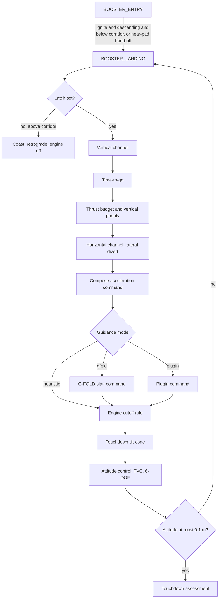
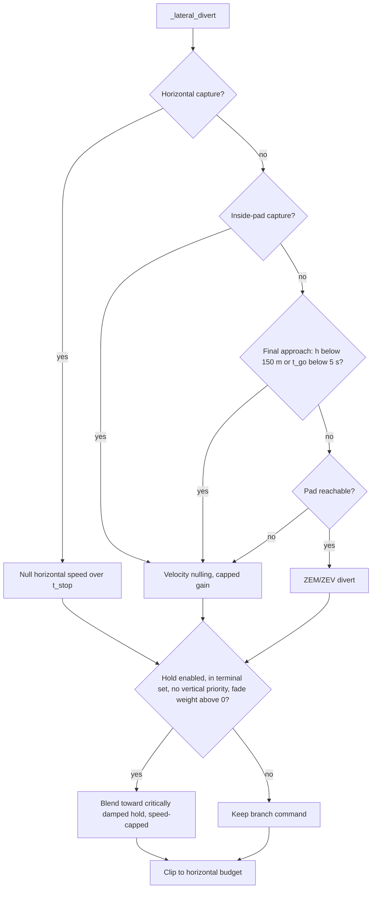
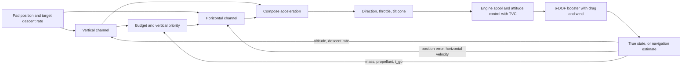

# 8. Booster recovery guidance II: the landing burn

> The landing burn is the final powered phase of booster recovery
> (`BOOSTER_LANDING`). It starts with a latched suicide-burn ignition test and
> ends at ground contact. Each guidance step builds a thrust acceleration
> command from two channels. The vertical channel is a constant-deceleration
> stop to a target touchdown speed. The horizontal channel is a ZEM/ZEV
> (zero-effort-miss / zero-effort-velocity) divert that switches to velocity
> nulling and then to a critically damped position hold on final approach.
> A thrust budget that protects the vertical stop limits the horizontal command.
> The command then becomes a thrust direction and a throttle, clipped to a
> touchdown tilt cone. Two optional modes can replace the default heuristic
> law: a G-FOLD-style convex minimum-fuel planner (`gfold.py`), re-solved in a
> receding horizon, and a user guidance plugin. **Fidelity:** guidance-level
> point-mass laws flown by the full 6-DOF vehicle. The default law is a
> project heuristic built from textbook pieces. G-FOLD follows the
> lossless-convexification literature, but its model has no drag. Guidance is
> given the true state and the true drag scale.

Source paths are relative to `backend/rlv_sim/`. Default values come from
`create_default_config()`. Some differ from the bare dataclass defaults in
`config/definition.py`; §8.13 notes where.

---

## 8.1 Role in the simulation

`MissionManager._update_booster_entry` (`mission/manager.py:528-575`) switches
the booster from `BOOSTER_ENTRY` to `BOOSTER_LANDING` in either of two cases:

- The suicide-burn estimator says "ignite", the booster is descending, and it
  is below the ignition corridor top (§8.2).
- The near-pad hand-off is ready. This requires all of: altitude ≤ 7030 m
  (`NEAR_PAD_HANDOFF_ALTITUDE_M`), propellant > 0.75 × `booster_landing_reserve_kg`,
  a ballistic-predicted miss ≤ `booster_pad_tolerance_m`, and a time to impact ≥ 8 s.

From then on, every step calls `compute_booster_guidance` (`guidance/booster.py:1163`)
with `phase="BOOSTER_LANDING"`, which dispatches to `_landing_guidance`
(`booster.py:904-1160`). The step loop (`mission/step.py:700-760`) passes the
returned unit thrust direction to the vehicle unchanged. The booster has no
guidance-side actuator filter (`step.py:717-720`). The returned throttle is
rate-limited by the engine spool model (`apply_engine_transient`, spool-up
1.5 s, spool-down 0.8 s, `physics/forces.py:547-578`). The attitude controller
and TVC (thrust vector control) then point body $+z$ along the command
(Chapter 5).

Inputs per step: true $\mathbf{r},\mathbf{v},m,t$; the pad position
$\mathbf{r}_{pad}(t)$ from `target_landing_site_eci` (current time, no lead);
and the suicide-burn prediction computed in `compute_booster_guidance`
(`booster.py:1207-1210`). Outputs: thrust direction, `thrust_on`, throttle,
and telemetry (`landing_a_vert_needed_mps2`, `landing_a_horiz_budget_mps2`,
`landing_reserve_authority`, `landing_vertical_priority`,
`landing_guidance_mode`, `gfold_time_of_flight_s`, ...).



The heuristic channels are always evaluated, even when G-FOLD or a plugin
supplies the final command. Their telemetry columns therefore describe the
heuristic law, not the active mode.

**Frames and notation used in this chapter.**

- $\hat{\mathbf{u}}$ is the local vertical at the vehicle.
- $\hat{\mathbf{u}}_{pad}$ is the local vertical at the pad.
- $\mathbf{v}_g = \mathbf{v} - \boldsymbol\omega_\oplus\times\mathbf{r}$ is the ground-relative velocity (no wind).
- $v_d = \max(-\mathbf{v}_g\cdot\hat{\mathbf{u}},0)$ is the descent rate.
- $\mathbf{v}_h$ is the horizontal ground velocity, projected on the pad horizontal plane.
- $\mathbf{e} = (\mathbf{r}_{pad}-\mathbf{r})_{\perp\hat{\mathbf{u}}_{pad}}$ is the horizontal position error, pointing from the vehicle to the pad.
- $h = \max(|\mathbf{r}|-R_\oplus, 0.5)$ m.
- $g = \mu/|\mathbf{r}|^2$.
- $a_T = T_{land}/m$ is the full-throttle thrust acceleration. $T_{land}$ = `landing_thrust_n` = `landing_engine_count` × `stage1_engine_thrust_n` = 1 × 845 222 N (`config/definition.py:430-431`).

---

## 8.2 Suicide-burn ignition

**Idea.** Start the burn at the last safe moment: when the altitude equals the
distance the vehicle needs to stop at its mean thrust deceleration, scaled up
by a safety factor. Once the burn starts it never stops (it is latched).

**Equations** (`guidance/recovery.py:639-768`, `estimate_suicide_burn`):

$$
v_{eff} = \sqrt{v_d^2 + w\,|\mathbf{v}_h|^2},\qquad w = 1
$$

$$
a_{brake} = \frac{T_p}{m} - g,\qquad T_p = T_{land}\cdot k_{plan}
$$

If $a_{brake}\le 0$, the estimator returns $h_{ig}=h$ (ignite now,
`recovery.py:711-720`). Otherwise it uses the rocket equation to find the burn
end mass:

$$
I_{sp}(h) = I_{sp,vac} - (I_{sp,vac}-I_{sp,sl})\,\mathrm{clip}(P(h)/P_0,0,1.2),\quad
v_e = I_{sp} g_0,\quad m_f = \max\!\left(m\,e^{-v_{eff}/v_e},\ m_{dry}\right)
$$

The mean deceleration is the time average of $T/m$ over a constant-$\dot m$
burn from $m$ to $m_f$, minus gravity:

$$
\bar a = \frac{T_p\,\ln(m/m_f)}{m-m_f} - g,\qquad \bar a \leftarrow \max(\bar a, 0.15\,g)
$$

$$
h_{ig} = \frac{v_{eff}^2}{2\bar a}
$$

When $m - m_f \le 1$ kg, the code uses $\bar a = a_{brake}$ instead
(`recovery.py:736-740`). The ignition corridor top and the latch are
(`booster.py:913-920`, mirrored in `manager.py:143-161`):

$$
h_{corr} = \min\!\left(h_{ceil},\ SF\cdot h_{ig}\right),\qquad
\text{latch} \leftarrow \text{latch} \lor (h \le h_{corr})
$$

Until the latch is set, the command is: retrograde direction, `thrust_on=False`.

**Implementation notes.**

- `burn_altitude` is the *unscaled* $h_{ig}$. The safety factor $SF$ is applied once, in the corridor test. The estimator's own `ignite` flag ($h \le SF\,h_{ig}$) is used only by the phase manager.
- The latch is `GuidanceState.booster_landing_burn_started` (`guidance/common.py:39`). It never resets, so a vehicle that drifts back above the corridor keeps burning. The test `test_landing_burn_stays_latched` checks this.
- The estimator evaluates the *standard* atmosphere (`compute_atmosphere_properties`), not the configured one, and uses `C.STAGE1_DRY_MASS` instead of `config.stage1_dry_mass` (no `dry_mass_kg` argument is passed, `booster.py:1207`). Neither is an issue at default settings. `runtime_isp_scale` is not applied.
- Because the horizontal speed counts fully in $v_{eff}$ ($w=1$), the estimator plans to remove all ground-relative speed by the vertical stopping distance.
- With the near-pad hand-off, the phase can switch above $h_{corr}$. The vehicle then coasts with the engine off inside `BOOSTER_LANDING` until the latch fires.

**Worked values** (default configuration, pad overhead, $SF=1.8$; computed with
the code):

| $h$ (m) | $v_d$ (m/s) | $m$ (kg) | $h_{ig}$ (m) | $h_{corr}$ (m) | $a_{brake}$ (m/s²) |
|---|---|---|---|---|---|
| 3000 | 250 | 30 000 | 1593 | 2868 | 18.4 |
| 1500 | 180 | 28 000 | 759 | 1366 | 20.4 |
| 500 | 80 | 26 000 | 138 | 249 | 22.7 |

| Symbol | Config field / constant | Default | Unit | Meaning |
|---|---|---|---|---|
| $SF$ | `booster_landing_ignition_safety_factor` | 1.8 | – | multiplier on $h_{ig}$ for the corridor |
| $h_{ceil}$ | `booster_landing_ignition_ceiling_m` | 8000 | m | highest altitude at which ignition is allowed |
| $k_{plan}$ | `booster_landing_planning_throttle` | 1.0 (validated in [0.3, 1]) | – | fraction of landing thrust the estimator plans on |
| $T_p$ | `landing_planning_thrust_n` (property) | 845 222 | N | $T_{land} k_{plan}$ (`definition.py:434-436`) |
| $I_{sp,vac}, I_{sp,sl}$ | `C.ISP_VAC`, `C.ISP` | 311, 282 | s | Isp interpolation endpoints |
| $w$ | `horizontal_weight` argument | 1.0 | – | weight of horizontal speed in $v_{eff}$ |

**Classification.** The braking distance $v^2/2a$ and the rocket-equation mean
acceleration are *Standard*. The safety factor, ceiling, $0.15g$ floor and
latch are *Project heuristic*; no external reference.

**Validity limits.**

- Drag is ignored in the estimator. During the burn, drag adds deceleration, so the estimate is conservative when drag is present. The burn law (§8.3) recomputes the required deceleration from the current state every step.
- The Monte Carlo data (§8.12) show that planning on less thrust ($k_{plan}=0.8$) made results worse.

---

## 8.3 Vertical channel

**Idea.** Ask for the constant deceleration that brings the descent rate from
$v_d$ to a target touchdown rate $v_{td}$ exactly at the ground, and add
gravity. The command is recomputed every step from the current state, so it
behaves as a feedback law, not a fixed profile.

**Equation** (`booster.py:931-945`). Kinematics at constant deceleration $d$
gives $v_{td}^2 = v_d^2 - 2dh$, so the thrust acceleration is

$$
a_{v,raw} = g + \frac{v_d^2 - v_{td}^2}{2h},\qquad
a_v = \mathrm{clip}(a_{v,raw},\,0,\,a_T)
$$

with $a_{v,raw}=0$ when $h<10$ m and $v_d < v_{td}$. The target rate is

$$
v_{td} = \min\!\left(c_{td},\ 0.85\,v_{leg}\right),\qquad
c_{td} = \begin{cases}4.2 & \text{near-pad RTLS}\\ 3.0 & \text{otherwise}\end{cases}
$$

At defaults this gives $v_{td} = \min(4.2, 5.1) = 4.2$ m/s. "Near-pad" means
the resolved landing site is within 15 km of the launch site
(`is_near_pad_target`, `recovery.py:259-264`). RTLS (return to launch site) is
the default mission.

**Engine cutoff rules near the ground.** The throttle is forced to zero and the
thrust direction to $\hat{\mathbf{u}}$ in two cases:

1. $v_d < 1$ and $|\mathbf{v}_h| < 1$ m/s, at any altitude (`booster.py:1092-1094`, heuristic mode).
2. $h<10$ m and $v_d < v_{td}$ (`booster.py:1132-1134`). This rule applies to every mode, including G-FOLD and plugins.

`thrust_on` stays `True`. The zero throttle shuts the engine through the spool
model (≤ 0.8 s from full to zero). Neither rule latches. If the descent rate
grows again, the next step re-commands thrust, subject to spool-up.

| Symbol | Config field / constant | Default | Unit | Meaning |
|---|---|---|---|---|
| $v_{leg}$ | `landing_leg_max_touchdown_speed_mps` | 6.0 | m/s | leg-rated touchdown speed |
| $c_{td}$ | hard-coded (`booster.py:931`) | 4.2 / 3.0 | m/s | target-rate ceiling |
| – | hard-coded 10 m cutoff altitude | 10 | m | engine-cutoff band |

**Classification.** Constant-deceleration kinematics is *Standard*. The target
rate, the 0.85 factor and the cutoff rules are *Project heuristic*.

**Validity limits.**

- Drag is not modelled as a feed-forward term. It acts as an unmodelled deceleration that the feedback absorbs.
- $a_T$ uses `landing_thrust_n` *without* `runtime_thrust_scale`, but the plant applies the scaled thrust (`step.py:603-617`). Under a thrust dispersion, the throttle-to-acceleration map is therefore off by the scale factor, and the feedback must absorb that too.

---

## 8.4 Time-to-go estimate

**Idea.** Split the remaining flight into a ballistic fall down to the
ignition altitude and a powered stop. Model the stop as a constant
deceleration, which takes $2h/v$, stretched by 20 %.

**Equations** (`recovery.py:771-832`, `estimate_booster_touchdown_time`).
These are called from `booster.py:947-956` with $T_{land}$ (not $T_p$),
$SF = 1$, and floored at 1 s. Let $h_{ig}$ be computed as in §8.2 and
$v_d \leftarrow \max(v_d, 1)$:

$$
t_{go} = \begin{cases}
1.2\cdot\dfrac{2h}{v_d} & h \le h_{ig}\\[2ex]
t_c + 1.2\cdot\dfrac{2h_{ig}}{\max(v_d + g t_c, 1)} & h > h_{ig}
\end{cases}
$$

The coast time $t_c$ is the positive root of $\tfrac12 g t_c^2 + v_d t_c - (h-h_{ig}) = 0$.

**Notes.**

- Because the latch fires at up to $1.8\,h_{ig}$, the first part of the burn uses the second branch. That branch treats the vehicle as falling freely, even though it is already braking.
- Typical values: 17.9 s at (3000 m, 250 m/s) and 6.5 s at (500 m, 80 m/s).
- $t_{go}$ drives the ZEM/ZEV gains, the reachability test, the reserve-authority propellant prediction and the G-FOLD time-of-flight guess.

**Classification.** *Project heuristic* (factor 1.2, two-segment model); no
external reference.

---

## 8.5 Horizontal channel

All horizontal quantities live in the pad horizontal plane. The pad is fixed
on the rotating Earth, and the plant's horizontal dynamics are treated as a
double integrator, $\ddot{\mathbf{e}} = -\mathbf{a}_h$.

### 8.5.1 ZEM/ZEV divert

**Derivation (zero final velocity).** Minimise $\tfrac12\int_t^{t_f}|\mathbf{a}|^2\,d\tau$
for $\ddot{\mathbf r}=\mathbf a$ with $\mathbf r(t_f)=\mathbf r_T$ and $\dot{\mathbf r}(t_f)=\mathbf v_T$.
The costate equations make the optimal acceleration linear in time,
$\mathbf a(\tau)=\mathbf c_0+\mathbf c_1\tau$, where $\tau$ is the time from now. Integrating over $t_{go}$ gives

$$
\mathrm{ZEV} \equiv \mathbf v_T - \mathbf v = \mathbf c_0 t_{go} + \tfrac12\mathbf c_1 t_{go}^2,\qquad
\mathrm{ZEM} \equiv \mathbf r_T - (\mathbf r + \mathbf v t_{go}) = \tfrac12\mathbf c_0 t_{go}^2 + \tfrac16\mathbf c_1 t_{go}^3
$$

Eliminating $\mathbf c_1$ gives the classic law (Ebrahimi et al. 2008; Guo, Hawkins & Wie 2013):

$$
\mathbf a = \mathbf c_0 = \frac{6\,\mathrm{ZEM}}{t_{go}^2} - \frac{2\,\mathrm{ZEV}}{t_{go}}
$$

Horizontally, gravity is zero. With $\mathbf v_T=0$ and $\mathbf r_T-\mathbf r=\mathbf e$,
we have $\mathrm{ZEV}=-\mathbf v_h$ and $\mathrm{ZEM}=\mathbf e-\mathbf v_h t_{go}$. Then

$$
\mathbf a_{ZZ} = \frac{6\,(\mathbf e - \mathbf v_h t_{go})}{t_{go}^2} + \frac{2\,\mathbf v_h}{t_{go}}
= \frac{6\,\mathbf e}{t_{go}^2} - \frac{4\,\mathbf v_h}{t_{go}}
$$

**Implemented form** (`booster.py:968, 982`):
`zem = r_err_horiz - v_horiz_site*t_go`; `a_divert_zem_zev = 6/t_go² · zem + 2/t_go · v_horiz_site`.
This is exactly $\mathbf a_{ZZ}$. The code's "$+2\mathbf v/t$" term is the
textbook $-2\,\mathrm{ZEV}/t$ with $\mathrm{ZEV}=-\mathbf v_h$. The bundled
plugin `plugin_examples/example_zem_zev.py:31-32` writes the same law as
$6\mathbf e/t^2 - 4\mathbf v/t$.

### 8.5.2 Velocity nulling with a gain cap

**Implemented form** (`booster.py:980-981`):

$$
\mathbf a_{ZEV} = -\min\!\left(\frac{2}{t_{go}},\ \frac{1}{\tau_{min}}\right)\mathbf v_h
$$

The gain $2/t_{go}$ is the ZEV coefficient of §8.5.1 used on its own. The
minimum-energy law with only a terminal-velocity constraint would have gain
$1/t_{go}$; the code does not explain the factor of 2. The cap $1/\tau_{min}$
binds once $t_{go} < 2\tau_{min}$ = 3 s. Without the cap, the gain grows
without bound near touchdown. With roughly 1 s of attitude lag, the
horizontal velocity then limit-cycled: tailwind touchdowns reached
6–7.6 m/s (code comment `booster.py:977-979`; test
`test_tailwind_touchdown_has_no_lateral_limit_cycle`).

### 8.5.3 Branch selection (`_lateral_divert`, `booster.py:826-884`)

The selector uses two flags:

- final approach: $h<150$ m or $t_{go}<5$ s;
- inside-pad capture: $|\mathbf e| \le$ `booster_pad_tolerance_m` and $h<150$ m (`booster.py:971`).

Horizontal capture is inside-pad capture plus near-pad RTLS plus
$|\mathbf v_h|>3$ m/s (`booster.py:972-976`). With these flags:

$$
\mathbf a_{div} = \begin{cases}
-\mathbf v_h / \max(t_{stop}, \tau_{min}) & \text{horizontal capture}\\
\mathbf a_{ZEV} & \text{inside-pad capture, or final approach}\\
\mathbf a_{ZZ} & \text{otherwise, if the pad is reachable (§8.6.4)}\\
\mathbf a_{ZEV} & \text{otherwise}
\end{cases}
$$

with $t_{stop} = \mathrm{clip}(t_{go}, 1.5, 3.0)$ s (`booster.py:1060-1064`).
The code comment explains why ZEM/ZEV is dropped below 150 m: its $1/t_{go}^2$
position term kept accelerating toward an off-pad target while the thrust sat
at the tilt limit. Tailwind cases then touched down at about 30 m/s sideways.



"Terminal set" means final approach, horizontal capture, or inside-pad
capture. When ZEM/ZEV is selected (i.e. not final approach), the hold can
never apply.

### 8.5.4 Final-approach position hold

**Idea.** Velocity nulling on its own freezes whatever position error remains
at 150 m. That produced 50–70 m pad misses with propellant to spare (§8.12).
The hold adds a position loop with a time constant that never shrinks below a
floor. This avoids the $1/t_{go}^2$ blow-up of ZEM/ZEV.

**Derivation.** For the error dynamics $\ddot{\mathbf e} = -\mathbf a$ with
$\dot{\mathbf e} = -\mathbf v_h$, require a critically damped response
$\ddot{\mathbf e} + \tfrac{2}{\tau}\dot{\mathbf e} + \tfrac{1}{\tau^2}\mathbf e = 0$.
This has a double pole at $s=-1/\tau$ and no overshoot. Substituting gives

$$
\mathbf a_{hold} = \frac{\mathbf e}{\tau^2} - \frac{2\,\mathbf v_h}{\tau}
= \frac{2}{\tau}\left(\mathbf v_{ref} - \mathbf v_h\right),\qquad \mathbf v_{ref} = \frac{\mathbf e}{2\tau}
$$

**Implemented form** (`booster.py:863-879`). The code adds a closing-speed cap
and a fade:

$$
\tau = \max(0.5\,t_{go},\ \tau_h),\qquad
\mathbf v_{ref} \leftarrow \mathbf v_{ref}\cdot\min\!\left(1,\frac{V_{cap}}{|\mathbf v_{ref}|}\right)
$$

$$
w = \mathrm{clip}\!\left(\frac{h-h_f}{h_f},0,1\right),\qquad
\mathbf a_{div} \leftarrow w\,\mathbf a_{hold} + (1-w)\,\mathbf a_{div}
$$

The fade weight is $w=1$ above $2h_f$ = 60 m and $w=0$ below $h_f$ = 30 m.
The hold runs only when all four conditions hold: $\tau_h>0$, the vehicle is in
the terminal set, vertical priority is off, and $w>0$.

**Closing-speed cap** (`booster.py:1065-1077`):

$$
a_{brake} = \min\!\left(a_{h,budget},\ \tan\theta_c\cdot\max(a_v, g)\right),\qquad
t_{above} = \frac{\max(h-h_f,0)}{\max(v_d,1)},\qquad
V_{cap} = \tfrac12\,a_{brake}\,t_{above}
$$

$\theta_c$ is the touchdown cone (§8.7). $a_{brake}\,t_{above}$ is the
horizontal speed the tilt-limited thrust could remove before the fade floor.
The hold may build up only half of it. This prevents a far-off pad from being
chased faster than the vehicle can brake, which caused 12–30 m/s impacts at
realistic drag (§8.12).

| Symbol | Config field | Default | Unit | Meaning |
|---|---|---|---|---|
| $\tau_{min}$ | `booster_terminal_divert_time_constant_s` | 1.5 | s | velocity-nulling gain cap $1/\tau_{min}$ |
| $\tau_h$ | `booster_terminal_position_hold_tau_s` | 3.0 | s | hold time-constant floor; 0 disables the hold |
| $h_f$ | `booster_terminal_position_hold_floor_m` | 30 | m | fade floor; full hold above $2h_f$ |
| $t_{stop}$ limits | `booster_terminal_hcapture_tstop_min_s` / `_max_s` | 1.5 / 3.0 | s | horizontal-capture stop time |
| – | `booster_pad_tolerance_m` | 50 | m | inside-pad radius (also the success radius) |
| – | hard-coded | 150 m, 5 s, 3 m/s | – | final-approach and capture gates |

**Classification.** ZEM/ZEV is *Published* (Ebrahimi et al. 2008; Guo et al.
2013). The critically damped second-order law is *Standard* (linear control).
The branch logic, gain cap, hold floor, fade, speed cap and gates are
*Project heuristic*, tuned by Monte Carlo.

**Validity limits.**

- Every law here assumes the commanded acceleration is achieved immediately. The 6-DOF attitude lag is handled only through the $\tau$ floors.
- ZEM uses straight-line propagation and ignores drag and wind.
- At realistic drag (0.68), tailwind cases reach 250 m altitude 100–380 m off target. That error is beyond what the final-approach logic is designed to recover (§8.12).

---

## 8.6 Thrust budget allocation

### 8.6.1 Available horizontal acceleration and altitude bands

The vertical channel has priority. Horizontal authority is whatever thrust
acceleration is left over, further limited by a fraction that depends on
altitude (`booster.py:964-967, 983`; `divert_fraction_by_altitude`,
`booster.py:268-285`):

$$
a_{h,avail} = \sqrt{\max(a_T^2 - a_v^2, 0)}
$$

$$
f(h) = \begin{cases} f_{high} & h > h_{high}\\ f_{mid} & h_{low} < h \le h_{high}\\ f_{low} & h \le h_{low}\end{cases}
$$

### 8.6.2 Vertical priority

The code first computes three ratios (`booster.py:985-1006`):

- the fuel margin ratio $\phi = \max(P - M, 0)/\max(R,1)$, where $P$ is the propellant remaining, $M$ the landing margin and $R$ the landing reserve;
- the vertical load ratio $\lambda = a_v/a_T$;
- the vertical risk flag, $\text{risk} = \lambda > \lambda_{risk} \lor (h<15 \land v_d > k_{os} v_{td})$.

Vertical priority (VP) is on when any of these holds:

- **fuel critical:** $\phi < \phi_{crit}$, and ($h>30$ m or risk);
- **high load:** $\lambda > 0.85$;
- **low altitude margin:** $h < \max(250, 0.55\,h_{ig})$ and risk.

The fraction is then adjusted (`booster.py:1007-1013`):

- Inside-pad capture without VP: $f \leftarrow \max(f, f_{high})$.
- With VP: $f \leftarrow 0.25f$ if fuel critical or $h<500$ m, otherwise $f \leftarrow 0.60f$.

The budget is (`booster.py:1015-1018`)

$$
a_{h,budget} = \begin{cases} 0 & \lambda > 0.9 \land h < 100\\ \min\!\left(a_{h,avail},\ \max(a_v,g)\,f\right) & \text{otherwise}\end{cases}
$$

$h_{ig}$ here is the current $h_{ig}$ from §8.2, recomputed every step.

### 8.6.3 Reserve authority

`compute_landing_reserve_authority` (`booster.py:288-311`) predicts the
propellant the vertical stop will still use. It scales lateral authority down
when the surplus above that prediction falls below a band:

$$
P_v = \dot m_{full}\,\lambda\,t_{go}\,\max(SF_v,1),\qquad
\alpha_r = \mathrm{clip}\!\left(\frac{P - (P_v + M)}{\max(0.25R,\,250)},\,0,\,1\right)
$$

$\dot m_{full}$ is the full-throttle landing mass flow at the current altitude
(`compute_mass_flow_rate`, with the thrust and Isp scales applied;
`booster.py:1020-1028`). The budget becomes $a_{h,budget} \leftarrow \alpha_r\,a_{h,budget}$.
If $\alpha_r \le 0$, VP is set to true. At that point the VP flag affects only
the position-hold gate and the unreachable-pad branch below.

During horizontal capture without vertical risk, the budget is raised
(`booster.py:1045-1050`):

$$
a_{h,budget} \leftarrow \alpha_r\min\!\left(a_{h,avail},\ \max(a_{h,budget}, \min(35, 0.75a_T))\right)
$$

### 8.6.4 Reachability test

The pad counts as reachable if the vehicle could cover the error with its
current horizontal speed plus the budgeted acceleration (`booster.py:1051-1058`):

$$
d_{reach} = |\mathbf v_h|\,t_{go} + \tfrac12 a_{h,budget}\,t_{go}^2,\qquad
\text{reachable} = |\mathbf e| \le \max(350, d_{reach})
$$

If the pad is unreachable and the vehicle is not inside-pad, the budget is
recomputed as $\min(a_{h,avail}, \max(a_v,g)\,f(h)\,[0.25 \text{ if VP}])$, and
§8.5.3 selects velocity nulling. Two points to note:

- $d_{reach}$ uses the *speed* $|\mathbf v_h|$, whatever its direction. The test is therefore optimistic when the vehicle is moving away from the pad.
- The recomputed budget leaves out the factor $\alpha_r$ (see §8.14).

| Symbol | Config field | Default | Unit | Meaning |
|---|---|---|---|---|
| $f_{high}, f_{mid}, f_{low}$ | `booster_divert_fraction_high` / `_mid` / `_low` | 0.72 / 0.62 / 0.40 | – | divert fraction per altitude band |
| $h_{high}, h_{low}$ | `booster_divert_band_high_alt_m` / `_low_alt_m` | 1200 / 150 | m | band edges |
| $\lambda_{risk}$ | `booster_vertical_load_risk_ratio` | 0.72 | – | load-risk threshold |
| $k_{os}$ | `booster_terminal_descent_overspeed_factor` | 4.0 | – | terminal overspeed multiple of $v_{td}$ |
| $\phi_{crit}$ | `booster_fuel_critical_ratio` | 0.35 | – | fuel-critical threshold |
| $R$ | `booster_landing_reserve_kg` | 5000 | kg | landing reserve |
| $M$ | `booster_landing_propellant_margin_kg` | 750 | kg | landing margin (also a success criterion) |
| $SF_v$ | `booster_landing_vertical_propellant_safety_factor` | 1.25 | – | multiplier on predicted vertical propellant |
| – | hard-coded | 0.85, 0.9, 100 m, 250 m, 500 m, 350 m, 35 m/s² | – | gates in §8.6.2–8.6.4 |

**Classification.** $\sqrt{a_T^2-a_v^2}$ is *Standard* (vector thrust
geometry). Everything else in this section is *Project heuristic*; no external
reference.

---

## 8.7 Thrust direction, throttle and the touchdown cone

**Composition** (`booster.py:1092-1105`). The acceleration command depends on
the active branch:

$$
\mathbf a_{cmd} = \begin{cases}
\left(g - \dfrac{\mathbf v_g\cdot\hat{\mathbf u}}{t_{stop}}\right)\hat{\mathbf u} + \mathbf a_{div} & \text{horizontal capture, hold active}\\[2ex]
g\,\hat{\mathbf u} - \dfrac{(\mathbf v_g\cdot\hat{\mathbf u})\hat{\mathbf u} + \mathbf v_h}{t_{stop}} & \text{horizontal capture, hold inactive}\\[2ex]
a_v\,\hat{\mathbf u} + \mathbf a_{div} & \text{otherwise}
\end{cases}
$$

$$
\hat{\mathbf d} = \mathbf a_{cmd}/|\mathbf a_{cmd}|,\qquad
\text{throttle} = \mathrm{clip}(|\mathbf a_{cmd}|/a_T,\,0,\,1)
$$

In the normal branch, $|\mathbf a_{div}| \le a_{h,avail}$, so
$|\mathbf a_{cmd}| \le a_T$. In both capture branches, the vertical command
drives the vertical speed toward zero (not toward $v_{td}$) over $t_{stop}$.
In the "hold inactive" capture branch, the horizontal part bypasses the budget.

**Touchdown cone** (`_limit_direction_cone`, `booster.py:314-333`; applied at
`booster.py:1136-1143` after every mode). With $\theta_c = \min(\theta_{att},\theta_{leg})$:

$$
\hat{\mathbf d} \leftarrow \begin{cases}\hat{\mathbf d} & \angle(\hat{\mathbf d},\hat{\mathbf u}) \le \theta_c\\
\cos\theta_c\,\hat{\mathbf u} + \sin\theta_c\,\hat{\mathbf t} & \text{otherwise}\end{cases},\qquad
\hat{\mathbf t} = \frac{\hat{\mathbf d} - (\hat{\mathbf d}\cdot\hat{\mathbf u})\hat{\mathbf u}}{|\cdot|}
$$

The cone keeps the azimuth of the lateral command and does not change the
throttle. **Consequence:** the budget fraction (up to 0.72 of
$\max(a_v,g)$) is much larger than $\tan 15^\circ = 0.27$. So the cone, not
the budget, is usually the binding horizontal limit. When the cone clips, the
vertical component becomes $|\mathbf a_{cmd}|\cos\theta_c$, which is larger
than $a_v$. Excess horizontal demand therefore turns into extra vertical
braking (for example, +19 % at $|\mathbf a_{div}| = 0.72\,a_v$). The hold speed
cap (§8.5.4) uses $\tan\theta_c$ for this reason.

**Engine throttle range.** The booster path does *not* clip the throttle to
`min_engine_throttle_fraction` (0.35). The only clip is to [0, 1], then the
spool rate limit (`step.py:727-738`). The heuristic and plugin modes can
therefore deep-throttle down to zero. G-FOLD alone plans with the 0.35 lower
bound. The plugin docstring (`plugins.py:16-18`) says the "engine throttle
range" is enforced; it is not.

**Attitude limits.** The cone is the only tilt limit applied in guidance. At
touchdown, the actual body-axis tilt is checked against
`landing_leg_max_tilt_deg` (§8.10). The post-run summary separately compares it
with `booster_terminal_attitude_error_max_deg` (`outputs/summary.py:380-385`).

| Symbol | Config field | Default | Unit | Meaning |
|---|---|---|---|---|
| $\theta_{att}$ | `booster_terminal_attitude_error_max_deg` | 15 | deg | terminal attitude-error limit |
| $\theta_{leg}$ | `landing_leg_max_tilt_deg` | 15 | deg | leg stability tilt limit |
| – | `enable_engine_transients`, `engine_spool_up_time`, `engine_spool_down_time` | true, 1.5, 0.8 | –, s, s | throttle rate limit |

**Classification.** Direction and throttle from a thrust-acceleration vector
are *Standard*. The cone projection is *Standard* geometry. The capture-branch
forms are *Project heuristic*.

---

## 8.8 G-FOLD mode

Selected with `booster_landing_guidance="gfold"`. Requires the optional
`cvxpy` package (`gfold` extra); without it, `require_available` raises at
mission start (`gfold.py:192-198`, test `test_gfold_without_cvxpy_fails_loudly`).
G-FOLD runs only after the heuristic latch (§8.2) has fired.

### 8.8.1 Problem posed (`gfold.py:83-173`)

The problem is a point mass in a local East-North-Up (ENU) frame at the pad
(`local_frame`, `gfold.py:201-207`). The inputs are:

- $\mathbf r_0 = F(\mathbf r - \mathbf r_{pad})$ and $\mathbf v_0 = F\,\mathbf v_g$, where $F$ is the ENU rotation;
- gravity $\mathbf g = [0,0,-g]$, flat and constant;
- $N$ uniform intervals over a fixed $t_f$, so $\Delta t = t_f/N$.

Variables at nodes $k=0..N$: $\mathbf r_k, \mathbf v_k$, the thrust
acceleration $\mathbf u_k = \mathbf T/m$, the log-mass $z_k = \ln m$, and the
slack $\sigma_k \ge |\mathbf u_k|$ (`s`).

$$
\max\ z_N
$$

subject to:

- **Boundary conditions:** $\mathbf r_0, \mathbf v_0$ and $z_0 = \ln m$ fixed; $\mathbf r_N = [0,0,h_{gate}]$; $\mathbf v_N = [0,0,-v_{td}]$; $z_N \ge \ln m_{dry}$.
- **Dynamics:** first-order hold on $\mathbf u$ with constant gravity. These updates are exact for piecewise-linear $\mathbf u$:

$$
\mathbf v_{k+1} = \mathbf v_k + \tfrac{\Delta t}{2}(\mathbf u_k+\mathbf u_{k+1}) + \mathbf g\Delta t,\qquad
\mathbf r_{k+1} = \mathbf r_k + \tfrac{\Delta t}{2}(\mathbf v_k+\mathbf v_{k+1}) + \tfrac{\Delta t^2}{12}(\mathbf u_k-\mathbf u_{k+1})
$$

$$
z_{k+1} = z_k - \tfrac{\alpha\Delta t}{2}(\sigma_k+\sigma_{k+1}),\qquad \alpha = \dot m_{full}/T_{max}
$$

- **Thrust bounds after lossless convexification:** $|\mathbf u_k| \le \sigma_k$, and with $w_k = z_k - z_{0,k}$ and $z_{0,k} = \ln(m - \alpha T_{max}t_k)$:

$$
T_{min}e^{-z_{0,k}}\left(1 - w_k + \tfrac12 w_k^2\right) \le \sigma_k \le T_{max}e^{-z_{0,k}}(1-w_k)
$$

- **Log-mass bounds:** $\ln(m-\alpha T_{max}t_k) \le z_k \le \ln(m-\alpha T_{min}t_k)$, with both masses floored at $m_{dry}$.
- **Thrust pointing:** $u_{k,z} \ge \cos\theta_c\,\sigma_k$.
- **Glide slope:** $\|(r_{k,x}, r_{k,y})\| \le \cot\gamma_{gs}\,r_{k,z}$.

This matches the lossless-convexification minimum-fuel problem of Açıkmeşe &
Ploen (2007): the change of variables $\sigma = \Gamma/m$, $z=\ln m$, and the
second-order Taylor lower bound and first-order upper bound on
$e^{-z}$. The pointing constraint has the form analysed by Açıkmeşe, Carson &
Blackmore (2013). Blackmore, Açıkmeşe & Scharf (2010) is the G-FOLD
minimum-landing-error extension. The code does **not** implement its
landing-error stage; it fixes the terminal point and only maximises final mass.

The limits come from configuration (`booster.py:796-807`):

- $T_{max} = T_{land}\cdot$`runtime_thrust_scale`, multiplied by `max_engine_throttle_fraction`;
- $T_{min}$ = `min_engine_throttle_fraction` $\times T_{max}$;
- $\theta_c$ as in §8.7.

The solver is Clarabel, cold-started (`warm_start=False`) so that identical
missions give identical results (`gfold.py:165-172`). Compiled problems are
cached per thread and per (nodes, tilt, glide slope) (`gfold.py:179-189`).

### 8.8.2 Time-of-flight search and command

`plan_descent` (`gfold.py:210-248`) solves for
$t_f = \max(1, c\,t_{guess})$ with $c \in \{0.8, 1.0, 1.25, 1.6, 2.0, 2.6\}$. It
keeps the feasible plan with the highest final mass, skips infeasible factors,
and stops at the first feasible factor whose final mass is lower than the best.
It returns `None` if the vehicle is already at or below the gate, or if no
factor is feasible. The guess $t_{guess}$ is the remaining time of the current
plan if that is more than 1.5 s, else the heuristic $t_{go}$.

`command_from_plan` (`gfold.py:251-261`) interpolates $\mathbf u$ linearly at
time $t$ (consistent with first-order hold). It sets
$\hat{\mathbf d} = F^\top\mathbf u/|\mathbf u|$ and
throttle = clip$(|\mathbf u|\,m_{now}/T_{max},0,1)$, using the *current*
6-DOF mass.

### 8.8.3 Replanning (`_gfold_command`, `booster.py:770-823`)

```mermaid
sequenceDiagram
    participant LG as _landing_guidance
    participant GC as _gfold_command
    participant PD as plan_descent
    participant GS as GuidanceState
    LG->>GC: every step, after the heuristic command
    alt cvxpy missing or altitude at or below gate
        GC-->>LG: None
    else
        GC->>GS: read plan and last solve time
        alt plan expired, or due with no plan or more than 1.5 s left
            GC->>PD: solve from current state with t_f guess
            PD-->>GC: plan or None
            GC->>GS: store solve time; store plan on success, else count failure
        end
        GC-->>LG: interpolated direction and throttle, or None
    end
    alt G-FOLD command available
        LG->>LG: mode gfold
    else at or below gate
        LG->>LG: keep heuristic, mode gfold_terminal
    else
        LG->>LG: keep heuristic, mode gfold_fallback
    end
    LG->>LG: engine cutoff rule and touchdown cone
```

Replanning rules:

- A solve is due when there is no plan, or when `gfold_replan_period_s` has passed since the last attempt.
- During the final ≤ 1.5 s, a due solve is skipped and the existing plan is held.
- An expired plan forces an immediate re-solve.
- A failed solve still updates the solve time, so the next retry waits a full period. Meanwhile the last good plan is flown. If that plan has expired, the heuristic command is used (`gfold_fallback`).
- Below `gfold_terminal_altitude_m`, the heuristic vertical-descent law flies the last metres (`gfold_terminal`).

| Symbol | Config field | Default | Unit | Meaning |
|---|---|---|---|---|
| – | `booster_landing_guidance` | `heuristic` | – | `heuristic`, `gfold` or `plugin` |
| – | `gfold_replan_period_s` | 1.0 | s | receding-horizon re-solve period |
| $N$ | `gfold_nodes` | 25 | – | intervals, integer in [5, 200] |
| $\gamma_{gs}$ | `gfold_glideslope_deg` | 5 | deg | glide-slope elevation above the pad horizontal, in (0, 90) |
| $h_{gate}$ | `gfold_terminal_altitude_m` | 15 | m | terminal gate height |
| – | `min_engine_throttle_fraction`, `max_engine_throttle_fraction` | 0.35, 1.0 | – | $T_{min}, T_{max}$ fractions |

**Classification.** *Published* (Açıkmeşe & Ploen 2007; Açıkmeşe, Carson &
Blackmore 2013; Blackmore, Açıkmeşe & Scharf 2010 for the G-FOLD lineage). The
terminal gate, the time-of-flight search grid and the replanning rules are
*Project heuristic*.

**Validity limits.**

- **Not drag-aware**, with flat constant gravity and no Coriolis term. Drag is an unmodelled disturbance, absorbed only by replanning every second. The literature remedy is successive convexification; it is not implemented (`MONTE_CARLO_RESULTS.md`, "Open work").
- $\alpha$ is frozen at the Isp of the solve altitude.
- The plan ignores attitude lag.
- `gfold_glideslope_deg` is the *minimum elevation* of the cone, not a half-angle from vertical as the field doc says (§8.14). At 5° the cone is very loose ($\|r_h\| \le 11.4\,r_z$).

---

## 8.9 Guidance plugins

Selected with `booster_landing_guidance="plugin"` and
`booster_landing_plugin="<file stem>"`. The plugin is loaded by name only,
from the user plugin folder or `guidance/plugin_examples/`
(`plugins.py:63-96`). It is reloaded when the file's modification time
changes.

**Interface.** `landing_command(state: LandingState) -> 3 floats`. The return
value is the commanded thrust acceleration (m/s², ECI, including the
counter-gravity part). `LandingState` (`plugins.py:43-60`) is filled at
`booster.py:1110-1130`:

| Field | Value passed |
|---|---|
| `t` | mission time (s) |
| `altitude_m` | $h$ (floored at 0.5 m) |
| `up` | $\hat{\mathbf u}_{pad}$ |
| `position_error_m` | $\mathbf e$ (vehicle → pad, horizontal) |
| `velocity_mps` | $\mathbf v_g$ |
| `vertical_speed_mps` | $\mathbf v_g\cdot\hat{\mathbf u}$ (+ up) |
| `horizontal_velocity_mps` | $\mathbf v_h$ |
| `mass_kg`, `propellant_kg` | $m$, propellant above dry mass |
| `max_accel_mps2` | $a_T$ (unscaled thrust) |
| `gravity_mps2` | $g$ |
| `time_to_go_s` | $t_{go}$ (§8.4) |
| `tilt_limit_deg` | $\theta_c$ |
| `target_descent_rate_mps` | $v_{td}$ |

**Conversion** (`plugins.py:133-152`). The return value must be 3 finite
numbers, otherwise the mission errors. A command with norm < 1e-9 gives
direction `up` and throttle 0. Otherwise $\hat{\mathbf d}=\mathbf a/|\mathbf a|$
and throttle = clip$(|\mathbf a|/a_T,0,1)$. The plugin replaces the
heuristic/G-FOLD output. The engine cutoff rule (§8.3, rule 2) and the
touchdown cone (§8.7) still apply afterwards.

**Bundled example** (`plugin_examples/example_zem_zev.py`):

- vertical channel: $a_v$ from §8.3, clipped to $[0, a_T]$;
- horizontal channel: $6\mathbf e/t^2 - 4\mathbf v_h/t$ with $t=\max(t_{go},2)$;
- the horizontal part is clipped to $\tan\theta_c\max(a_v,g)$ so the cone never has to clip.

**Classification.** Interface: project design. The example law is *Published*
ZEM/ZEV.

---

## 8.10 Touchdown detection and landing success

**Ground contact.**

- If a step crosses $h=0$, the state is linearly interpolated to the crossing and projected onto the pad radius $R_\oplus +$ `launch_site_altitude_m` (`step.py:645-659`, `_interpolate_ground_crossing` `step.py:346-372`).
- Termination fires in `BOOSTER_LANDING` once `state.altitude` ≤ 0.1 m (`step.py:445-512`).
- There is no contact or leg-compression model. The run ends at first contact.

**Measured quantities** (`step.py:449-473`):

- touchdown speed $|\mathbf v_{rel}|$, air-relative. The wind model tapers to zero at the ground (smoothstep below 5 km, `core/utils.py:77-80`), so this equals the ground-relative speed to round-off;
- site error, the great-circle distance to the pad at the current time;
- tilt, the angle between body $+z$ and $\hat{\mathbf u}$.

**Landing legs** (`vehicle/recovery_hardware.py:85-112`). Below
`landing_leg_deploy_altitude_m` (1500 m), the deploy fraction grows linearly
over `landing_leg_deploy_time_s` (3 s) and then becomes `LOCKED`. Leg drag is
covered in Chapter 7.

**Contact classification** (`assess_touchdown_contact`, `recovery_hardware.py:273-371`).
The checks run in order:

1. Legs enabled and not `LOCKED` → `leg_deployment_failure`.
2. $|\text{tilt}|$ > `landing_leg_max_tilt_deg` (15°) → `tipover`.
3. Ground speed $\le v_{leg}$ (6 m/s): `landing_success` if the site error ≤ `booster_pad_tolerance_m` (50 m), else `offsite_touchdown`.
4. Speed $<\max(10, 2v_{leg})$: `hard_landing` / `hard_offsite_landing`.
5. Otherwise: `crash_landing` / `offsite_crash_landing`.

On `landing_success`, the termination reason comes from `classify_landing`
(`outputs/summary.py:215-272`). That function also checks
propellant ≥ `booster_landing_propellant_margin_kg`. Otherwise, impacts above
`hard_landing_speed_limit` (10 m/s at defaults) become `CRASH` / `OFFSITE CRASH`.
With `booster_enforce_pad_landing`, an off-pad touchdown becomes
`OFFSITE LANDING`.

The mission-level flag `booster_landing_success` is true exactly when the
reason string starts with "LANDING SUCCESS" (`step.py:85-93`).

| Criterion | Config field | Default | Unit |
|---|---|---|---|
| touchdown speed | `landing_leg_max_touchdown_speed_mps` | 6.0 | m/s |
| hard/crash boundary | derived, `hard_landing_speed_limit` | 10.0 | m/s |
| pad radius | `booster_pad_tolerance_m` | 50 | m |
| tilt | `landing_leg_max_tilt_deg` | 15 | deg |
| legs | `enable_landing_legs`, `landing_leg_deploy_altitude_m`, `landing_leg_deploy_time_s` | true, 1500, 3 | –, m, s |
| propellant margin | `booster_landing_propellant_margin_kg` | 750 | kg |
| off-pad is failure | `booster_enforce_pad_landing` | true | – |

**Classification.** *Project heuristic* thresholds. The 6 m/s limit and 15°
tilt are representative of Falcon-class legs, but no published source is
cited in code.

---

## 8.11 Control-loop structure



Both channels run at the simulation step (`dt` = 0.05 s, or finer during
recovery phases). The only dynamic elements outside the plant are the throttle
spool limit and the attitude loop. The guidance laws themselves are static
maps of the current state, apart from the ignition latch and the G-FOLD plan.

---

## 8.12 Monte Carlo evidence for the design choices

Source: `docs/MONTE_CARLO_RESULTS.md`. Settings: 100 runs, seed 42, the six
legacy dispersions, heuristic guidance. With 100 runs, the one-sided 90 %
Clopper-Pearson lower bound on a 98 % success rate is only 94.8 %.

| Choice | Evidence |
|---|---|
| Velocity-nulling gain cap $\tau_{min}=1.5$ s | Code comment at `definition.py:224`: MC 90 % → 94 %. Fixes the lateral limit cycle (7.6 m/s touchdown case, `test_tailwind_touchdown_has_no_lateral_limit_cycle`). |
| ZEV-only below 150 m instead of ZEM/ZEV | Code comment `booster.py:854-858`: tailwind touchdowns at about 30 m/s sideways with ZEM/ZEV. |
| Position hold $\tau_h=3$ s, v1 | 95 % (5 pad misses of 50–70 m → 1 miss, plus 3 headwind crashes and 1 hard landing). |
| Hold v2: covers capture branches, 30 m fade, VP gate, speed cap (default) | 98 % (lower bound 94.8 %). Remaining: one 7.9 m/s hard landing and one 51 m miss with 0.5 t left. |
| Realistic descent drag 0.68 | 87 % → 88 % with hold v2. Remaining are mostly soft off-pad landings 53–376 m out. The error originates above 250 m, not in the final approach. |
| Planning throttle 0.8 (earlier ignition) | 87 % → 84 %: an earlier burn wastes propellant. The default stays at 1.0. |

**Caveats.** Guidance knows the true drag scale. Only six scalar dispersions
are used. G-FOLD has not been through a Monte Carlo campaign in this
document; only the deterministic 3 m/s tailwind test covers it.

---

## 8.13 Verification

| Test | What it checks |
|---|---|
| `tests/test_position_hold.py` (6 tests) | Hold disabled gives velocity nulling. Above the fade, the law equals $\mathbf e/\tau^2 - 2\mathbf v/\tau$ with $\tau=\max(0.5t_{go},\tau_h)$. Fade weights 0 / 0.5 / 1 at 30 / 45 / 60 m. VP disables the hold. Zero speed cap leaves only braking. The budget clip applies. |
| `tests/test_booster_guidance.py` | `test_landing_burn_waits_above_ignition_corridor`, `test_landing_burn_ignites_low_and_stays_inside_touchdown_cone`, `test_landing_burn_stays_latched`, `test_landing_engine_cuts_just_above_touchdown`. |
| `tests/test_gfold.py` (needs cvxpy) | Plan reaches the gate with final mass in (dry, initial), tilt ≤ 15.5° and $|\mathbf u| \le T/m_f$. Infeasible descent returns `None`. Command interpolation, and `None` after the plan ends. Mode selection `gfold` / `heuristic`. Config validation. |
| `tests/test_wind_robustness.py` (`-m slow`) | Heuristic lands within 10 m at ±3 m/s wind. G-FOLD lands at +3 m/s tailwind and is bit-repeatable. Two seed-42 Monte Carlo regression cases land on the pad below 6 and 5.5 m/s. G-FOLD without cvxpy fails loudly. |
| `tests/test_touchdown_classification.py` | Leg, tilt, speed and pad gates of `assess_touchdown_contact`, including the 3077 m/s crash case. |
| `tests/test_research_features.py` | Bundled `example_zem_zev` loads and returns a valid command. A user plugin's acceleration maps to direction and throttle $|\mathbf a|/a_T$. |

**Default-value note.** Some `create_default_config()` values differ from the
bare `SimulationConfig` dataclass defaults:

- safety factor: 1.8 vs 1.52;
- ceiling: 8000 vs 20 000 m;
- reserve: 5000 vs 6000 kg;
- margin: 750 vs 350 kg;
- $SF_v$: 1.25 vs 1.20.

All the tables in this chapter use the `create_default_config()` values.

---

## 8.14 Known issues and surprising behaviour

1. **No minimum throttle in the heuristic and plugin modes** (§8.7). `min_engine_throttle_fraction` is never applied on the booster path, so the engine can be commanded anywhere in (0, 0.35). The plugin docstring claims the throttle range is enforced.
2. **Unreachable-pad budget drops the reserve-authority factor** (`booster.py:1054-1058`). When the pad is judged unreachable, the recomputed budget leaves out $\alpha_r$. A fuel-starved vehicle can therefore get more lateral authority in that branch than in the reachable branch.
3. **Reserve authority is applied twice during horizontal capture** (`booster.py:1041` and `1050`): the budget becomes roughly $\alpha_r^2$ times its value when the 35 m/s² floor does not bind.
4. **The tilt cone, not the budget, is the effective lateral limit** (fraction 0.72 against $\tan15^\circ=0.27$). Clipping keeps the throttle, so excess horizontal demand becomes extra vertical deceleration.
5. **Engine cutoff when nearly stationary at any altitude** (`booster.py:1092-1094`): $v_d<1$ and $|\mathbf v_h|<1$ m/s gives zero throttle even when the vehicle is high above the ground. The vehicle then falls and the engine relights through spool-up.
6. **Thrust-scale mismatch.** The heuristic and plugin modes use the unscaled $a_T$. G-FOLD and the plant use `runtime_thrust_scale`.
7. **Velocity-nulling gain is $2/t_{go}$**, twice the minimum-energy terminal-velocity gain. The difference is not explained in the code.
8. **`gfold_glideslope_deg` semantics.** The field doc says "maximum angle from vertical". The constraint $\|r_h\| \le \cot\gamma\,r_z$ makes it the minimum elevation angle above the horizontal.
9. **The success flag ignores propellant margin.** `classify_landing` appends "- but propellant margin below ..." to a "LANDING SUCCESS" reason and sets `success=False`. However, `_booster_landing_success` (`step.py:85-93`) tests only the prefix and so reports success. `assess_full_mission` uses `classify_landing.success` and reports failure.
10. **Two tilt limits.** Contact uses `landing_leg_max_tilt_deg`; the summary attitude gate uses `booster_terminal_attitude_error_max_deg`. Both are 15° at defaults.
11. **Estimator shortcuts.** `estimate_suicide_burn` uses the standard atmosphere and `C.STAGE1_DRY_MASS`, not the configured values.

---

## 8.15 References

1. Ebrahimi, B., Bahrami, M., Roshanian, J. (2008). "Optimal sliding-mode guidance with terminal velocity constraint for fixed-interval propulsive maneuvers." *Acta Astronautica*, 62. (Origin of the ZEM/ZEV form.)
2. Guo, Y., Hawkins, M., Wie, B. (2013). "Applications of generalized zero-effort-miss/zero-effort-velocity feedback guidance algorithm." *Journal of Guidance, Control, and Dynamics*, 36(3).
3. Açıkmeşe, B., Ploen, S. R. (2007). "Convex programming approach to powered descent guidance for Mars landing." *Journal of Guidance, Control, and Dynamics*, 30(5).
4. Blackmore, L., Açıkmeşe, B., Scharf, D. P. (2010). "Minimum-landing-error powered-descent guidance for Mars landing using convex optimization." *Journal of Guidance, Control, and Dynamics*, 33(4).
5. Açıkmeşe, B., Carson, J. M., Blackmore, L. (2013). "Lossless convexification of nonconvex control bound and pointing constraints of the soft landing optimal control problem." *IEEE Transactions on Control Systems Technology*, 21(6).
6. Project documents: `docs/MATHEMATICAL_REFERENCES.md` §11; `docs/MONTE_CARLO_RESULTS.md`; `docs/reports/Reusable booster sim improvements.md`.

Everything else in this chapter (ignition safety factor and latch, time-to-go
model, branch gates, budget fractions, reserve authority, hold floor and
fade, capture branches, touchdown thresholds) is a project heuristic; no
external reference.
