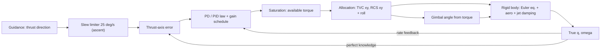
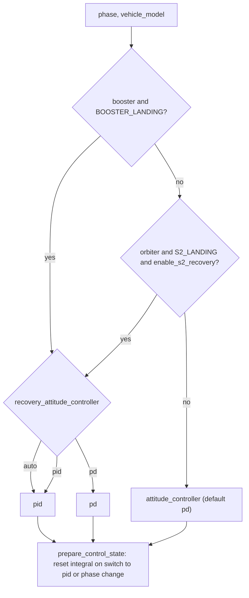

# 9. Attitude control

> The attitude controller turns guidance's desired thrust direction into a
> body-frame control torque each integration step. It uses a *reduced-attitude*
> (thrust-axis-only) quaternion error, a PD or PID law with inertia-scheduled
> gains, integral anti-windup, and a torque allocation that splits pitch/yaw
> between thrust vector control (TVC) and the reaction control system (RCS) and
> gives roll to the RCS only. The commanded torque is applied directly to
> Euler's rotational equation; the TVC gimbal angle is then inferred from the
> torque, quasi-statically, to tilt the thrust vector. Fidelity: rigid body,
> perfect attitude and rate knowledge, no actuator lag, no gimbal-angle
> dynamics, no flexible-body or slosh modes. The quaternion-feedback structure
> is standard; gains, limits, deadbands and the phase scheduling are project
> tuning.

## 9.1 Role in the simulation

`simulation_step` (`backend/rlv_sim/mission/step.py:673`) runs one fixed step
in this order:

1. Guidance (`_run_guidance`) returns `guidance['thrust_direction']`, an
   inertial unit vector $\hat{\mathbf{d}}$.
2. Booster hardware (`_run_booster_hardware`, `step.py:171`) computes the grid
   fin command and grid-fin *force*. Grid fins produce no attitude torque (see
   9.7.4).
3. The reference direction is shaped by the slew limiter in
   `vehicle/actuator.py` (stacked and orbiter ascent only, `step.py:714-724`).
4. The inertia, the stage torque limit and the available actuator authority are
   evaluated (`step.py:744-787`).
5. `resolve_attitude_controller` and `prepare_control_state` select PD or PID
   and reset the integrator if needed (`step.py:772-773`).
6. `compute_control_output` (`vehicle/control.py:313`) computes the torque
   (`step.py:789-798`).
7. The torque is allocated to TVC/RCS (`_allocate_attitude_torque`,
   `step.py:809-814`) and RCS propellant is debited (`step.py:818-825`).
8. The torque is held constant over the RK4 step (zero-order hold) and enters
   $\mathbf{I}\dot{\boldsymbol\omega} = \boldsymbol\tau_c + \boldsymbol\tau_{aero}
   - \boldsymbol\omega\times\mathbf{I}\boldsymbol\omega - \dot{\mathbf{I}}\boldsymbol\omega
   - \boldsymbol\tau_{jet}$ (`physics/dynamics.py:88-120`, `:323`). The same
   transverse torque sets the gimbal deflection of the thrust vector in
   `physics/forces.py:781-834`.

The controller reads the **true** state `state.q`, `state.omega`
(`step.py:790`): navigation errors (chapter on GPS/INS) affect guidance
only, not attitude feedback.

Inputs and outputs of `compute_control_output` (`control.py:313-378`):

| Input | Meaning | Unit |
|---|---|---|
| `q_current` | $\mathbf{q}$, body-to-ECI | – |
| `omega` | $\boldsymbol\omega$, body frame | rad/s |
| `desired_direction` | $\hat{\mathbf{d}}$ (after slew limiter), ECI | – |
| `inertia` | per-axis control inertia $[I_x^c, I_y^c, I_z^c]$ | kg m² |
| `max_torque` | available torque $\tau_{avail}$ | N m |
| `max_roll_torque` | RCS roll authority $\tau_{RCS}$ | N m |
| `rcs_only` | TVC authority is zero | bool |
| `controller` | `"pd"` or `"pid"` | – |

Output dictionary: `q_commanded` (logged only), `error_axis`
($\mathbf{q}_{ev}$), `error_angle` ($\theta$), `error_degrees`, `torque`,
`torque_magnitude`, `saturated`, `attitude_controller`, `integral_torque`,
`integral_torque_magnitude`, `control_state`. `step.py:815-816` overwrites
`torque_magnitude` and `saturated` after allocation.

## 9.2 From thrust direction to attitude command

### 9.2.1 Physical idea

Guidance specifies only where the thrust axis (body $+z$) must point. Roll
about that axis is not commanded. The controller therefore regulates the
two-degree-of-freedom *reduced attitude* (the pointing of body $+z$), and roll
is left free apart from rate damping.

### 9.2.2 Commanded quaternion (logged only)

`compute_commanded_quaternion` (`control.py:40-53`) calls
`direction_to_quaternion(d, BODY_Z_AXIS)` (`core/frames.py:115-156`), the
shortest-arc rotation that takes the reference $\hat{\mathbf{z}}=[0,0,1]$ onto
$\hat{\mathbf{d}}$:

$$
\mathbf{q}_{cmd} = \frac{[\,1+\hat{\mathbf{z}}\cdot\hat{\mathbf{d}},\;\hat{\mathbf{z}}\times\hat{\mathbf{d}}\,]}
{\left\|[\,1+\hat{\mathbf{z}}\cdot\hat{\mathbf{d}},\;\hat{\mathbf{z}}\times\hat{\mathbf{d}}\,]\right\|}
$$

(`frames.py:153-156`). If $1+\hat{\mathbf z}\cdot\hat{\mathbf d}<10^{-12}$
(antiparallel) a 180° rotation about an arbitrary perpendicular axis is
returned (`frames.py:143-148`); a zero direction returns identity
(`frames.py:132-133`). The implied roll is "minimal rotation from the ECI
axes", which has no physical meaning. $\mathbf{q}_{cmd}$ is written to the
telemetry but **is not used by the control law** (`control.py:343`).

### 9.2.3 Reference slew limiter (`vehicle/actuator.py`)

For the stacked vehicle and for the orbiter outside its recovery phases, the
guidance direction passes through `update_actuator` (`actuator.py:58-63`,
called at `step.py:723`). `_limit_rotation` (`actuator.py:27-55`) rotates the
previous reference $\hat{\mathbf{a}}_k$ toward $\hat{\mathbf d}$ by at most
$\dot\delta_{max}\,\Delta t$ (Rodrigues' formula):

$$
\hat{\mathbf a}_{k+1} =
\begin{cases}
\hat{\mathbf d}, & \angle(\hat{\mathbf a}_k,\hat{\mathbf d}) \le \dot\delta_{max}\Delta t\\
\hat{\mathbf a}_k\cos\vartheta + (\hat{\mathbf e}\times\hat{\mathbf a}_k)\sin\vartheta
+ \hat{\mathbf e}(\hat{\mathbf e}\cdot\hat{\mathbf a}_k)(1-\cos\vartheta), & \text{otherwise}
\end{cases}
$$

with $\vartheta=\dot\delta_{max}\Delta t$, $\hat{\mathbf e} = \hat{\mathbf a}_k\times\hat{\mathbf d}/\|\cdot\|$
(an arbitrary perpendicular if antiparallel, `actuator.py:38-47`). The state is
initialised to the local vertical (`mission/full_mission.py:228`) and copied
to both vehicles at separation (`full_mission.py:382`, `:395`).

Although `ActuatorState` is described as "engine gimbal actuator dynamics"
and the module docstring says "second-order", it is a pure first-order rate
limit on the **attitude reference direction**. `actuator.thrust_dir` is not the
physical thrust direction; the thrust force is computed from the body attitude
plus the gimbal deflection of 9.7.1. For the booster and for the orbiter in
`S2_DEORBIT`/`S2_ENTRY`/`S2_LANDING` the limiter is bypassed and the
normalised guidance direction is used directly (`step.py:715-721`, local
vertical if the direction is zero).

| Symbol | Config field / constant | Default | Unit | Meaning |
|---|---|---|---|---|
| $\dot\delta_{max}$ | `C.MAX_GIMBAL_RATE` (`core/constants.py:347`) | 25 (0.436 rad/s) | deg/s | reference slew-rate limit |
| $\Delta t$ | `dt`; capped by `C.STACKED_ASCENT_MAX_DT`, `C.BOOSTER_RECOVERY_MAX_DT` | 0.05 | s | control/integration step |

Classification: Project heuristic (named after a gimbal rate, used as a
command-shaping filter).

## 9.3 Attitude error

### 9.3.1 Textbook form

Quaternion feedback (Wie & Barba 1985 [1]; Wie [2]) forms the error quaternion
$\mathbf{q}_e = \mathbf{q}_{cmd}^{*}\otimes\mathbf{q}$ (or the reverse), flips
its sign if $q_{e,w}<0$ to take the short way, and feeds back the vector part
$\mathbf{q}_{e,v} = \hat{\mathbf e}\sin(\theta/2)$.

### 9.3.2 Implemented form: thrust-axis error

`compute_thrust_axis_error` (`control.py:56-88`) does not form a full
quaternion error. With $\mathbf R(\mathbf q)$ the body-to-ECI matrix
(`core/frames.py:33-38`):

$$
\hat{\mathbf b}_z = \mathbf R(\mathbf q)\,[0,0,1]^T,\qquad
\theta = \arccos\!\big(\mathrm{clip}(\hat{\mathbf b}_z\cdot\hat{\mathbf d},-1,1)\big)
$$

$$
\hat{\mathbf e}_{I} = \frac{\hat{\mathbf b}_z\times\hat{\mathbf d}}{\|\hat{\mathbf b}_z\times\hat{\mathbf d}\|},\qquad
\hat{\mathbf e}_{B} = \mathbf R^T\hat{\mathbf e}_I,\qquad
\boxed{\mathbf q_{ev} = \hat{\mathbf e}_B\,\sin(\theta/2)}
$$

(`control.py:72-88`). $\mathbf q_{ev}$ is the vector part of the shortest-arc
quaternion that rotates the current thrust axis onto the desired one, expressed
in body axes.

Properties and edge cases:

- **Sign / shortest path.** $\theta\in[0,\pi]$ by construction, so
  $\sin(\theta/2)\ge0$ and the rotation is always the short one; no
  $q_w$ sign test is needed. The axis points *from current toward desired*,
  so positive $\mathbf q_{ev}$ calls for positive torque: the law uses
  $+K_p\mathbf q_{ev}$ (`control.py:221-226`, `:282`). This is the same as
  Wie's $-K\mathbf q_{e,v}$ with the opposite error definition.
- **No roll error.** $\hat{\mathbf e}_I\perp\hat{\mathbf b}_z$, so
  $\hat{\mathbf e}_B$ has a zero $z$ component: the error never commands roll.
  Roll is governed only by the rate term (9.4).
- $\|\hat{\mathbf d}\|<10^{-10}$ or $\theta<10^{-10}$: zero error
  (`control.py:68-69`, `:76-77`, `C.ZERO_TOLERANCE`).
- Antiparallel ($\|\hat{\mathbf b}_z\times\hat{\mathbf d}\|<10^{-10}$, $\theta\approx\pi$):
  axis fixed to body $+x$, $\mathbf q_{ev}=[1,0,0]$ (`control.py:81-83`).
- `error_angle` $\theta$ is returned for logging and the RCS deadband.

Small-angle limit: $\mathbf q_{ev}\approx\tfrac12\boldsymbol\theta$, where
$\boldsymbol\theta$ is the small rotation vector from current to desired.
**The loop stiffness is therefore $K_p/2$ per radian, not $K_p$** (9.6).

Classification: Standard (reduced-attitude / shortest-arc pointing error; the
quaternion-feedback structure of [1], [2]). Restriction to the thrust axis is a
project design choice, documented in the docstring (`control.py:59-63`).

## 9.4 Control laws

### 9.4.1 PD law (`pd_control_law`, `control.py:206-310`)

$$
\boldsymbol\tau_p = \mathbf K_p\circ\mathbf q_{ev},\qquad
\boldsymbol\tau_d = -\mathbf K_d\circ\boldsymbol\omega
$$

(`control.py:282`, `:284`; $\circ$ = element-wise product with the per-axis
scheduled gains of 9.5). The rate term uses the absolute body rate: the
commanded rate is taken as zero (`control.py:226`), so a moving reference
produces a tracking lag proportional to its rate.

**RCS-only deadband** (`control.py:276-280`): if the TVC has no authority
(`rcs_only=True`, set at `step.py:784-787` when
`_tvc_authority` $\le0$ and $\tau_{avail}>0$) and $\theta<3.5°$, then
$\mathbf q_{ev}\leftarrow\mathbf 0$. Damping stays active. If `rcs_only` is not
passed (direct callers), the fallback test is
$\tau_{max}<$ `C.RCS_FULL_AUTHORITY_NM` = 80 000 N m.

### 9.4.2 PID law

Only when `controller == "pid"`, a `ControlState` is supplied and $\Delta t>0$
(`control.py:286-302`):

1. *Conditional integration (clamping)*: compute
   $\boldsymbol\tau_{pre} = \boldsymbol\tau_p+\boldsymbol\tau_d+\mathbf K_i\circ\mathbf z_{k}$.
   If $\|\boldsymbol\tau_{pre}\|\ge0.999\,\tau_{avail}$ the integrator is frozen
   (`control.py:289-292`).
2. Otherwise forward-Euler update
   $\mathbf z_{k+1}=\mathbf z_k+\mathbf q_{ev}\,\Delta t$ (`control.py:294`),
   followed by the anti-windup clamp of 9.4.3.
3. $\boldsymbol\tau_i=\mathbf K_i\circ\mathbf z_{k+1}$ (`control.py:302`).

Since $\mathbf q_{ev,z}=0$, the roll integral never grows; only transverse
integration is effective.

### 9.4.3 Integral anti-windup (`_apply_integral_anti_windup`, `control.py:172-203`)

With $f_w$ = `attitude_integral_windup_fraction`:

$$
L_{xy}=\max(f_w\,\tau_{avail},0),\qquad L_z=\max(f_w\,\tau_{RCS},0)
\;(\text{or }L_{xy}\text{ if }\tau_{RCS}\text{ is None})
$$

$$
\text{if } \|(\mathbf K_i\circ\mathbf z)_{xy}\|>L_{xy}:\;
\mathbf z_{xy}\leftarrow\mathbf z_{xy}\,\frac{L_{xy}}{\|(\mathbf K_i\circ\mathbf z)_{xy}\|};\qquad
\text{if } L_{xy}\le0:\;\mathbf z_{xy}\leftarrow\mathbf 0
$$

and the same for the roll component with $L_z$. The transverse pair is scaled
as a vector (direction preserved); roll is scaled independently. Because
`step.py:796` always passes `max_roll_torque=rcs_limit`, an exhausted RCS
($\tau_{RCS}=0$) zeroes the roll integral.

### 9.4.4 Integrator reset (`prepare_control_state`, `control.py:151-169`)

When the active law is PID and either the previous law was not PID or the
mission phase name changed, $\mathbf z\leftarrow\mathbf 0$. Switching to PD
keeps $\mathbf z$ (unused). The state is per vehicle (`GuidanceState.control_state`).

### 9.4.5 Torque saturation

$$
\boldsymbol\tau = \boldsymbol\tau_p+\boldsymbol\tau_d+\boldsymbol\tau_i,\qquad
\text{if }\|\boldsymbol\tau\|>\tau_{avail}:\;\boldsymbol\tau\leftarrow\boldsymbol\tau\,\frac{\tau_{avail}}{\|\boldsymbol\tau\|}
$$

(`control.py:304-308`): direction-preserving norm saturation on all three axes
together. The allocation of 9.7 then applies per-axis limits.

| Symbol | Config field / constant | Default | Unit | Meaning |
|---|---|---|---|---|
| $K_p^{ref}$ | `kp_attitude` (`C.KP_ATTITUDE`, `constants.py:116`) | $1.6\times10^{8}$ | N m (per unit $q_{ev}$) | proportional gain at $I^{ref}$ |
| $K_d^{ref}$ | `kd_attitude` (`C.KD_ATTITUDE`, `:117`) | $1.07\times10^{8}$ | N m s/rad | rate gain at $I^{ref}$ |
| $K_i^{ref}$ | `ki_attitude` (`C.KI_ATTITUDE`, `:120`) | $8.0\times10^{6}$ | N m/s (per unit $q_{ev}$) | integral gain at $I^{ref}$ |
| – | `attitude_controller` | `"pd"` | – | law outside recovery landing |
| – | `recovery_attitude_controller` | `"auto"` | – | law in booster / S2 landing |
| $f_w$ | `attitude_integral_windup_fraction` (`C.ATTITUDE_INTEGRAL_WINDUP_FRACTION`) | 0.35 | – | integral torque budget, validated in $(0,1]$ |
| – | literal, `control.py:278` | 3.5 | deg | RCS-only pointing deadband |
| – | literal, `control.py:291` | 0.999 | – | pre-saturation freeze threshold |

Classification: Standard structure (PD/PID quaternion feedback [1], [2];
conditional-integration anti-windup [5]). Gains, $f_w$, deadband and
thresholds: Project heuristic; no external reference.

## 9.5 Gain scheduling with inertia

### 9.5.1 Equations (`_schedule_gains`, `control.py:105-127`)

For a 3-element control inertia $\mathbf I^c=[I^c_x,I^c_y,I^c_z]$:

$$
\rho_i=\min\!\left(\frac{I^c_i}{I^{ref}},1\right),\qquad
K_{p,i}=K_p^{ref}\rho_i,\quad K_{d,i}=K_d^{ref}\rho_i,\quad K_{i,i}=K_i^{ref}\rho_i
$$

with $I^{ref}$ = `C.IXX_FULL` $=7.2\times10^{7}$ kg m² (`constants.py:92`). A
positive scalar inertia gives the same $\rho$ on all axes; `None` or
non-positive gives $\rho=1$. `step.py` always passes the per-axis diagonal of
`compute_inertia_tensor` (`step.py:744-749`).

Because every gain scales with $I_i$, the gain-to-inertia ratios
$K/I$ are constant while $I_i\le I^{ref}$, so the closed-loop poles are
(approximately) independent of mass and of axis. The cap $\rho\le1$ only
matters for $I>I^{ref}$; the stacked liftoff pitch inertia equals $I^{ref}$
exactly, so in practice the cap is never active.

### 9.5.2 Booster detune (`BOOSTER_CONTROL_INERTIA_SCALE`)

For `vehicle_model == "booster"` the scheduling input is
$\mathbf I^c = s_b\,\mathrm{diag}(\mathbf I)$, $s_b=0.8$
(`step.py:766-770`, `constants.py:130-139`). The physical inertia in the
equations of motion is unchanged. The effect is to lower all booster gains by
20 % relative to the vehicle's true inertia. The constant's comment calls it
"an empirical controller detune with no underlying physics equation".

### 9.5.3 Implied natural frequency and damping

The docstring (`control.py:233-235`) quotes
$\omega_n=\sqrt{K_p^{ref}/I^{ref}}\approx1.49$ rad/s and
$\zeta=K_d^{ref}/(2\sqrt{K_p^{ref}I^{ref}})\approx0.50$. Those numbers treat
$K_p$ as torque per radian. Because the fed-back error is
$\sin(\theta/2)\approx\theta/2$ (9.3.2), the actual linearised loop
(9.8.1) has stiffness $K_p/2$:

$$
\omega_n=\sqrt{\frac{s\,K_p^{ref}}{2I^{ref}}},\qquad
\zeta=\frac{s\,K_d^{ref}/I^{ref}}{2\,\omega_n}
$$

($s=1$ for stacked/orbiter, $s=s_b$ for booster, valid while $sI\le I^{ref}$).

| Vehicle | $s$ | $\omega_n$ (rad/s) | $\zeta$ | PD poles (1/s) | PID poles (1/s) |
|---|---|---|---|---|---|
| Stacked, orbiter (all axes) | 1.0 | 1.054 | 0.705 | $-0.743\pm0.748j$ | $-0.716\pm0.722j$, $-0.054$ |
| Booster (all axes) | 0.8 | 0.943 | 0.631 | $-0.594\pm0.732j$ | $-0.568\pm0.711j$, $-0.054$ |
| Docstring claim (stacked) | 1.0 | 1.49 | 0.50 | – | – |

PID poles are the roots of $s^3+(K_d/I)s^2+(K_p/2I)s+(K_i/2I)=0$ with
$K/I$ from the table above; the slow real pole ($\approx-0.054$ s⁻¹, time
constant ≈ 19 s) is the integral mode. Computed with `numpy.roots` from the
defaults; not produced by any test.

Roll: $\mathbf q_{ev,z}=0$, so the roll loop is pure rate damping,
$I_z\dot\omega_z=-K_{d,z}\omega_z$, with time constant
$I_z/K_{d,z}=I^{ref}/(sK_d^{ref}) = 0.67$ s ($s=1$) or 0.84 s ($s=0.8$), as long
as the RCS roll limit (9.7.2) is not reached.

Classification: Standard (gain scaling by inertia to hold $\omega_n,\zeta$);
the reference values and $s_b$ are Project heuristics.

## 9.6 Controller selection

`resolve_attitude_controller` (`control.py:130-148`):

With defaults, every phase uses PD except booster `BOOSTER_LANDING` (PID). The
integral term is intended to remove steady pointing bias from persistent
disturbance torques (aerodynamic moment, CG offset) during the landing burn.
`"auto"` has no logic beyond "PID in landing"; it does not inspect the state.
`enable_s2_recovery` defaults to `False`. Valid values are checked in
`config/definition.py:482-488`.

Classification: Project heuristic.

## 9.7 Torque realisation

### 9.7.1 Authority and stage limits

Stage structural/design limit (`_stage_max_torque`, `step.py:622-630`), with
$\tau_{cfg}$ = `max_torque`:

| Case (checked in this order) | $\tau_{stage}$ | Default (N m) |
|---|---|---|
| Orbiter in S2 recovery phases | $\tau_{cfg}\cdot$ `BOOSTER_MAX_TORQUE_NM`$/$`MAX_TORQUE` | $1.2\times10^{7}$ |
| Stage 2 | $\tau_{cfg}\cdot 2\times10^{6}/$`MAX_TORQUE` (literal) | $2.0\times10^{6}$ |
| Booster | $\tau_{cfg}\cdot$ `BOOSTER_MAX_TORQUE_NM`$/$`MAX_TORQUE` | $1.2\times10^{7}$ |
| Otherwise (stacked) | $\tau_{cfg}$ | $3.2\times10^{7}$ |

TVC authority (`_tvc_authority`, `step.py:633-643`), zero unless thrust is on
with throttle and thrust > 0:

$$
\tau_{TVC} = T\,\eta\,\sin\delta_{max}\,\ell_{TVC}
$$

with $T$ the stage thrust magnitude from `_thrust_magnitude` (`step.py:599-618`;
booster burns use `boostback_thrust_n`, `entry_thrust_n`, `landing_thrust_n`),
$\eta$ the actual throttle, $\delta_{max}$ = `C.MAX_GIMBAL_ANGLE` = 15°,
$\ell_{TVC}$ from `_tvc_lever_arm` (`physics/forces.py:748-778`):
`tvc_lever_arm_m` if set, else 21 m (booster), 12 m (stage 2), 32 m (stage
1/stacked). RCS authority (`vehicle/rcs.py:130-141`):

$$
\tau_{RCS} = F_{RCS}\,N_{RCS}\,\ell_{RCS}\quad(0\text{ if exhausted})
$$

Available torque passed to the controller (`_available_attitude_torque_limit`,
`step.py:231-251`):

$$
\tau_{avail} = \max\!\big(0,\;\min(\tau_{stage},\;\tau_{TVC}+\tau_{RCS})\big)
$$

except in the orbiter recovery phases, where $\tau_{avail}=\tau_{stage}$
without any actuator check (`step.py:757-758`).

Representative values at full throttle (defaults):

| Case | $T$ (MN) | $\ell_{TVC}$ (m) | $\tau_{TVC}$ (MN m) | $\tau_{stage}$ (MN m) |
|---|---|---|---|---|
| Stacked, 9 engines | 7.607 | 32 | 63.0 | 32 |
| Stage 2 | 0.95 | 12 | 2.95 | 2.0 |
| Booster boostback / entry (3 engines) | 2.536 | 21 | 13.8 | 12 |
| Booster landing (1 engine) | 0.845 | 21 | 4.59 | 12 |
| RCS only | – | 20 | 0.08 | – |

### 9.7.2 Allocation (`_allocate_attitude_torque`, `step.py:254-296`)

Body $z$ is the roll axis; one gimballed engine (lumped) gives no roll torque.

$$
\tau_{TVC}' = \min(\tau_{TVC},\tau_{stage}),\qquad
L_{xy}=\min(\tau_{stage},\;\tau_{TVC}'+\tau_{RCS})
$$

$$
\boldsymbol\tau_{xy}\leftarrow\boldsymbol\tau_{xy}\min\!\Big(1,\frac{L_{xy}}{\|\boldsymbol\tau_{xy}\|}\Big),\qquad
\tau_z\leftarrow\mathrm{clip}(\tau_z,-\tau_{RCS},\tau_{RCS}),\qquad
\boldsymbol\tau\leftarrow\boldsymbol\tau\min\!\Big(1,\frac{\tau_{stage}}{\|\boldsymbol\tau\|}\Big)
$$

Roll is clipped per axis (not direction-preserving). With the default RCS,
roll torque is at most 80 kN m; for the stacked vehicle
($I_z=2\times10^6$ kg m²) that is 0.04 rad/s². In the orbiter recovery
phases the allocation is skipped and only the norm limit $\tau_{stage}$ is
applied (`step.py:803-808`), so roll is not restricted to RCS there.

### 9.7.3 Gimbal angle from torque (`physics/forces.py:781-834`)

During thrust, the transverse control torque also tilts the thrust vector. The
part within TVC capacity is treated as gimbal-produced, the rest as RCS:

$$
\tau_{cap}=T_{eff}\sin\delta_{max}\,\ell_{TVC},\qquad
\boldsymbol\tau^{g}_{xy}=\boldsymbol\tau_{xy}\frac{\min(\|\boldsymbol\tau_{xy}\|,\tau_{cap})}{\|\boldsymbol\tau_{xy}\|}
$$

Inverting $\boldsymbol\tau=\boldsymbol\ell\times\mathbf F$ for a gimbal on
body $-z$ at distance $\ell_{TVC}$ below the CG:

$$
F_y=\frac{\tau^g_x}{\ell_{TVC}},\quad F_x=-\frac{\tau^g_y}{\ell_{TVC}},\quad
\delta=\arcsin\!\Big(\mathrm{clip}\big(\tfrac{\sqrt{F_x^2+F_y^2}}{T_{eff}},0,1\big)\Big)
$$

$$
\mathbf F_{body}=T_{eff}\,[\sin\delta\,\hat u_x,\;\sin\delta\,\hat u_y,\;\cos\delta]
$$

where $T_{eff}$ is the thrust after pressure and throttle corrections
(`forces.py:890-903`). Implementation notes:

- The gimbal is quasi-static: $\delta$ follows the torque command instantly.
  There is no gimbal angle state, no gimbal rate limit, no actuator bandwidth.
  `C.MAX_GIMBAL_RATE` is used only by the reference slew limiter (9.2.3).
- The gimbal torque is **not** recomputed from $\mathbf F_{body}$; the
  commanded torque is applied to the Euler equation directly
  (`dynamics.py:323`). The gimbal calculation only adds the lateral force
  and the $\cos\delta$ axial loss to the translational equation
  (`dynamics.py:325`).
- $\delta\le\delta_{max}=15°$ holds by construction because $\tau^g$ is capped at
  $\tau_{cap}$.

### 9.7.4 RCS and grid fins

RCS propellant use (`step.py:818-825`, `rcs.py:29-127`): the RCS is charged
for $\tau_{RCS,dem}=\sqrt{\max(0,\|\boldsymbol\tau_{xy}\|-\tau_{TVC})^2+\tau_z^2}$
and burns

$$
\dot m_{RCS}=\frac{F_{RCS}N_{RCS}}{I_{sp,RCS}\,g_0}\,\min\!\Big(1,\frac{\tau_{RCS,dem}}{F_{RCS}N_{RCS}\ell_{RCS}}\Big)
$$

from a separate budget; this mass is not removed from the vehicle state. RCS
authority is full until the budget reaches zero, then zero.

Grid fins (`vehicle/recovery_hardware.py:217-270`) are modelled as a
translational force (lift along a commanded direction plus drag) and play no
part in the attitude loop: `compute_grid_fin_force` discards `q` and returns no
moment. With an aerodynamic deck loaded, the grid-fin deflection enters only
the drag lookup (`forces.py:1171-1176`); `compute_aerodynamic_moment` is called
with `fin_deg=0`.

| Symbol | Config field / constant | Default | Unit | Meaning |
|---|---|---|---|---|
| $\tau_{cfg}$ | `max_torque` (`C.MAX_TORQUE`) | $3.2\times10^{7}$ | N m | stacked limit; scales other limits |
| – | `C.BOOSTER_MAX_TORQUE_NM` | $1.2\times10^{7}$ | N m | booster / S2-recovery limit |
| – | literal `step.py:627` | $2.0\times10^{6}$ | N m | stage-2 limit |
| $\delta_{max}$ | `C.MAX_GIMBAL_ANGLE` | 15 | deg | gimbal limit used by physics |
| – | `max_gimbal_angle_deg` | 15 | deg | config field, **not read by the physics** (see 9.10) |
| $\ell_{TVC}$ | `tvc_lever_arm_m` / `C.S1_TVC_LEVER_ARM`, `C.S2_TVC_LEVER_ARM`, `C.BOOSTER_TVC_LEVER_ARM` | None / 32 / 12 / 21 | m | gimbal-to-CG arm (constant) |
| $F_{RCS}$ | `rcs_thrust` | 500 | N | thrust per thruster |
| $N_{RCS}$ | `rcs_num_thrusters` | 8 | – | thrusters |
| $\ell_{RCS}$ | `C.RCS_LEVER_ARM` | 20 | m | RCS arm (all vehicles) |
| $I_{sp,RCS}$ | `rcs_isp` | 220 | s | RCS specific impulse |
| – | `rcs_propellant_mass` | 300 | kg | RCS budget per vehicle |
| – | `enable_rcs` | True | – | enables RCS authority |
| $s_b$ | `C.BOOSTER_CONTROL_INERTIA_SCALE` | 0.8 | – | booster gain detune |

Classification: TVC geometry, Standard (Sutton & Biblarz [3]); allocation
rules, limits, lever arms and RCS sizing, Project heuristic.

## 9.8 Stability discussion

### 9.8.1 Small-angle closed loop

For one transverse axis, constant reference, small error $\theta$ (rotation
from current to desired), no saturation, neglecting gyroscopic coupling,
$\dot I$ and jet damping:

$$
I\ddot\theta = -\Big(\frac{K_p}{2}-M_\alpha\Big)\theta - (K_d - M_q)\dot\theta
\;\Big[-\frac{K_i}{2}\!\int\!\theta\,dt\Big]
$$

with $K=K^{ref}\rho$ (9.5), $M_\alpha$ the aerodynamic stiffness (positive =
destabilising) and $M_q\le0$ the aerodynamic pitch damping. The
approximation $\alpha\approx\theta$ ignores flight-path rotation. Jet damping
(`dynamics.py:139-176`) and $\dot{\mathbf I}\boldsymbol\omega$ add further
damping during burns. The zero-order-hold torque with $\Delta t=0.05$ s gives
$\omega_n\Delta t\approx0.05$, so discretisation has negligible effect on
these poles.

### 9.8.2 Aerodynamic instability during ascent

In the analytic aerodynamic branch (no deck, the default), the normal force
$F_N=\bar q\,S\,C_N(\alpha)$ acts at $z_{cp}$ = `C.H_CP` = 33 m above the
base, and the moment is $(z_{cp}-z_{cg})\hat{\mathbf z}\times(-F_N\hat{\mathbf u}_t)$
(`forces.py:988-1013`). If $z_{cp}>z_{cg}$ (CP ahead of CG) the moment
increases $\alpha$. Linearised, $M_\alpha=\bar q S C_{N\alpha}(z_{cp}-z_{cg})$.

With $S=10.75$ m², $C_{N\alpha}=4.0$ (`C.C_N_ALPHA`) and an illustrative
$\bar q=35$ kPa (`C.MAX_DYNAMIC_PRESSURE`), evaluated along the stacked mass
history with `compute_center_of_mass` and `compute_inertia_tensor`:

| Mass (t) | $I_x$ (10⁶ kg m²) | $z_{cg}$ (m) | $M_\alpha$ (MN m/rad) | $K_p/2$ (MN m/rad) | $M_\alpha/(K_p/2)$ |
|---|---|---|---|---|---|
| 552.6 (liftoff) | 72.0 | 26.8 | 9.3 | 80.0 | 0.12 |
| 449.9 | 59.0 | 28.4 | 6.9 | 65.5 | 0.10 |
| 347.2 | 44.9 | 31.2 | 2.7 | 49.8 | 0.05 |
| 295.8 | 37.8 | 33.4 | −0.6 | 42.0 | stable |
| 193.1 | 23.7 | 41.0 | −12.1 | 26.3 | stable |

The stacked vehicle is aerodynamically unstable until the CG passes 33 m. The
destabilising stiffness is at most ≈ 12 % of the control stiffness, so
$\omega_n$ drops by about 6 % (from $\sqrt{1-0.12}$) and the loop stays stable
as long as torque is not saturated. The dynamic pressure actually reached at
each mass depends on the trajectory; this table only bounds the ratio. With an
aerodynamic deck the moment comes from the deck's $C_m$ instead.

### 9.8.3 Bandwidth separation from guidance

The attitude loop has $\omega_n\approx1.05$ rad/s (stacked/orbiter) and
$0.94$ rad/s (booster); envelope time constant $1/(\zeta\omega_n)$ ≈ 1.35 s and
1.68 s, 2 % settling ≈ 5.4 s and 6.7 s. The booster terminal lateral-velocity
loop caps its gain at $1/\tau$ with $\tau$ =
`booster_terminal_divert_time_constant_s` = 1.5 s
(`guidance/booster.py:977-981`), a bandwidth of 0.67 rad/s. That is only about
1.4× below the booster attitude $\omega_n$, well short of the 3–10× separation
usually wanted for cascaded loops (Franklin et al. [4]). The code comment at
`guidance/booster.py:977-979` notes "~1 s of attitude lag" causing a horizontal
velocity limit cycle, which is why the cap was introduced. In this sense the
1.5 s value is a tuning result of the attitude bandwidth, not an independent
parameter: changing `kp_attitude`, `kd_attitude` or $s_b$ affects landing
accuracy through this coupling.

The ascent reference slew limit (25°/s) is far faster than the attitude loop
and only acts on large guidance steps (e.g. phase transitions).

### 9.8.4 Validity limits

- Rigid body, true-state feedback, no sensor noise or delay, no actuator
  dynamics; real TVC servo bandwidth and bending modes would lower the usable
  gain.
- Linearisation valid for small $\theta$; for large errors $\sin(\theta/2)$
  makes the proportional torque saturate naturally at $K_p$ (θ = 180°).
- Torque saturation is common at large errors (e.g. booster flip), and then
  the closed-loop figures above do not apply.
- Roll is uncontrolled in angle; roll drift from aerodynamic or gyroscopic
  coupling is not corrected.

## 9.9 Verification

`backend/tests/test_control.py`:

| Class | Tests |
|---|---|
| `TestScheduleGains` | scalar scaling, half inertia halves gains, per-axis scaling, cap at 1, `None` uses reference gains, explicit overrides |
| `TestResolveAttitudeController` | booster landing `auto`→`pid`, explicit `pd` respected, S2 landing with/without recovery, non-landing phase, wrong vehicle model |
| `TestPrepareControlState` | fresh state, reset on switch to PID, reset on phase change, preserved otherwise, not reset when switching to PD |
| `TestPdControlLaw` | zero in/zero out, sign of proportional term, norm saturation, RCS-only deadband on/off, PID accumulation, PD never integrates, freeze when pre-saturated |
| `TestIntegralAntiWindup` | transverse clamp, independent roll clamp, zero budget zeroes integral |
| `TestThrustAxisError` | aligned (0), perpendicular (90°), opposite (180°), zero direction |

`tests/test_config.py` checks invalid `attitude_controller` and negative
`kp_attitude`. No unit test covers `_allocate_attitude_torque`,
`_available_attitude_torque_limit`, `_stage_max_torque`, `update_actuator`,
`_gimbaled_thrust_body_vector` or the RCS propellant model directly; they are
exercised only through the full-mission regression (`pytest -m slow`). No test
checks closed-loop $\omega_n$ or $\zeta$.

## 9.10 Known issues and inconsistencies

1. **Natural frequency in the docstring is off by $\sqrt2$.** `control.py:233-235`
   claims $\omega_n\approx1.49$ rad/s, $\zeta\approx0.50$; with the
   $\sin(\theta/2)$ error the loop gives 1.05 rad/s and 0.70.
2. **`max_gimbal_angle_deg` is not used by the physics.** It is validated,
   documented and exposed by the web server (`server/app.py:346`), but all
   physics uses `C.MAX_GIMBAL_ANGLE` (`step.py:244`, `:277`, `:640`;
   `forces.py:814`). Changing it in the UI has no effect.
3. **`vehicle/actuator.py` is a reference slew limiter, not a gimbal model**,
   despite its docstring ("second-order"); the real gimbal is quasi-static
   (9.7.3) and has no rate limit.
4. **Orbiter recovery phases bypass actuator authority.** In `S2_DEORBIT`,
   `S2_ENTRY`, `S2_LANDING` the available torque is the booster limit
   $1.2\times10^7$ N m, independent of thrust or RCS, and roll is not limited to
   RCS (`step.py:757-758`, `:803-808`). This is far more than stage 2 can
   produce (2.95 MN m of TVC at full thrust).
5. **TVC lever arms are constant** (32/12/21 m) and do not follow the moving
   CG (26.8 m to 49 m above the base for the stacked vehicle). The comment at
   `forces.py:759-766` and `MATHEMATICAL_REFERENCES.md` §6 says physical
   values are "a few metres", which conflicts with the gimbal-to-CG geometry
   (engines at the base, CG tens of metres up) and with the 21–32 m defaults.
   The same comment's "roll authority" remark does not apply: TVC gives no
   roll torque in this model.
6. **RCS lever arm 20 m for every vehicle**, including stage 2; RCS authority
   does not decrease as propellant is used, and RCS propellant is not removed
   from the vehicle mass.
7. **Roll is not regulated in angle.** By design (thrust-axis error), but
   `q_commanded` in the telemetry implies a roll target that the controller
   ignores.
8. **Hard-coded literals:** stage-2 torque limit $2\times10^6$ N m
   (`step.py:627`), deadband 3.5° (`control.py:278`), 0.999 freeze threshold.

## 9.11 References

1. Wie, B., and Barba, P. M., "Quaternion Feedback for Spacecraft Large Angle
   Maneuvers," *Journal of Guidance, Control, and Dynamics*, Vol. 8, No. 3,
   1985, pp. 360–365.
2. Wie, B., *Space Vehicle Dynamics and Control*, AIAA Education Series,
   American Institute of Aeronautics and Astronautics, 1998 (2nd ed. 2008).
3. Sutton, G. P., and Biblarz, O., *Rocket Propulsion Elements*, Wiley
   (thrust vector control chapter; cited by `forces.py:793-795`).
4. Franklin, G. F., Powell, J. D., and Emami-Naeini, A., *Feedback Control of
   Dynamic Systems*, Pearson (second-order response, cascaded-loop design).
5. Åström, K. J., and Murray, R. M., *Feedback Systems: An Introduction for
   Scientists and Engineers*, Princeton University Press, 2008 (integrator
   windup and anti-windup).
