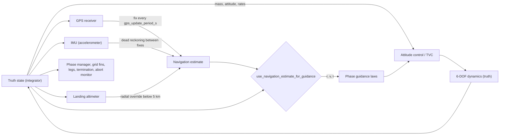
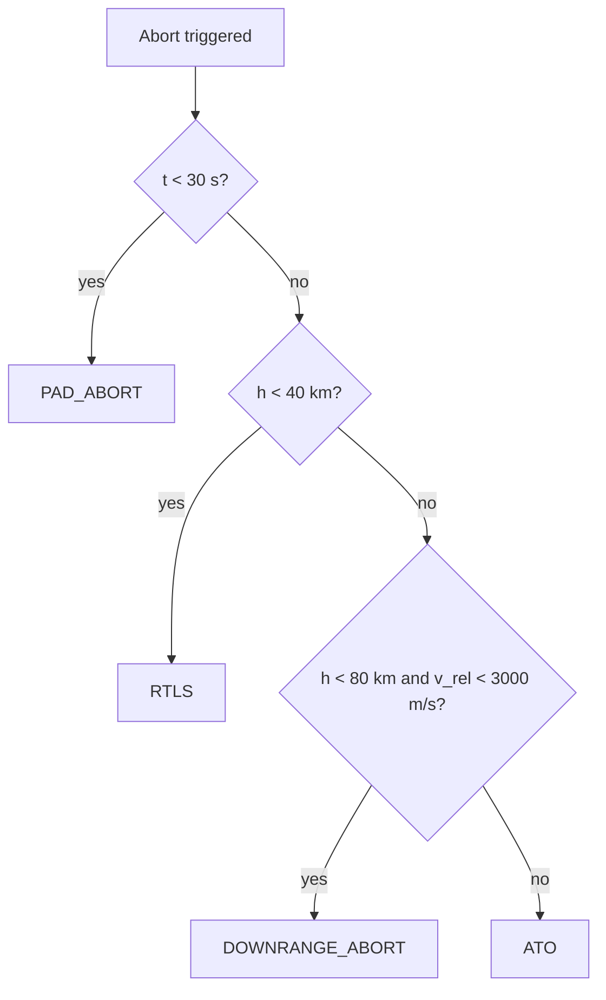
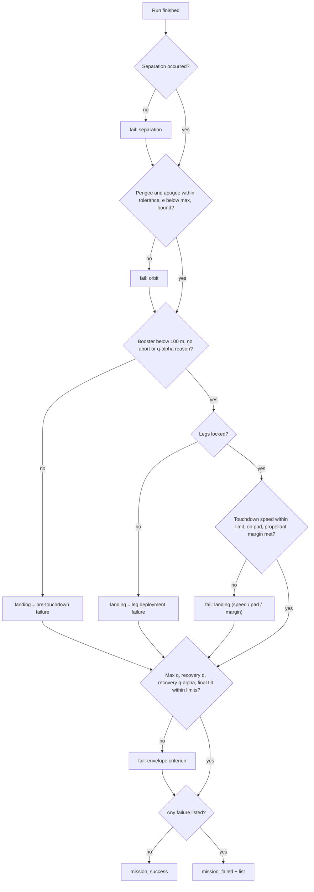

# 10. Navigation, sensors, abort modes and mission assessment

> This chapter covers four parts of the simulator that sit around the flight
> dynamics. Each one either feeds guidance a degraded view of the state or
> judges the outcome of a run. (1) Navigation: three sensor models (a
> GPS/GNSS position-velocity fix, an accelerometer-only inertial measurement
> unit (IMU) and a terminal-landing altimeter) build a state estimate that
> guidance can use in place of the true state. There is **no fusion filter**:
> the estimate is reset to each raw GPS fix, propagated between fixes by dead
> reckoning, and its radial component is overwritten by the altimeter near the
> ground. (2) Abort monitoring: an optional monitor watches the dynamic
> pressure times angle of attack (q·α), the attitude error and the body rate.
> If any limit trips it **ends the run** with a labelled abort mode; it does not
> fly an abort trajectory. (3) Mission assessment: after the run, strict
> pass/fail gates check the orbit, the booster touchdown and the
> structural-load envelope, and every failure is listed by name. (4) Run
> provenance: a JSON manifest records the inputs, environment, results and a
> NASA-STD-7009A-style input-pedigree score. All four are at demonstration
> fidelity, and they are off or permissive by default.

## 10.1 Role in the simulation

The physics integrator **always** uses the true state $(\mathbf{r},\mathbf{v},\mathbf{q},\boldsymbol\omega,m)$.
Navigation only changes the position, velocity and time that are passed into
the guidance laws.

Navigation runs once per guidance call. The steps are:

1. `mission/step.py:105` calls `update_navigation_estimate` (`vehicle/navigation.py:252`) on the vehicle's
   `GuidanceState.navigation_state` (`guidance/common.py:42`).
2. `mission/step.py:111-117` selects the guidance inputs:

$$
(\mathbf r_g,\mathbf v_g,t_g)=
\begin{cases}
(\hat{\mathbf r},\hat{\mathbf v},\hat t) & \text{if } \texttt{use\_navigation\_estimate\_for\_guidance} \wedge \hat{\mathbf x}\neq\varnothing\\
(\mathbf r,\mathbf v,t) & \text{otherwise}
\end{cases}
$$

3. Every phase's guidance function receives $(\mathbf r_g,\mathbf v_g,t_g)$ and
   the **true** mass $m$ (`mission/step.py:119-157`).

The navigation flags and error norms are copied into the guidance dict
(`mission/step.py:155-161`). From there they reach telemetry
(`mission/models.py:236-241`).

### Which quantities use the estimate and which use truth

| Consumer | Source when nav is on | Source location |
|---|---|---|
| Phase guidance laws: ascent, coast, orbit insertion, deorbit, S2 entry/landing, booster flip/boostback/coast/entry/landing (position, velocity, time inputs) | **Estimate** $\hat{\mathbf r},\hat{\mathbf v},\hat t$ | `mission/step.py:115-157` |
| Mass passed to guidance | Truth $m$ | same |
| Relative velocity `v_rel` written into the guidance dict (used by the safety checks and telemetry) | Truth | `mission/step.py:163-166` |
| Attitude controller (quaternion, body rates) | Truth. **No gyro model exists**, so there is no attitude estimate. | `vehicle/control.py` |
| Grid-fin commands, landing-leg deployment, predicted landing error | Truth | `mission/step.py:172-228` |
| Mission phase transitions (`MissionManager.update`) | Truth | `mission/full_mission.py:90`, `:264` |
| Termination, touchdown detection, abort monitor, q·α limit | Truth | `mission/step.py:390-595` |
| Mission assessment and telemetry | Truth | `outputs/summary.py`, `outputs/telemetry.py` |

### Selecting a mode

| Mode | How to select it | Effect |
|---|---|---|
| Truth (default) | `--nav-mode truth`, or the default config | All sensors off; guidance uses truth |
| Onboard | `--nav-mode onboard` (`cli.py:88-96`, `cli.py:183-190`) | Sets `enable_gps`, `enable_imu`, `enable_landing_altimeter` and `use_navigation_estimate_for_guidance` to `True` |
| Custom | Set the five config fields individually (JSON, web UI "Sensors & navigation" group, `config/schema.py:132-138`) | Any combination. See the combinations listed in §10.2.5. |

## 10.2 Navigation sensor models and the estimate

### 10.2.1 GPS/GNSS receiver

**Idea.** Each fix is the true ECI position and velocity plus independent
zero-mean Gaussian noise on each axis. The model includes no clock bias, no
satellite geometry (DOP), no outages, no latency, no time-correlated (multipath
or ionospheric) error and no antenna lever arm.

**Equations** (`vehicle/navigation.py:83-102`):

$$
\tilde{\mathbf r}_k=\mathbf r(t_k)+\mathbf n_r,\quad \mathbf n_r\sim\mathcal N(\mathbf 0,\sigma_r^2\mathbf I_3);\qquad
\tilde{\mathbf v}_k=\mathbf v(t_k)+\mathbf n_v,\quad \mathbf n_v\sim\mathcal N(\mathbf 0,\sigma_v^2\mathbf I_3)
$$

The samples are independent between fixes, so the noise is white at the fix
rate. With the defaults, the 3-D position error has RMS
$\sqrt3\,\sigma_r\approx5.2$ m and the 3-D velocity error has RMS
$\approx0.087$ m/s.

**Schedule** (`vehicle/navigation.py:281-287`). A fix is taken when
$t-t_{\text{last fix}}\ge T_{GPS}$, or on the first call. Fixes therefore
happen only on guidance steps. With $\Delta t=0.05$ s and $T_{GPS}=0.2$ s
there is nominally one fix every 4 steps. Because the comparison is done in
floating point, an accumulated time of $0.19999\ldots$ can push a fix to the
next step.

**Use of a fix** (`vehicle/navigation.py:288-299`). The estimate is
**replaced** by the raw fix: $\hat{\mathbf r}=\tilde{\mathbf r}_k$ and
$\hat{\mathbf v}=\tilde{\mathbf v}_k$. There is no weighting against the
propagated estimate and no covariance.

**Seeding** (`vehicle/navigation.py:261-268`). The GPS RNG uses `gps_seed`, the
IMU uses `gps_seed + 1` and the altimeter uses `gps_seed + 2`. NumPy
`default_rng` (PCG64) is used. `gps_seed = None` gives non-reproducible
entropy seeding. Stochastic wind uses `wind_seed`, or `gps_seed + 3` when
`wind_seed` is unset (`mission/full_mission.py:107-118`).

### 10.2.2 IMU (accelerometer only) and dead reckoning

**Idea.** Between GPS fixes, if `enable_imu` is set, the estimate is propagated
from a simulated accelerometer reading. The model has an accelerometer
**turn-on bias**, drawn once per receiver instance and then held constant, and
white measurement noise. There is no gyro, no scale-factor error, no
misalignment and no attitude propagation: the "IMU" output is already
expressed in ECI. There is also no strapdown mechanisation.

**Specific force seen by the sensor** (`vehicle/navigation.py:306-316`). The
code does not tap the force model. It reconstructs the true total acceleration
by a backward difference of the truth velocity and then removes point-mass
gravity:

$$
\mathbf a_{true}=\frac{\mathbf v(t)-\mathbf v(t_{prev})}{\Delta t_{truth}},\qquad
\mathbf g_{pm}=-\frac{\mu\,\mathbf r(t)}{\max(\lVert\mathbf r(t)\rVert^3,1)},\qquad
\mathbf f=\mathbf a_{true}-\mathbf g_{pm}
$$

Here $\Delta t_{truth}=\max(t-t_{prev},\ \Delta t_e,\ 10^{-9})$ and
$\Delta t_e=\max(t-\hat t,\ \Delta t,\ 10^{-9})$ is the propagation interval
($\Delta t$ is the step size passed in). $\mu$ is `C.MU_EARTH`. Both
$\mathbf g_{pm}$ and $\mathbf r$ are evaluated at the **true** position.

**Sensor error model** (`vehicle/navigation.py:112-127`):

$$
\tilde{\mathbf f}=\mathbf f+\mathbf b+\mathbf w,\qquad
\mathbf b\sim\mathcal N(\mathbf 0,\sigma_b^2\mathbf I_3)\ \text{(drawn once)},\qquad
\mathbf w\sim\mathcal N\!\left(\mathbf 0,\ \frac{\sigma_n^2}{\Delta t_e}\mathbf I_3\right)
$$

The variance $\sigma_n^2/\Delta t_e$ makes $\sigma_n$ (`imu_accel_noise`) a
noise *density*, in m/s²/√Hz ≡ m/s/√s. The velocity error added in one
interval has standard deviation $\sigma_n\sqrt{\Delta t_e}$. This is the
standard velocity-random-walk discretisation (Groves 2013, ch. 4).

**Propagation** (`vehicle/navigation.py:323-331`) uses constant-acceleration
kinematics over $\Delta t_e$:

$$
\hat{\mathbf a}=\tilde{\mathbf f}+\mathbf g_{pm},\qquad
\hat{\mathbf v}^+=\hat{\mathbf v}+\hat{\mathbf a}\,\Delta t_e,\qquad
\hat{\mathbf r}^+=\hat{\mathbf r}+\hat{\mathbf v}\,\Delta t_e+\tfrac12\hat{\mathbf a}\,\Delta t_e^2
$$

**Consequences of this construction:**

- **Gravity error cancels exactly.** The same $\mathbf g_{pm}$ is subtracted to
  form $\mathbf f$ and added back in $\hat{\mathbf a}$. Higher-order gravity
  (J2, EGM96) therefore ends up inside the "specific force", and the
  navigation error comes only from $\mathbf b+\mathbf w$. A real
  accelerometer cannot sense gravity, and real INS errors from a wrong
  gravity model or a position-dependent gravity feedback (Schuler or vertical
  channel instability) are **not** represented.
- **One-step lag.** $\mathbf a_{true}$ is the mean acceleration over the
  previous step, so it lags by about one step. Over one step this is
  negligible, but at sharp thrust transients the estimate lags by one step.
- **Error growth** without GPS from the bias alone is
  $\delta r\approx\tfrac12 b t^2$ per axis. With $\sigma_b=10^{-3}$ m/s² this
  is 0.05 m after 10 s, 180 m after 600 s, and about 1.8 km after 1 900 s
  (1σ per axis).

### 10.2.3 Landing altimeter

**Idea.** Below `landing_altimeter_max_altitude_m`, a radar/laser-style
altimeter measures height above a **spherical** Earth and the vertical
velocity. Each sample has independent Gaussian noise
(`vehicle/navigation.py:136-167`):

$$
\tilde h=(\lVert\mathbf r\rVert-R_E)+n_h,\quad n_h\sim\mathcal N(0,\sigma_h^2);\qquad
\tilde v_z=\mathbf v\cdot\hat{\mathbf u}+n_{vz},\quad n_{vz}\sim\mathcal N(0,\sigma_{vz}^2),\quad \hat{\mathbf u}=\mathbf r/\lVert\mathbf r\rVert
$$

**Correction** (`vehicle/navigation.py:220-249`, applied at `:347-353`). This
is a direct override: the radial components of the estimate are replaced by
the measurement, and the horizontal components are kept.

$$
\hat{\mathbf r}\leftarrow(\hat{\mathbf r}-(\hat{\mathbf r}\cdot\hat{\mathbf u})\hat{\mathbf u})+(R_E+\tilde h)\,\hat{\mathbf u},\qquad
\hat{\mathbf v}\leftarrow(\hat{\mathbf v}-(\hat{\mathbf v}\cdot\hat{\mathbf u})\hat{\mathbf u})+\tilde v_z\,\hat{\mathbf u}
$$

The vertical unit vector $\hat{\mathbf u}$ is taken from the **true**
position. The altimeter measures relative to the spherical $R_E$
(`C.R_EARTH`), whereas `State.altitude` is measured above the *configured*
surface (`physics/forces.py:586`). If a non-zero landing-site altitude or a
non-spherical surface is configured, the altimeter's height is offset from
the simulator's altitude. The code does not compensate for this.

### 10.2.4 Estimate bookkeeping

After every update, `_with_error_metrics` (`vehicle/navigation.py:205-217`)
records the true errors $\lVert\hat{\mathbf r}-\mathbf r\rVert$ and
$\lVert\hat{\mathbf v}-\mathbf v\rVert$. They are logged as
`nav_position_error_m` and `nav_velocity_error_mps`.

### 10.2.5 Sensor-combination behaviour

The branch order is in `vehicle/navigation.py:270-356`.

| GPS | IMU | Altimeter | Estimate between GPS fixes |
|---|---|---|---|
| off | off | off | Truth every step (`uses_truth_fallback = True`). Guidance is identical to truth mode even if `use_navigation_estimate_for_guidance` is on. |
| on | on | any | Reset to the raw fix at each fix, dead reckoning between fixes. This is "onboard" mode. |
| on | off | any | **Zero-order hold**: the estimate *and its time stamp* $\hat t$ stay frozen until the next fix. Guidance then receives a stale $t_g$ and a position up to $vT_{GPS}$ old (about 1.5 km at 7.5 km/s). |
| off | on | any | Initialised once from truth, then pure dead reckoning for the whole flight. |
| off | off | on | Initialised once from truth, then only the radial components are refreshed below 5 km. |

**Classification.** GPS white-noise and IMU bias + white-noise error models:
*Standard* (simplified forms of Groves 2013, ch. 4 and 9; Titterton & Weston
2004). Reset-to-fix, dead reckoning, and the altimeter radial override:
*Project heuristic; no external reference*. The module docstring itself
states that the model is "not a complete strapdown INS or covariance-based
GPS/INS Kalman filter" (`vehicle/navigation.py:10-11`).

**Parameters**

| Symbol | Config field | Default | Unit | Meaning |
|---|---|---|---|---|
| — | `enable_gps` | False | — | GPS fixes on |
| $\sigma_r$ | `gps_position_sigma_m` | 3.0 | m | Per-axis position noise 1σ |
| $\sigma_v$ | `gps_velocity_sigma_mps` | 0.05 | m/s | Per-axis velocity noise 1σ |
| $T_{GPS}$ | `gps_update_period_s` | 0.2 | s | Minimum interval between fixes (must be > 0) |
| — | `gps_seed` | 42 | — | RNG seed (IMU +1, altimeter +2, wind +3) |
| — | `enable_imu` | False | — | Dead reckoning between fixes |
| $\sigma_b$ | `imu_accel_bias` | 0.001 | m/s² | 1σ of the per-axis turn-on bias |
| $\sigma_n$ | `imu_accel_noise` | 0.01 | m/s²/√Hz | Accelerometer white-noise density |
| — | `enable_landing_altimeter` | False | — | Altimeter on |
| $h_{max}$ | `landing_altimeter_max_altitude_m` | 5000 | m | Altimeter ceiling |
| $\sigma_h$ | `landing_altimeter_altitude_sigma_m` | 0.25 | m | Height noise 1σ |
| $\sigma_{vz}$ | `landing_altimeter_velocity_sigma_mps` | 0.05 | m/s | Vertical-speed noise 1σ |
| — | `use_navigation_estimate_for_guidance` | False | — | Guidance uses the estimate |
| $\mu$ | `C.MU_EARTH` | constant | m³/s² | Gravitational parameter |
| $R_E$ | `C.R_EARTH` | constant | m | Spherical reference radius |

The sigmas are validated as non-negative and the period as positive
(`config/definition.py:665-672`). In Monte-Carlo campaigns the `gps_noise`
dispersion multiplies both GPS sigmas by $\max(1+0.25z,\,0.05)$
(`mission/campaign.py:265, 287-288`). This has an effect only if the base
config enables GPS.

**Validity limits and known issues**

- No Kalman or complementary filter, no covariance, no innovation checks and no
  fault detection. The estimate error is bounded only by the GPS sigma
  (GPS-on) or grows quadratically (GPS-off).
- No gyro and no attitude estimation. Attitude control always flies on truth.
- No GNSS outage modelling, for example during plasma blackout or at high
  dynamics.
- No Earth-rate, transport-rate or Coriolis terms in the mechanisation. They
  are not needed because propagation is in ECI and the gravity error cancels,
  but this also hides the real INS error dynamics.
- **Seeds are shared between vehicles.** The stack, the orbiter and the
  booster each get a fresh `GuidanceState`, and therefore fresh
  receivers seeded with the same `gps_seed` (`mission/full_mission.py:225, 379, 394`). After separation the orbiter and booster draw *identical* noise
  sequences, and each new estimate starts from a fresh GPS fix with no
  memory.

## 10.3 Abort modes and runtime safety limits

Two independent mechanisms are checked after every integrator step in
`_check_runtime_safety_limits` (`mission/step.py:537-597`). They are called
from the ascent loop (`mission/full_mission.py:308-319`), from
`_step_vehicle` for the separated orbiter and booster
(`mission/full_mission.py:98-104`), and from the single-vehicle runner
(`mission/single_vehicle.py:252`). Both use truth.

### 10.3.1 Hard q·α limit (`abort_on_q_alpha_limit`)

$$
q\alpha=\tfrac12\rho(h)\,v_{rel}^2\,\alpha,\qquad
\alpha=\angle(\hat{\mathbf z}_b,\mathbf v_{rel})\ \text{(axisymmetric, so tail-first flight has }\alpha=0)\ \text{if } v_{rel}>10\text{ m/s, else }0
$$

`mission/step.py:552-564`. If `abort_on_q_alpha_limit` is set and
$q\alpha>$ `q_alpha_max`, the run terminates with
`"Q-alpha limit exceeded: … Pa*rad"`. This check applies in **every phase,
including booster recovery and S2 entry**. Note that the default
`q_alpha_max` (50 000 Pa·rad) is lower than the post-run booster-recovery gate
`booster_recovery_max_q_alpha_pa_rad` (150 000 Pa·rad). Enabling this flag
can therefore end recovery flights that the assessment would pass.

### 10.3.2 Abort monitor (`enable_abort_modes`)

`guidance/abort.py:21-165`. One monitor is created per vehicle
(`mission/full_mission.py:133-139`). The monitor is **skipped during booster
recovery phases** (FLIP, BOOSTBACK, COAST, ENTRY, LANDING;
`mission/step.py:568-575`). The checks are evaluated in order, and the first
one that matches wins:

| Order | Trigger | Condition | Config / constant |
|---|---|---|---|
| 0 | Invalid state | non-finite $\mathbf r,\mathbf v,\mathbf q$, or $\boldsymbol\omega$ | Mode is forced to `SELF_DESTRUCT` (`abort.py:64-94`) |
| 1 | q·α exceedance | $q\alpha>q\alpha_{abort}$ **and** $h<80$ km | `abort_q_alpha_threshold` = 60 000 Pa·rad; 80 km is hard-coded (`abort.py:127`) |
| 2 | Attitude error | $\theta_{err}>\theta_{abort}$, where $\theta_{err}$ = controller `error_angle` | `abort_attitude_threshold` = 30° (`abort.py:132`) |
| 3 | Tumble | $\lVert\boldsymbol\omega\rVert>1$ rad/s | `max_tumble_rate` = 1.0 rad/s, a constructor default that cannot be set from config (`abort.py:26, 137`) |

The monitor computes $q\alpha$ with `compute_atmosphere_properties` (altitude
$\lVert\mathbf r\rVert-R_E$, times `runtime_atmosphere_density_scale`)
(`abort.py:105-119`). The hard limit in §10.3.1 uses the configured
atmosphere and surface instead, so the two $q\alpha$ values can differ
slightly.

**Mode selection** (`abort.py:156-165`). The mode depends on flight time $t$,
altitude $h$ and the relative speed $v_{rel}$:

RTLS = return to launch site; ATO = abort to orbit.

**Action.** The only action is to **terminate that vehicle's run**, with
the reason `"ABORT - <MODE>: <reason>"` (`mission/step.py:589-595`). The
mode label is informational; no abort guidance, engine-out logic or escape
trajectory is flown. The monitor latches its first trigger
(`abort.py:96-103, 142-146`). If the stacked ascent aborts, separation never
happens, and the assessment then fails `separation`, `orbit` and `landing`.

**Classification.** *Project heuristic; no external reference.* The mode
names follow Space Shuttle abort terminology. The thresholds (30 s, 40 km,
80 km, 3 km/s, 1 rad/s) are not taken from any published abort-boundary
analysis.

| Symbol | Config field / constant | Default | Unit | Meaning |
|---|---|---|---|---|
| — | `enable_abort_modes` | False | — | Arms the monitor (CLI `--enable-abort-modes` / `--disable-abort-modes`, `cli.py:191-194`) |
| $q\alpha_{abort}$ | `abort_q_alpha_threshold` | 60 000 | Pa·rad | Monitor q·α trigger (only below 80 km) |
| $\theta_{abort}$ | `abort_attitude_threshold` | 30 | deg | Attitude-error trigger |
| $\omega_{max}$ | `AbortMonitor.max_tumble_rate` | 1.0 | rad/s | Tumble trigger (not exposed in config) |
| — | `abort_on_q_alpha_limit` | False | — | Arms the hard q·α termination |
| $q\alpha_{max}$ | `q_alpha_max` | 50 000 | Pa·rad | Hard q·α limit, all phases |

## 10.4 Mission assessment

`assess_full_mission` (`outputs/summary.py:550-650`) runs after the mission.
It is the single source of the `mission_success` flag written to
`mission_summary.json` and `mission_summary.md` (`outputs/summary.py:758-776`)
and to the run manifest. It is assembled from three sub-assessments and a set
of envelope gates. Every gate compares a **truth** quantity.

### 10.4.1 Orbit assessment

The orbit elements come from `compute_orbit_metrics`
(`mission/manager_helpers.py:38-75`):

$$
\varepsilon=\tfrac12 v^2-\frac{\mu}{r},\quad
a=\begin{cases}-\mu/(2\varepsilon)&|\varepsilon|>1\ \mathrm{J/kg}\\ r&\text{otherwise}\end{cases},\quad
e=\sqrt{\max\!\left(0,\,1-\frac{h^2}{\mu a}\right)}\ (a>0;\ \text{else }e=1)
$$

$$
h_p=a(1-e)-R_E,\qquad h_a=a(1+e)-R_E\qquad(\text{both }-R_E\text{ if }a\le0)
$$

Here $h=\lVert\mathbf r\times\mathbf v\rVert$. These are Keplerian two-body
elements (*Standard*; Vallado 2013). Altitudes are measured above the
spherical $R_E$.

`assess_orbit` (`outputs/summary.py:121-187`) fails a criterion when:

| Criterion name | Fails if | Field (default) |
|---|---|---|
| `perigee_altitude` | $h_p$ not finite, or $\lvert h_p-h_{tgt}\rvert>\Delta h$ | `orbit_target_altitude_m` (400 000 m), `orbit_altitude_tolerance_m` (75 000 m) |
| `apogee_altitude` | $h_a$ not finite, or $\lvert h_a-h_{tgt}\rvert>\Delta h$ | same |
| `eccentricity` | $e$ not finite, or $e>e_{max}$ | `orbit_ecc_max` (0.02; validated in $(0,1)$) |
| `bound_orbit` | $\varepsilon\ge0$ | — |

The state that is assessed depends on the configuration:

- **Without S2 recovery**, the orbiter's final state is assessed.
- **With `enable_s2_recovery`**, the orbit is assessed at the first logged
  `ORBIT_ACHIEVED` or `S2_ORBIT_HOLD` sample. If neither exists, the last
  `ORBIT_INSERTION` sample is used. This stops a later deorbit from
  overwriting a successful insertion (`outputs/summary.py:521-547, 603-607`).

The orbit status is one of three values:

- `orbit_achieved`.
- `orbit_failed`, when the termination reason contains FAILED, FAILURE,
  CRASH, MAXIMUM SIMULATION TIME, MAX TIME, VALIDATION or ABORT
  (`outputs/summary.py:103-118`). The reason is then extended with the
  achieved apogee and perigee, the errors and the remaining propellant.
- `orbit_incomplete`, otherwise.

### 10.4.2 Booster touchdown: two classifiers

**At touchdown (in-flight).** `check_termination` (`mission/step.py:446-512`)
declares contact when the phase is `BOOSTER_LANDING` and $h\le0.1$ m. It
calls `assess_touchdown_contact` (`vehicle/recovery_hardware.py:273-367`).
The touchdown speed $v_{td}=\lVert\mathbf v_{rel}\rVert$ is computed with the
runtime wind offset. The site error is the great-circle distance to the
target pad. The checks are applied in this order:

1. If `enable_landing_legs` is set and the legs are not `LOCKED`, the result
   is `leg_deployment_failure`.
2. If the tilt $\theta=\arccos(\hat{\mathbf z}_b\cdot\hat{\mathbf u})$ exceeds
   `landing_leg_max_tilt_deg` (15°), the result is `tipover`.
3. Otherwise the speed and pad bands below apply.

**Speed and pad bands** (`classify_landing`, `outputs/summary.py:215-272`;
the same bands appear in `recovery_hardware.py:326-353`). The hard-landing
boundary is

$$
v_{hard}=\begin{cases}10\ \text{m/s}& v_{ok}\le10\\ 2v_{ok}&\text{otherwise}\end{cases}
$$

(`hard_landing_speed_limit`, `outputs/summary.py:190-212`). Here $v_{ok}$ is
`landing_leg_max_touchdown_speed_mps`, and the pad is hit when
$e_{site}\le$ `booster_pad_tolerance_m`.

| $v_{td}$ | Pad hit | Pad missed |
|---|---|---|
| $\le v_{ok}$ | `landing_success` | `offsite_touchdown` |
| $(v_{ok},v_{hard})$ | `hard_landing` | `hard_offsite_landing` |
| $\ge v_{hard}$ | `crash_landing` | `offsite_crash_landing` |

The failed criteria are `touchdown_speed` ($v_{td}>v_{ok}$), `pad_error` and
`propellant_margin`. The last one fails when the remaining booster propellant
is below `booster_landing_propellant_margin_kg`. The landing succeeds only if
the status is `landing_success` **and** no criterion failed.

**Termination wording.** The termination reason is chosen as follows
(`mission/step.py:482-512`):

- If contact is `landing_success`, `classify_landing` provides the reason,
  which starts with "LANDING SUCCESS".
- Otherwise, if $v_{td}>v_{hard}$, the reason is "CRASH - Impact …" or
  "OFFSITE CRASH - Missed pad …".
- Otherwise, if `booster_enforce_pad_landing` is set and the contact was
  `offsite_touchdown`, the reason is "OFFSITE LANDING - Missed pad …".
- Otherwise the contact reason is used.

`booster_enforce_pad_landing` therefore **only changes the wording** of the
termination reason. An off-pad touchdown fails the `pad_error` criterion in
the assessment whether the flag is on or off. The flight-level flag
`booster_landing_success` is true only if the reason starts with
"LANDING SUCCESS" (`mission/step.py:85-93`).

**Post-run landing assessment** (`outputs/summary.py:556-595`). The touchdown
speed and site error are the values the manager recorded at contact. For
older results they are parsed from the reason text, and as a last resort
they are recomputed from the final state (`:321-349`). The post-run
assessment then applies three steps:

1. It runs `classify_landing` with the remaining booster propellant.
2. It applies contact and leg gates from the log (`:402-447`): any logged leg
   status other than `locked` gives `leg_deployment_failure`.
3. It **overrides the result to a pre-touchdown failure** if any of these
   holds: separation never occurred, the final booster altitude is above
   100 m, the reason contains "Q-ALPHA", or the reason contains "ABORT"
   without "TOUCHDOWN" or "LANDING". The status becomes `q_alpha_abort`
   (criterion `q_alpha`) or `pre_touchdown_failure` (criterion
   `pre_touchdown_abort`), with the reason "… at X km - <termination
   reason>".

### 10.4.3 Mission-level gates

`outputs/summary.py:597-619`. The mission succeeds only if the list below is
empty. The reason is `"Mission failed: " + ", ".join(failed)`.

| Criterion | Fails if | Threshold source (default) |
|---|---|---|
| `separation` | `result.separation_time is None` | — |
| `s2_recovery` | `enable_s2_recovery` and the orbiter did not land: S2 touchdown speed ≥ `s2_touchdown_speed_limit_mps` (`mission/step.py:74-82`) | 5.0 m/s |
| `orbit` | Any orbit criterion of §10.4.1 failed | see §10.4.1 |
| `landing` | The landing sub-assessment of §10.4.2 is not a success | see §10.4.2 |
| `ascent_dynamic_pressure` | max logged ascent $\bar q$ > `C.MAX_DYNAMIC_PRESSURE` | 35 000 Pa (constant, not config) |
| `recovery_dynamic_pressure` | max booster $\bar q$ > `booster_recovery_max_q_pa` | 90 000 Pa |
| `recovery_q_alpha` | max booster $q\alpha$ > `booster_recovery_max_q_alpha_pa_rad` | 150 000 Pa·rad |
| `terminal_attitude_error` | final booster tilt from local vertical > `booster_terminal_attitude_error_max_deg` | 15° |

### 10.4.4 Complete threshold table

| Gate | Config field / constant | Default | Unit | Where checked |
|---|---|---|---|---|
| Target orbit altitude | `orbit_target_altitude_m` | 400 000 | m | `summary.py:138-141` |
| Perigee/apogee tolerance | `orbit_altitude_tolerance_m` | 75 000 | m | same |
| Max eccentricity | `orbit_ecc_max` | 0.02 | — | `summary.py:142` |
| Bound orbit | specific energy $<0$ | — | J/kg | `summary.py:144` |
| Touchdown success speed | `landing_leg_max_touchdown_speed_mps` | 6.0 | m/s | `summary.py:227`, `recovery_hardware.py:326` |
| Hard/crash boundary | derived: $\max(10, 2v_{ok})$ if $v_{ok}>10$, else 10 | 10 | m/s | `summary.py:190-212` |
| Pad tolerance | `booster_pad_tolerance_m` | 50 | m | `summary.py:224` |
| Off-pad wording | `booster_enforce_pad_landing` | True | — | `step.py:503-511` |
| Leg tilt at contact (tipover) | `landing_leg_max_tilt_deg` | 15 | deg | `recovery_hardware.py:308` |
| Final tilt (mission gate) | `booster_terminal_attitude_error_max_deg` | 15 | deg | `summary.py:381-385` |
| Landing propellant margin | `booster_landing_propellant_margin_kg` | 750 (factory; dataclass default 350) | kg | `summary.py:254-257`, `config/factory.py:72` |
| Legs must lock | `enable_landing_legs` | True | — | `recovery_hardware.py:293`, `summary.py:415` |
| Pre-touchdown altitude cut | hard-coded | 100 | m | `summary.py:575` |
| Touchdown detection height | hard-coded | 0.1 | m | `step.py:446` |
| Ascent max $\bar q$ | `C.MAX_DYNAMIC_PRESSURE` | 35 000 | Pa | `summary.py:612` |
| Recovery max $\bar q$ | `booster_recovery_max_q_pa` | 90 000 | Pa | `summary.py:614` |
| Recovery max $q\alpha$ | `booster_recovery_max_q_alpha_pa_rad` | 150 000 | Pa·rad | `summary.py:616` |
| S2 touchdown speed | `s2_touchdown_speed_limit_mps` | 5.0 | m/s | `step.py:74-75` |
| Runtime hard q·α | `q_alpha_max` (if `abort_on_q_alpha_limit`) | 50 000 | Pa·rad | `step.py:560` |
| Abort q·α / attitude / tumble | `abort_q_alpha_threshold` / `abort_attitude_threshold` / constructor | 60 000 / 30 / 1.0 | Pa·rad / deg / rad/s | `abort.py:127-140` |
| Ground impact (other phases) | altitude ≤ 0 after pad clear; floor `C.CRASH_ALTITUDE_TOLERANCE` | 0 / −1000 | m | `step.py:529-532` |

**Classification.** Orbit elements: *Standard*. All thresholds are *Project
heuristics; no external reference*. They are engineering choices for a
Falcon 9-like vehicle, not flight rules.

## 10.5 Run provenance and the credibility block

### 10.5.1 Run manifest

`build_run_manifest` (`outputs/manifest.py:29-70`) writes
`run_manifest.json` next to the outputs. The CLI writes it only for
`--mission full` when `enable_run_manifest` is set (default True;
`cli.py:383-396`). Campaign cases disable it (`mission/campaign.py:283`).

| Key | Contents |
|---|---|
| `schema_version` | "1.0" |
| `generated_at_utc` | ISO-8601 timestamp |
| `package` | name `rlv-sim`, `__version__` |
| `environment` | `sys.version`, `platform.platform()` |
| `inputs` | `cli_argv`, and the full `SimulationConfig` as a dict, which includes all seeds and nav/abort flags |
| `dependencies.requirements_lock_sha256` | SHA-256 of `backend/uv.lock`, or null if missing |
| `outputs` | directory, artifact paths (including the manifest itself) |
| `results` | `validation_version` "1.0", the `MissionAssessment` dict, the termination reasons |
| `credibility` | see §10.5.2 |

Together with the seeds in the config, this is enough to re-run a case
bit-for-bit on the same platform and dependency lock. No git commit hash is
recorded.

### 10.5.2 Credibility block

`credibility_block` (`outputs/manifest.py:73-97`) is labelled
"NASA-STD-7009A style self-assessment". It scores only the **input pedigree**
factor, on the 0-4 scale. The docstring's anchors are "0 = none … 4 = flight
data", which is a project shorthand for the level descriptions.

| Input | Pedigree | Source stated in code |
|---|---|---|
| `aero_decks` | 1 | geometry/literature estimates; no wind-tunnel or CFD data |
| `booster_descent_drag` | 2 | fitted to Falcon 9 webcast telemetry (`docs/VALIDATION_DRAG.md`); not the default |
| `engine_geometry_for_jet_damping` | 1 | engineering estimate |
| `landing_propellant_reserve` | 1 | community estimate, low confidence |
| Each Monte-Carlo dispersion (`DISPERSION_PEDIGREE`, `mission/campaign.py:69-96`: thrust, Isp, mass, wind, atmosphere, pitchover, descent drag, separation Δv, GPS noise 25 %, layered wind modes) | 1 | engineering estimate / "GRAM-like" |

The block reports `input_pedigree_score = min(all scores)`, which is
currently **1**. It is checked by
`tests/test_research_features.py::test_model_card_has_models_limits_and_credibility`.
Taking the minimum, so that the weakest input sets the score, is the
project's conservative convention.

**Relation to the standard.** NASA-STD-7009A, *Standard for Models and
Simulations* (NASA, 2016), sets requirements for documenting and assessing
M&S credibility. The original NASA-STD-7009 (2008) introduced a Credibility
Assessment Scale with several factors scored on levels 0-4, of which "input
pedigree" is one. Later revisions moved the detailed scale guidance into the
companion handbook NASA-HDBK-7009. Vyom scores **one** factor only. It makes
no assessment of verification, validation, results uncertainty, results
robustness, use history, M&S management or people qualifications. The block
is therefore a partial self-assessment "in the style of" the standard, not
compliance with it. The level descriptions were not checked against the
standard's text.

## 10.6 Telemetry (high level)

`outputs/telemetry.py` turns the truth state and guidance dict into the web
front end's stream:

- `extract_telemetry_point` (`:22-64`) produces altitude, surface-relative
  speed, mass, downrange, heat flux, $\bar q$, throttle, pitch, live orbit
  elements (the same `compute_orbit_metrics`) and the quaternion.
- `extract_mission_progress` (`:90-136`) adds fuel, and in dual-vehicle mode
  adds booster altitude, speed, phase, throttle, fuel, grid-fin and leg status
  and the landing error. The landing error is the central angle times $R_E$.

Navigation quantities are **not** in the web stream. They are in the per-step
`SimulationLog` / CSV: `nav_position_error_m`, `nav_velocity_error_mps`,
`gps_available`, `imu_available`, `altimeter_available` and
`guidance_uses_navigation_estimate` (`mission/models.py:236-241`).

## 10.7 Validity limits (summary)

- Navigation is a noise-injection and dead-reckoning demonstration. There is
  no filter, no gyro, no outages, no realistic INS error dynamics, and seeds
  are shared between vehicles (§10.2).
- Aborts terminate the run. No abort trajectories are modelled, and the
  thresholds are heuristic (§10.3).
- Assessment thresholds are project choices. The tilt gate is applied twice
  with two fields (15° each). The leg gate in the post-run assessment reads
  the logged leg status even when `enable_landing_legs` is off (§10.8).
- The credibility block covers input pedigree only (§10.5).

## 10.8 Verification

| Test | What it covers |
|---|---|
| `tests/test_touchdown_classification.py` | Leg-not-locked and tilt gates (`assess_touchdown_contact`), the speed × pad matrix, success requiring empty `failed_criteria`, and a 3077 m/s touchdown classified as a crash |
| `tests/test_full_mission_regression.py` (slow) | `assess_full_mission` on the nominal mission: success, separation time, orbit elements, booster landing |
| `tests/test_review_regressions.py::test_preseparation_mission_can_be_assessed_and_written`, `::test_s2_report_uses_achieved_or_last_insertion_state`, `::test_short_campaign_case_is_mission_failure_not_simulation_error` | Assessment of degenerate runs; S2 orbit-sample selection |
| `tests/test_wind_robustness.py`, `tests/test_vehicle_builder.py` | Landing success via `assess_full_mission` under wind and custom vehicles |
| `tests/test_research_features.py::test_model_card_has_models_limits_and_credibility` | Credibility block present, pedigree score = 1 |

**Gap.** No test in `tests/` imports `vehicle/navigation.py` or
`guidance/abort.py`, or exercises `--nav-mode onboard`,
`use_navigation_estimate_for_guidance`, `enable_abort_modes` or
`abort_on_q_alpha_limit`. The noise statistics, the dead-reckoning drift and
the abort-mode selection are unverified.

**Behaviours observed in the code that a reviewer should know about** (found
by reading the code, not by running it):

1. With `enable_landing_legs = False`, the in-flight contact check skips the
   leg gate, but the booster log records the default `stowed` status
   (`vehicle/recovery_hardware.py:95-96`, `mission/step.py:221`). The post-run
   overlay (`outputs/summary.py:415-420`) then marks the landing as
   `leg_deployment_failure`.
2. `touchdown_contact_status` is always logged as an empty string
   (`mission/step.py:226`), so the contact overlay in
   `outputs/summary.py:422-430` never fires. A `tipover` touchdown is
   therefore re-classified by speed and pad alone and can show
   `landing.success = True`. The mission still fails, through the separate
   `terminal_attitude_error` gate, because both tilt limits are 15°.
3. When the propellant margin is short, the termination reason still starts
   with "LANDING SUCCESS - … - but propellant margin below …". As a result
   `booster_landing_success` is True while the assessment fails
   `propellant_margin`.

## 10.9 References

1. Groves, P. D. (2013). *Principles of GNSS, Inertial, and Multisensor
   Integrated Navigation Systems*, 2nd ed. Artech House. (Context for IMU
   bias and noise error models, dead reckoning and what a GNSS/INS filter
   would add. Not implemented here.)
2. Titterton, D. H., & Weston, J. L. (2004). *Strapdown Inertial Navigation
   Technology*, 2nd ed. IET. (Context for strapdown mechanisation and
   inertial sensor errors.)
3. Vallado, D. A. (2013). *Fundamentals of Astrodynamics and Applications*,
   4th ed. Microcosm Press. (Orbit elements from position and velocity.)
4. NASA (2016). *NASA-STD-7009A: Standard for Models and Simulations*.
   National Aeronautics and Space Administration. (Credibility assessment
   context. Vyom scores only the input-pedigree factor.)
5. Abort-mode logic, sensor default values and all pass/fail thresholds:
   project heuristics; no external reference.
