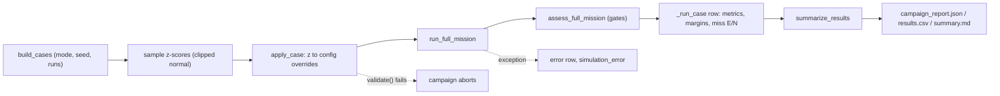
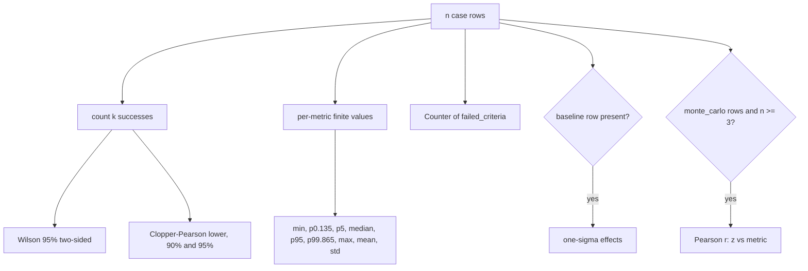
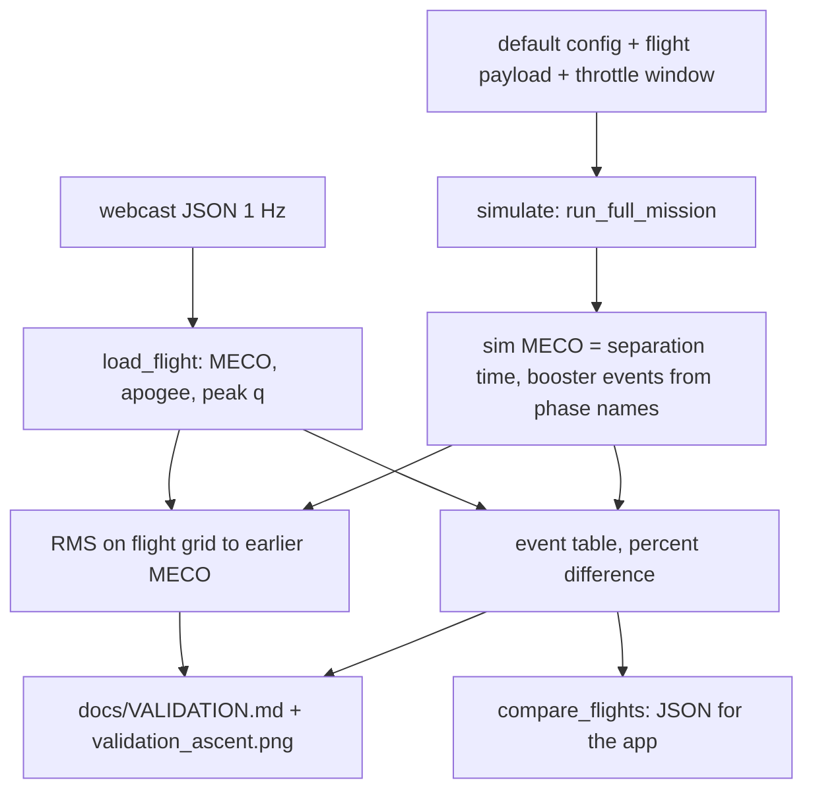

# 11. Monte Carlo dispersion analysis, verification and validation

> This chapter covers how Vyom checks its own results. It describes: (1) the
> **dispersion campaign** engine (`rlv_sim/mission/campaign.py`), which flies
> the full two-stage mission many times with seeded, perturbed inputs and
> reports success rates with exact binomial confidence bounds and margin
> percentiles; (2) the **flight validation** against public Falcon 9 webcast
> telemetry (`rlv_sim/validation/flight_compare.py`) and the descent-drag fit
> (`rlv_sim/validation/drag_fit.py`); (3) the **verification** test suite
> (`backend/tests/`); and (4) the **credibility self-assessment** written into
> run manifests (`rlv_sim/outputs/manifest.py`). The statistics are standard
> and exact. The dispersion magnitudes are engineering estimates (input
> pedigree 1 of 4). Validation covers only the stage-1 ascent energy and the
> booster event timeline, using 1 Hz webcast data. Treat the simulator as a
> research and education tool, not a flight-qualified model.

All paths below are relative to `backend/` unless they start with `docs/`.

## 11.1 Role in the simulation

The campaign engine sits outside the mission loop. It builds a list of
*cases*. Each case is a set of dimensionless z-scores. `apply_case` turns the
z-scores into a modified frozen `SimulationConfig`, the mission runs unchanged
through `run_full_mission` (`rlv_sim/mission/full_mission.py:512`), and the
result is graded by the same pass/fail gates as a single run
(`assess_full_mission`, `rlv_sim/outputs/summary.py:550`). No campaign code
runs inside the integrator: all dispersions take effect through config fields
that the physics and guidance already read.

Entry points:

| Entry point | Location | Notes |
|---|---|---|
| CLI | `python -m rlv_sim.mission.campaign` (`campaign.py:735-830`) | `--mode`, `--dispersions`, `--runs`, `--seed`, `--workers`, `--case-ids`, `--set FIELD=VALUE`, `--landing-guidance`. Exit code 0 only if every case succeeds (`campaign.py:830`). |
| Web/desktop server | `rlv_sim/server/app.py:1170` (campaign endpoint), `app.py:401-403` (replay one case as a single interactive run) | Both call `build_cases`. |
| Library | `build_cases`, `run_campaign`, `summarize_results`, `write_campaign_artifacts` | `run_campaign` uses a `ProcessPoolExecutor` when `workers > 1` and returns rows in case order (`campaign.py:445-462`). |

Inputs: a base config (default `create_default_config()`, plus any `--set`
overrides) and the campaign mode. Outputs: one result row per case and a
summary dictionary, written as `campaign_report.json`, `campaign_results.csv`
and `campaign_summary.md` (`campaign.py:623-732`).

## 11.2 Dispersion model

### 11.2.1 Physical idea

Each uncertain input $p_j$ is modelled as its nominal value plus a
standard-normal z-score $z_j$ times a 1-sigma magnitude $\sigma_j$. All
z-scores are independent, so no correlations are modelled. Draws are clipped
at $\pm 3$ so that a single case cannot sample a physically absurd tail.
Multiplicative quantities (thrust, $I_{sp}$, density, drag, separation
$\Delta v$, GPS noise) are scaled by $(1 + z\sigma)$. Additive quantities
(mass, wind, pitchover angle) are offset by $z\sigma$ in physical units.

### 11.2.2 Sampling (implemented form)

For a Monte Carlo campaign with $N$ runs and seed $s$
(`sample_monte_carlo_cases`, `campaign.py:152-195`):

$$
z_{ij} = \operatorname{clip}\big(\varepsilon_{ij}, -3, 3\big), \qquad
\varepsilon_{ij} \sim \mathcal N(0,1)\ \text{i.i.d.}
$$

- Legacy stream: `np.random.default_rng(s).normal(size=(N, 6))`, with columns
  in the order of `PARAMETERS` (`campaign.py:168-169`).
- Extended stream: `np.random.default_rng(s + 1 000 003)` draws an
  $N \times 7$ normal block for `EXTENDED_PARAMETERS`, then an $N \times 4$
  block of wind-mode phases $\phi_{ik} \sim \mathcal U[0, 2\pi)$
  (`campaign.py:171-174`; offset `_EXTENDED_STREAM_OFFSET`, `campaign.py:54`).

Because the extended set comes from a separate generator, turning on
`--dispersions extended` leaves the six legacy z-scores of every case
bit-identical. A seed-42 legacy failure therefore still exists, with the same
legacy inputs, in an extended campaign. `test_legacy_draws_unchanged_by_extended_set`
checks this.

Clipping is a hard clip, not a truncated-normal resample. About 0.27 % of
draws land exactly on $\pm 3$, so the realised distribution has small point
masses at the clip limits and a standard deviation slightly below 1.

Each case is labelled `mc_0001` … `mc_NNNN` and stores `seed`, `dispersions`,
`z_scores` and (for the extended set) `wind_mode_phases`
(`campaign.py:181-193`).

### 11.2.3 Mapping z-scores to physical overrides (`apply_case`)

`apply_case` (`campaign.py:235-298`) composes each dispersion with the base
config's own value. A base config that already has, for example, a 1.02
thrust scale is dispersed about 1.02, not about 1.0. The table lists the
implemented form for each parameter. $(\cdot)_0$ is the base-config value.

| Parameter (`z` key) | Implemented override | Clamp | Config field | Line |
|---|---|---|---|---|
| `thrust` | $k_T = k_{T,0}(1 + z\,\sigma_T)$ | $k_T \ge 0.5$ | `runtime_thrust_scale` | 238-240, 290 |
| `isp` | $k_I = k_{I,0}(1 + z\,\sigma_I)$ | $k_I \ge 0.5$ | `runtime_isp_scale` | 241-243, 291 |
| `mass` | $\Delta m = \Delta m_0 + z\,\sigma_m\,M_{ref}$, $M_{ref}=$ `C.INITIAL_MASS` $= 544\,600$ kg | none (config validation) | `runtime_initial_mass_offset_kg` | 244-246 |
| `wind` | $w = w_0 + z\,\sigma_w$ (m/s) | none | `runtime_wind_offset_mps` | 247-249 |
| `atmosphere` | $k_\rho = k_{\rho,0}(1 + z\,\sigma_\rho)$ | $k_\rho \ge 0.1$ | `runtime_atmosphere_density_scale` | 250-254, 294 |
| `pitchover` | $\theta_{po} = \theta_{po,0} + z\,\sigma_\theta$ (rad) | $[0, 30^\circ]$ | `pitchover_angle` | 255-258, 295 |
| `descent_drag` | $k_D = k_{D,0}(1 + z\,\sigma_D)$ | $k_D \ge 0.1$ | `booster_descent_drag_scale` | 259-261, 285 |
| `separation_dv` | $\Delta v_{sep} = \Delta v_{sep,0}(1 + z\,\sigma_{sep})$ | $\ge 0$ | `separation_delta_v` | 262-264, 286 |
| `gps_noise` | $g = \max(1 + z\,\sigma_{gps}, 0.05)$; both GPS sigmas $\times g$ | $g \ge 0.05$ | `gps_position_sigma_m`, `gps_velocity_sigma_mps` | 265, 287-288 |
| `wind_mode_k` | append mode $(a_k, \lambda_k, \phi_k)$ with $a_k = z\,\sigma_{wm}$ | none | `runtime_wind_profile_modes` | 266-271, 289 |

`apply_case` also overrides the following. Then it calls `config.validate()`
(`definition.py:459`).

- `verbose=False` and `enable_run_manifest=False`.
- The **wind-aware landing reserve** (`campaign.py:273-279`):

$$
R_{case} = R_0 - k_w \max(-w_0, 0) + k_w \max(-w, 0),
$$

with $k_w$ = `recovery_reserve_wind_sensitivity_kg_per_mps` = 383 kg/(m/s)
and $R_0$ = `stage1_landing_fuel_reserve_kg` = 67 500 kg (default; it already
includes the base config's own wind adjustment, which the formula removes
before it adds the case's). The adjustment applies only to headwind
(negative $w$), as `wind_reserve_adjustment_kg` defines it
(`rlv_sim/mission/planner.py:46-49`). This treats the dispersed mean wind as
**perfectly forecast** at launch. That is a modelling choice that flatters
robustness to wind.

Where each override acts in the physics:

| Override | Consumed at |
|---|---|
| thrust, $I_{sp}$ scales | `physics/dynamics.py:215,305-306`, `physics/integrators.py:74-75`, `mission/step.py:619,863`, guidance `guidance/ascent.py:79`, `guidance/booster.py:782,1025-1026` |
| mass offset | added to the lift-off mass, `mission/vehicle_split.py:90` |
| density scale | multiplies both $p$ and $\rho$ (so $T$ is unchanged), `physics/forces.py:230` |
| mean-wind offset and wind modes | `core/utils.py:67-92` (below) |
| descent drag scale | multiplies drag area in `BOOSTER_ENTRY` and `BOOSTER_LANDING` only, `physics/forces.py:1093-1095` |
| separation $\Delta v$ | `mission/vehicle_split.py:51` |
| GPS sigmas | `vehicle/navigation.py:85`, only when `enable_gps` is true (`navigation.py:73`) |

**Wind profile with modes.** The mean wind speed at altitude $h$ is
(`core/utils.py:59-77`):

$$
V(h) = \Big[V_{ref}\,(h/h_{ref})^{n} + w + \sum_k a_k \sin\!\big(2\pi h/\lambda_k + \phi_k\big)\Big]\;S(h),
$$

$$
S(h) = \begin{cases} x^2(3-2x),\ x = h/5000\ \text{m} & h < 5000\ \text{m}\\ 1 & \text{otherwise}\end{cases}
$$

Constants: $V_{ref}$ = `C.WIND_REF_SPEED` = 30 m/s, $h_{ref}$ =
`C.WIND_REF_ALT` = 10 000 m, $n$ = `C.WIND_EXPONENT` = 0.2. The wind blows
along azimuth `C.WIND_DIRECTION_AZIMUTH` = 90°, toward east, so a positive
offset is an eastward wind and the code calls a negative offset a
"headwind". The modes are held in a `ContextVar` that
`run_full_mission` sets for the run (`full_mission.py:532`), so concurrent
server runs do not share profiles (`utils.py:46-56`). A negative amplitude
equals a phase shift of $\pi$. The perturbation changes wind **speed** along
the fixed azimuth only, not direction. Sensitivity sweeps of `wind_mode_k`
use phase 0 because those cases carry no `wind_mode_phases`
(`campaign.py:266`).

### 11.2.4 Parameters

All sigmas are module constants in `campaign.py`. None of them is a config
field.

| Symbol | Constant (`campaign.py` line) | 1σ | Unit | Set | Physical 1σ at default |
|---|---|---|---|---|---|
| $\sigma_T$ | `_MC_THRUST_DISPERSION` (29) | 0.02 | fraction of cluster thrust | legacy | ±2 % thrust (all engines together) |
| $\sigma_I$ | `_MC_ISP_DISPERSION` (30) | 0.01 | fraction | legacy | ±1 % $I_{sp}$ |
| $\sigma_m$ | `_MC_MASS_DISPERSION` (31) | 0.005 | fraction of `C.INITIAL_MASS` | legacy | ±2 723 kg |
| $\sigma_w$ | `_MC_WIND_DISPERSION` (32) | 5.0 | m/s mean-wind offset | legacy | ±5 m/s |
| $\sigma_\rho$ | `_MC_ATMOSPHERE_DENSITY_DISPERSION` (33) | 0.05 | fraction of density | legacy | ±5 % $\rho$ and $p$ |
| $\sigma_\theta$ | `_MC_PITCHOVER_ANGLE_DISPERSION_DEG` (34) | 0.25 | deg | legacy | about the 9.0° default (`pitchover_angle` = 0.1571 rad) |
| $\sigma_D$ | `_MC_DESCENT_DRAG_DISPERSION` (49) | 0.10 | fraction of booster descent drag | extended | ±10 % |
| $\sigma_{sep}$ | `_MC_SEPARATION_DV_DISPERSION` (50) | 0.20 | fraction of separation $\Delta v$ | extended | ±0.3 m/s about 1.5 m/s |
| $\sigma_{gps}$ | `_MC_GPS_NOISE_DISPERSION` (51) | 0.25 | fraction of GPS sigmas | extended | ±0.75 m about 3 m; ±0.0125 m/s about 0.05 m/s |
| $\sigma_{wm}$ | `_MC_WIND_MODE_AMPLITUDE_MPS` (52) | 2.0 | m/s per mode | extended | modes at $\lambda$ = 2, 5, 12, 25 km (`_WIND_MODE_WAVELENGTHS_M`, 53) |
| — | `_DEFAULT_MC_SEED` (35) | 42 | — | — | — |
| — | `_DEFAULT_MC_RUNS` (36) | 100 | — | — | — |

The legacy set has 6 parameters (`PARAMETERS`, `campaign.py:38-45`). The
extended set adds 7: three scalars and four wind modes (`EXTENDED_PARAMETERS`,
`campaign.py:56-61`), for 13 in `ALL_PARAMETERS`.

### 11.2.5 Classification and validity limits

- **Sampling scheme**: standard (independent clipped-normal Monte Carlo).
- **Sigma values**: *Project heuristic; no external reference.* The code
  itself records every sigma as pedigree 1, "engineering estimate"
  (`DISPERSION_PEDIGREE`, `campaign.py:65-96`). The project's literature
  search (`docs/research_notes/Reusable booster sim improvements/monte_carlo_practice.md`)
  found no public numeric 1σ tables to calibrate them against.
- **Wind modes**: the comment calls them "GRAM-like", but they are four
  deterministic sinusoids in altitude with random amplitude and phase. They
  are not Earth-GRAM, not calibrated to a site or month, and not correlated
  with density.
- **What is not dispersed**: per-engine thrust or engine-out, thrust
  misalignment, CG offset and inertia, aerodynamic coefficients during ascent
  and stage-2 flight, actuator delay and rate limits, initial-state errors,
  and correlations between density and wind. Professional campaigns (MER,
  MSL, SLS; see the research note) disperse these.
- **Guidance knows the truth.** The descent-drag scale, density scale and
  mean wind are config fields that guidance predictors also read (for
  example, the impact predictor uses `runtime_atmosphere_density_scale`,
  `guidance/recovery.py:328`). With the default `use_navigation_estimate_for_guidance = false`,
  guidance also flies on the true state. The campaign therefore measures
  robustness to *known* off-nominal conditions, not to unknown ones.
- **`gps_noise` is inert at default settings.** `enable_gps` defaults to
  `false` (the navigation model returns early, `navigation.py:73`) and guidance
  does not use the navigation estimate. Dispersing GPS sigmas has an effect
  only when `--set enable_gps=true --set use_navigation_estimate_for_guidance=true`.
- **Mass reference**: $\sigma_m$ is a fraction of the constant
  `C.INITIAL_MASS` (544 600 kg: stage 1 wet plus stage 2 wet, **without
  payload**), not of the configured lift-off mass (552 600 kg with the 8 t
  default payload). It does not scale if the vehicle is resized.

## 11.3 Campaign modes

`build_cases` (`campaign.py:201-232`) accepts `monte-carlo`, `sensitivity`
and `sweep-3sigma`. Underscores are accepted and replaced with hyphens.

| Mode | Cases | Generator |
|---|---|---|
| `monte-carlo` | $N$ random cases `mc_0001…` | `sample_monte_carlo_cases` |
| `sensitivity` | `baseline` + `{p}_minus_1sigma`, `{p}_plus_1sigma` per parameter | `build_sensitivity_cases(sigma=1)` (`campaign.py:119-149`) |
| `sweep-3sigma` | `baseline` + `{p}_minus_3sigma`, `{p}_plus_3sigma` per parameter | `build_sensitivity_cases(sigma=3)` |

Sensitivity and sweep cases are deterministic. They use no RNG. They vary one
parameter at a time and hold all others at nominal, which is the approach of
the FAA's one-at-a-time 3σ dispersion guidance cited in the research note. They
cover the six legacy parameters by default, or all 13 with
`dispersions="extended"`, unless `parameters` names a subset
(`campaign.py:223-225`). Rows from both sensitivity modes carry
`mode = "sensitivity"`.

**Replay.** With `case_ids` (CLI `--case-ids mc_0011,mc_0042`), `build_cases`
first regenerates the full case list from the same mode, runs, seed and
dispersion set, then filters it (`campaign.py:226-231`). A failed case from a
100-run seed-42 campaign can therefore be re-flown alone with identical
inputs. Unknown ids raise `ValueError`. The server uses the same path to load
one campaign case as an ordinary interactive run (`server/app.py:401-403`).
`test_build_cases_modes_and_replay` and `test_server_replays_campaign_case`
cover this.

**Reproducibility.** A case is fully determined by
(mode, runs, seed, dispersion set, case id, base config). Results also depend
on the code version and on whether numba kernels are active. Numba is
documented to match pure Python "to round-off" (`docs/MONTE_CARLO_RESULTS.md`),
which is not bitwise. Worker count does not affect results: each case runs in
its own process with no shared state.

### 11.3.1 One-sigma effect estimate

For each parameter $p$ that has a matched minus/plus pair, and each metric
$y$ (`summarize_results`, `campaign.py:570-592`):

$$
E_{p,y} = \frac{y(+s\sigma_p) - y(-s\sigma_p)}{2s}, \qquad s \in \{1, 3\}
$$

This is a central-difference slope per 1σ. The 1σ pair is used when present,
otherwise the 3σ pair. For a nonlinear response the 3σ estimate averages the
slope over a wider span. Neither estimate captures interactions. Cases that
crashed (no metric) are skipped. The baseline row is required for the block
to be computed but does not enter the formula.

### 11.3.2 Pearson correlations

In any result set with at least three rows and at least one `monte_carlo`
row, for each parameter $p$ present in the z-scores and each metric $y$
(`campaign.py:594-619`):

$$
r_{p,y} = \frac{\sum_i (z_{ip} - \bar z_p)(y_i - \bar y)}
{\sqrt{\sum_i (z_{ip} - \bar z_p)^2}\,\sqrt{\sum_i (y_i - \bar y)^2}}
$$

The sum runs over cases with a non-null $y_i$ (at least 3). It is computed
with `np.corrcoef` and skipped if either sample has zero variance. It
correlates against the **z-score**, not the physical value, so clamped cases
(for example, pitchover at 0°) count with their unclamped $z$. With $N=100$,
$|r| \lesssim 0.2$ is not distinguishable from zero at the 95 % level (the
standard error of $r$ near 0 is about $1/\sqrt{N}$), so only the larger
correlations should be read as drivers.

## 11.4 Per-case metrics

`_run_case` (`campaign.py:328-442`) records the assessment outcome
(`status`, `mission_success`, `orbit_success`, `landing_success`,
`failed_criteria`) and the metrics in `METRICS` (`campaign.py:98-116`). Most
are copied from the assessment. The derived ones are:

| Metric | Implemented form | Line |
|---|---|---|
| `site_error_east_m`, `site_error_north_m` | Horizontal miss $\mathbf d = \mathbf r_{site} - \mathbf r_{td}$ with its vertical part removed, $\mathbf d \leftarrow \mathbf d - (\mathbf d\cdot\hat{\mathbf u})\hat{\mathbf u}$, projected on $\hat{\mathbf e} = \hat{\mathbf z}\times\hat{\mathbf u}$ and $\hat{\mathbf n} = \hat{\mathbf u}\times\hat{\mathbf e}$. This is the vector from touchdown **to** the pad. | 334-347, 362-363 |
| `max_angle_of_attack_deg` | max over ascent, orbiter and booster logs (finite values only) | 367-372 |
| `max_angle_of_attack_above_5kpa_deg` | same, restricted to samples with $\bar q \ge 5000$ Pa | 373-378 |
| `perigee_lower_bound_margin_km` | $h_p - (h_{target} - \Delta h_{tol})$ | 383-393 |
| `ascent_q_margin_pa` | `C.MAX_DYNAMIC_PRESSURE` (35 000 Pa) $- \bar q_{max,ascent}$ | 394-398 |
| `touchdown_speed_margin_mps` | `landing_leg_max_touchdown_speed_mps` (6 m/s) $-$ touchdown speed | 399-404 |
| `pad_error_margin_m` | `booster_pad_tolerance_m` (50 m) $-$ site error | 405-409 |

A positive margin means the requirement is met. Any exception raised inside
the mission run becomes an `error` row with `failed_criteria = ["simulation_error"]`
(`campaign.py:413-424`), so one crashing case does not stop a campaign. The
call to `apply_case` (line 330) is **outside** that `try`. A case whose
dispersed config fails `validate()` (for example, a mass offset that leaves
no ascent propellant, `definition.py:681`) raises and stops the whole
campaign. That cannot happen with the default sigmas and the ±3σ clip.

## 11.5 Statistics

### 11.5.1 Success rate and Wilson interval

With $k$ successes in $n$ cases, $\hat p = k/n$. The two-sided 95 % Wilson
score interval (`_wilson_interval`, `campaign.py:482-490`, $z = 1.959963984540054$):

$$
\tilde p = \frac{\hat p + \dfrac{z^2}{2n}}{1 + \dfrac{z^2}{n}}, \qquad
\delta = \frac{z\sqrt{\dfrac{\hat p(1-\hat p)}{n} + \dfrac{z^2}{4n^2}}}{1 + \dfrac{z^2}{n}}, \qquad
[\tilde p - \delta,\ \tilde p + \delta] \cap [0,1].
$$

The code writes the radicand as $\big(\hat p(1-\hat p) + z^2/4n\big)/n$, which
is algebraically identical. *Standard*: Wilson (1927) [1]. Unlike the normal
("Wald") interval, it stays inside $[0,1]$ and behaves sensibly at
$\hat p = 1$.

### 11.5.2 One-sided Clopper-Pearson lower bound

A requirement verification statement has the form "success probability is
at least $p_L$ with confidence $C$" (consumer risk $\alpha = 1 - C$). The exact
binomial (Clopper-Pearson) lower bound is the $p_L$ that solves

$$
P(X \ge k \mid n, p_L) = \sum_{j=k}^{n} \binom{n}{j} p_L^{\,j} (1-p_L)^{n-j} = \alpha ,
$$

which is equivalent to $p_L = B^{-1}(\alpha;\, k,\, n-k+1)$, the $\alpha$
quantile of a Beta distribution. For $k = n$ it reduces to
$p_L = \alpha^{1/n}$. *Standard*: Clopper and Pearson (1934) [2]. The
consumer-risk phrasing follows Hanson and Beard [3].

Implementation (`campaign.py:493-527`):

- `_binomial_sf` evaluates the upper tail in log space, with
  $\ln\binom{n}{j}$ from `math.lgamma`, and adds the terms with a
  max-shift (log-sum-exp), so it stays accurate for large $n$.
- `clopper_pearson_lower` bisects 100 times on $[0, k/n]$. A step sets
  `lo = mid` when $P(X\ge k \mid p=\text{mid}) < \alpha$. The tail probability
  increases with $p$, so the bracket closes on the root. It returns 0 for
  $k = 0$ or $n = 0$.
- `summarize_results` reports the bound at $C = 0.90$ and $C = 0.95$
  (`campaign.py:561-562`).

### 11.5.3 Zero-failure sample size

The number of failure-free runs needed to demonstrate reliability $R$ at
confidence $C$ (`zero_failure_runs_required`, `campaign.py:530-532`) comes
from $R^n \le 1 - C$:

$$
n = \left\lceil \frac{\ln(1-C)}{\ln R} \right\rceil
$$

For $R = 0.9973$ (the two-sided 3σ fraction) and $C = 0.90$:
$n = \lceil -2.302585 / -0.0027037 \rceil = \lceil 851.6 \rceil = 852$.
The summary always reports this number
(`zero_failure_runs_for_99_73pct_at_90pct`, `campaign.py:563`). For comparison,
$C = 0.95$ needs 1 109 runs and $R = 0.99$ at 90 % needs 230 (evaluated with
the same function).

**Why 100 runs cannot show high reliability.** Even a perfect 100/100 gives
$p_L = 0.1^{1/100} = 97.7\,\%$ at 90 % confidence. Each failure lowers that
bound by roughly 1-1.5 points: 98/100 gives 94.8 % and 95/100 gives 90.9 %.
A 100-run campaign is therefore a smoke test that ranks failure modes. It is
not a reliability demonstration. The research note and
`docs/MONTE_CARLO_RESULTS.md` recommend at least 2 000 runs for release
campaigns. The project has not run one yet.

### 11.5.4 Margin percentiles

For each metric, `_numeric_summary` (`campaign.py:465-479`) reports min, max,
mean, sample standard deviation (`ddof=1`), median, p5, p95, and the one-sided
3σ tails **p0.135** and **p99.865**. The percentiles come from
`np.percentile` with its default linear interpolation between order
statistics. Continuous margins converge much faster than rare failure rates,
which is why they are reported. At $n = 100$, however, p0.135 lies at
fractional rank $0.00135 \times 99 = 0.13$. That interpolates between the
smallest and second-smallest sample, so it is close to the sample minimum,
and p99.865 is close to the sample maximum. Read the "3σ" tails as sample
extremes until $n \gtrsim 1\,000$.

## 11.6 Campaign results to date

From `docs/MONTE_CARLO_RESULTS.md` (2026-10-22). All rows use 100 runs, seed
42, the legacy six dispersions and heuristic landing guidance. The 90 %
lower-bound column is the document's own value where it gives one. Values in
*italics* were computed for this chapter with `clopper_pearson_lower(k, 100, 0.90)`.
The Wilson column was computed with `_wilson_interval`.

| Configuration | Success | 90 % CP lower bound | 95 % Wilson | Orbit | Remaining failures |
|---|---|---|---|---|---|
| Old roll jet damping (earlier baseline) | 94 % | *89.7 %* | 87.5-97.2 % | 100 % | headwind starvation |
| Per-axis jet damping | 93 % | *88.5 %* | 86.3-96.6 % | 100 % | 5 pad misses of 50-70 m, 2 headwind starvations |
| + wind-aware reserve (383 kg per m/s headwind) | 95 % | 90.9 % | 88.8-97.8 % | 100 % | 5 pad misses of 50-70 m |
| + terminal position hold (first version) | 95 % | 90.9 % | 88.8-97.8 % | 100 % | 3 headwind crashes, 1 hard landing, 1 miss |
| + both (first version) | 97 % | 93.4 % | 91.5-99.0 % | 100 % | 1 hard landing, 2 misses of 50 m |
| **+ both, hold v2 (current default)** | **98 %** | **94.8 %** | 93.0-99.4 % | 100 % | 1 hard landing (7.9 m/s on pad); 1 miss of 51 m with 0.5 t left |
| Descent drag 0.68, current guidance | 87 % | *81.6 %* | 79.0-92.2 % | 100 % | 13 tailwind pad misses with 4-10 t left |
| Drag 0.68 + 80 % planning throttle | 84 % | *78.3 %* | 75.6-89.9 % | 100 % | earlier ignition wastes propellant; crashes |
| Drag 0.68 + both fixes (first version) | 90 % | 85.0 % | 82.6-94.5 % | 100 % | hard landings and crashes; p99.865 touchdown 26.8 m/s |
| Drag 0.68 + both, hold v2 | 88 % | 82.7 % | 80.2-93.0 % | 100 % | 10 soft (4.4-4.9 m/s) off-pad landings 53-376 m out; 1 hard landing (7.3 m/s); 1 starvation crash |

How to read the table:

- **Orbit insertion** never failed in any campaign. All failures are booster
  landings.
- At the **default** descent drag, the two remaining failures sit at the edges
  of the landing gates: 7.9 m/s against the 6 m/s leg limit, and 51 m against
  the 50 m pad tolerance. The success claim supported by the data is "at
  least 94.8 % at 90 % confidence".
- With the **flight-fitted** drag (scale 0.68, §11.7.3) success falls to 88 %
  (at least 82.7 % at 90 % confidence). Tailwind cases reach 250 m altitude
  100-380 m off target. The position hold now lands most of them softly off
  the pad instead of crashing. The document locates the error above the
  final approach, in the entry and early landing-burn divert.
- The differences between adjacent rows (for example 93 % vs 94 %) are well
  inside the Wilson intervals. Only the larger steps (drag 1.0 vs 0.68) are
  statistically clear at $n = 100$. Rows run on the same seed share
  dispersion draws (common random numbers), which sharpens paired
  comparisons. The project has not applied a paired test.
- The extended dispersion set and release-size campaigns ($\ge$ 2 000 runs)
  are listed as open work and have no results yet.

Two Monte Carlo cases found earlier are now pinned as slow regression tests
in `tests/test_wind_robustness.py` (§11.8).

## 11.7 Flight validation

### 11.7.1 Data source

`rlv_sim/validation/data/` contains four Falcon 9 flights from the public
**shahar603/Telemetry-Data** repository (<https://github.com/shahar603/Telemetry-Data>).
The data was extracted from SpaceX launch webcasts at 1 Hz and is marked
public domain (`flight_compare.py:3-5`):

| File | Content |
|---|---|
| `<flight>.json` | arrays `time` (s), `altitude` (km), `velocity` (surface-relative speed, m/s), `velocity_y` (vertical speed), `q` (Pa) |
| `<flight>_events.json` | event times (s): `maxq`, `throttle_down_start/end`, `meco`, `boostback_start/end`, `apogee`, `entry_start/end`, `landing_start/end`, `ses1`, `seco1`, … (null when not available) |

| Flight | Sim payload (`FLIGHTS`, `flight_compare.py:27-32`) | Throttle-down in data | Booster events |
|---|---|---|---|
| SpaceX CRS-11 | 6 900 kg (2 708 kg cargo + about 4.2 t Dragon) | 50-74 s | yes (RTLS) |
| Orbcomm OG2 | 2 034 kg | no | no (stage-2 data only) |
| NROL-76 | unpublished, 8 000 kg default | no | yes (RTLS) |
| Zuma | unpublished, 8 000 kg default | 50-61 s | yes (RTLS) |

Webcast telemetry is a display readout, not instrumented flight data. It has
no attitude, thrust, mass or wind information, and its speed is
surface-relative.

### 11.7.2 Method: ascent comparison (`flight_compare.py`)

1. **Simulation** (`simulate`, `flight_compare.py:42-69`). The run uses the
   default vehicle (Falcon 9 FT stage masses, 9 × 845 kN). It sets
   `payload_mass` where published. Where the data shows the max-q throttle
   window, it sets `ascent_throttle_bucket_start_s/end_s` (flown at 70 %
   thrust). Target orbit, inclination and landing site stay at the sim
   defaults. Sim MECO is `result.separation_time`. Booster event times are the
   first log sample whose phase name contains `BOOSTBACK`, `ENTRY` or
   `LANDING`. Touchdown is the last booster sample. Flights with the same
   (payload, throttle window) share one simulation (`_flight_setups`, lines 105-114).
2. **Curve error** (`_curve_rms`, lines 117-123). On the flight's 1 Hz grid
   $t_i \le t_{end} = \min(t_{MECO}^{flight}, t_{MECO}^{sim})$, the sim is
   linearly interpolated to $t_i$:

$$
\mathrm{RMS}_h = \sqrt{\frac1M\sum_{i=1}^{M}\big(h_{sim}(t_i) - h_{flt}(t_i)\big)^2},\qquad
\mathrm{RMS}_v = \sqrt{\frac1M\sum_{i=1}^{M}\big(v_{sim}(t_i) - v_{flt}(t_i)\big)^2}
$$

   The sim speed is `velocity_rel` (air-relative). The flight speed is the
   webcast's surface-relative readout. The two differ by the wind (30 m/s at
   10 km in the sim's mean profile).
3. **Key events** (`_metric_rows`, lines 126-137). Each row is reported as a
   difference $100\,(x_{sim} - x_{flt})/x_{flt}$. The quantities are MECO time,
   speed and altitude, peak $\bar q$ (flight $\bar q$ restricted to
   $t \le t_{MECO}$), max-q time, booster apogee (from samples after MECO,
   only where an `apogee` event exists), and the booster event times.
4. `python -m rlv_sim.validation.flight_compare` writes `docs/VALIDATION.md`
   and `docs/validation_ascent.png` (`main`, lines 189-270). `compare_flights`
   (lines 151-186) returns the same data as JSON for the app.

**Classification**: *Published data set* (webcast telemetry). The comparison
method is standard (point and RMS differences).

### 11.7.3 Results (`docs/VALIDATION.md`)

Ascent curve error, lift-off to MECO:

| Flight | Sim payload (kg) | Throttle-down | Altitude RMS (km) | Speed RMS (m/s) |
|---|---|---|---|---|
| CRS-11 | 6 900 | 50-74 s | 5.27 | 111 |
| Orbcomm OG2 | 2 034 | none in data | 7.79 | 208 |
| NROL-76 | 8 000 (unpublished) | none in data | 6.08 | 145 |
| Zuma | 8 000 (unpublished) | 50-61 s | 7.05 | 155 |

Key quantities, sim vs flight (percent difference):

| Quantity | CRS-11 | OG2 | NROL-76 | Zuma |
|---|---|---|---|---|
| MECO time | 135.8 vs 145 s (−6.3 %) | 129.7 vs 145 (−10.5 %) | 129.5 vs 140 (−7.5 %) | 131.9 vs 143 (−7.8 %) |
| MECO speed | 1 618 vs 1 684 m/s (−3.9 %) | 1 692 vs 1 670 (+1.4 %) | 1 642 vs 1 685 (−2.5 %) | 1 629 vs 1 672 (−2.6 %) |
| MECO altitude | 67.0 vs 62.4 km (+7.4 %) | 73.4 vs 74.5 (−1.5 %) | 70.9 vs 67.8 (+4.6 %) | 69.1 vs 61.8 (+11.9 %) |
| Peak $\bar q$ | 29.7 vs 23.0 kPa (+28.9 %) | 31.9 vs 28.6 (+11.6 %) | 31.9 vs 29.2 (+9.4 %) | 29.4 vs 26.0 (+13.4 %) |
| Max-q time | 50 vs 65 s (−22.7 %) | 62 vs 70 (−10.7 %) | 63 vs 69 (−8.3 %) | 50 vs 75 (−33.0 %) |
| Booster apogee | 126.6 vs 120.1 km (+5.4 %) | — | 138.7 vs 165.6 (−16.2 %) | 133.5 vs 124.9 (+6.8 %) |
| Boostback start | 164 vs 161 s (+1.6 %) | — | 157 vs 157 (+0.3 %) | 160 vs 159 (+0.5 %) |
| Entry burn start | 327 vs 372 s (−12.0 %) | — | 341 vs 431 (−20.8 %) | 335 vs 381 (−12.0 %) |
| Landing burn start | 464 vs 429 s (+8.3 %) | — | 456 vs 508 (−10.3 %) | 461 vs 446 (+3.5 %) |
| Touchdown | 503 vs 462 s (+8.9 %) | — | 506 vs 540 (−6.4 %) | 503 vs 459 (+9.6 %) |

Interpretation, as recorded in `docs/VALIDATION.md`:

- **MECO speed is within 4 %** on all four flights, so the stage-1 energy
  delivered is about right.
- **MECO comes 6-10 % early.** The sim holds back a 67.5 t recovery reserve
  for its return to launch site (RTLS), which needs about 3 600 m/s. Falcon 9
  burns more of stage 1 on ascent. A drag-credit option for the entry burn was
  tried. It moves MECO by only about 1 s and lowers Monte Carlo success, so it
  is off by default.
- **Peak $\bar q$ is 9-29 % high**, and max-q comes 8-33 % early. The real
  throttle depth and timing are not published, so the 70 % bucket is an
  estimate. On CRS-11, flying the flight's throttle window roughly halves the
  curve error (altitude RMS 9.2 → 5.3 km, speed RMS 218 → 111 m/s).
- **Boostback start is within 2 %.** Later booster events differ by up to
  21 %, partly because the sim flies its own target orbit and pad, not the
  flight's. These timeline differences are therefore not pure model error.

**Regression guard**: `tests/test_flight_validation.py::test_meco_speed_matches_flight_telemetry`
(slow) requires the CRS-11 sim MECO speed to be within 5 % of flight, and the
booster to land.

### 11.7.4 Descent drag fit (`drag_fit.py`)

**Physical idea.** Between entry-burn cutoff and landing-burn ignition the
real booster falls unpowered and nearly vertically. Gravity and drag are the
only significant forces (lift is neglected), so the drag deceleration can be
inferred from the speed history.

**Equations (implemented form).** On the flight's 1 Hz samples in the window
$t_{entry\_end} + 3\ \text{s} \le t \le t_{landing\_start} - 3\ \text{s}$ with
$v > 100$ m/s (`real_drag_area`, `drag_fit.py:39-58`):

$$
\frac{D}{m} = g_0 \left(\frac{-v_y}{v}\right) - \frac{dv}{dt}, \qquad
\bar q = \tfrac12 \rho(h)\, v^2, \qquad
(C_D A)_{flt} = \frac{D/m}{\bar q}\; m_{assumed}
$$

- $-v_y/v = \sin\gamma$ is the sine of the descent angle.
- $dv/dt$ is computed with `np.gradient` on the 1 Hz series.
- $\rho(h)$ and the speed of sound $a$ come from `compute_atmosphere_properties`
  (US-76, called without a config, so with no density dispersion).
- Mach is $v/a$.
- Samples are kept only if $\bar q > 500$ Pa and $D/m > 0$.
- $g_0 = 9.80665$ m/s², taken as constant (no altitude variation).
- $v$ is the surface-relative speed, used as airspeed (no wind).

The sim's drag area comes from its own default-config booster log, as
$D/\bar q$ in the `BOOSTER_ENTRY` and `BOOSTER_LANDING` phases below 40 km
with $\bar q > 500$ Pa (`sim_drag_area`, lines 61-71). Both sample sets are
grouped into Mach bins with edges $[0.9, 1.2, 1.5, 2.0, 2.5]$ (`MACH_BINS`,
line 36). The median is taken in each bin that has at least 2 samples
(`_binned`, lines 74-76). Then:

$$
r_b = \frac{\tilde{(C_DA)}_{flt,b}}{\tilde{(C_DA)}_{sim,b}}, \qquad
k_D^{fit} = \operatorname{median}_b\, r_b, \qquad
\text{band } k_D^{fit}(1 \pm 0.15)
$$

(`main`, lines 79-91). The booster mass is unpublished. It is taken as
$m_{assumed}$ = `ASSUMED_MASS_KG` = 26 000 kg (about 22.2 t dry plus 3-5 t of
landing propellant). Its ±15 % uncertainty (`MASS_UNCERTAINTY`) scales the
result one-to-one.

**Result** (`docs/VALIDATION_DRAG.md`; flights NROL-76, CRS-11, Zuma):

| Mach | Falcon 9 $C_DA$ (m²) | Sim $C_DA$ (m²) | Ratio |
|---|---|---|---|
| 0.9-1.2 | 12.3 | 27.1 | 0.45 |
| 1.2-1.5 | 15.0 | 24.8 | 0.60 |
| 1.5-2.0 | 16.2 | 21.4 | 0.76 |
| 2.0-2.5 | 16.8 | 18.9 | 0.89 |

The fitted `booster_descent_drag_scale` is **0.68** (range 0.58-0.78 for the
mass uncertainty).

- The sim's descent drag is too high, most of all near Mach 1. The Cd(Mach)
  table peaks transonically, while the real booster's drag area rises
  monotonically with Mach. That trend is consistent with a blunt,
  engines-first body dominated by base drag. A single scale cannot reproduce
  the Mach dependence.
- **The fit is not the default** (`booster_descent_drag_scale = 1.0`). The
  landing guidance was tuned against the higher drag and loses about 10
  points of Monte Carlo success at 0.68 (§11.6). Use it with
  `--set booster_descent_drag_scale=0.68`. Consequently, **the default
  configuration's descent drag is known to disagree with flight data**.

**Classification**: *Published data* combined with a *project heuristic*
reduction. The assumed mass, the window margins and the median-of-bin-ratios
estimator have no external source.

## 11.8 Verification (test suite)

The test suite is the code-verification evidence. Run it from `backend/`:

- `.venv/Scripts/python -m pytest -q` runs the fast suite. `pyproject.toml`
  sets `addopts = -m "not slow"`.
- `pytest -m slow` runs the end-to-end missions.

| Area | Test file(s) | What it guards |
|---|---|---|
| **Campaign engine** | `test_campaign.py` | Sensitivity cases are deterministic (baseline + ± pairs, ±1 z-scores, unknown parameter rejected). Monte Carlo cases: same seed gives identical cases, different seeds differ, ids are zero-padded and sequential, all parameters present, clip at ±3, zero or negative runs rejected. |
| | `test_campaign_statistics.py` | Legacy draws are unchanged by the extended set and equal raw `default_rng(42)`. Clopper-Pearson: $100/100 \to 0.1^{0.01}$, ordering of the 95/90 % bounds below $\hat p$, `zero_failure_runs_required(0.9973, 0.90) == 852`. Summary has lower bounds and ordered tails. Extended overrides apply. The 3σ sweep effect is divided by 6. Wind-profile context is scoped and matches the sinusoid. Wind-aware reserve applies to headwind only and is swapped, not compounded, by `apply_case`. |
| | `test_research_features.py` | `build_cases` modes, sweep size $1 + 2\times13$, replay of `mc_0011` equals case 11 of the full draw, errors for unknown ids or mode. Server replay maps z to wind. Model card has credibility input pedigree 1. Wind-mode config validation. |
| | `test_review_regressions.py::test_short_campaign_case_is_mission_failure_not_simulation_error` | A truncated run is graded `mission_failed`, not `error`. |
| | `test_server_bugfixes.py::TestCampaignWorkersWired`, `test_small_fixes.py` | The server campaign runs all cases sequentially and in parallel. Worker limits 1-16. Wind seed is independent of the GPS seed. Campaign cancel button exists. |
| **Unit physics** | `test_integrators.py`, `test_physics_checks.py`, `test_jet_damping.py`, `test_numba_kernels.py` | RK4 quaternion norm, mass during coast, exact propellant-depletion split, input validation. State invariant gates and energy check. Per-axis jet damping. Numba kernels match pure Python (EGM96 gravity, impact predictor). |
| **Analytic validation** ("Tier 1") | `test_validation_tier1.py`, `test_review_regressions.py` (gravity) | Kepler circular and elliptical orbits conserve energy and angular momentum, Kepler's third law, vis-viva, Tsiolkovsky $\Delta v$, US-76 table values. C20 gravity matches analytic J2, and full gravity matches an independent potential gradient. |
| **Aerodynamics** | `test_aero_validation.py`, `test_aero_import.py` | Geometry sanity checks, deck interpolation, Tier-2 literature comparison checks that each carry a citation. Imported wind-tunnel/CFD grid becomes a deck and flies. |
| **Guidance and control** | `test_control.py`, `test_booster_guidance.py`, `test_position_hold.py`, `test_gfold.py`, `test_touchdown_classification.py`, `test_s2_landing_propellant_reserve.py` | Attitude law (gain scheduling, PID/PD selection, anti-windup, saturation, deadband). Booster phase logic (flip, boostback, entry gate, landing ignition and latch, cutoff). Position-hold law and fade. G-FOLD feasibility and limits. Touchdown classification precedence. Stage-2 reserve gating. |
| **Config and vehicle** | `test_config.py`, `test_vehicle_builder.py`, `test_mission_planner.py` | `validate()` accepts good and rejects bad configs. Frozen config. Thrust and area derive from the vehicle. Rocket-equation feasibility agrees with simulation outcomes. |
| **Smoke** | `test_mission_smoke.py` | Short ascent runs, terminates on `max_time`, valid final state, mass decreases. |
| **Full-mission regression (slow)** | `test_full_mission_regression.py` | Nominal default-config mission succeeds and matches references recorded 2026-10-07 (table below). |
| **Wind robustness (slow)** | `test_wind_robustness.py` | Heuristic guidance lands within 10 m at ±3 m/s wind. G-FOLD lands in tailwind and is deterministic. Pinned seed-42 Monte Carlo cases: `test_tailwind_dispersion_case_lands_on_pad` (once missed by 1.4 km) and `test_tailwind_touchdown_has_no_lateral_limit_cycle` (once touched down at 7.6 m/s), now required to touch down below 6 and 5.5 m/s respectively, inside pad tolerance. Fast guards: G-FOLD fails loudly without cvxpy, integer node count, CLI accepts `--landing-guidance`, impact-prediction memoisation. |
| **Other slow** | `test_flight_validation.py`, `test_booster_guidance.py::test_entry_drag_credit_saves_propellant_and_still_lands`, `test_vehicle_builder.py` (variants fly, max-q held), `test_research_features.py::test_example_plugin_flies_a_full_landing` | Flight MECO speed within 5 %. Option paths fly full missions. |
| **Server and UI** | `test_server_security_hardening.py`, `test_storage_licensing.py`, `test_e2e_ui.py`, `test_telemetry_csv.cjs` | Loopback default bind, production auth. Scenarios, history, licence keys. Playwright end-to-end Mission Setup → Live Telemetry → Stop in headless Chromium (skipped if Playwright is absent). Node test of the browser CSV serializer. |

Full-mission regression references (`test_full_mission_regression.py:27-34`;
default config):

| Quantity | Reference | Tolerance |
|---|---|---|
| Separation (MECO) time | 129.55 s | ±0.1 s |
| Perigee altitude | 326.73 km | ±2 km |
| Apogee altitude | 435.01 km | ±2 km |
| Eccentricity | 0.00802 | ±5e-4 |
| Touchdown speed | 4.41 m/s | ±0.25 m/s |
| Site error | 0.31 m | ±5 m |

These are regression references, not truth values. They detect unintended
trajectory changes and must be re-recorded after an intentional model change.
The campaign itself is a robustness check, not a verification test.

**Solution verification** (convergence in time step) has no automated test.
The fixed-step RK4 has no error estimator. Step sizes were chosen empirically
(model card, `outputs/model_card.py:24-27`). For refactors the project
compares full-mission telemetry CSVs before and after (working practice
noted in `CLAUDE.md`, not a test).

## 11.9 Credibility assessment

`credibility_block()` (`rlv_sim/outputs/manifest.py:73-97`) writes a
NASA-STD-7009A-style input-pedigree self-assessment into every run manifest
(`build_run_manifest`, `manifest.py:29-70`, key `credibility`) and into the
app's model card (`outputs/model_card.py:107-115`). The score scale is
0 = none to 4 = flight data. Following 7009 practice, input pedigree is scored
at the lowest-quality input, so the overall score is the minimum
(`manifest.py:94`).

| Input | Pedigree | Source as recorded |
|---|---|---|
| Aero decks | 1 | geometry/literature estimates; no wind-tunnel or CFD data |
| Booster descent drag | 2 | fitted to Falcon 9 webcast telemetry; **not the default** |
| Engine geometry for jet damping | 1 | engineering estimate |
| Landing propellant reserve | 1 | community estimate, low confidence |
| Each of the 13 dispersion sigmas | 1 | engineering estimate (wind modes: "amplitudes not site-calibrated") |
| **Overall input pedigree** | **1** | minimum of the above |

The manifest also records the full config, CLI arguments, Python and platform
versions, package version, and the SHA-256 of `uv.lock`
(`manifest.py:29-70`). These support reproducibility of a run. Campaign
cases set `enable_run_manifest=False` (`campaign.py:283`). Instead,
`campaign_report.json` carries the base config and `DISPERSION_PEDIGREE`
(`campaign.py:632-646`).

Validity limits of this self-assessment:

- Only the **input pedigree** factor is scored. NASA-STD-7009A defines eight
  factors (data pedigree, input pedigree, code verification, solution
  verification, conceptual validation, referent validation, results
  uncertainty, results robustness). The other seven are not scored in code.
  This chapter gives qualitative evidence for them: §11.8 for code
  verification, §11.7 for referent validation, §11.5-11.6 for uncertainty
  and robustness.
- The booster-descent-drag entry claims pedigree 2 for a value that the
  default configuration does **not** use. The default runs with scale 1.0,
  which has pedigree 1 at best and is contradicted by the fit.
- The model card (`model_card.py:13-92`) gives separate per-model pedigrees
  (2-3 for dynamics, integration, gravity and atmosphere; 1 for
  aerodynamics, guidance and navigation). Those are a different list from
  the manifest's model inputs.

### What is and is not validated

| Claim | Status |
|---|---|
| Orbital mechanics, rocket equation, US-76 atmosphere, J2/EGM96 gravity | **Verified** against analytic or published reference values (unit tests). |
| Stage-1 ascent energy (MECO speed) | **Validated** to within 4 % on four flights (webcast referent, 1 Hz). |
| Ascent profile shape and max-q | **Partly validated.** Altitude RMS 5-8 km and speed RMS 111-208 m/s. Peak $\bar q$ 9-29 % high. MECO 6-10 % early (known cause: the reserve). |
| Booster event timeline | **Boostback start only** (within 2 %). Later events differ by 6-21 %, mixed with mission-design differences. |
| Booster descent drag | **Compared and found 1.1-2.2× too high** at Mach 0.9-2.5. The fitted scale exists but is off by default. |
| Landing precision, touchdown dynamics, propellant at touchdown | **Not validated.** There is no flight referent (webcast data has no pad miss or residual propellant). |
| Stage-2 insertion and stage-2 recovery | **Not validated** against flight. Stage-2 recovery is experimental. |
| Attitude dynamics, control, aero moments, grid fins | **Not validated.** There is no attitude telemetry. Grid-fin authority is a flat-plate estimate. |
| Dispersion magnitudes | **Not validated.** All are pedigree 1. |
| Mission success probability | **Estimated only** under the model's own assumptions: at least 94.8 % (90 % conf., 100 runs) at default drag and at least 82.7 % with flight-fitted drag. It is not a reliability claim for any real vehicle. |

## 11.10 Validity limits and known issues

1. Sigmas are engineering estimates with pedigree 1. There are no
   correlations between inputs, and wind is a single azimuth with sinusoidal
   speed modes.
2. Guidance knows the true wind, density and drag scale. The reserve uses a
   perfect wind forecast. Robustness is therefore optimistic.
3. `gps_noise` has no effect unless GPS and navigation-in-the-loop are
   enabled.
4. 100-run campaigns bound success only to about 95 % at best. The
   "3σ" percentiles are sample extremes at that size.
5. A dispersed config that fails validation aborts the whole campaign instead
   of being recorded as a failed case (`apply_case` is outside the `try`,
   `campaign.py:330`).
6. The flight comparison pairs the sim's air-relative speed with the flight's
   surface-relative readout. It also picks MECO samples asymmetrically: the
   sim uses the sample just **before** MECO (`searchsorted − 1`, line 58), the
   flight the sample at or after it (line 79). At 1 Hz this is up to one
   second of acceleration (about 30-40 m/s near MECO).
7. The drag fit uses an assumed booster mass (±15 %) and neglects lift and
   wind. Webcast speed is quantised and differentiated at 1 Hz.

## 11.11 References

1. Wilson, E. B. (1927). Probable inference, the law of succession, and
   statistical inference. *Journal of the American Statistical Association*,
   22(158), 209-212.
2. Clopper, C. J., and Pearson, E. S. (1934). The use of confidence or
   fiducial limits illustrated in the case of the binomial. *Biometrika*,
   26(4), 404-413.
3. Hanson, J. M., and Beard, B. B. (2010). *Applying Monte Carlo Simulation to
   Launch Vehicle Design and Requirements Analysis*. NASA/TP-2010-216447,
   NASA Marshall Space Flight Center. NTRS 20100038453.
4. NASA (2016). *Standard for Models and Simulations*, NASA-STD-7009A.
   National Aeronautics and Space Administration.
5. shahar603, *Telemetry-Data* (public-domain Falcon 9 webcast telemetry),
   <https://github.com/shahar603/Telemetry-Data>. Data set; no formal
   publication.
6. U.S. Standard Atmosphere, 1976. NOAA/NASA/USAF, Washington, D.C. (used by
   the drag fit through `compute_atmosphere_properties`).
7. Project documents: `docs/MONTE_CARLO_RESULTS.md`, `docs/VALIDATION.md`,
   `docs/VALIDATION_DRAG.md`, `docs/reports/Reusable booster sim improvements.md`,
   `docs/research_notes/Reusable booster sim improvements/monte_carlo_practice.md`.
   The research note lists further NASA NTRS sources on campaign practice
   (MER, MSL, SLS, Earth-GRAM). Those sources are not cited here because
   this chapter's equations do not depend on them.
